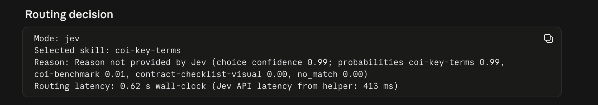

# Lab: Jev Picks the Skill, Claude Do the Work

In the last lab you checked COIs against a checklist. Now you'll **pull the key terms out of them**: coverage types, policy limits and important conditions.

There's one new piece. Instead of telling Claude which skill to use, you hand the task to a **router**. The router looks at the task, picks the right skill, and runs it. Picking a skill from a short list isn't writing, it's **deciding**, and that's what Jev is built for.

In this lab you'll run the same task twice, once with Claude picking the skill and once with Jev picking it, then compare the timings.

Here's the flow for this lab:

- **Upload the skills.** Add the two skills for this lab to Claude.
- **Open a new session.** Point it at the `coi-benchmark` folder.
- **Run it with Claude.** Claude picks the skill, then Claude extracts the key terms.
- **Run it with Jev.** Jev picks the skill, then Claude extracts the key terms.
- **Compare.** Let the numbers show where Jev helps.

---

## Table of Contents

- [Prerequisites](#prerequisites)
- [Part 1: The Idea](#part-1-the-idea)
- [Part 2: Upload the Skills](#part-2-upload-the-skills)
- [Part 3: Open a New Session](#part-3-open-a-new-session)
- [Part 4: Run It with Claude](#part-4-run-it-with-claude)
- [Part 5: Run It with Jev](#part-5-run-it-with-jev)
- [Part 6: Read the Comparison](#part-6-read-the-comparison)

---

## Prerequisites

✅ **Claude Code Desktop** installed and signed in.

✅ **The `coi-benchmark` folder** from the [previous lab](../Readme.md), with the COIs in `coi-documents/`.

✅ **Jev connected.** You did this in Part 5 of the previous lab.

✅ **The two skills for this lab:**

- skill-router file: [Link Here](./skill-router/SKILL.md)
- coi-key-terms file: [Link Here](./coi-key-terms/SKILL.md)

---

## Part 1: The Idea

Every run has two steps:

1. **Routing.** Look at the task and pick which skill fits.
2. **Extraction.** Run that skill and pull the key terms out of the COIs.

The rule from the last lab still holds: **Jev decides, Claude writes.**

- **Jev only picks the skill.** That's the decision, so it's the part Jev takes over.
- **Claude does the extraction.** Once the skill is picked, Claude runs it, in both modes.

So the two runs differ in one place only: who does the routing.

| Skill | What it does |
|-------|--------------|
| `skill-router` | Picks which skill fits the task, using either Claude or Jev, runs it, and reports routing and extraction time separately. |
| `coi-key-terms` | Extracts key terms, coverage details and policy limits from COIs. |

---

## Part 2: Upload the Skills

1. Open Claude Code Desktop and go to **Customize**, then **Skills**.
2. Upload both skills: `<skill-router file>` and `<coi-key-terms file>`.

> **Note:** Upload both before you start. If `coi-key-terms` is missing, the router has nothing to pick.

---

## Part 3: Open a New Session

1. Start a **new session** in Claude Code Desktop.
2. Open the `coi-benchmark` folder, so the COIs in `coi-documents/` are the ones being used.


> **Note:** Open the `coi-benchmark` folder itself, not the folder above it.

---

## Part 4: Run It with Claude

First, set a baseline. Let Claude pick the skill.

Type this command:

```
/skill-router mode=claude Extract key terms from the attached COIs and show performance metrics.
```


Along with the key terms, you'll see which skill was picked and why. Look for these fields:

```
Mode: claude
Selected skill:
Reason:
Routing latency:
```


| Field | What it tells you |
|-------|-------------------|
| **Mode** | Who picked the skill. Here it's `claude`. |
| **Selected skill** | The skill the router chose. It should be `coi-key-terms`. |
| **Reason** | Why that skill was chosen. |
| **Routing latency** | How long it took to pick the skill. |

---

## Part 5: Run It with Jev

Same COIs, same task. Only the mode changes.

Type this command:

```
/skill-router mode=jev Extract key terms from the same COIs and show performance metrics.
```

You'll see the same fields, now with `Mode: jev`:


```
Mode: jev
Selected skill:
Reason:
Routing latency:
```


Because your Claude run is already done, this time you also get a **Claude vs Jev** comparison, measured on the same 3 COIs and the same task.



---

## Part 6: Read the Comparison

```
Claude vs Jev (measured, same 3 COIs and task)

                Claude          Jev
Routing         2.64 s          0.62 s
Extraction      4.18 s          5.89 s
```

| Row | What it measures | Claude | Jev |
|-----|------------------|--------|-----|
| **Routing** | Time to pick the right skill for the task. | 2.64 s | 0.62 s |
| **Extraction** | Time for the chosen skill to pull out the key terms. | 4.18 s | 5.89 s |

What the numbers say:

- **Jev picked the skill faster.** Routing took 0.62 s against 2.64 s, about 4 times faster. That's the one step Jev took over.
- **Extraction is Claude's job in both runs.** Jev only selects the skill. Once it's picked, Claude runs it, so extraction isn't where Jev is supposed to help. Don't read the gap between 4.18 s and 5.89 s as Jev being slower at extracting.

What to look for:

- **Did both modes pick the same skill?** Check **Selected skill** in both runs. If they match, Jev's faster routing cost you nothing.
- **Does the Reason make sense?** Read it in both runs.
- **How much time did Jev save on routing?** About 2 s per run here. Routing happens on every task, so it adds up when you run many.

> **Note:** Speed says nothing about whether the right skill was picked or the right terms were found. Check the extracted terms against the COIs.
