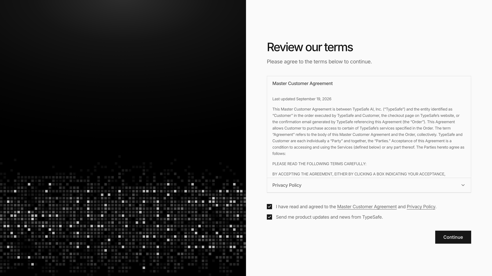
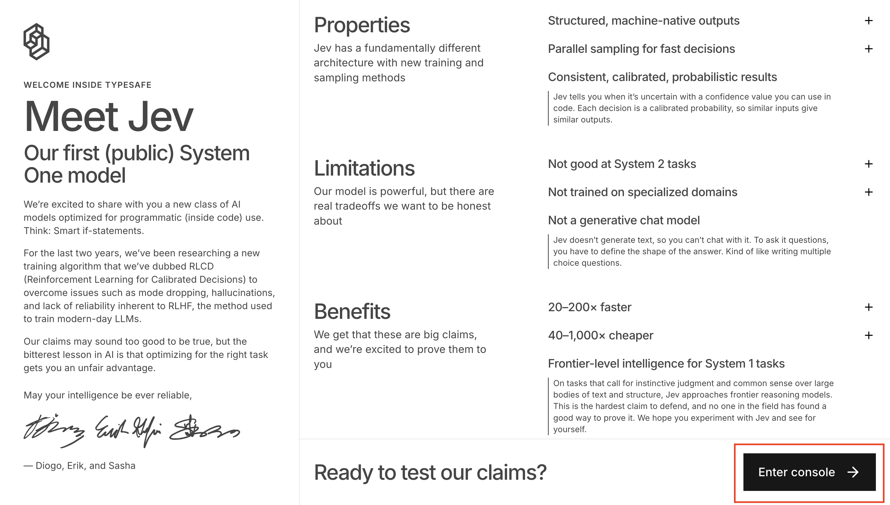
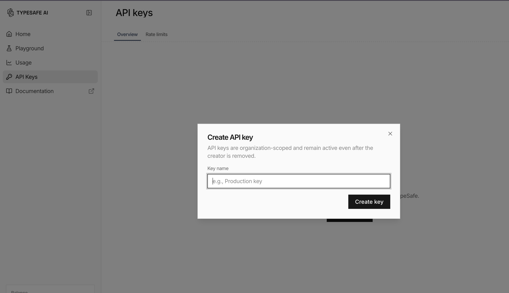
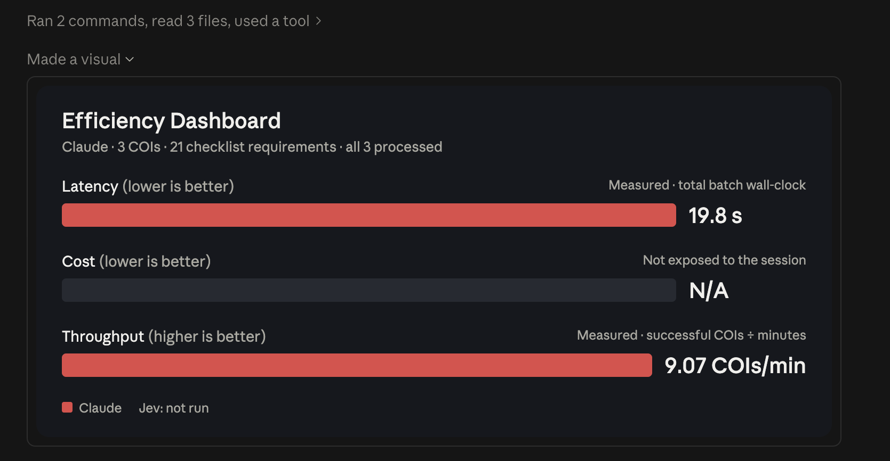
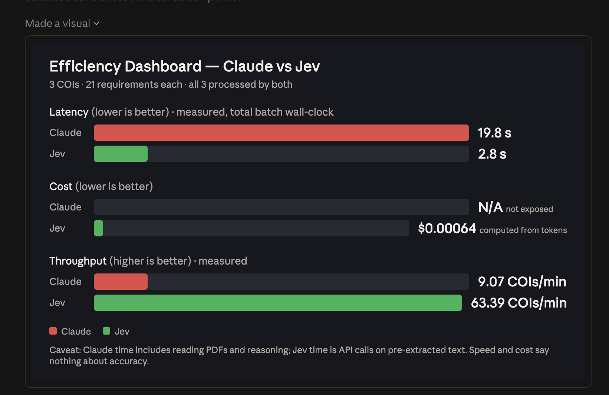
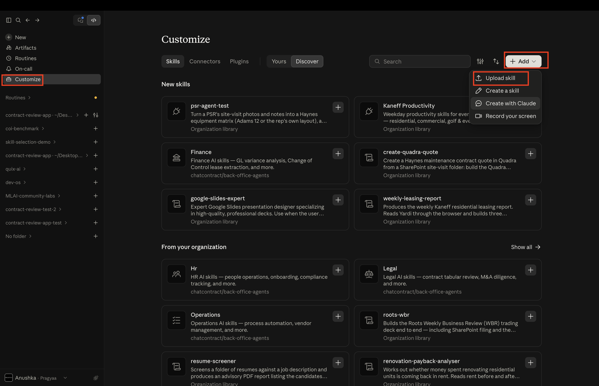
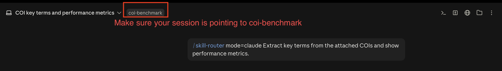
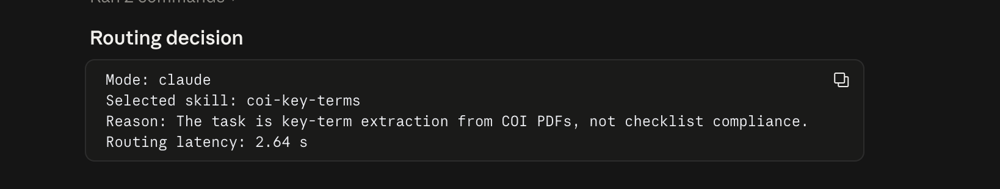

# Lab: Make Claude Faster and Cheaper with Jev

**Jev** is an AI model from [Typesafe](https://docs.typesafe.ai/agent-skill) built for decisions, not writing: give it text and a question, and it instantly picks an option, scores it, or says how likely it is, at a fraction of the cost. In this lab you'll see where Jev fits, where Claude fits, and how combining them makes the same job faster and cheaper: **Jev decides, Claude writes.**

Here's what we'll do in this lab:

- **Set up.** Open the benchmark folder and connect Jev.
- **Check COIs against a checklist.** Run it with Claude alone, then with Jev, and compare speed and cost.
- **Let Jev pick the skill.** Hand the task to a router. Jev picks the right skill, Claude extracts the key terms, and you compare the timings.

---

## Table of Contents

- [Prerequisites](#prerequisites)
- [Part 1: Set Up](#part-1-set-up)
- [Part 2: Check COIs Against a Checklist](#part-2-check-cois-against-a-checklist)
- [Part 3: Let Jev Pick the Skill](#part-3-let-jev-pick-the-skill)
- [What You Learned](#what-you-learned)
- [Reference](#reference)

---

## Prerequisites

✅ **Claude Code Desktop** installed and signed in.

✅ **The benchmark folder.** Download the zip, it has everything you need:

- [coi-benchmark.zip](./coi-benchmark.zip)

It comes with the COI documents, the compliance checklist and the skill that runs the check for you.

✅ **The two skills for the skill-router part (Part 3):**

- skill-router file: [Link Here](./skill-router/SKILL.md)
- coi-key-terms file: [Link Here](./coi-key-terms/SKILL.md)

---

## Part 1: Set Up

First, we'll get everything ready: open the benchmark folder with the COIs and the checklist, install the Jev plugin, and connect it with your API key. Once that's done, you can run the same check with Claude and with Jev.

### Step 1: Set Up the Benchmark Folder

1. Download [coi-benchmark.zip](./coi-benchmark.zip).
2. Unzip it.
3. Open the unzipped `coi-benchmark` folder in Claude Code Desktop.

Everything for the check lives in one folder. Once unzipped, you'll see this:

```
coi-benchmark/
│
├── .claude/
│   └── skills/
│       └── coi-benchmark/
│           └── SKILL.md
│
├── coi-documents/
│   ├── AECOM.pdf
│   ├── Caterpillar.pdf
│   ├── Proctor.pdf
│   └── ...any number of COI PDFs
│
├── checklist.csv
│
├── results/
│
└── README.md
```

| Path | What it is | Do you touch it? |
|------|------------|------------------|
| `coi-benchmark/` | The project folder. Open this folder in Claude Code Desktop. | Open it, nothing else |
| `.claude/skills/coi-benchmark/SKILL.md` | The skill behind the `/coi-benchmark` command. It tells Claude how to run the check and build the dashboard. | No |
| `coi-documents/` | The COIs to check. Comes with AECOM, Caterpillar and Proctor. | Yes, add or remove PDFs to change what gets checked |
| `checklist.csv` | The requirements every COI is checked against. | Yes, edit it to change the requirements |
| `results/` | Where each run saves its results. Starts empty. | No, the skill fills it |
| `README.md` | A short guide to the folder. | No |

> **Note:** Open the `coi-benchmark` folder itself, not the folder above it. Claude only finds the skill when this folder is the one you opened.

### Step 2: Install the Jev Plugin

In your terminal, run these two commands:

```
claude plugin marketplace add typesafe-ai/skills
claude plugin install typesafe@typesafe-ai
```


### Step 3: Create Your API Key

Before Claude can reach Jev, you need a Typesafe API key.

1. Go to [https://console.typesafe.ai/](https://console.typesafe.ai/).
2. Enter your email.
3. Agree to the terms and conditions.

4. Skip the next steps.
5. Click **Enter console**.

6. When asked "Can you chat with Jev, TypeSafe's new model?", click **No**.
7. A message says "TypeSafe only responds with structured decisions". Click **Close**.
8. Click **API keys** in the sidebar.
9. Click **Create API key** and create a new key.

10. If your balance shows zero, click **Balance**, then **Add funds**.

> ⚠️ Keep your key private. Don't paste it into any file you might share.

### Step 4: Add Your API Key

Now give Claude your key so it can reach Jev. Paste this prompt and replace `TYPESAFE_API_KEY` with your own key when Claude asks for it:

```
I want to integrate Jev, a fast, low-cost AI model for classification, scoring, and decision-making, into my existing Claude Code workspace.

1. Understand Jev
First, read the official documentation: https://docs.typesafe.ai/llms.txt

2. Set Up the API
Connect Jev using the official Typesafe API and TYPESAFE_API_KEY. Ask me for my API key, store it securely on my computer, and never expose or commit it.

3. Configure Jev
Jev supports three operations: Choice, Score, and Probability. Keep Jev OFF by default and use it only when I explicitly request it. Otherwise, use Claude normally.

4. Run a Real Test
Create a sample sales email and use Jev to evaluate:
- Lead quality
- Email type
- Whether a personalized reply is needed

Show actual responses, confidence scores, latency, and available cost. If the test fails, show the exact error.

5. Create a Reusable Skill
Save the working integration as a Claude Code skill so I can invoke it anytime by saying "Use Jev to sort these."

Important Rules:
- Jev decides, Claude writes.
- If Jev is uncertain, Claude makes the final decision.
- Always ask permission before sending private data to Jev.
```

> ⚠️ Anything sent to Jev leaves your computer. Never send private documents without checking first.

---

## Part 2: Check COIs Against a Checklist

Many tasks come down to a simple decision at every step: yes or no, pass or fail. Claude can make these calls, but it reads, thinks and writes a full answer each time, which is slow and costly as the work piles up. These are exactly the calls Jev is built for.

- **Jev's job:** make the decisions, in this case PASS, FAIL or NOT_EVIDENCED for each checklist requirement.
- **Claude's job:** organize the results into a clear dashboard.


### Step 1: Run the Check with Claude Only

First, set a baseline. Let Claude make every decision on its own.

1. Open Claude Code Desktop and open the `coi-benchmark` folder.
2. Start a new chat.
3. Type this command:

```
/coi-benchmark run with claude
```

Claude checks every COI in `coi-documents/` against `checklist.csv`, saves the run to `results/`, and shows you an **Efficiency Dashboard** with latency, cost and throughput.



Keep this run. Jev will be measured against it.

### Step 2: Run the Check with Jev

Same documents, same checklist. This time Jev makes the decisions.

1. Stay in the `coi-benchmark` folder and start a new chat.
2. Type this command:

```
/coi-benchmark run with jev
```

Jev checks every COI in `coi-documents/`, and Claude only organizes the results. Because your Claude run is already saved in `results/`, you get both side by side in one **Efficiency Dashboard: Claude vs Jev**.



### Step 3: Read the Dashboard

The dashboard compares the two runs on three numbers:

| Metric | What it means | Better is | In the example run |
|--------|---------------|-----------|--------------------|
| **Latency** | Total wall-clock time to check all the COIs, from start to finish. | Lower | Claude 19.8 s, Jev 2.8 s |
| **Cost** | What it costs to check all the COIs. | Lower | Claude N/A, Jev $0.00064 |
| **Throughput** | How many COIs get checked per minute. | Higher | Claude 9.07 COIs/min, Jev 63.39 COIs/min |

A few things to know when you read it:

- **Claude's cost shows N/A.** Claude Code doesn't show you the cost of a session inside the chat, so there's no real number for the dashboard to use. Jev's cost is computed from the tokens its API reports back, which is why it has a value.

### Step 4: Estimate Claude's Cost

Since the dashboard can't show it, you can estimate it from Anthropic's [published pricing](https://platform.claude.com/docs/en/about-claude/pricing). Take **3 COIs of 2 pages each, 6 pages in total**:

- **Input:** Anthropic's [PDF docs](https://docs.claude.com/en/docs/build-with-claude/pdf-support) put a page at roughly 1,500 to 3,000 tokens, so 6 pages is about **9,000 to 18,000 tokens**. We'll use about **14,000**, and add about 1,000 for the checklist, so roughly **15,000 input tokens**.
- **Output:** A verdict and a short reason for each of the 21 requirements on each COI comes to roughly **3,000 output tokens**. This is a rough guess, not a measured number.

| Model | Input price | Output price | Estimated cost for 3 COIs |
|-------|-------------|--------------|---------------------------|
| Claude Sonnet 5.5 | $2 / MTok | $10 / MTok | about **$0.06** |
| Claude Opus 5.5 | $4 / MTok | $20 / MTok | about **$0.12** |
| Claude Fable 5.1 | $10 / MTok | $50 / MTok | about **$0.30** |
| **Jev** (measured in the example run) | n/a | n/a | **$0.00064** |

> **Note:** These are estimates, and real sessions usually cost a bit more because of the extra tokens Claude Code uses behind the scenes. Pick the row for the model you're using. At 3 COIs the gap looks tiny, but at 3,000 COIs the same maths turns $0.06 into about $60 and $0.00064 into under $1.

### What We've Seen So Far

Up to here you saw two things:

- **How to use a skill from a folder.** The `/coi-benchmark` command works because the skill lives in the `coi-benchmark` folder you opened. Claude picks it up from there, so you only type the command.
- **How much faster Jev is at checking against a checklist.** Same COIs, same checklist. Jev finished in 2.8 s against Claude's 19.8 s, for a fraction of a cent.

But so far *we* told Claude which skill to use. Now let's see how **Jev can help us select the correct skill**.

---

## Part 3: Let Jev Pick the Skill

So far we told Claude exactly which skill to use. In real work there are many skills, and something has to **choose the right one** for each task. Choosing from a short list is a decision, not writing, so it's a perfect job for Jev.

- **Jev's job:** read the task and pick the right skill.
- **Claude's job:** run the chosen skill and do the actual work (here, extracting key terms from the COIs).

We'll run the same task twice, once with Claude choosing the skill and once with Jev choosing it, and compare how long the choosing takes. The goal is the same skill picked either way, with Jev making that step faster. You'll need the `coi-benchmark` folder and Jev connected from [Part 1](#part-1-set-up).

### Step 1: Upload the Skills and Open a New Session

1. Open Claude Code Desktop and go to **Customize**, then **Skills**.
2. Upload both skills: [skill-router](./skill-router/SKILL.md) and [coi-key-terms](./coi-key-terms/SKILL.md).
3. Start a **new session** in Claude Code Desktop, pointing to the same `coi-benchmark` folder.

| Skill | What it does |
|-------|--------------|
| `skill-router` | Picks the right skill using Claude or Jev, runs it, and reports routing and extraction time separately. |
| `coi-key-terms` | Extracts key terms, coverage details and policy limits from COIs. |


> **Note:** Upload both skills before you start. If `coi-key-terms` is missing, the router has nothing to pick.



### Step 2: Run It with Claude

First, set a baseline. Let Claude pick the skill.

Type this command:

```
/skill-router mode=claude Extract key terms from the attached COIs and show performance metrics.
```



Along with the key terms, you'll see which skill was picked and why. Look for these fields:

```
Mode: claude
Selected skill:
Reason:
Routing latency:
```



| Field | What it tells you |
|-------|-------------------|
| **Mode** | Who picked the skill. Here it's `claude`. |
| **Selected skill** | The skill the router chose. It should be `coi-key-terms`. |
| **Reason** | Why that skill was chosen. |
| **Routing latency** | How long it took to pick the skill. |

### Step 3: Run It with Jev

Same COIs, same task. Only the mode changes.

Type this command:

```
/skill-router mode=jev Extract key terms from the same COIs and show performance metrics.
```

You'll see the same fields, now with `Mode: jev`:

```
Mode: jev
Selected skill:
Reason:
Routing latency:
```


Because your Claude run is already done, this time you also get a **Claude vs Jev** comparison, measured on the same 3 COIs and the same task.


### Step 4: Read the Comparison

```
Claude vs Jev (measured, same 3 COIs and task)

                Claude          Jev
Routing         2.64 s          0.62 s
Extraction      4.18 s          5.89 s
```

| Row | What it measures | Claude | Jev |
|-----|------------------|--------|-----|
| **Routing** | Time to pick the right skill for the task. | 2.64 s | 0.62 s |
| **Extraction** | Time for the chosen skill to pull out the key terms. | 4.18 s | 5.89 s |

What the numbers say:

- **Jev picked the skill faster.** Routing took 0.62 s against 2.64 s, about 4 times faster. That's the one step Jev took over.
- **Extraction is Claude's job in both runs.** Jev only selects the skill. Once it's picked, Claude runs it, so extraction isn't where Jev is supposed to help. Don't read the gap between 4.18 s and 5.89 s as Jev being slower at extracting.

---

## What You Learned

- **Jev is for deciding.** Pass or fail, which skill to use, how likely something is: anything that's a pick, a score or a probability can go to Jev.
- **Jev is much faster and cheaper at checking.** On the same COIs and checklist, Jev finished in 2.8 s against Claude's 19.8 s, for $0.00064 instead of roughly $0.06 or more.
- **Jev picks the right skill quickly.** Routing took 0.62 s with Jev against 2.64 s with Claude, and the result matched.
- **Claude still writes.** Once Jev has decided, Claude does the reading, extracting and formatting. Jev decides, Claude writes.
- **Always check the output.** Speed doesn't prove the right skill was picked or the right terms were found.

---

## Reference

[Typesafe agent skill docs](https://docs.typesafe.ai/agent-skill)
