# Grade contract answers with Jev, Claude and Azure, and compare time and cost

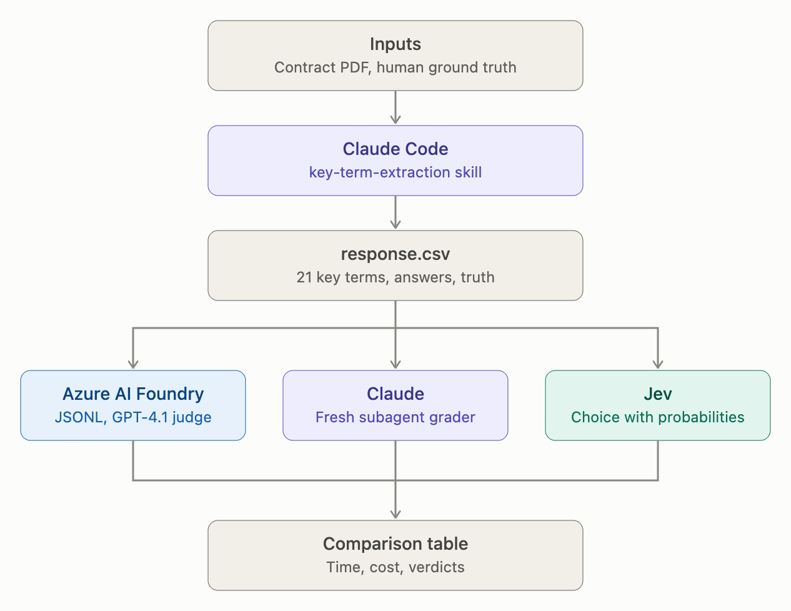

Today we talk about Jev.

Everyone is talking about Jev, but not many people know how it works. So let me show you. We'll build one small lab end to end:

1. Extract 21 key terms from a contract with Claude.
2. Grade those answers three ways: **Azure AI Foundry**, **Claude**, and **Jev**.
3. Put time and cost side by side in one table.

By the end you'll have a working `/jev-evaluate` skill, and you'll know when Jev is the right tool and when it isn't.

---

## Table of Contents

- [What is Jev?](#what-is-jev)
- [How Jev Works](#how-jev-works)
- [What We're Building](#what-were-building)
- [Prerequisites](#prerequisites)
- [Step 1: Open Claude Code](#step-1-open-claude-code)
- [Step 2: Install the Jev Plugin](#step-2-install-the-jev-plugin)
- [Step 3: Verify Jev is Installed](#step-3-verify-jev-is-installed)
- [Step 4: Run the Key Term Extraction](#step-4-run-the-key-term-extraction)
- [Step 5: Create the Dataset for Azure Evaluations](#step-5-create-the-dataset-for-azure-evaluations)
- [Step 6: Evaluate with Azure AI Foundry](#step-6-evaluate-with-azure-ai-foundry)
- [Step 7: Evaluate with Claude](#step-7-evaluate-with-claude)
- [Step 8: Evaluate with Jev](#step-8-evaluate-with-jev)
- [Conclusion: Time and Cost Side by Side](#conclusion-time-and-cost-side-by-side)
- [Where to Go Next](#where-to-go-next)
- [Reference](#reference)

---

## What is Jev?

Jev is TypeSafe's first **System One** model. A System One model makes quick, structured decisions that software can use directly.

It is **not** a chatbot. It does not write text, explain itself, or generate code. You give it some text and a question, and it answers in one of three typed shapes:

| Shape | What it answers | Example |
|---|---|---|
| **Choice** | Pick one option from a set | Correct / Partially Correct / Incorrect |
| **Score** | A position on an ordered scale | How frustrated is this customer, 1 to 5 |
| **Noul** | A probability from 0 to 1 | Does this message ask for a refund? |

Think of it as programmable common sense. Your code runs the workflow. Jev makes the small semantic judgment that ordinary code can't.

**The rule we follow all lab: Jev decides, Claude writes.** Jev gives the verdict. Claude orchestrates and reports. Claude never overrides Jev.

---

## How Jev Works

Every call has three parts:

- **state**: the text to judge (a string, JSON object or array)
- **model**: `jev-latest`
- **questions**: what you want decided, each one typed (`choice`, `score` or `noul`)

Here's a real request from this lab, trimmed:

```json
{
  "state": { "reponse": "...", "ground_truth": "..." },
  "model": "jev-latest",
  "questions": {
    "verdict": {
      "type": "choice",
      "instructions": "Compare `reponse` against `ground_truth`. How well does it match?",
      "criteria": {
        "Correct": "Conveys everything in ground_truth, no contradiction.",
        "Partially Correct": "Matches part of it, or omits something material.",
        "Incorrect": "Contradicts it, answers something else, or is missing."
      }
    }
  }
}
```

And what comes back:

```json
{
  "model": "jev-1.13.0",
  "answers": {
    "verdict": {
      "type": "choice",
      "choice": "Partially Correct",
      "probabilities": { "Correct": 0.03, "Partially Correct": 0.84, "Incorrect": 0.13 },
      "confidence": 0.76
    }
  },
  "usage": { "input_tokens": 538, "output_tokens": 30 }
}
```

Four things to notice:

1. **You get the whole distribution**, not just the winner. That's how you see how sure Jev is.
2. **Confidence** measures how far the top option sits above an even split. For a Choice with `n` options: `confidence = (p_max - 1/n) / (1 - 1/n)`. All the probability on one option gives 1.0. An even spread gives 0.
3. **Confidence is not accuracy.** It tells you how concentrated the answer is. We use it as a gate: below **0.7**, a human reviews the row.
4. **Usage is reported**, so you can compute the exact cost from the tokens the API returns.

Under the hood it is a plain HTTP call: `POST https://api.typesafe.ai/v1/systemone` with a bearer token. No SDK needed.

**Where Jev fits:** routing, scoring, guardrails, classification, grading. **Where it doesn't:** anything that needs written text or reasoning you can read. That's still Claude's job.

---

## What We're Building

```
Contract PDF + human ground truth
        |
        v
 /key-term-extraction  -->  response.csv  (21 rows: key_terms, response, ground_truth)
        |
        +--> eval-dataset.jsonl --> Azure AI Foundry evaluation
        |
        +--> Claude grades the rows
        |
        +--> Jev grades the rows (/jev-evaluate)
        |
        v
 One table: time, cost, verdicts
```

---

## Prerequisites

✅ **Claude Code Desktop** installed and signed in.

✅ **Jev connected to Claude.** Complete the Set Up Your Jev API Key first, it takes about five minutes:

- [Set Up Your Jev API Key](./jev-api-key-setup/Readme.md)

✅ **The MSA and the ground truth.** You need two files:

- The **Sample MSA PDF** (the Horizon Cloud Master Services Agreement): [Link Here](https://pragyaallc-my.sharepoint.com/:w:/g/personal/anurag_b_legalgraph_ai/IQAVZWwg07n1Q42rzDVdLDXGASap0pjexQ4tlDRaTs1wTeM?e=aTFWmV&OR=EXCEL-WEB.BODY.NT&CT=1791992650211)
- The **Ground Truth XLSX** with the correct answers for the same 21 key terms export Horizon Cloud sheet as CSV: [Link Here](https://pragyaallc-my.sharepoint.com/:x:/g/personal/anurag_b_legalgraph_ai/IQAvT9UJmOGCQbbpYInresV2AUvH7eKWRDE3u9TV3A5DI0E?e=kN9505&wdExp=TEAMS-TREATMENT&web=1)

✅ **An Azure AI Foundry project**

---

## Step 1: Open Claude Code

1. Open the Claude desktop app.
2. Go to the **Code** tab.
3. Start a new session and choose a folder to work in.

That's it. Everything else happens by typing prompts here.

---

## Step 2: Install the Jev Plugin

First, what's a plugin? **A plugin is a package that bundles skills (and sometimes agents and hooks) so you can install them in one go.** The TypeSafe plugin carries the skill that teaches Claude how the Jev API works.

> **New to skills?** Learn how to add skills to Claude Code: [How to Add Skills to Claude](https://github.com/sachin0034-tech/MLAI-community-labs/tree/main/Cohort-Labs/Cohort%209/week%200%20%20-%20foundation/how-to-add-skills-to-claude)

In a terminal, run:

```bash
claude plugin marketplace add typesafe-ai/skills
claude plugin install typesafe@typesafe-ai
```

Restart Claude Code so it picks up the plugin.

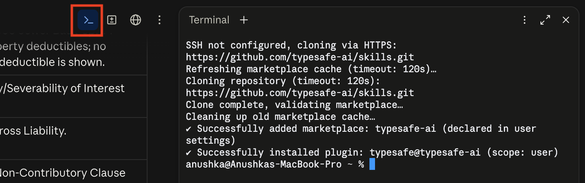

---

## Step 3: Verify Jev is Installed

Two checks.

**Check 1: the skill loads.** Type `/typesafe:typesafe-ai` in the prompt box. If it loads, the plugin is installed.

**Check 2: the API answers.** Paste this prompt. It also sets the ground rules for the whole lab:

```text
I've installed the TypeSafe plugin in Claude Code.

Here is my API key : <ADD YOUR API KEY HERE>

1. UNDERSTAND JEV
Read https://docs.typesafe.ai/llms.txt. Jev returns three shapes only: Choice (pick one
option), Score (a position on an ordered rubric), Noul (a probability from 0 to 1).
It does not generate text.

2. VERIFY THE CONNECTION
Make one trivial Jev call and report ok/fail plus latency. On failure, print the exact
error text. Never print any part of the key.

3. RULES
- Jev stays OFF by default. Use it only when I say "use jev".
- Jev decides, Claude writes.
- If Jev's confidence is below 0.7, flag the row for human review rather than accepting
  it silently.
- Ask before sending contract text to Jev.
- NEVER fall back to Claude silently if a Jev call fails. Stop and show the error.
  A silent fallback would make a failed demo look like a successful one.

4. INSTRUMENT EVERY CALL
For every Jev call record latency_ms, input_tokens, output_tokens, and cost at $0.042
per 1M input tokens with output free. Keep a running session total. After any batch,
print: total calls, wall-clock time, total tokens, total cost.
Report Jev's cost separately from Claude's. Never merge them into one number.

5. REAL TEST ON THE LAB'S TASK
Not a sales email. Take three rows with `reponse` and `ground_truth` columns and use a
Jev Choice over Correct / Partially Correct / Incorrect. For each row show the verdict,
the full probability distribution, and the confidence. Then print the metrics block.

6. SAVE AS A SKILL
Save the working integration as /jev-evaluate, taking a CSV with `reponse` and
`ground_truth` columns and returning a verdict per row plus the metrics block.
Keep the `reponse` spelling. It matches the lab's files.
```

You should see something like:

```text
OK  latency_ms=360  detail=positive
total calls : 1
tokens      : 325 (in 294 / out 31)
Jev cost    : $0.00001235  @ $0.042/1M input, output free
```

Why the "never fall back" rule matters: if Jev fails and Claude quietly does the job instead, you'd show a "Jev result" that Jev never produced. We make failures loud.

> The `$0.042 per 1M input tokens, output free` rate is the one we used in this lab. Check your own TypeSafe plan for your rate.

---

## Step 4: Run the Key Term Extraction

Now the real work. Attach the contract PDF and the ground truth CSV, then run:

```text
use /key-term-extraction skill
```

The skill asks which key terms to use. Pick **Default set** (21 terms). It reads the whole MSA and writes `response.csv` with three columns:

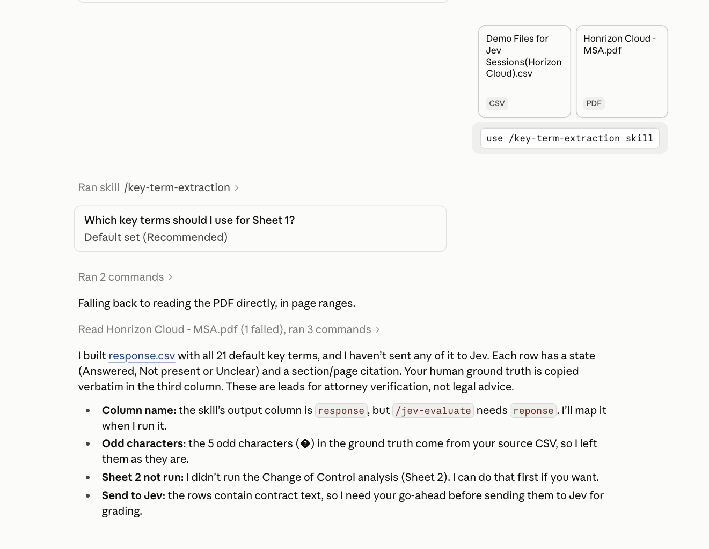

| Column | What's in it |
|--------|--------------|
| `key_terms` | The term name (Customer Name, Payment Terms, Assignment, ...) |
| `reponse` | Claude's answer with the contract quote, section citation and a state: **Answered / Not present / Unclear / Needs review** |
| `ground_truth` | The human answer, copied verbatim from your CSV |

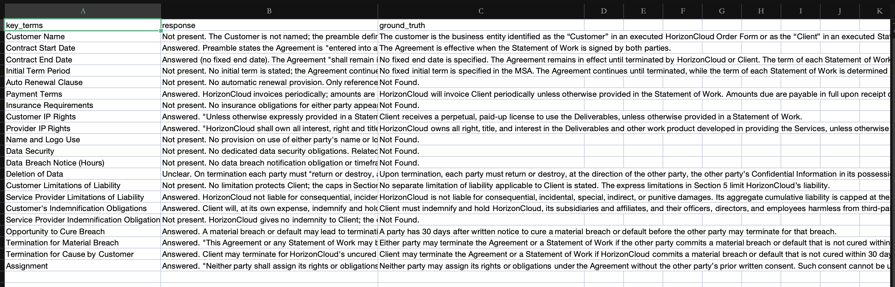

The skill also offers a **Change of Control** analysis (Sheet 2). It's optional here — choose **skip it**.

One thing to watch: the skill writes the column as `response`, but `/jev-evaluate` expects the lab's spelling, `reponse`. Our run mapped one to the other. The skill handles this when you ask it to.

---

## Step 5: Create the Dataset for Azure Evaluations

Azure AI Foundry evaluations want a JSONL file: one JSON object per line, with `query`, `context`, `response` and `ground_truth`. The `context` is the contract text the answer should be based on. Paste this:

```text
You are given a CSV of contract key terms with columns "key_terms", "reponse",
"ground_truth", and the full text of a Master Services Agreement (MSA) PDF.

Produce a JSONL file for Azure AI Foundry evaluation: one JSON object per CSV row, one
per line, UTF-8, no wrapper array. Each object has exactly these four fields, in this
order:

1. "query": the fixed template "What does the contract say about {key_terms}?" using the
   row's key_terms value unchanged.
2. "context": the verbatim MSA text of the clauses relevant to that key term. Choose
   clauses by (a) the section citations in reponse and ground_truth, and (b) the clauses
   that actually address the term. Copy clause text exactly from the PDF, with line
   breaks collapsed to single spaces. Prefix each clause with "[Section X.Y] ", and use
   "[Preamble]" for the opening paragraph. Join clauses with a blank line ("\n\n").
   Never paraphrase, summarize, or invent text.
3. "response": reponse, copied unchanged.
4. "ground_truth": ground_truth, copied unchanged.

Rules:
- If the MSA has no clause on the term (the answer says "Not present" or "Not Found"),
  still fill context with the nearest related clauses. Never leave it empty and never
  invent a clause.
- Do not edit, trim, or strip citations from response or ground_truth.
- Keep the CSV row order.
- Validate before finishing: the line count equals the CSV row count, every line parses
  as JSON, and each context substring appears verbatim in the PDF text.
- After the file, list the clause-to-term mapping you used, so I can review it.
- Save it as `eval-dataset.jsonl` and tell me the file size and total token count.
- Report how long this step took and what it cost.
```

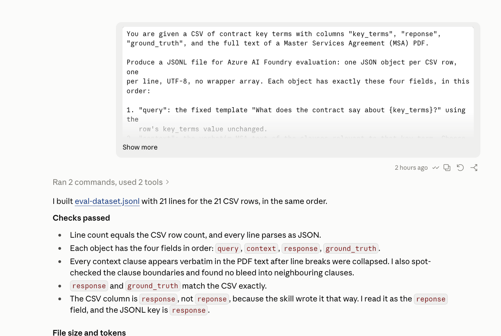

What we got: **21 lines for 21 rows**, every line valid JSON, and every context clause found verbatim in the PDF.

Review the clause-to-term mapping Claude prints. Seven terms (Insurance, Name and Logo, Data Security, Data Breach Notice, Auto Renewal, Initial Term, Provider Indemnification) have no clause of their own, so they get the nearest related clauses. That's the right call, and it's the part a human should check.

---

## Step 6: Evaluate with Azure AI Foundry

1. Go to [ai.azure.com](https://ai.azure.com) and open your Foundry project.
2. In the left sidebar, click **Evaluations**, then **Create**.

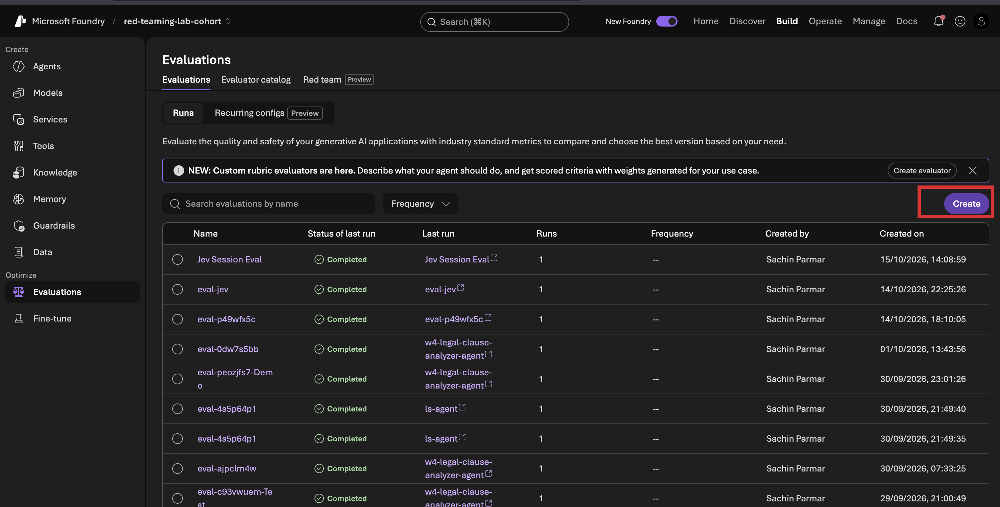

3. Upload `eval-dataset.jsonl` as a dataset.

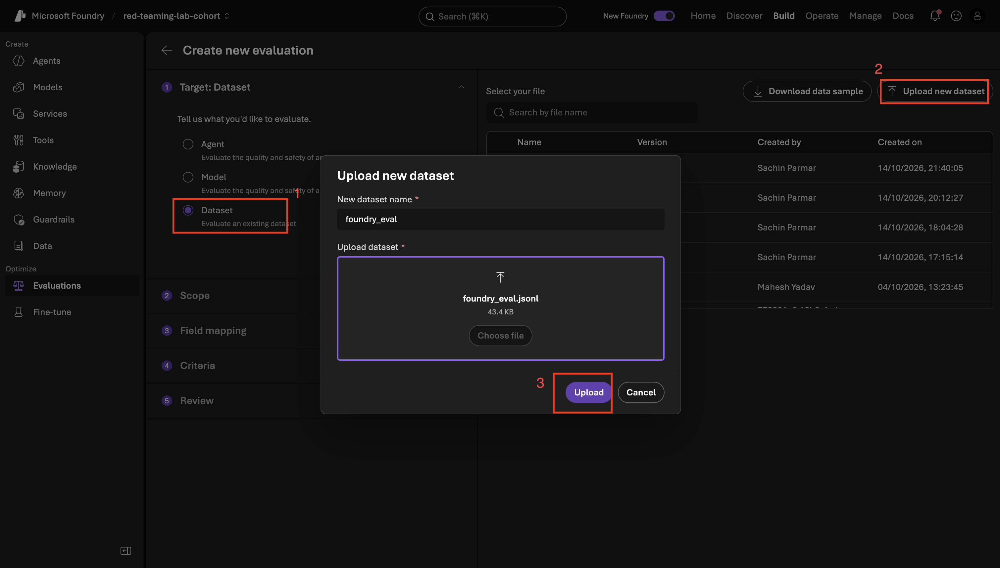

4. For Scope select **Individual turns**.

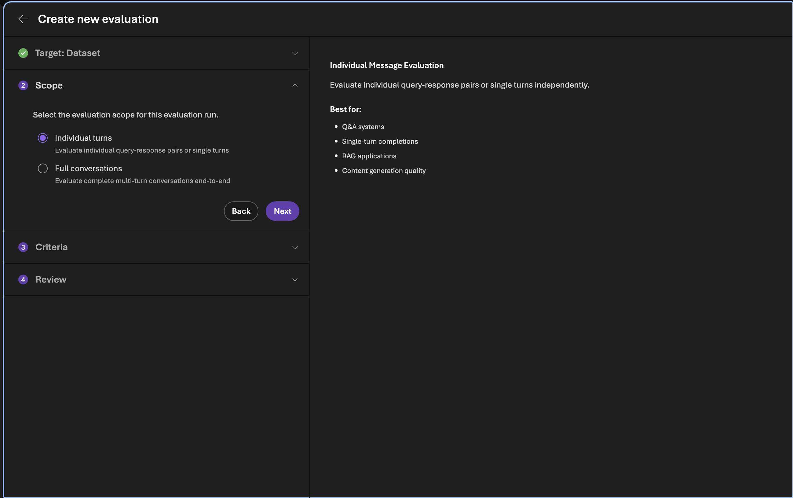

5. Choose your evaluation criteria:
   - Coherence
   - Relevance
   - Fluency
   - ResponseCompleteness

   and a **Judge model** — we used `gpt-4.1`.

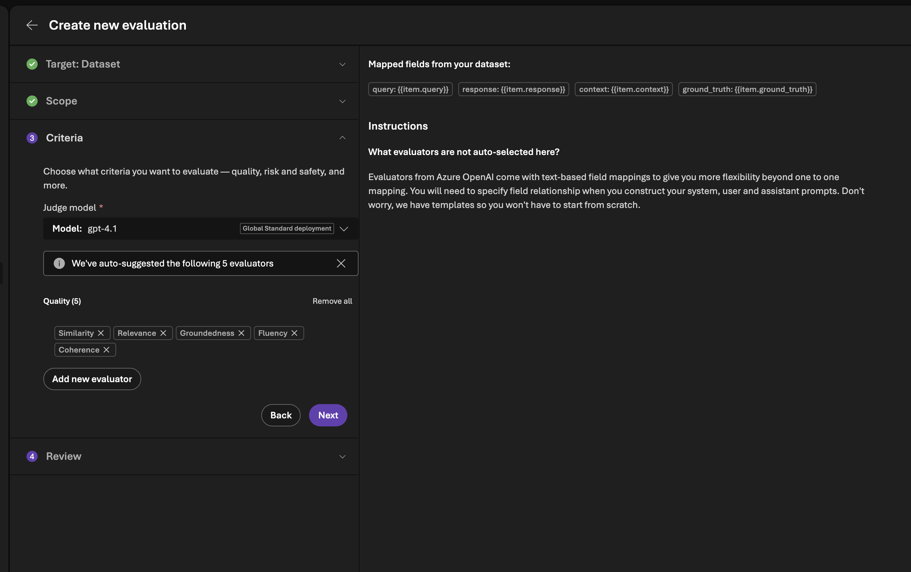

6. Click **Submit** and wait for the run to finish.

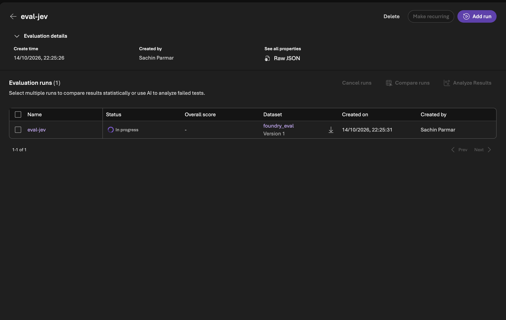

In the example run, the evaluation took **1m 51.96s** and 21/21 rows passed.

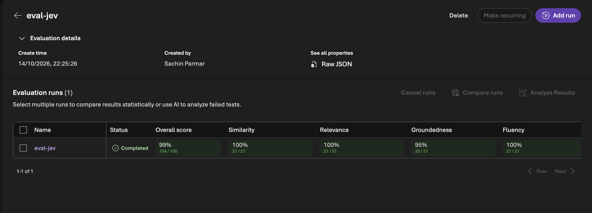

**Cost:** Azure doesn't report dollars here, so we compute it. At GPT-4.1 Global Standard rates ($2.00 per 1M input, $8.00 per 1M output; check your own deployment type and region):

```text
115,560 x $2.00 / 1M  = $0.2311
 10,347 x $8.00 / 1M  = $0.0828
                        ------
                        about $0.314
```

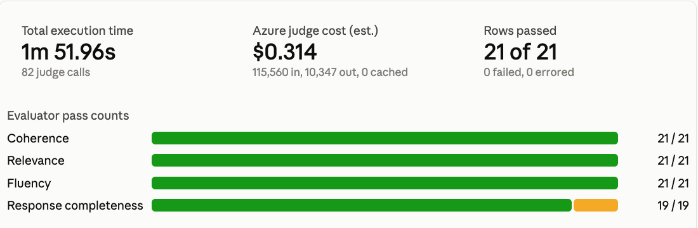

**Read this one carefully.** Azure scored *quality*: is the answer coherent, relevant, fluent and complete? It did **not** grade correct, partially correct or incorrect against the ground truth. A fluent wrong answer can still pass.

---

## Step 7: Evaluate with Claude

Now ask Claude to grade the same 21 rows. Start a new chat, attach `response.csv` and paste this prompt:

```text
Evaluate each row in the CSV by comparing `reponse` with `ground_truth`.
Classify each answer as Correct, Partially Correct, or Incorrect based on factual
accuracy and completeness. Ignore wording differences.

Run the grading in a fresh subagent so its time and token usage are measured, not guessed.

Show a table of all rows with their verdicts, and name every row you marked Partially
Correct or Incorrect with a one-line reason.

At the end show visually:
- Total execution time
- Estimated cost (look up the current published rates for the model; say which numbers
  are measured and which are estimates)
- Verdict counts: Correct / Partially Correct / Incorrect
```

Why a fresh subagent? If Claude grades its own work in the same chat, it can't tell you honestly how long that took or how many tokens it used, and it grades answers it wrote itself. A fresh run gives a measured time and a token count, and a less biased judge.

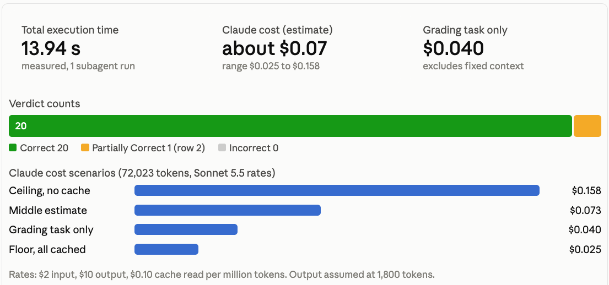

Our result:

```text
Verdicts (Claude, fresh run)
Correct            ████████████████████  20
Partially Correct  █                      1   (row 2: Contract Start Date)
Incorrect                                 0

Time:   13.94 s   (measured)
```

---

## Step 8: Evaluate with Jev

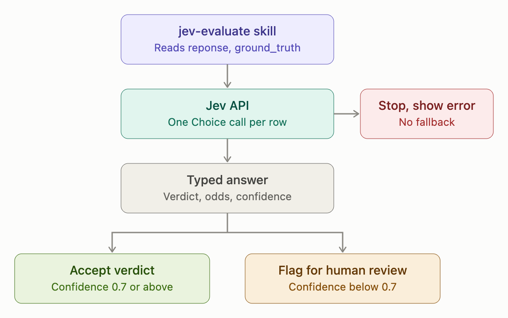

Now the main event. Say "use jev" (Jev is off until you do) and run:

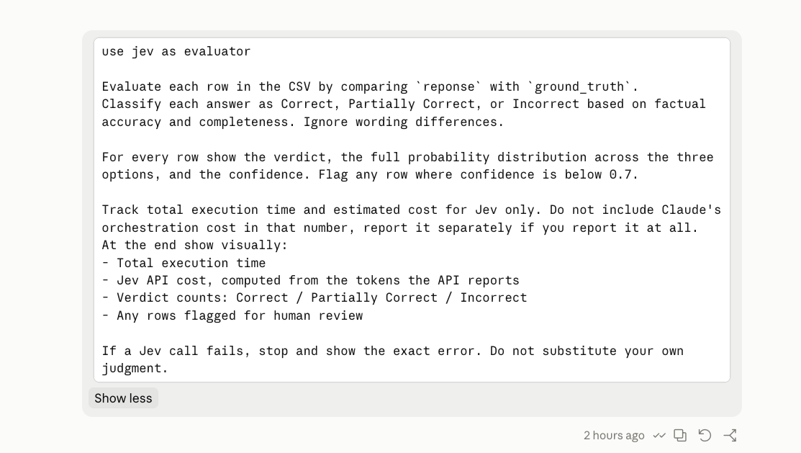

```text
use jev as evaluator

Evaluate each row in the CSV by comparing `reponse` with `ground_truth`.
Classify each answer as Correct, Partially Correct, or Incorrect based on factual
accuracy and completeness. Ignore wording differences.

For every row show the verdict, the full probability distribution across the three
options, and the confidence. Flag any row where confidence is below 0.7.

Track total execution time and estimated cost for Jev only. Do not include Claude's
orchestration cost in that number, report it separately if you report it at all.
At the end show visually:
- Total execution time
- Jev API cost, computed from the tokens the API reports
- Verdict counts: Correct / Partially Correct / Incorrect
- Any rows flagged for human review

If a Jev call fails, stop and show the exact error. Do not substitute your own judgment.
```

Jev is off by default, so `use jev as evaluator` is what turns it on. Claude will ask permission before sending the rows to Jev — approve it.


Results, row by row (Correct / Partially Correct / Incorrect probabilities):

| # | Key term | Verdict | Distribution | Conf | Flag |
|---|---|---|---|---|---|
| 1 | Customer Name | Correct | .910 / .080 / .010 | 0.86 | |
| 2 | Contract Start Date | Partially Correct | .030 / .840 / .130 | 0.76 | |
| 3 | Contract End Date | Correct | 1.000 / .000 / .000 | 1.00 | |
| 4 | Initial Term Period | Correct | .990 / .010 / .000 | 0.98 | |
| 5 | Auto Renewal Clause | Correct | .590 / .390 / .020 | 0.38 | review |
| 6 | Payment Terms | Correct | .650 / .350 / .000 | 0.48 | review |
| 7 | Insurance Requirements | Correct | .970 / .030 / .000 | 0.95 | |
| 8 | Customer IP Rights | Correct | .880 / .120 / .000 | 0.82 | |
| 9 | Provider IP Rights | Correct | .830 / .170 / .000 | 0.74 | |
| 10 | Name and Logo Use | Correct | .870 / .120 / .010 | 0.80 | |
| 11 | Data Security | Correct | .760 / .220 / .020 | 0.64 | review |
| 12 | Data Breach Notice (Hours) | Correct | .950 / .050 / .000 | 0.92 | |
| 13 | Deletion of Data | Correct | .910 / .090 / .000 | 0.86 | |
| 14 | Customer Limitations of Liability | Correct | .740 / .260 / .000 | 0.61 | review |
| 15 | Service Provider Limitations of Liability | Correct | .940 / .060 / .000 | 0.91 | |
| 16 | Customer's Indemnification Obligations | Correct | .930 / .070 / .000 | 0.89 | |
| 17 | Service Provider Indemnification Obligations | Correct | .790 / .180 / .030 | 0.69 | review |
| 18 | Opportunity to Cure Breach | Partially Correct | .360 / .620 / .020 | 0.43 | review |
| 19 | Termination for Material Breach | Correct | .690 / .310 / .000 | 0.53 | review |
| 20 | Termination for Cause by Customer | Partially Correct | .430 / .560 / .010 | 0.34 | review |
| 21 | Assignment | Correct | .810 / .190 / .000 | 0.72 | |

And the summary:

```text
Verdicts (Jev)
Correct            ██████████████████  18
Partially Correct  ███                  3   (rows 2, 18, 20)
Incorrect                               0

Flagged for human review (confidence < 0.7): 8 of 21
  rows 5, 6, 11, 14, 17, 18, 19, 20

Time:  6.83 s    (21 calls, about 324 ms each)
Tokens: 11,198 in / 891 out
Cost:  $0.00047  (11,198 x $0.042 / 1M, output free)
```

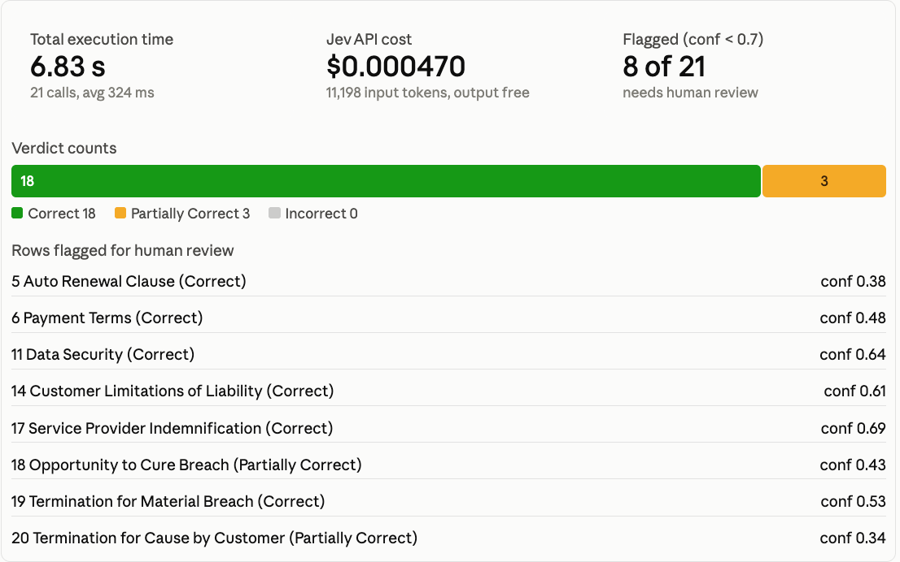

The useful part is the flags. Jev doesn't just say "Correct." It says "Correct, but I'm only 38% confident." Those 8 rows are your review queue.

---

## Conclusion: Time and Cost Side by Side

Same 21 rows, same contract.

| | **Azure AI Foundry** | **Claude** | **Jev** |
|---|---|---|---|
| What it judges | Quality (coherence, relevance, fluency, completeness) | Correctness, one verdict per row | Correctness, verdict plus full probabilities and confidence |
| Result | 21 / 21 passed | 20 Correct, 1 Partial, 0 Incorrect | 18 Correct, 3 Partial, 0 Incorrect |
| Time | 1m 51.96s | 13.94 s | **6.83 s** |
| Cost | about $0.314 (estimate, GPT-4.1 rates) | about $0.04 task only, ~$0.07 with fixed context (estimate) | **$0.00047** (exact, from reported tokens) |
| Tokens | 115,560 in / 10,347 out | 72,023 total (no split) | 11,198 in / 891 out |
| Low-confidence flag | No | No | **Yes, 8 rows** |

**What it means:**

- **Speed.** Jev was about 2x faster than Claude and about 16x faster than the Azure run.
- **Cost.** On our numbers Jev was roughly 86x cheaper than Claude's task-only estimate and roughly 670x cheaper than Azure. Jev's figure is exact; the other two are estimates, so treat those ratios as a rough scale, not a benchmark.
- **Signal.** Azure said everything passed. Claude said one answer was partial. Jev said three, and told us which eight to look at. A pass rate that high on quality metrics is easy to read as "all good", when the real question is whether each answer matches the ground truth.

**Be honest about the limits:**

- One contract and 21 rows is a demo, not a benchmark.
- The three evaluators measure different things, so the verdict counts aren't an apples-to-apples score.
- Jev's confidence is a signal, not proof. Check the 0.7 threshold against your own human labels before you trust it.
- Our Claude cost is an estimate because the run reported only a total token count.
- Claude grading answers it wrote itself leans toward agreement. That's why we use a fresh run, and why an independent judge like Jev is useful.

**The takeaway:** use the right model for the job. Claude reads the contract and writes the answers. Jev makes the fast, cheap, repeatable judgment on top, and shows how sure it is. Azure evaluations are good for checking fluency and completeness. They don't replace a correctness grade.

---

## Where to Go Next

- Run `/jev-evaluate` on your own CSV with `reponse` and `ground_truth` columns.
- Tune the confidence threshold on rows your team has already labeled.
- Add a Noul question per row ("does the response cite the right section?") for a second signal.
- Read the Jev docs: <https://docs.typesafe.ai/llms.txt>

---

## Reference

- [Set Up Your Jev API Key](./jev-api-key-setup/Readme.md)
- [Typesafe agent skill docs](https://docs.typesafe.ai/agent-skill)
- [Claude pricing](https://platform.claude.com/docs/en/about-claude/pricing)
- [Azure AI Foundry observability pricing](https://azure.microsoft.com/en-us/pricing/details/foundryobservability/)
