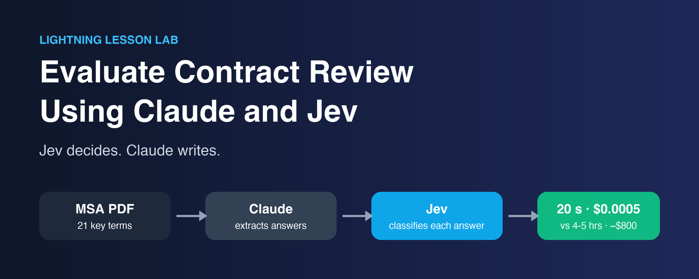
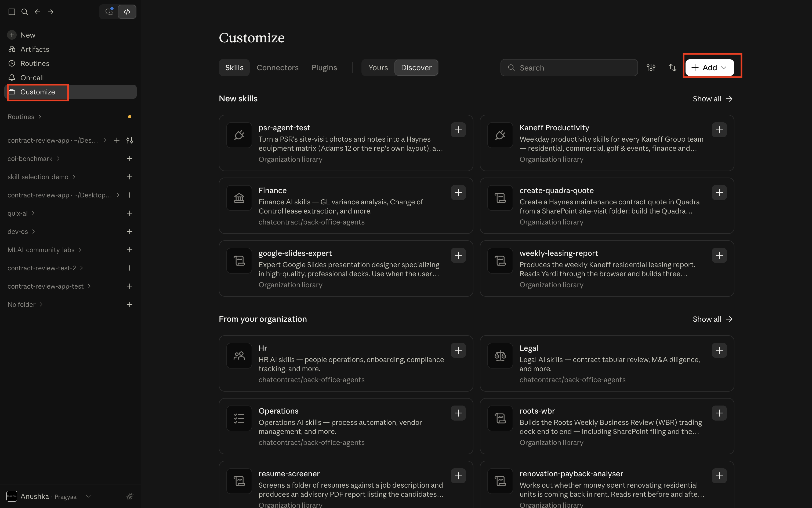
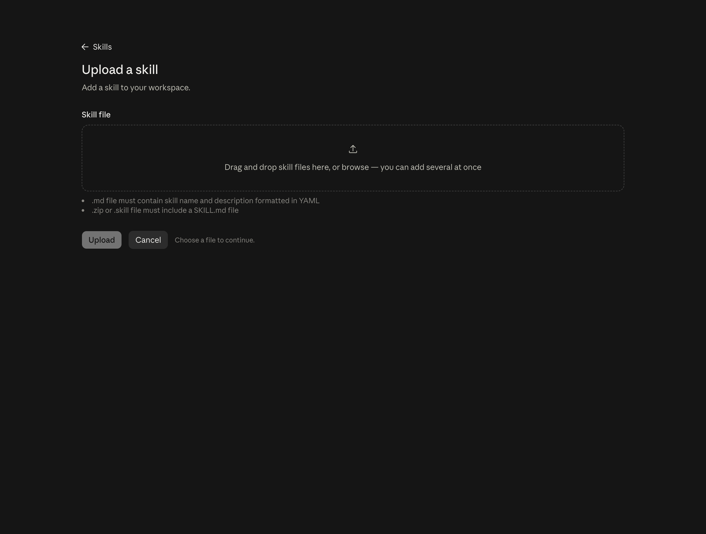
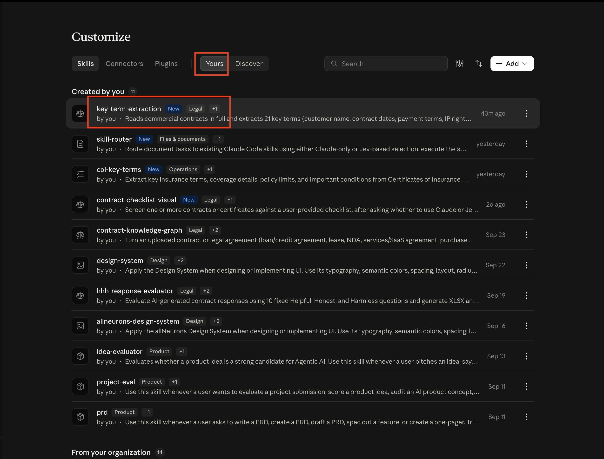
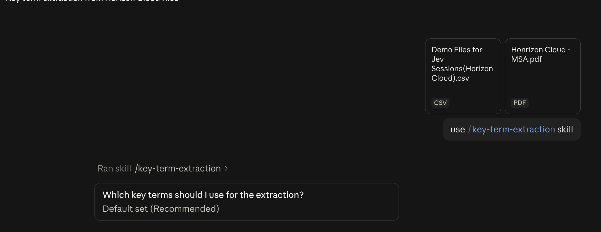
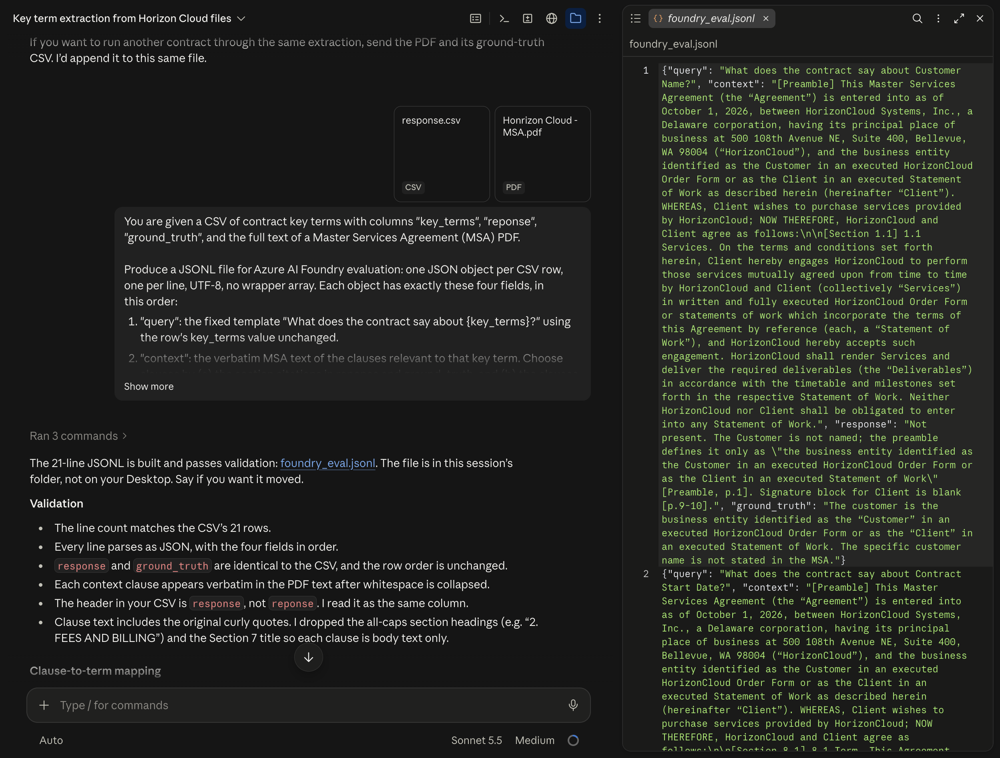
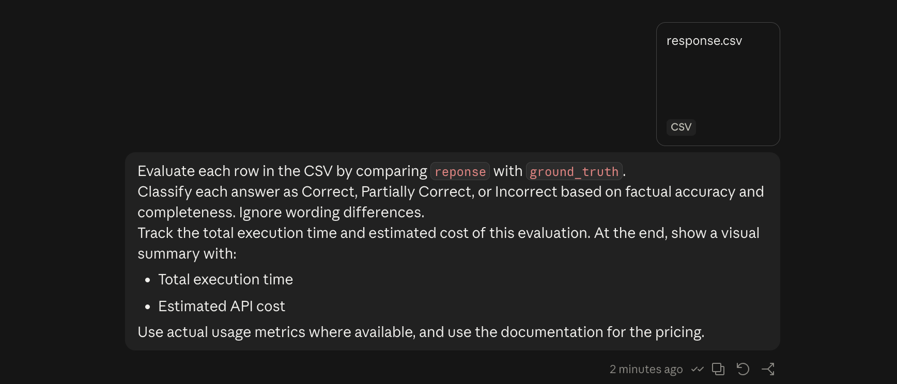
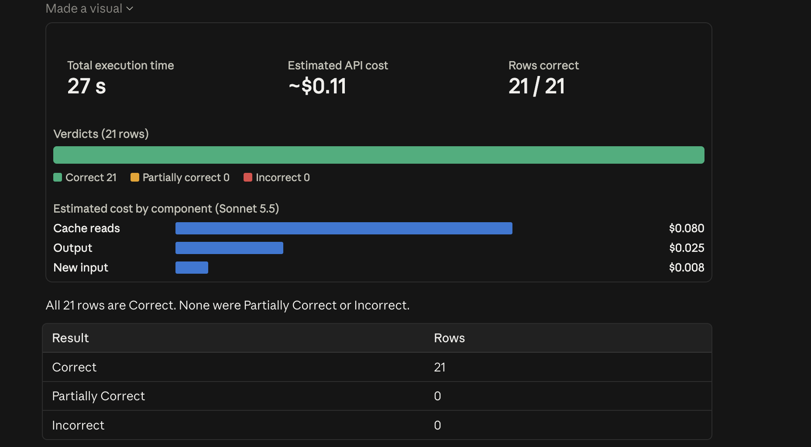
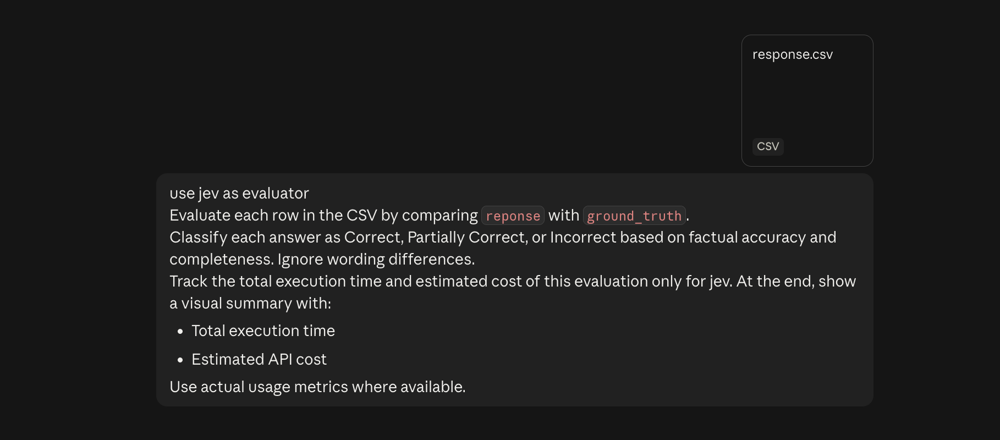
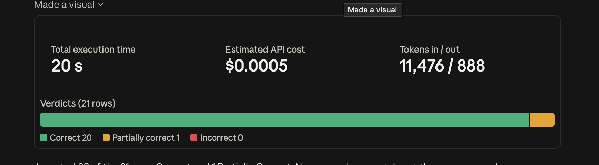

# Evaluate Contract Review Using Claude and Jev



Reviewing a Master Services Agreement (MSA) by hand means a person reads every clause and writes down the key terms. For one contract, that costs around **$800** and takes **4 to 5 hours**. In this lab you'll evaluate the review, check the answers against a human-made ground truth, and see how **Jev** makes the checking step faster and cheaper.

**Jev** is an AI model from [Typesafe](https://docs.typesafe.ai/agent-skill) built for decisions, not writing: give it text and a question, and it instantly picks an option, scores it, or says how likely it is, at a fraction of the cost. **Jev decides, Claude writes.**

Here's the flow for this lab:

- **Extract the key terms.** Claude reads the MSA and fills a CSV with each key term, its answer from the PDF, and the ground truth.
- **Evaluate in Azure AI Foundry.** Turn the CSV into a dataset and score it with Foundry.
- **Evaluate with Claude.** Mark every answer Correct, Partially Correct or Incorrect.
- **Evaluate with Jev.** Same job, now with Jev as the evaluator, and compare time and cost.

---

## Table of Contents

- [Prerequisites](#prerequisites)
- [Part 1: Extract the Key Terms](#part-1-extract-the-key-terms)
- [Part 2: Evaluate in Azure AI Foundry](#part-2-evaluate-in-azure-ai-foundry)
- [Part 3: Evaluate with Claude](#part-3-evaluate-with-claude)
- [Part 4: Evaluate with Jev](#part-4-evaluate-with-jev)
- [Part 5: Compare the Results](#part-5-compare-the-results)
- [What You Learned](#what-you-learned)
- [Reference](#reference)

---

## Prerequisites

✅ **Claude Code Desktop** installed and signed in.

✅ **Jev connected to Claude.** Complete the Set Up Your Jev API Key first, it takes about five minutes:

- [Set Up Your Jev API Key](./jev-api-key-setup/Readme.md)

✅ **The MSA and the ground truth.** You need two files:

- The **Sample MSA PDF** (the Horizon Cloud Master Services Agreement): [Link Here](https://pragyaallc-my.sharepoint.com/:w:/g/personal/anurag_b_legalgraph_ai/IQAVZWwg07n1Q42rzDVdLDXGASap0pjexQ4tlDRaTs1wTeM?e=aTFWmV&OR=EXCEL-WEB.BODY.NT&CT=1791992650211)
- The **Ground Truth XLSX** with the correct answers for the same 21 key terms export Horizon Cloud sheet as CSV: [Link Here](https://pragyaallc-my.sharepoint.com/:x:/g/personal/anurag_b_legalgraph_ai/IQAvT9UJmOGCQbbpYInresV2AUvH7eKWRDE3u9TV3A5DI0E?e=kN9505&wdExp=TEAMS-TREATMENT&web=1)

✅ **An Azure AI Foundry project**

---

## Part 1: Extract the Key Terms

A manual review has one big problem: it's slow and expensive. A person reads the whole contract, finds each term and types an answer. We'll let Claude do that reading with a skill.

### Step 1: Upload the Skill

A skill is a set of instructions Claude follows whenever you call it. Before you can use `/key-term-extraction`, Claude needs to have it.

1. Download [SKILL.md](./assets/SKILL.md) to your computer.
2. Open Claude Code Desktop.
3. Click **Customize** in the sidebar.
4. Click **Skills**.



5. Click **Add skill**.
6. Click **Upload skill**.



7. Select the `SKILL.md` file you downloaded.
8. Check that **key-term-extraction** now shows in your skills list and is switched on.



> **Note:** Upload the skill before you start the chat. If it's missing, `/key-term-extraction` won't be recognised.

### Step 2: Run the Skill

1. Start a **new chat** in Claude Code Desktop.
2. Upload the **Sample MSA PDF** and the **Ground Truth CSV**.
3. Type this prompt:

```
use /key-term-extraction skill
```

4. The skill asks which key terms to use. Choose **1. Default set**, the standard 21 key terms.



for Run the Change of Control analysis (Sheet 2) too? choose skip it

Claude reads the contract and builds one CSV, `reponse.csv`, with three columns:

| Column | What it holds |
|--------|---------------|
| `key_terms` | The term, for example Payment Terms or Assignment. |
| `reponse` | What Claude found in the MSA, with section citations. |
| `ground_truth` | The ground truth answer for the same term. |


Now you have a CSV with Claude's answer next to the ground truth, for all 21 terms. The next question is how to tell whether Claude's answers are right.

---

## Part 2: Evaluate in Azure AI Foundry

To score the answers, Azure AI Foundry needs a dataset in a specific shape: **JSONL**, one JSON object per line, with `query`, `context`, `response` and `ground_truth`. We'll let Claude build it from the CSV and the MSA.

### Step 1: Build the Dataset

In the same chat, with the CSV and the MSA PDF attached, paste this prompt:

```
You are given a CSV of contract key terms with columns "key_terms", "reponse", "ground_truth", and the full text of a Master Services Agreement (MSA) PDF.

Produce a JSONL file for Azure AI Foundry evaluation: one JSON object per CSV row, one per line, UTF-8, no wrapper array. Each object has exactly these four fields, in this order:

1. "query": the fixed template "What does the contract say about {key_terms}?" using the row's key_terms value unchanged.
2. "context": the verbatim MSA text of the clauses relevant to that key term. Choose clauses by (a) the section citations in reponse and ground_truth, and (b) the clauses that actually address the term. Copy clause text exactly from the PDF, with line breaks collapsed to single spaces. Prefix each clause with "[Section X.Y] ", and use "[Preamble]" for the opening paragraph. Join clauses with a blank line ("\n\n"). Never paraphrase, summarize, or invent text.
3. "response": reponse, copied unchanged.
4. "ground_truth": ground_truth, copied unchanged.

Rules:
- If the MSA has no clause on the term (the answer says "Not present" or "Not Found"), still fill context with the nearest related clauses. Never leave it empty and never invent a clause.
- Do not edit, trim, or strip citations from response or ground_truth.
- Keep the CSV row order.
- Validate before finishing: the line count equals the CSV row count, every line parses as JSON, and each context substring appears verbatim in the PDF text.
- After the file, list the clause-to-term mapping you used, so I can review it.
```

| Field | What it holds |
|-------|---------------|
| `query` | The question, built from the key term. |
| `context` | The exact MSA clauses that relate to the term. |
| `response` | Claude's answer from the PDF. |
| `ground_truth` | The ground truth answer. |



### Step 2: Run the Evaluation

1. Go to [ai.azure.com](https://ai.azure.com) and open your Foundry project.
2. In the left sidebar, click **Evaluations**, then **Create**.

3. Upload the JSONL file as your dataset.

4. For Scope select Individual turns

5. Choose your evaluation criteria
    - Similarity
    - Groundedness
    - Retrieval
    - Coherence
    - Fluency

and a **Judge model** as gpt-4.1.


6. Click **Submit** and wait for the run to finish.


Foundry gives you a scored report for every row. In the example run, the evaluation took **2 min 22 s** and cost **$0.39**.


---

## Part 3: Evaluate with Claude

Foundry scored the answers with five metrics, but it took over two minutes. Let's see if Claude can check the same CSV more simply.

Now we ask a simpler question for each row: *does the answer from the PDF match the ground truth?*

Start a new chat, attach `response.csv` and paste this prompt:

```
Evaluate each row in the CSV by comparing `reponse` with `ground_truth`.
Classify each answer as Correct, Partially Correct, or Incorrect based on factual accuracy and completeness. Ignore wording differences.
Track the total execution time and estimated cost of this evaluation. At the end, show a visual summary with:

* Total execution time
* Estimated API cost

Use actual usage metrics where available, and use the documentation for the pricing.
```

| Verdict | What it means |
|---------|---------------|
| **Correct** | The answer has the same facts as the ground truth. |
| **Partially Correct** | The answer has some of the facts, or leaves something out. |
| **Incorrect** | The answer is wrong or says the opposite. |



In the example run, the summary showed:

| Metric | Claude |
|--------|--------|
| Total execution time | 27 s |
| Estimated API cost | ~$0.11 |



This is our baseline. Classifying is a decision, not writing, so let's see if Jev does it better.

---

## Part 4: Evaluate with Jev

Claude gave us a baseline of 27 s and about $0.11, so now let's run the same check with Jev and see how it compares.

Same CSV, same three verdicts. This time Jev makes the decisions and Claude only puts the results together.

Start a new chat, attach `response.csv` and paste this prompt:

```
use jev as evaluator
Evaluate each row in the CSV by comparing `reponse` with `ground_truth`.
Classify each answer as Correct, Partially Correct, or Incorrect based on factual accuracy and completeness. Ignore wording differences.
Track the total execution time and estimated cost of this evaluation only for jev. At the end, show a visual summary with:

* Total execution time
* Estimated API cost

Use actual usage metrics where available.
```

Jev is off by default, so the line `use jev as evaluator` is what turns it on. Claude will ask permission before sending the rows to Jev. Approve it.



In the example run, the summary showed:

| Metric | Jev |
|--------|-----|
| Total execution time | 20 s |
| Estimated API cost | $0.0005 |



---

## Part 5: Compare the Results

| Approach | Time | Cost |
|----------|------|------|
| Manual review | 4 to 5 hours | ~$800 |
| Evaluate in Azure AI Foundry (ai.azure.com) | 2 min 22 s | $0.39 |
| Evaluate with Claude | 27 s | ~$0.11 |
| Evaluate with Jev | 20 s | $0.0005 |

What the numbers say:

- **Automating the review beats doing it by hand.** Hours and hundreds of dollars become seconds and cents.
- **Jev is faster than Claude at the checking step.** 20 s against 27 s, about 25% less time.
- **Jev is about 220 times cheaper.** $0.0005 against roughly $0.11.
- **The gap grows with volume.** For one contract it looks small. At 1,000 contracts, $0.11 per contract becomes $110, and $0.0005 becomes 50 cents.

> **Note:** Claude's cost is an estimate from Anthropic's [published pricing](https://platform.claude.com/docs/en/about-claude/pricing), and the Foundry cost follows [Azure's pricing](https://azure.microsoft.com/en-us/pricing/details/foundryobservability/). Jev's cost is worked out from the tokens its API reports back. Both are close, but not exact.

---

## What You Learned

- **A manual MSA review is slow and expensive.** About 4 to 5 hours and around $800.
- **Claude can extract the key terms.** The `key-term-extraction` skill turns a PDF into a CSV with citations.
- **Evaluation needs the right dataset.** Foundry reads JSONL with `query`, `context`, `response` and `ground_truth`.
- **Classifying is a decision, not writing.** That makes it a job for Jev.
- **Jev is faster and cheaper at deciding.** 20 s and $0.0005 against 27 s and about $0.11.
- **Always check the output.** Compare Jev's verdicts with Claude's before you trust them.

---

## Reference

- [Set Up Your Jev API Key](./jev-api-key-setup/Readme.md)
- [Typesafe agent skill docs](https://docs.typesafe.ai/agent-skill)
- [Claude pricing](https://platform.claude.com/docs/en/about-claude/pricing)
- [Azure AI Foundry observability pricing](https://azure.microsoft.com/en-us/pricing/details/foundryobservability/)
