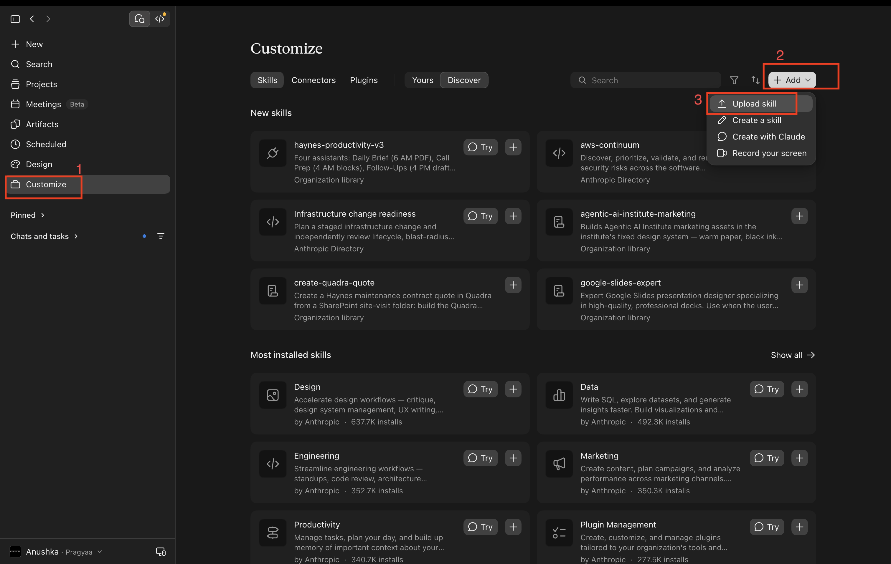
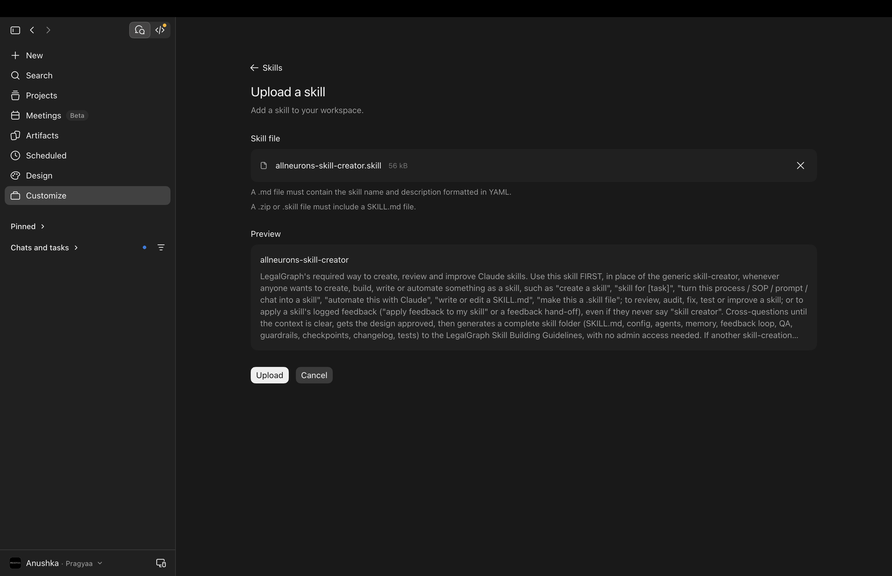
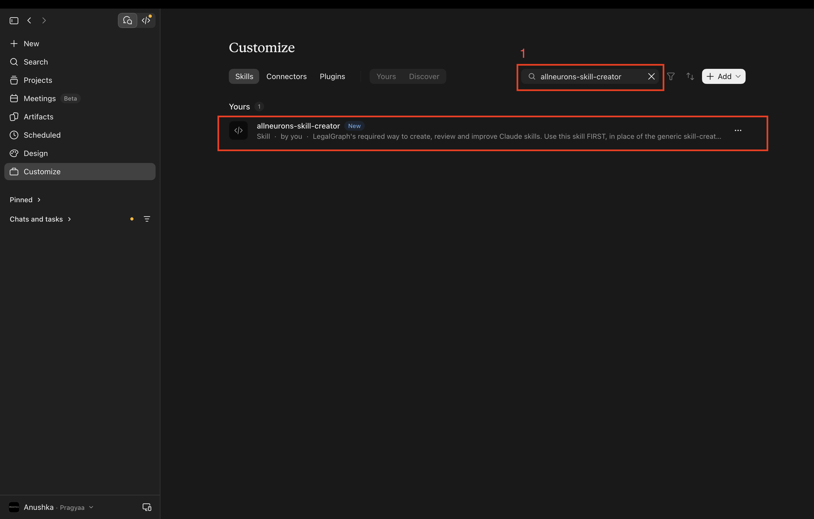
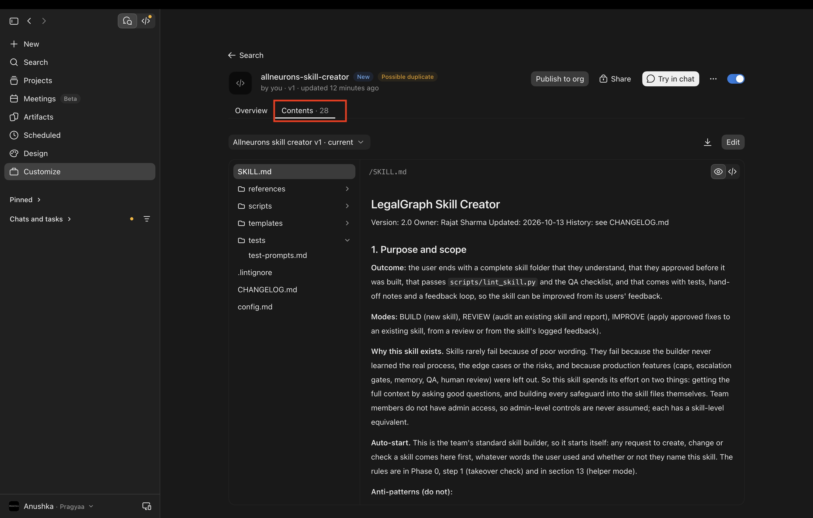

# Module 1: What Are Skills and How Do You Write a Good One?

## Table of Contents

- [What You Will Learn](#what-you-will-learn)
- [The Problem: Repeating Yourself](#the-problem-repeating-yourself)
- [So, What Is a Skill?](#so-what-is-a-skill)
- [Why Do We Need Skills?](#why-do-we-need-skills)
  - [The Four Big Wins](#the-four-big-wins)
- [How Skills Work Behind the Scenes](#how-skills-work-behind-the-scenes)
- [What Is Inside a Skill Folder?](#what-is-inside-a-skill-folder)
  - [Where Does the Skill Live?](#where-does-the-skill-live)
- [How to Write a Good Skill](#how-to-write-a-good-skill)
  - [Rule 1: Write the description like you are writing a trigger](#rule-1-write-the-description-like-you-are-writing-a-trigger)
  - [Rule 2: One skill, one job](#rule-2-one-skill-one-job)
  - [Rule 3: Write steps, not essays](#rule-3-write-steps-not-essays)
  - [Rule 4: Explain the why, not just the what](#rule-4-explain-the-why-not-just-the-what)
  - [Rule 5: Show an example](#rule-5-show-an-example)
  - [Rule 6: Keep SKILL.md short](#rule-6-keep-skillmd-short)
  - [Rule 7: Say what NOT to do](#rule-7-say-what-not-to-do)
- [Common Mistakes](#common-mistakes)
- [Hands-On: Build Your First Skill with the Skill Builder](#hands-on-build-your-first-skill-with-the-skill-builder)
  - [Step 1: Install the skill builder](#step-1-install-the-skill-builder)
  - [Step 2: Check that it is installed and read how it is written](#step-2-check-that-it-is-installed-and-read-how-it-is-written)
  - [What happens next](#what-happens-next)
- [Quick Check](#quick-check)
- [Key Takeaways](#key-takeaways)

## What You Will Learn

In this lesson you will be learning about skills in Claude, why they matter, and how to write a good one.

By the end of this lesson, you will be able to:

- Explain what a skill is in simple words
- Know when a skill is the right tool (and when it is not)
- Understand the parts of a skill
- Write a skill that Claude actually uses
- Use the skill we are giving you to create new skills in minutes

Before starting anything, let's first understand what a skill is.

---

## The Problem: Repeating Yourself

Think about how you use Claude today.

You open a chat and write: "Summarize this meeting. Use bullet points. Keep it under 150 words. Put action items at the end with owner names. Don't use fancy words."

Next day, another meeting. You write the same thing again. Maybe you forget one rule. The output looks a little different.

A week later your teammate does the same task and writes a completely different prompt. Now the same task gives you three different results.

This is the problem. **Your best way of doing a task lives in your head, or in a note somewhere, and you have to re-explain it every single time.**

## So, What Is a Skill?

A skill is a set of instructions that you write once and Claude can use again and again.

That's it. Think of it like training a new team member. You don't explain the full process every morning. You give them a guide once, and they follow it whenever the task comes up.

Technically, a skill is just a **folder with a file called `SKILL.md`** inside it. That file has two parts:

1. A short **description** that tells Claude *when* to use the skill
2. The **instructions** that tell Claude *how* to do the task

Here is the smallest possible skill:

```markdown
---
name: meeting-summary
description: Summarizes meeting notes into short bullet points with action items. Use when the user shares meeting notes or a transcript and asks for a summary.
---

# Meeting Summary

1. Write a summary in bullet points, under 150 words.
2. Use simple words. No jargon.
3. End with an "Action Items" section. Each item needs an owner name.
```

Now whenever you say "summarize this meeting", Claude finds this skill, reads it, and follows it. You don't repeat yourself.

---

## Why Do We Need Skills?

You might be thinking: "Can't I just write a good prompt?" or "Can't I put everything in CLAUDE.md?"

Good questions. Here is how skills are different.

| | Normal prompt | CLAUDE.md | Skill |
|---|---|---|---|
| Written | Every time | Once | Once |
| Loaded | When you paste it | Always, in every session | Only when the task needs it |
| Best for | One-off tasks | Rules that apply to everything | Repeatable tasks with a clear process |
| Shareable with team | Copy and paste | Yes | Yes, as a folder |

The most important row is **"Loaded"**.

CLAUDE.md is always sitting in Claude's memory. If you put every process in there, it gets crowded, and Claude has to carry all of it even when you only want to write an email.

Skills are smarter. Claude only reads the short description at the start. It loads the full instructions **only when your request matches**. So you can have 50 skills without slowing anything down.

### The Four Big Wins

1. **Consistency.** The same task gives the same quality of result, every time, for everyone.
2. **Speed.** No more writing long prompts.
3. **Sharing.** Hand the folder to a teammate and they get your exact way of working.
4. **Improvement.** When something goes wrong, you fix the skill once and every future run gets better. (This is the feedback loop we build in this workshop.)

---

## How Skills Work Behind the Scenes

You don't need to know this to write a skill, but it helps you write better ones.

**Step 1: Claude sees the menu.** When a session starts, Claude reads only the `name` and `description` of every skill. Nothing else.

**Step 2: You make a request.** Say you type, "Can you summarize these notes from today's call?"

**Step 3: Claude matches.** Claude compares your request with the descriptions. The `meeting-summary` description fits, so Claude picks it.

**Step 4: Claude reads the full skill.** Only now are the full instructions loaded and followed.

This is why **the description is the most important line in your whole skill.** If the description is vague, Claude will never pick the skill, no matter how good the instructions are.

You can also call a skill yourself by typing `/meeting-summary`.

---

## What Is Inside a Skill Folder?

```
meeting-summary/
├── SKILL.md          ← required: description + instructions
├── references/       ← optional: longer docs Claude can read when needed
├── scripts/          ← optional: code Claude can run
└── assets/           ← optional: templates, examples, files
```

Only `SKILL.md` is required. Start there. Add the other folders only when you actually need them.

### Where Does the Skill Live?

| Location | Who can use it |
|---|---|
| `~/.claude/skills/skill-name/` | You, in every project |
| `.claude/skills/skill-name/` | Everyone working in that project (commit it to git) |

---

## How to Write a Good Skill

A good skill is not long or fancy. A good skill is **clear**. Here are the rules we follow.

### Rule 1: Write the description like you are writing a trigger

The description answers two questions: **What does it do?** and **When should Claude use it?**

Bad:
```
description: Helps with documents.
```

This could mean anything. Claude won't know when to use it.

Good:
```
description: Turns raw meeting notes into a short summary with action items. Use when the user shares meeting notes, a transcript, or says "summarize this call".
```

Tip: include the actual words people use when they ask. If your teammates say "recap", add "recap".

### Rule 2: One skill, one job

Don't build a skill called `everything-writing`. Build `meeting-summary`, `weekly-update`, and `email-reply` separately. Small skills are easier to trigger, test, and fix.

### Rule 3: Write steps, not essays

Claude follows numbered steps very well. Compare:

Bad:
```
Summaries should generally be concise and it would be good if they were readable
and also had the important points and possibly the next steps.
```

Good:
```
1. Write 3 to 5 bullets covering the key decisions.
2. Keep the whole summary under 150 words.
3. Add an "Action Items" section with owner names.
```

### Rule 4: Explain the why, not just the what

"Keep it under 150 words" works. "Keep it under 150 words because executives read these on their phone between meetings" works **better**. When Claude knows the reason, it handles edge cases you did not think about.

### Rule 5: Show an example

One good example is worth ten lines of rules. Add a short before and after:

```
## Example

Input: "John said we should delay launch. Maria disagreed. We agreed to decide Friday."

Output:
- Launch timing is undecided. John wants a delay, Maria disagrees.
- Decision deadline: Friday.

Action Items:
- Everyone: bring launch data to Friday meeting
```

### Rule 6: Keep SKILL.md short

Aim for under 500 lines. If you have a lot of reference material, put it in the `references/` folder and tell Claude in `SKILL.md` when to read it.

### Rule 7: Say what NOT to do

If there is a mistake Claude keeps making, write it down.

```
## Avoid
- Do not add opinions. Only report what was said.
- Do not invent action items that nobody agreed to.
```

---

## Common Mistakes

| Mistake | What happens | Fix |
|---|---|---|
| Vague description | Skill never triggers | Add what it does and when to use it |
| Skill does too many things | Results are messy | Split into smaller skills |
| Only rules, no example | Output style is inconsistent | Add one real example |
| Very long instructions | Claude misses important parts | Move extra detail to `references/` |
| Never tested | You discover the problems in real work | Test with 3 to 5 real requests |

---

## Hands-On: Build Your First Skill with the Skill Builder

Writing a skill from scratch is easy once you know the rules. But there is an even faster way.

We have given you a skill that **helps you create skills**. It's called `allneurons-skill-creator`. It asks you questions about your task, then writes a clean `SKILL.md` for you following all the rules above.

### Step 1: Install the skill builder

1. **[⬇ Download allneurons-skill-creator.skill](https://pragyaallc-my.sharepoint.com/:u:/g/personal/sachin_parmar_legalgraph_ai/IQDH-Vhbb6o8TZ9uBm_g0RxCAS2M7q1nn5KjWV9mMgHr-Ak?e=u0cAKt)** to your computer.
2. In Claude, open **Customize** from the left sidebar.
3. Click **Add** at the top right of the Skills page.
4. Choose **Upload skill** and select the `allneurons-skill-creator.skill` file you just downloaded.



5. Check the preview shows `allneurons-skill-creator`, then click **Upload**.



### Step 2: Check that it is installed and read how it is written

1. Go to **Customize → Skills** and type `allneurons-skill-creator` in the search box.
2. You should see it listed under **Yours**.



3. Click the skill to open it, then go to the **Contents** tab to read.



### What happens next

In the **next lab**, we will use `allneurons-skill-creator` to build your first skill. It will ask you a few questions about your task and write the skill folder for you. After that, you will test it and improve it using the feedback loop.

---

## Quick Check

Try answering these before moving on:

1. What are the two parts of a `SKILL.md` file?
2. Why is the description the most important line?
3. When would you use a skill instead of CLAUDE.md?
4. Why should one skill do only one job?

---

## Key Takeaways

- A skill is a folder with a `SKILL.md` file. You write your process once, and Claude reuses it.
- Claude reads only the name and description at first, and loads the rest when your request matches.
- A good description says **what** the skill does and **when** to use it.
- Good skills are small, written in clear steps, explain the why, and include an example.
- The `allneurons-skill-creator` skill helps you create new skills quickly.
- A skill is never finished on the first try. You test it, see what breaks, and improve it.

At this point, you should have the skill creator installed. In the next lab, we will use it to build your first skill, then test it and use feedback to make it better over time.


**Next:** [Module 2: Get Your Follow-Up Loop Skill and Put It on a Schedule →](../module-2-build-and-schedule-follow-up-loop/Readme.md)
