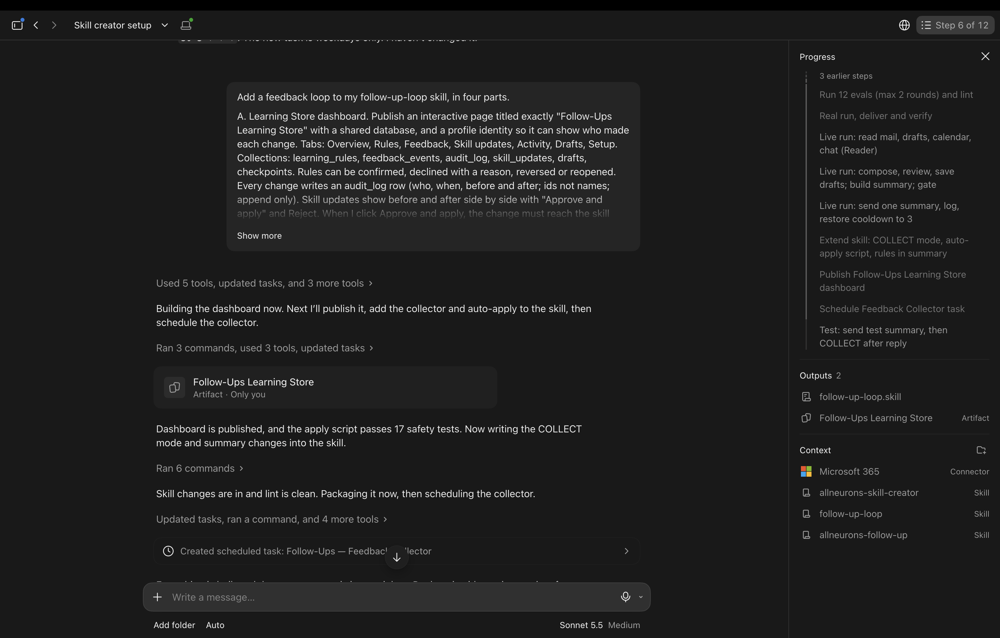
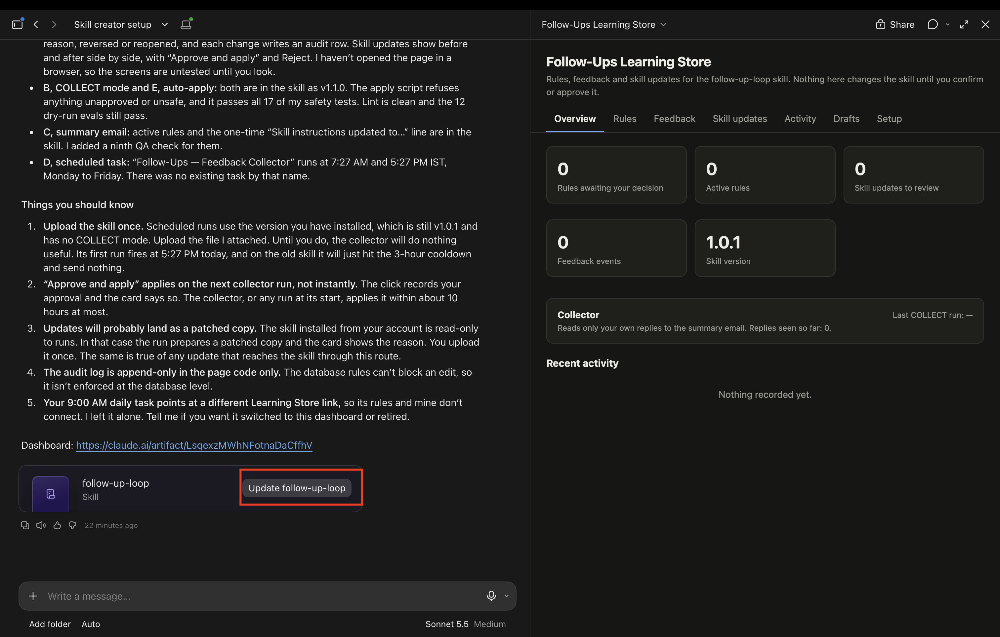

# Module 3: Add a Feedback Loop So Your Skill Learns on Its Own

## Table of Contents

- [What You Will Learn](#what-you-will-learn)
- [The Problem: A Skill That Never Learns](#the-problem-a-skill-that-never-learns)
- [What Is a Feedback Loop?](#what-is-a-feedback-loop)
- [The Four Parts of the Loop](#the-four-parts-of-the-loop)
  - [Part A: The Learning Store (the dashboard)](#part-a-the-learning-store-the-dashboard)
  - [Part B: COLLECT Mode (reading your replies)](#part-b-collect-mode-reading-your-replies)
  - [Part E: AUTO-APPLY (writing the change into the skill)](#part-e-auto-apply-writing-the-change-into-the-skill)
  - [Part C: The Summary Email Uses Your Rules](#part-c-the-summary-email-uses-your-rules)
  - [Part D: Schedule the Collector](#part-d-schedule-the-collector)
- [Why This Is Safe](#why-this-is-safe)
- [Two Ways to Add the Loop](#two-ways-to-add-the-loop)
  - [Option A: Use Our Skill (Fastest)](#option-a-use-our-skill-fastest)
  - [Option B: Build It with the Prompt](#option-b-build-it-with-the-prompt)
  - [Why This Prompt Works](#why-this-prompt-works)
- [Step 4: Prove the Loop Works (10 Minutes)](#step-4-prove-the-loop-works-10-minutes)
  - [How to Know You Passed](#how-to-know-you-passed)
- [Things to Know](#things-to-know)
- [Common Mistakes](#common-mistakes)
- [Quick Check](#quick-check)
- [Key Takeaways](#key-takeaways)

## What You Will Learn

In this lesson you will be learning how to make your skill get better over time, using nothing more than your replies to its daily email.

By the end of this lesson, you will be able to:

- Explain what a feedback loop is and why a skill needs one
- Understand the four parts of the loop: collect, review, apply, use
- Build the loop into your `follow-up-loop` skill with one prompt
- Understand why the loop is safe, even though the skill edits itself
- Prove that it works with a simple 10-minute test

In Module 2 you scheduled a skill that runs by itself every weekday. Now let's make sure it does not stay as good (or as bad) as it was on day one.

---

## The Problem: A Skill That Never Learns

Your `follow-up-loop` skill runs every weekday at 4 PM. On day one it is decent. Then you start reading the emails and notice things:

- "I wish the deadlines were at the very top."
- "Stop flagging this client, we already handled it."
- "My drafts are too long."

What do you do today? You open the skill, find the right file, edit it, hope you did not break anything, and test again. Most people do this once or twice, and then they stop. The skill stays at version one forever.

The fix is simple to say: **you are already giving feedback by reading the email. What if you could just reply to it, and the skill learned from your reply?**

That is a feedback loop.

---

## What Is a Feedback Loop?

A feedback loop is a cycle where the **output** of a system comes back as **input** to improve it.

You already know feedback loops:

- A thermostat measures the room, then adjusts the heater, then measures again
- A teacher gives comments on your essay, and your next essay is better

For our skill, the loop looks like this:

```
Skill runs and sends you the summary email
            ↓
You reply with a change you want
            ↓
COLLECT: the skill reads your reply and records it
            ↓
REVIEW: you confirm or reject it on a dashboard
            ↓
APPLY: the approved change is written into the skill
            ↓
Next run: the summary follows your new rule
            ↓
(back to the top)
```

The loop never closes without you. **Nothing changes until a person approves it.** That one idea is what makes it safe, and we will come back to it.

---

## The Four Parts of the Loop

We will add four things to the skill. Here they are in plain words.

### Part A: The Learning Store (the dashboard)

This is a web page where you review everything the skill has learned. It is called **"Follow-Ups Learning Store"** and has a shared database behind it.

It has seven tabs:

| Tab | What it shows |
|---|---|
| **Overview** | A quick summary of where things stand |
| **Rules** | Rules the skill proposed from your feedback. You can confirm, decline (with a reason), reverse, or reopen them |
| **Feedback** | Every reply you sent, recorded as an event |
| **Skill updates** | Proposed changes to the skill's own instructions, shown before and after, side by side |
| **Activity** | A log of every change: who did it, when, and what it looked like before and after |
| **Drafts** | The reply drafts the skill has created |
| **Setup** | Settings and connection details |

It stores its data in six collections: `learning_rules`, `feedback_events`, `audit_log`, `skill_updates`, `drafts`, and `checkpoints`.

Two details matter a lot:

- **Every change is written to the audit log.** Who, when, and the before and after. It only ever gets added to. Nothing is edited or deleted. If something goes wrong later, you can see exactly what happened.
- **The dashboard knows who you are.** It uses your profile, so each change shows who made it.

### Part B: COLLECT Mode (reading your replies)

COLLECT is a second way of running the same skill. You do not need a separate skill.

In COLLECT mode, the skill looks for **your replies to its summary email** and turns them into feedback events. Here is how it stays accurate:

- It only reads **your** replies, where the subject starts with "Re:" (any capital or small letters) followed by "Follow-ups ready for review". Replies from other people are ignored.
- It **drops the quoted original** text, so it only reads what you actually wrote.
- It **counts each reply once**. When you reply to yourself, the message shows up twice: once in Sent and once in Inbox. The skill uses the message's `internetMessageId` to spot the copy.
- It records **one event per reply**.

Then it sorts what you said:

- A **clear instruction** (like "always list deadlines first") becomes a **proposed rule**. A proposed rule does nothing until you confirm it on the dashboard.
- A **lasting change to how the skill works** becomes a **proposed skill update**, with the before and after text.

### Part E: AUTO-APPLY (writing the change into the skill)

This is the clever part. After you click **Approve and apply** on the dashboard, the change reaches the skill **by itself**. You never copy a command or paste anything into chat.

The collector, or any normal run at the start, picks up approved updates and applies them. But it follows strict rules first:

1. **Check a person approved it.** There must be an audit entry showing a human did it.
2. **Edit only allowed files.** Only the summary email file, the drafting style file, and the selection rules file.
3. **Replace the exact text.** The approved "before" text must appear exactly once in the file. It gets replaced with the approved "after" text, and nothing else.
4. **Refuse unsafe changes.** Any change that removes or weakens a safety rule is rejected. These rules are: drafts only, one email, the run lock, and the gates.
5. **Keep a backup** of the file before changing it.
6. **Bump the version** and add a **changelog** entry.
7. **Record it in the audit log.**
8. **If any check fails, change nothing.**

It uses a **script** for the edit, so it behaves the same way for every user every time, instead of Claude improvising a different edit each run.

Two limits to know about:

- Changes to `SKILL.md`, the config, or the safety rules are **never applied automatically**. They wait for your approval in chat.
- If the skill folder is **read-only** (for example, the skill was uploaded to a chat), the skill cannot edit itself. It makes a **patched copy** for you to upload once.

### Part C: The Summary Email Uses Your Rules

Once a rule is confirmed, the next summary email follows it. The first time the skill version changes, the email also shows one line:

> Skill instructions updated to <version>: <what changed>

So you always know when and why the skill changed.

### Part D: Schedule the Collector

The collector needs to run by itself too, otherwise you would have to remember to ask for it. We schedule a second task named **"Follow-Ups — Feedback Collector"** that runs at **7:27 AM and 5:27 PM, Monday to Friday**, in your time zone.

Why those times? It runs once before your day starts and once after the 4 PM summary has had time to be read and replied to. The odd minute (27) is on purpose, so it does not run at the exact moment many other scheduled jobs start.

---

## Why This Is Safe

A skill that edits itself sounds risky. Here is why this design is careful:

| Risk | How the design handles it |
|---|---|
| The skill changes itself without you knowing | Nothing applies until you approve it on the dashboard. Every approval is in the audit log |
| A bad edit breaks the skill | The edit replaces only exact approved text, keeps a backup, and changes nothing if any check fails |
| The skill weakens its own safety rules | Changes that remove "drafts only", "one email" or the run lock are refused |
| Someone else's email changes your skill | Only your own replies are read |
| A mistake you cannot trace | The audit log records who, when, before and after, and is append-only |
| Changes to the most sensitive files | `SKILL.md`, the config and safety rules always need your approval in chat |
| The email text hijacks the skill | Mail content is treated as data, never as instructions |

The rule to remember: **the skill may propose anything, but only a person can approve, and only a small safe area can be changed automatically.**

---

## Two Ways to Add the Loop

You have two options. Pick one.

### Option A: Use Our Skill (Fastest)

We have already built the feedback loop into the `follow-up-loop` skill and tested it for you. This version already includes the Learning Store dashboard, COLLECT mode and the safe auto-apply step.

1. Download the skill from here: **[⬇ Download follow-up-loop 1 (1).skill](https://pragyaallc-my.sharepoint.com/:u:/g/personal/anushka_srivastava_legalgraph_ai/IQAhRvEM123JQItEec8NIaK5AeJo1YnDnjsL9GOLHxcy3ow?e=cNZKrs)**
2. In Claude, open **Customize** from the left sidebar.
3. Click **Add** at the top right of the Skills page.
4. Choose **Upload skill** and select the `follow-up-loop 1 (1).skill` file you just downloaded. (Your browser may name it slightly differently, for example `follow-up-loop.skill`. That is fine.)
5. Check the preview shows `follow-up-loop`, then click **Upload**.
6. To confirm it worked, search for `follow-up-loop` under **Customize → Skills**. It should be listed under **Yours**.

> **If you already have `follow-up-loop` from Module 2:** this version replaces it. Remove the old one first (or accept the replacement if Claude asks), so you do not end up with two skills of the same name.

7. Start a new Claude session and say **"run follow-up-loop"**. Make sure your mail and calendar connectors are connected first.
8. When Claude asks whether to set up the Learning Store and the scheduled tasks, say **yes**. It creates the **Follow-Ups Learning Store** dashboard and the collector task for you. Open the Learning Store link in its answer and check that it loads (it is empty at first).

Then go to **Step 4: Prove the Loop Works** below. You do not need to paste the Option B prompt.

> **Note:** setting up the dashboard and the schedule needs a session that has a scheduled-task tool and an artifact tool (Cowork or Claude Code). In a plain chat the skill still runs, but it shows a "Set-up still needed" card instead. Follow the card, then say "follow-up-loop status" to confirm.

### Option B: Build It with the Prompt

Use this option if you want to learn by doing, or if you want to shape the loop yourself.

Make sure `follow-up-loop` is installed and working from Module 2. Then start a new Claude session and paste this prompt.

```text
Add a feedback loop to my follow-up-loop skill, in four parts.

A. Learning Store dashboard. Publish an interactive page titled exactly "Follow-Ups Learning Store" with a shared database, and a profile identity so it can show who made each change. Tabs: Overview, Rules, Feedback, Skill updates, Activity, Drafts, Setup. Collections: learning_rules, feedback_events, audit_log, skill_updates, drafts, checkpoints. Rules can be confirmed, declined with a reason, reversed or reopened. Every change writes an audit_log row (who, when, before and after; ids not names; append only). Skill updates show before and after side by side with "Approve and apply" and Reject. When I click Approve and apply, the change must reach the skill automatically: I must never be asked to copy a command or paste anything into chat. If applying fails, the card shows the reason and a fallback.

B. COLLECT mode inside the skill, so no separate skill is needed. It reads MY replies to the summary email (subject starts with "Re:" in any letter case, then "Follow-ups ready for review"), skips everyone else's, drops the quoted original, dedupes by the message's internetMessageId (a reply to myself exists twice in Inbox and Sent), and records one event per reply. A clear instruction becomes a PROPOSED rule. A proposed rule does nothing until I confirm it on the dashboard. A lasting change to the skill's own steps becomes a proposed skill update with before and after text.

E. AUTO-APPLY. The collector (or any run, at the start) applies a skill update I approved on the dashboard. It must: confirm the approval came from a person (an audit entry), edit only the allowed reference files (summary email, drafting style, selection rules), replace exactly the approved before text (which must appear exactly once) with the approved after text, refuse any change that removes or weakens a safety rule (drafts only, one email, run lock, gates), keep a backup, bump the version, add a changelog entry, record it in the audit log, and change nothing if any check fails. Use a script for the edit so it behaves the same for every user. Changes to SKILL.md, the config or the safety rules are never applied automatically: they wait for my approval in chat. If the skill folder is read-only, produce a patched copy for me to upload once.

C. The summary email applies my active rules, and shows one line "Skill instructions updated to <version>: <what changed>" the first time the version changes.

D. Schedule a task named "Follow-Ups — Feedback Collector" at 7:27 AM and 5:27 PM, Monday to Friday, in my time zone, with the prompt: "Run the follow-up-loop skill in COLLECT mode. Unattended. Ask nothing." Check for an existing task first. No duplicates.

Then test it: send me a test summary, I will reply with a change, then run COLLECT and show me the new event and proposed rule on the dashboard.
```

**What you will see:** Claude works through the parts one at a time. It builds and publishes the **Follow-Ups Learning Store** dashboard, adds COLLECT mode and the auto-apply step to the skill, and creates the **Follow-Ups — Feedback Collector** scheduled task.



**Install the updated skill once.** When Claude finishes, it shows a summary, a link to the dashboard, and a card for the updated `follow-up-loop` skill. Click **Update follow-up-loop** on that card. Scheduled runs use the version you have installed, so until you click it, the collector will not have COLLECT mode and will do nothing useful.



On the right you can see the new dashboard. It starts empty: 0 rules, 0 feedback events and nothing recorded yet. It fills in as you reply to your summary emails.

### Why This Prompt Works

It uses the same habits you learned in the earlier modules.

- **Split into labeled parts (A to E).** Claude can build and check one part at a time.
- **Says exactly what must be true.** For example: "The change must reach the skill automatically. I must never be asked to copy a command." This removes guessing.
- **Names the data.** Tabs and collections are listed, so the dashboard comes out the way you expect.
- **Puts the safety rules in writing.** Refuse unsafe changes, keep a backup, change nothing if a check fails.
- **Asks for a script for the risky part.** A script does the same thing every time. A language model might not.
- **Ends with a test.** It does not stop at "build it." It asks Claude to prove it works.

> **A note, like in Module 2:** Claude builds this fresh each time, so what you get may look a little different from what we show here. Read the dashboard and the skill changes it makes, and ask Claude to fix anything that does not match the prompt.

---

## Step 4: Prove the Loop Works (10 Minutes)

Do not trust a loop until you have watched it close once.

**1. Reply to the summary email.**

Open the summary email in your inbox and reply with a change you want. For example:

> Always list deadlines first in the summary.

**2. Run the collector.**

Tell Claude: **Collect feedback.**

**3. Open the dashboard and look at three tabs.**

- **Feedback tab:** your reply appears as an event.
- **Rules tab:** a proposed rule appears. Click **Confirm**.
- **Activity tab:** shows who confirmed it, when, and the status before and after.

**4. If your reply changed how the skill works, approve the update.**

If your reply was a lasting change to how the skill works, the **Skill updates** tab shows it with a before and after side by side. Click **Approve and apply**. That is all. There is nothing to copy and nothing to say in chat.

**5. Wait for it to apply, or apply it now.**

The card changes to **queued**. The collector applies the change on its next run (7:27 AM or 5:27 PM on weekdays). To apply it now, tell Claude: **Collect feedback.**

When it is applied, the card changes to **applied** with the new version number. The Activity tab shows who approved it and when. The skill's `CHANGELOG` has a new entry and the version has moved up by one.

**6. Run the skill again.**

Run the skill again, or wait for the next scheduled run. The summary follows your rule. The first run after a skill update shows one line:

> Skill instructions updated to <version>

### How to Know You Passed

You can point to all five of these:

1. The **event** (Feedback tab)
2. The **rule** (Rules tab)
3. The **audit entry** (Activity tab)
4. The **version bump** (the skill's changelog)
5. The **changed summary** (the next email follows your rule)

---

## Things to Know

**Safe by design.** The skill applies only the exact wording you approved. It refuses any change that would remove a safety rule (drafts only, one email, the run lock). It keeps a backup and changes nothing if any check fails. Changes to `SKILL.md` or the safety rules are never applied automatically. Those still need your approval in chat.

**If apply fails.** The card shows the reason and a fallback command. The most common cause is that the file changed after the change was proposed. The "before" text no longer matches exactly once, so the skill refuses to guess.

**If your skill was uploaded to a chat.** Its folder is read-only, so the skill cannot edit itself. It produces a patched copy for you to upload once.

**A reply to yourself exists twice.** When you reply to your own email, it sits in both Sent and Inbox. The skill counts it once, using the message's `internetMessageId`. This was a real bug that testing caught, which is a good reason to test with real replies and not only with ideas.

---

## Common Mistakes

| Mistake | What happens | Fix |
|---|---|---|
| Replying to the wrong email | The collector ignores it | Reply to the summary email so the subject starts with "Re: Follow-ups ready for review" |
| Giving vague feedback ("make it better") | No clear rule can be made | Write one clear instruction: "Always list deadlines first" |
| Confirming a rule you did not read | A rule you did not want becomes active | Read each rule on the Rules tab, decline with a reason if it is wrong |
| Expecting changes before approval | Nothing happens | Confirm the rule or approve the update on the dashboard first |
| Skill folder is read-only | Auto-apply fails | Upload the patched copy the skill produces |
| Never checking the Activity tab | You lose track of what changed | Scan it weekly to see who changed what |

---

## Quick Check

Try answering these before moving on:

1. What is a feedback loop, in one sentence?
2. Why does a proposed rule do nothing until you confirm it?
3. Why does the skill use a script to edit its own files?
4. Name two kinds of changes that are never applied automatically.
5. Why does the collector count a reply to yourself only once?

---

## Key Takeaways

- A feedback loop turns your replies into improvements, so the skill gets better over time instead of staying at version one.
- The loop has four parts: the **dashboard** to review, **COLLECT** to read replies, **AUTO-APPLY** to write approved changes, and a **schedule** so it runs by itself.
- Nothing changes until a person approves it. The skill may propose, only you can approve.
- Auto-apply is narrow and careful: exact text only, allowed files only, safety rules protected, backup kept, and nothing changes if a check fails.
- Every change is recorded in an append-only audit log.
- Always prove the loop works with a real reply before you trust it.

At this point, you have a skill that runs on its own, listens to your feedback, and improves with your approval. That is the full feedback loop. From here you can use the same pattern for any skill you build.
