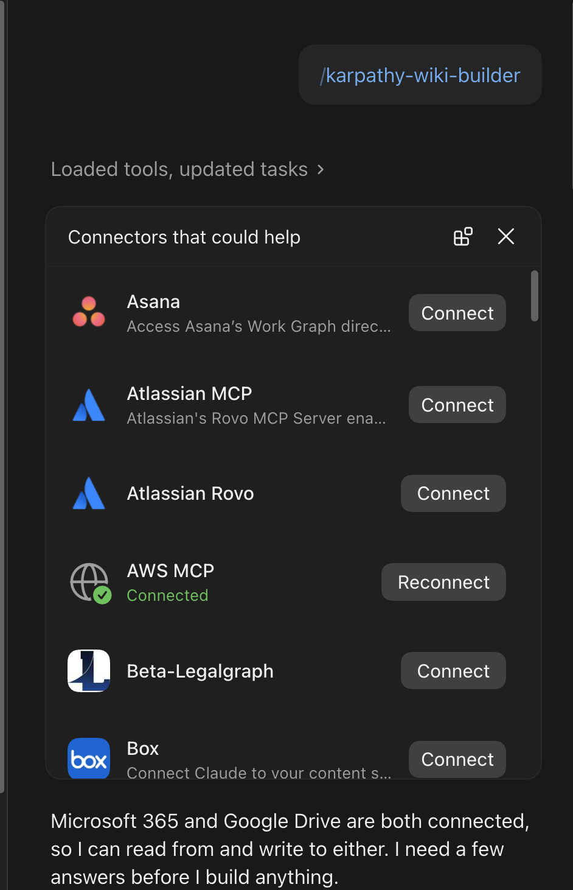
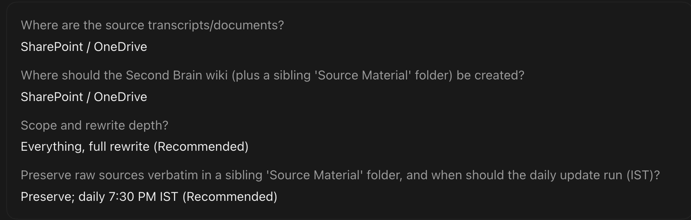
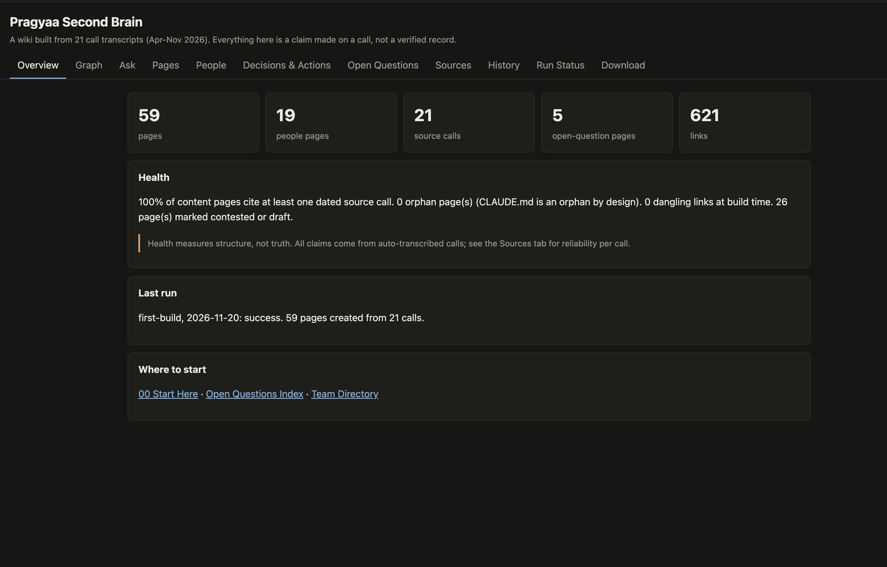
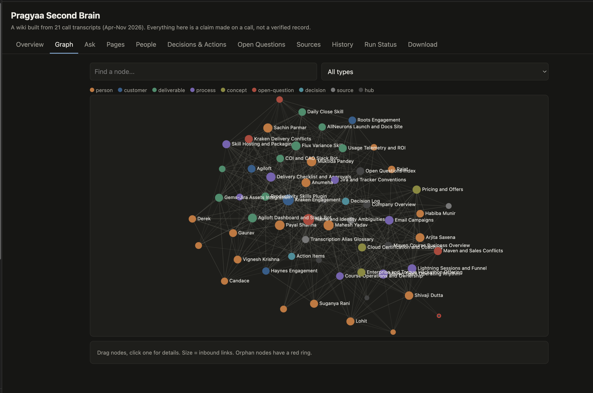
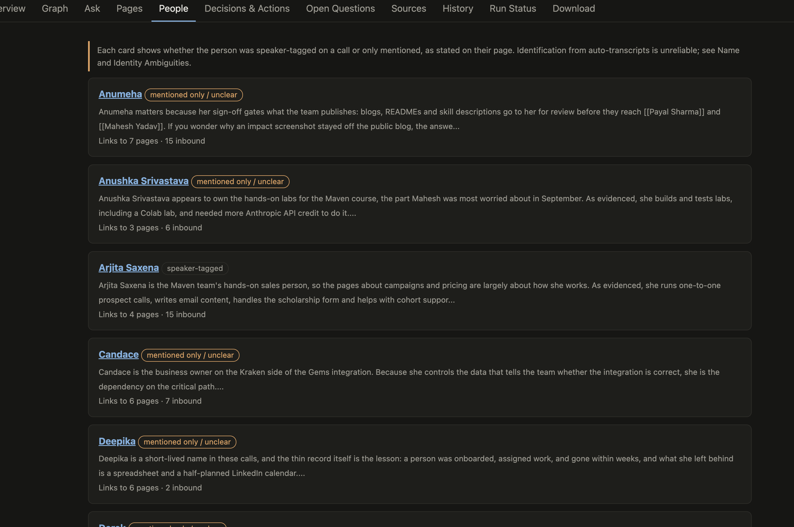

# Module 4: Build a Second Brain from Your Meeting Transcripts

## What You Will Learn

In this lesson you will be learning how to turn a pile of meeting transcripts into a wiki that you can browse in Obsidian and that Claude can answer questions from.

By the end of this lesson, you will be able to:

- Explain what a second brain is and why transcripts alone are not one
- Pull transcripts from SharePoint and turn them into a linked wiki
- Understand what Graphify is and why we use it to connect your transcripts
- Open that wiki in Obsidian and move around it
- Ask Claude a question and see the difference between "before" and "after"
- Keep the wiki fresh as new meetings happen

In the last three modules you built a skill, scheduled it, and gave it a feedback loop. Now let's give Claude something it usually lacks: your memory.

---

## The Problem: Knowledge Buried in Transcripts

Think about how many meetings you have had this year. Most of them were recorded. The transcripts are sitting in SharePoint, one file per meeting, named something like `Weekly Sync 2026-03-14.docx`.

So the information exists. But can you use it?

- You remember a decision was made, but not in which meeting.
- A new teammate asks "why did we choose this vendor?" and nobody can answer quickly.
- To find one fact you would have to open ten transcripts and read them.

Transcripts are **raw material**. They are long, repeat themselves, jump between topics, and are organized by *date*, not by *idea*. They are good for record keeping and bad for finding things.

## What Is a Second Brain?

A second brain is a place outside your head where your knowledge is stored **in a form you can find and use again**.

The key words are "find" and "use again". A folder of transcripts stores knowledge. A second brain **organizes** it.

The difference looks like this:

| | Folder of transcripts | Second brain (wiki) |
|---|---|---|
| Organized by | Date of the meeting | Topic, person, decision, project |
| One question needs | Reading many files | Opening one or two pages |
| Connections | None. You hold them in your head | Links between related pages |
| Can say "I'm not sure" | No | Yes, when sources disagree or are thin |
| Can you trace a claim? | Only by re-reading | Every claim points back to its source meeting |

## Why a Wiki, and Why Obsidian?

A wiki is a set of short pages that link to each other. One page for a client. One for a project. One for a person. One for a decision. Each page links to the others it relates to.

**Obsidian** is a free note app that works on plain text files in a normal folder. That makes it a perfect viewer for what Claude writes:

- Claude writes `.md` (markdown) files into a folder.
- You open that folder in Obsidian as a **vault**.
- Links written as `[[Page Name]]` become clickable.
- **Backlinks** show you every page that mentions the one you are on.
- **Graph view** draws your whole knowledge as a map of connected dots.

There is no database and no special server. If you stop using Obsidian tomorrow, you still have a folder of readable files.

---

## The Tool We Use: Graphify

This module's skill works alongside **Graphify**, a tool that builds and queries knowledge graphs.

The skill builds its own **entity graph** from your pages: a map of the people, topics and decisions in your meetings and how they link. That graph is what powers the **Graph** tab of your Second Brain page, so the page works from the graph file alone.

Graphify is used on top of that, when it is connected in Claude:

- **To cross-check structure.** If your wiki lives in a repository Graphify has indexed, the skill can use it to check how the pages connect.
- **To remember key facts.** The skill can store short, lasting facts, such as a settled decision or a named owner, so Claude can recall them later.

Graphify is **optional**. If it is not connected, the skill says so in one line and carries on. You do not need to set it up to finish this module.

> **Note:** Graphify is an open-source tool and its install steps change between versions. If you want to try it, check its [GitHub README](https://github.com/safishamsi/graphify) for the latest instructions.

---

## How It Works: The Big Picture

```
SharePoint transcripts
        ↓  fetch
Raw transcripts saved in a "sources" folder (kept as they are)
        ↓  read and understand (Graphify)
Graphify builds a knowledge graph of people, topics, decisions and open questions
        ↓  write
A wiki: one short page per idea, linked together
        ↓  open
Obsidian shows it with links, backlinks and a graph
        ↓  ask
Claude answers your questions from the wiki, with sources
```

Three ideas make this work well. Remember them, because they are what separate a good wiki from a pile of summaries.

### Idea 1: Write ideas, not meeting notes

A bad wiki has one page per meeting, each a summary. That is just the transcripts again, only shorter.

A good wiki has one page per **thing that matters**: a client, a decision, a person, a recurring problem. Information from many meetings is gathered onto that one page.

### Idea 2: Keep the raw sources, and link back to them

Claude rewrites the transcripts into clear pages. That is useful, but any rewrite can lose or twist something. So the original transcripts are saved untouched in a `sources` folder, and every important claim on a wiki page says **which meeting it came from**.

If you ever doubt a page, you click through and check. A wiki you cannot verify is a wiki you cannot trust.

### Idea 3: Be honest about what is not known

If two meetings disagree, the page says they disagree. If a decision was only discussed and never confirmed, the page says it was only discussed. The most dangerous wiki is the one that states a guess as a fact.

We ask for this on purpose in the prompt below.

---

## Build It: Step by Step

### Before You Start

You need three things:

1. **Obsidian** installed on your computer (it is free).
2. A **connector to SharePoint** (your Microsoft 365 connector) turned on in Claude, so Claude can search and read the files.
3. To know **where your transcripts live**: the SharePoint site and folder name.

> **A note on privacy.** Meeting transcripts often contain sensitive things like names, money, and people's opinions. The wiki is saved on **your own computer**. Only build it from transcripts you are allowed to use, and do not share the vault folder with people who should not see the meetings.

### Step 1: Create the folder for your vault

Make an empty folder anywhere on your computer. For example, `my-second-brain`. Open Claude Code in that folder. Claude will write everything inside it.

### Step 2: Get the Skill

You have two options, just like in Module 2. Pick one.

> **A note before you pick:** The skill you build yourself in Option B may not match the one we provide in Option A. Claude writes things fresh each time, so the steps, page names and wording can come out different. If you build it yourself, expect to read what it wrote and fix a few things. This is normal. Our provided skill is the safe version to compare against.

#### Option A: Use Our Skill (Fastest)

We have already built and tested a second brain skill for you. It is called `karpathy-wiki-builder`. It writes the wiki in plain, first-principles prose, keeps your raw sources next to it, and publishes a **Second Brain** page you can browse.

1. Download the skill from here: **[⬇ Download karpathy-wiki-builder.skill](assets/karpathy-wiki-builder.skill?raw=true)**
2. In Claude, open **Customize** from the left sidebar.
3. Click **Add** at the top right of the Skills page.
4. Choose **Upload skill** and select the `karpathy-wiki-builder.skill` file you just downloaded. (These are the same steps you used in [Module 1](../module-1-what-are-skills/Readme.md).)
5. Check the preview, then click **Upload**.
6. Start a new Claude session and type `/karpathy-wiki-builder`. Claude checks which connectors you have. Microsoft 365 or Google Drive needs to be connected so it can read your transcripts.



7. Claude asks you a few questions before it builds anything: where the transcripts are, where to create the wiki, how much to rewrite, and when the daily update should run. For each one, **select the recommended option** (or the place your files really live).



8. The skill reads your transcripts, shows you a plan, and waits for your OK before it writes anything. Go to Step 3.

#### Option B: Build It with a Prompt

Use this option if you want to learn by doing, or shape the wiki around your own habits. Paste this prompt instead:

```text
Build me a second brain wiki from my meeting transcripts.

SOURCE
My meeting transcripts are in SharePoint, in <SITE NAME> > <FOLDER PATH>. First confirm my SharePoint connector works with one cheap search. If it does not answer, stop and tell me to connect it. Do not guess.

FETCH
List every transcript in that folder (filename, date, size) and show me the count before downloading. Then save each one, unchanged, into a folder called sources/. Never edit these files. If a file cannot be read, list it at the end instead of skipping silently.

PLAN FIRST
Before writing any page, read all the transcripts and show me a plan: the list of people, clients or projects, topics, and decisions you found, and the page titles you propose. Wait for my OK before writing.

WRITE THE WIKI
Create an Obsidian-ready vault in a folder called wiki/. Rules:
- One page per idea (a person, a client, a project, a topic, a decision). NOT one page per meeting.
- Plain, simple language. Short paragraphs. Explain things so a new teammate could follow.
- Link related pages with [[wikilinks]], using the exact same page titles everywhere.
- Every important claim names the source transcript it came from, as a link to the file in sources/.
- Be honest about uncertainty. If meetings disagree, say so. If something was only discussed and not decided, say so. Never state a guess as a fact.
- Put a "Start Here" page at the top that explains how the wiki is organized and links to the main sections.
- Put an "Open Questions" page that collects everything unresolved.
- Add a small file called AGENTS.md at the root that tells any AI assistant how to use the wiki: read Start Here first, answer from the wiki, cite pages, and say when the wiki does not know.

CHECK YOUR WORK
When finished, check that every [[link]] points to a page that exists, every page links to at least one other page, and every claim has a source. Fix anything that fails, then show me the list of checks and whether each passed.

THEN
Tell me how many pages you created, and how to open the wiki folder in Obsidian.
```

Fill in the `< >` parts with your real SharePoint site and folder, whichever option you picked.

### Step 3: Review the plan

Claude (or the skill) will stop and show you a plan before writing. This is your chance to steer. Look at it and ask:

- Are the right people and clients on the list?
- Is anything missing that matters?
- Is anything on the list that should stay private or be left out?

Reply with changes, or say "looks good, go ahead."

### Step 4: Open it in Obsidian

1. Open Obsidian.
2. Choose **Open folder as vault**.
3. Pick the `wiki/` folder (or the parent folder if you want `sources/` visible too).
4. Open the **Start Here** page.

Now try three things:

- **Click a link.** You jump to that page.
- **Look at backlinks.** Open a client page and check the side panel. It shows every page that mentions that client.
- **Open graph view.** You see your whole knowledge as connected dots. Big clusters are the things your meetings talk about most.

> **Your wiki will not look exactly like anyone else's.** That is fine, because everyone's meetings are different. Read a few pages and ask Claude to fix anything that is unclear, wrong, or missing a source.

### What the Finished Second Brain Page Looks Like

Option A also publishes a **Second Brain** page, so you can browse the wiki without opening Obsidian. The screenshots below come from a real team's 21 call transcripts. Yours will show your own meetings.

The **Overview** tab shows how many pages, people and sources there are, plus a health check: does every page cite a source, and are there broken links.



The **Graph** tab draws the whole wiki as a map. Each dot is a page, coloured by type (person, customer, process, decision and so on). Bigger dots have more links pointing to them. Drag, search or click a dot for details.



The **People** tab has one card per person. Each card says whether the person was speaker-tagged on a call or only mentioned, and links to their page. This is the "honest about what is not known" idea in practice.



---

## Before and After: Asking a Question

This is the part that shows why the wiki is worth building. The example below is **made up** to show the idea. Your own results will depend on your own meetings.

Imagine you ask the same question both times:

> **"Why did we decide to move the Acme account to annual billing, and who agreed to it?"**

### Before: Asking Without the Wiki

Claude has no memory of your meetings. It has two bad choices.

**Choice 1: It does not know.**

> "I don't have information about your Acme account or billing decisions. If you can share the relevant notes or meeting records, I can help."

**Choice 2: You make it search the raw transcripts.**

You ask it to dig through SharePoint. It opens files one at a time. It may read 40 transcripts, take several minutes, miss one that used different wording ("yearly plan" instead of "annual billing"), and then give you a long answer with no clear sense of how sure it is:

> "Based on a few transcripts, it seems like annual billing may have been discussed in March. Someone suggested it might help with cash flow. I'm not certain who agreed."

**What went wrong:**

- No answer, or a slow and uncertain one
- Easy to miss the right meeting
- Nothing to click and verify
- You get a different answer if you ask again tomorrow

### After: Asking With the Wiki

Now Claude opens `Start Here`, follows the link to the **Acme** page, and follows the link from there to the **Decision: Acme Annual Billing** page. That takes seconds.

> **Acme moved to annual billing in March.** The main reason was cash flow: Acme's finance team wanted one yearly invoice instead of twelve small ones (source: [[Acme Check-in 2026-03-06]]). Priya (account lead) proposed it, and Daniel (finance) approved it in the follow-up call a week later (source: [[Finance Sync 2026-03-13]]).
>
> **What is not settled:** The discount is not clear. One meeting mentions 10%, another says it is still to be decided. I would treat the discount as open.
>
> **Related pages:** [[Acme]], [[Priya]], [[Daniel]], [[Open Questions]]

**What got better:**

| | Before | After |
|---|---|---|
| Speed | Minutes of searching, or no answer | Seconds |
| Answer | Vague or "I don't know" | Specific: why, who, when |
| Trust | Nothing to check | Every claim links to its source meeting |
| Honesty | Guesses mixed in | Clearly says what is still open |
| Repeatable | Different each time | Same answer each time |
| Next step | Dead end | Links to related people and pages |

The wiki did not make Claude smarter. It gave Claude **organized memory to read from**, and that is the whole idea of a second brain.

### Try It Yourself

Ask your own before and after:

1. **Before:** Open a fresh Claude session in a folder that does **not** contain your wiki. Ask a question about a past decision. Note the answer.
2. **After:** Open Claude in your wiki folder. Ask the same question. Note the answer.
3. Compare them using the table above.

Good first questions to try:

- "What did we decide about <topic>, and who was in that decision?"
- "What do we know about <client>, and what is still open?"
- "What did I promise <person> in the last month?"
- "Where do our meetings disagree with each other?"

---

## Keeping the Wiki Fresh

A wiki that stops growing becomes out of date, and then people stop trusting it. New meetings happen every week, so the wiki needs to keep up.

If you are using our skill, just say **"Update my second brain with new meetings"**. If you built it with the prompt, paste this when you want to add new meetings:

```text
Update my wiki with new meeting transcripts.

1. Check my SharePoint connector works. If not, stop.
2. Find transcripts in <SITE NAME> > <FOLDER PATH> that are not already in sources/. Show me the list first.
3. Save the new ones, unchanged, into sources/.
4. Update the existing pages they affect. Do not create a new page if one already exists for that person, client or topic. Add the new facts with their source links.
5. If a new transcript contradicts an existing page, do not overwrite silently. Say what changed and add it to Open Questions.
6. Run the same checks as before (links work, every claim has a source) and show me the results.
```

You can use what you learned in Module 2 and schedule this to run once a week. You can also use what you learned in Module 3 and let your corrections feed back into how the wiki is written.

---

## Common Mistakes

| Mistake | What happens | Fix |
|---|---|---|
| One page per meeting | You rebuilt the transcripts, just shorter | Ask for one page per person, client, project, topic or decision |
| No sources linked | You cannot check anything | Require a source link on every important claim |
| Skipping the plan review | The wiki covers the wrong things | Always read the plan before Claude writes |
| Deleting the raw transcripts | You cannot verify the wiki later | Keep `sources/` untouched |
| Different names for the same thing | Links break, and the same client appears on two pages | Insist on one exact page title used everywhere |
| Guesses written as facts | People trust something that is wrong | Keep the "be honest about uncertainty" rule |
| Never updating | The wiki goes stale | Run the update prompt weekly |
| Sharing the vault freely | Private meeting content leaks | Share only with people who may see the meetings |

---

## Quick Check

Try answering these before moving on:

1. What is the difference between a folder of transcripts and a second brain?
2. Why should the wiki have one page per idea instead of one page per meeting?
3. Why do we keep the raw transcripts in a separate `sources/` folder?
4. What should the wiki do when two meetings disagree?
5. In the before and after example, what changed that made the answer better?

---

## Key Takeaways

- A second brain turns knowledge you already have into something you can find and use again.
- Transcripts are raw material, organized by date. A wiki is organized by idea, with links between pages.
- Obsidian opens a plain folder of markdown files and gives you links, backlinks and a graph view.
- Keep the raw sources untouched, and make every important claim link back to its source.
- A good wiki is honest about what is unknown or disputed.
- Always review the plan before Claude writes, then check that every link and source works.
- The before and after is the proof: the same question gets a slow, vague answer without the wiki, and a fast, sourced, honest answer with it.
- Update the wiki regularly, or it goes stale.

At this point, you have a skill that runs on its own, learns from your feedback, and now has a memory of your meetings to draw from. Together, these are the building blocks of an assistant that works the way you work.
