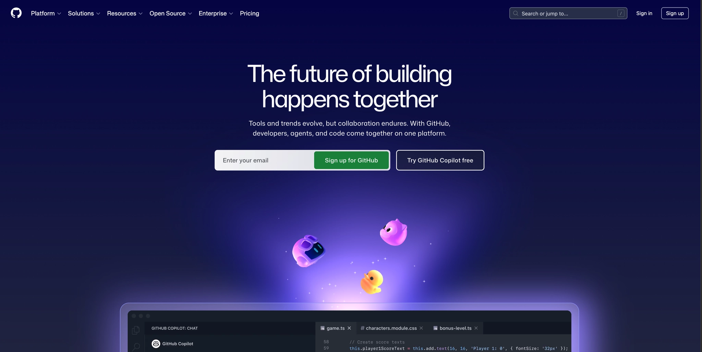
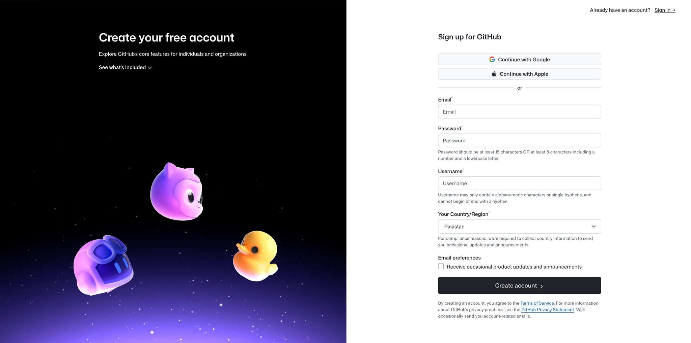
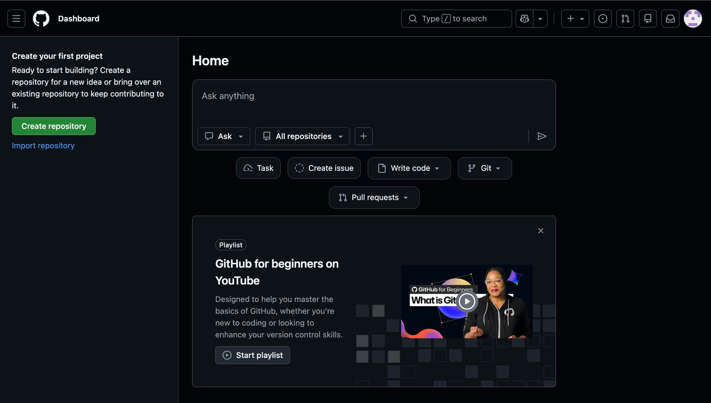
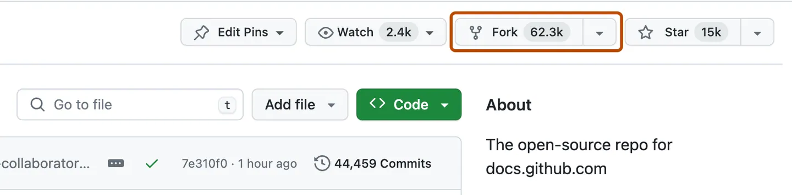
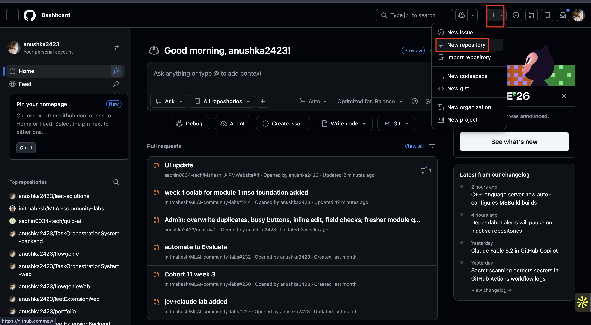
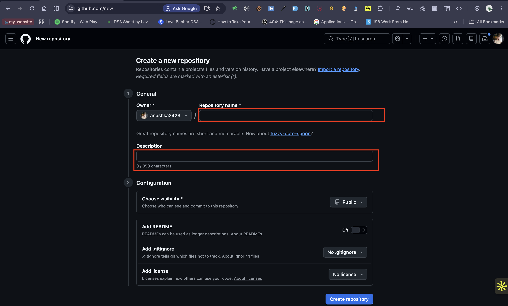
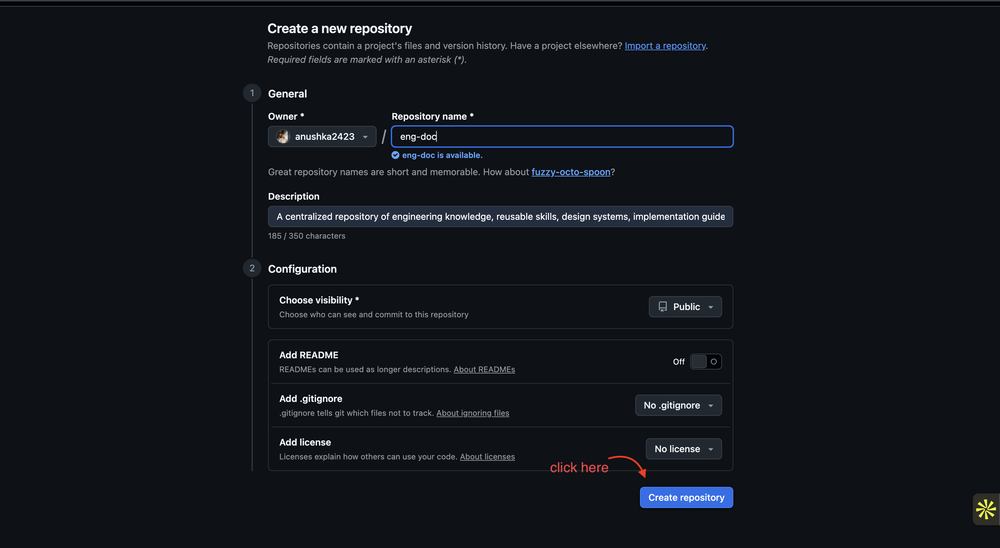
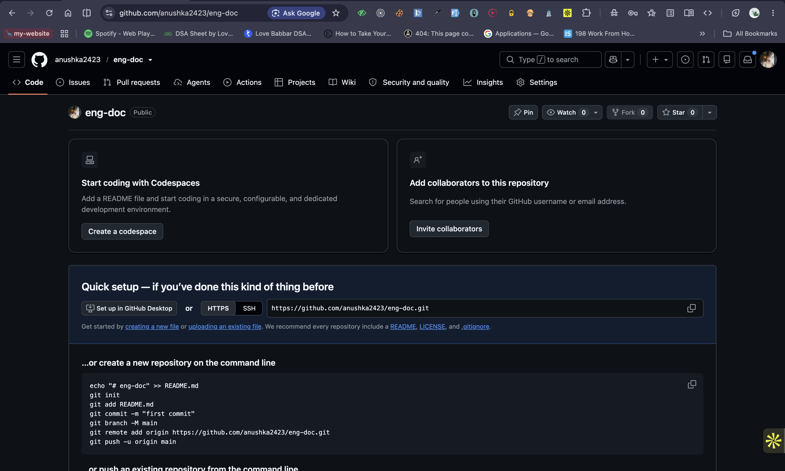

# Lesson 2.0 — Set Up Your GitHub Account

## Lesson overview

In this lesson you will create a **GitHub** account. You will:

- Learn what GitHub is and why PMs use it
- Sign up for a free GitHub account with your Google account
- Fork an existing repository
- Create your own first repository

By the end of this lesson, you'll have a GitHub account, a fork, and your first repo, ready for the labs ahead.

---

## Before you begin

- **Platform:** GitHub runs in your browser, so it works on **macOS and Windows**. There is nothing to install.
- **Subscription:** **Free**. No credit card needed.
- **You'll need:** a Gmail (Google) account.

---

## What is GitHub?

GitHub is the world's largest platform for hosting and working together on code. It uses **Git**, a version control system that tracks every change made to a file, by every person, at every point in time.

Think of it like **Google Drive for code**, with extra powers:

| Google Drive | GitHub |
|---|---|
| Stores files | Stores code + full change history |
| See who edited last | See every line changed, by whom, and why |
| Share a link | Fork, contribute, submit Pull Requests |
| No rollback | Go back to any earlier version |

### Why you need it as a PM

- Read and navigate the codebases your team works in
- Review Pull Requests and understand what's actually shipping
- Fork repos, run demos, and contribute to open source projects
- Work with engineers using the same tools they use every day

---

## Step 1: Open GitHub

In your browser, go to: **https://github.com**



---

## Step 2: Click Sign up

Click the **Sign up** button in the top right corner.


---

## Step 3: Click Continue with Google



---

## Step 4: Connect your Gmail account

Pick your Gmail account and follow the setup prompts. It takes less than 2 minutes.



---

> ✅ **Account created!** You now have a GitHub account. Keep your username handy, you'll use it in the labs ahead.

---

## Step 5: Fork a repository

Forking makes your own personal copy of someone else's repository. Your fork lives in your GitHub account, so you can edit it freely without changing the original project.

> **Why fork?** It's how you contribute to open source, try out someone else's code, or start from a template without touching the original.

We'll practice by forking the AI Community Site repo.

1. Open: **https://github.com/sachin0034-tech/ai-community-site**
2. Click the **Fork** button in the top right corner, next to the **Star** and **Watch** buttons.

   

3. In the dialog that opens:
   - **Owner:** select your GitHub username (not an organization)
   - **Repository name:** keep it as it is, or rename it
   - Leave **Copy the `main` branch only** checked
4. Click **Create fork**.
5. Wait a few seconds. GitHub takes you to your own copy at:

   ```
   https://github.com/<your-username>/ai-community-site
   ```

> ✅ **Fork complete!** Changes you make here won't affect the original. Later you can open a Pull Request to propose your changes back.

---

## Step 6: Create your first repository

A repository (or "repo") is a project folder on GitHub that stores your files and their full change history. Now you'll make one of your own.

1. Click the **+** icon in the top right corner of any GitHub page, then click **New repository**.
   (You can also go straight to **https://github.com/new**.)
   
2. Fill in the form:
   - **Owner:** your GitHub username [selected by deault]
   - **Repository name:** for example, `my-first-repo`
   - **Description:** optional, for example, `My first GitHub repo`
   - **Visibility:** choose **Public** (anyone can see it) or **Private** (only you can see it)

   

3. Click **Create repository**.

    

4. GitHub opens your new repo at:

   ```
   https://github.com/<your-username>/my-first-repo
   ```

   You'll see an empty repository.

   

> ✅ **You're done!** You have a GitHub account, a fork of the AI Community Site, and your own first repository.

---

## Fork vs. new repository: what's the difference?

| | Fork | New repository |
|---|---|---|
| **Starts from** | A copy of someone else's repo | Empty (or just a README) |
| **Linked to an original?** | Yes, you can send changes back with a Pull Request | No, it's fully yours |
| **Use it when** | You want to contribute to or build on an existing project | You're starting your own project |
