# Lesson 3.0 — Set Up n8n

## Lesson overview

In this lesson you will set up **n8n**, the workflow automation tool we will use to build agents in Week 1. You will:

- Create a free n8n Cloud account
- Verify your email and create your instance
- Answer the short welcome questions
- Open your first blank workflow

By the end of this module, you’ll have a working n8n instance, ready for the Week 1 lab.

---

## Before you begin

- **Platform:** n8n Cloud runs in your browser, so it works on **macOS and Windows**. There is nothing to install.
- **Subscription:** **14-day free trial**.

---

## Step 1: Open n8n and click Get started

1. In your browser, go to: **https://n8n.io/**
2. Click **Get started** (top right, or the button under the headline).

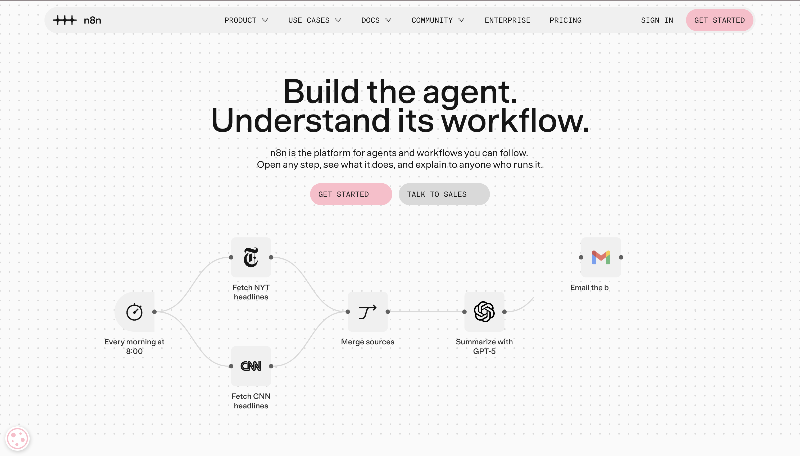

---

## Step 2: Enter your email

1. On the register page, **enter your email**.
2. Click **Continue**.

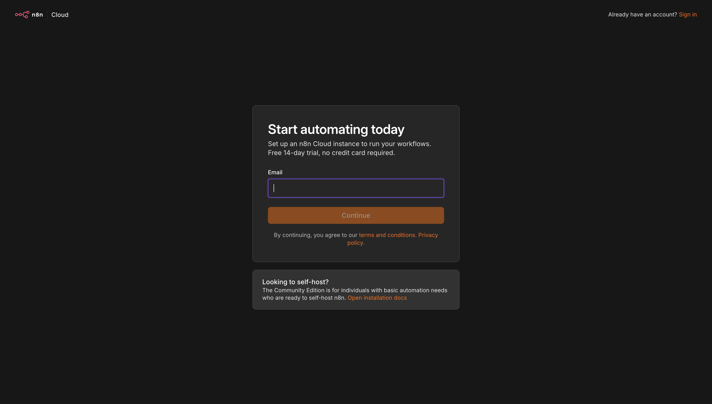

---

## Step 3: Verify your email

1. Open your inbox and find the email from n8n.
2. **Enter the 6-digit code (OTP)** on the screen to verify your email. You can also click the verification link in the email.
3. If you don’t see the email, check spam or click **Resend**.

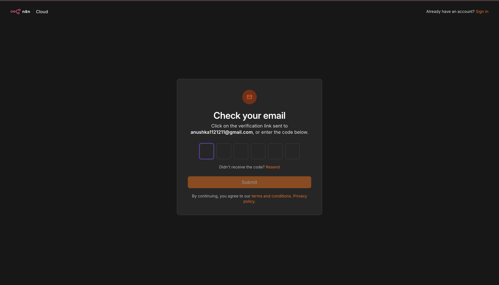

---

## Step 4: Finish creating your account

Fill in the three fields:

1. **Full name**
2. **Password** — at least 8 characters, with one number and one uppercase letter
3. **Instance name** — this becomes your instance URL (for example, `yourname.app.n8n.cloud`). Use only lowercase letters, digits, and hyphens.

Then click **Start free 14-day trial**.

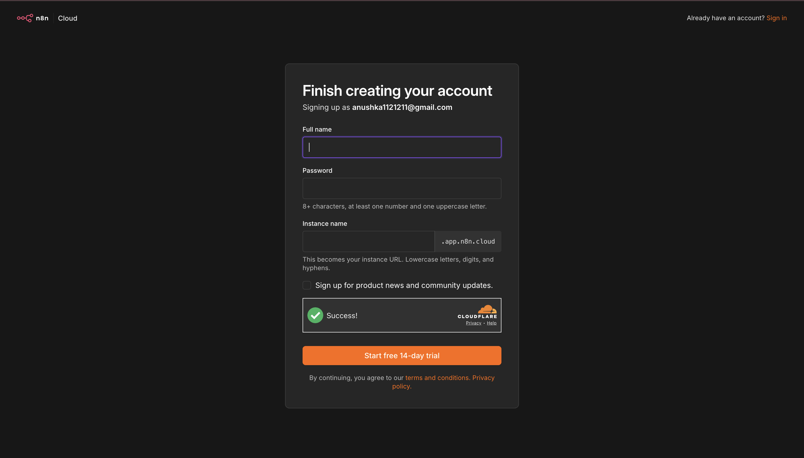

---

## Step 5: Answer the welcome questions

n8n will ask a few questions about you. Pick the answers below and click **OK** after each one.

**1. What is the size of your company?**

Pick **Only me**.

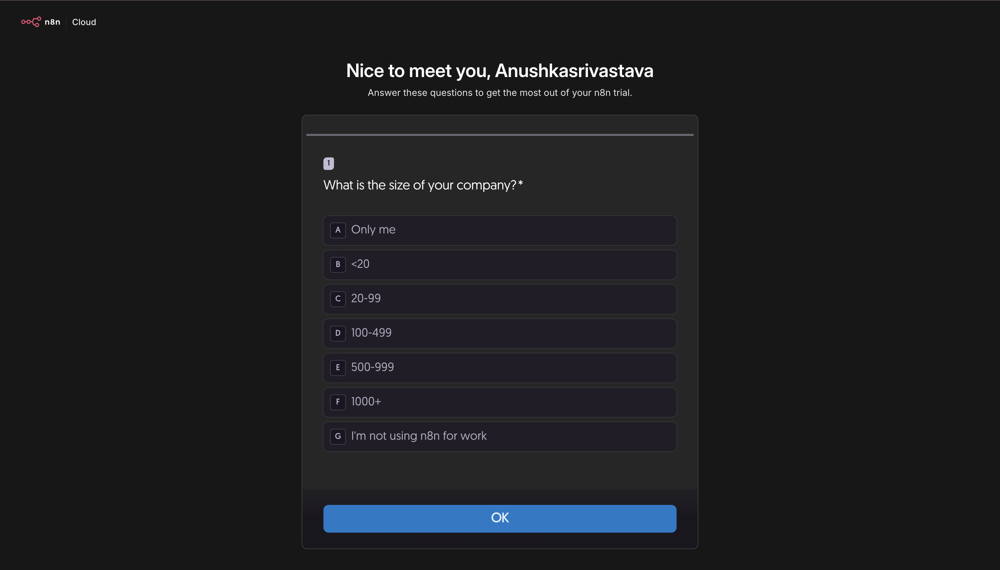

**2. What best describes your role?**

Pick **Product & Design**.

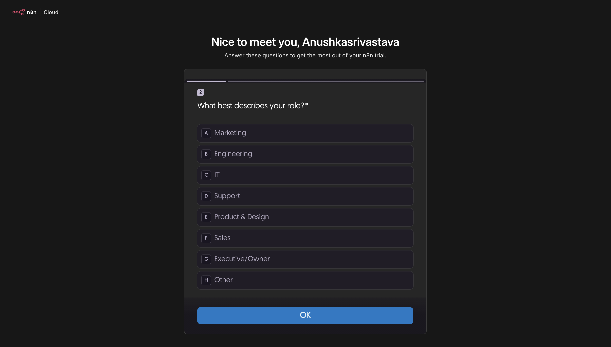

**3. How did you hear about n8n?**

Pick **Google**.

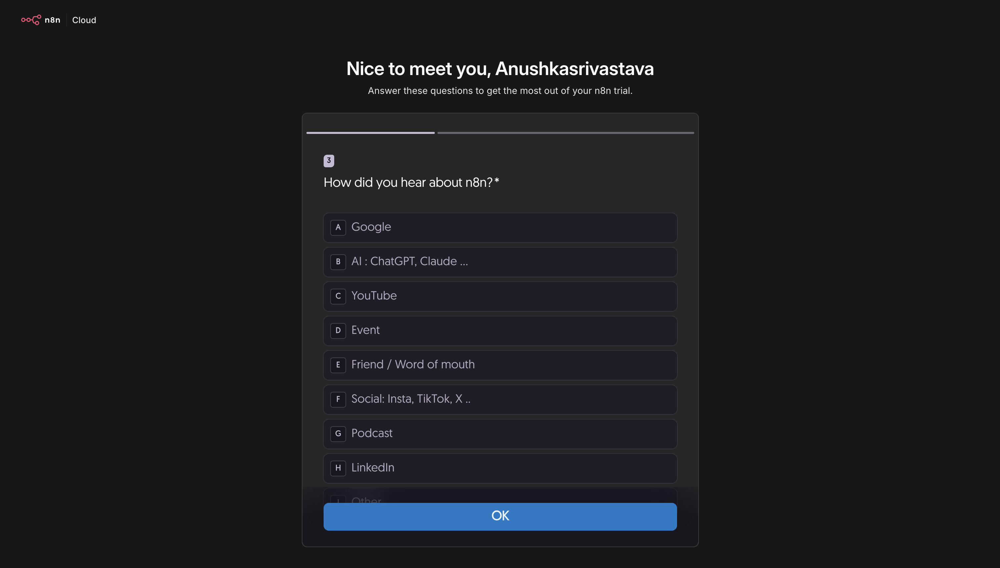

**4. Do you already know what you want to automate?**

Pick **Yes**.

**5. Which of these do you feel comfortable doing without AI?**

Pick **None of the above**, then click **OK**.

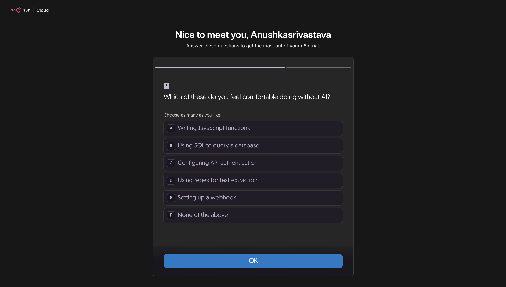

**6. Which AI tools do you use most?**

Pick **Claude (incl. Claude Code)**, then click **Submit**.

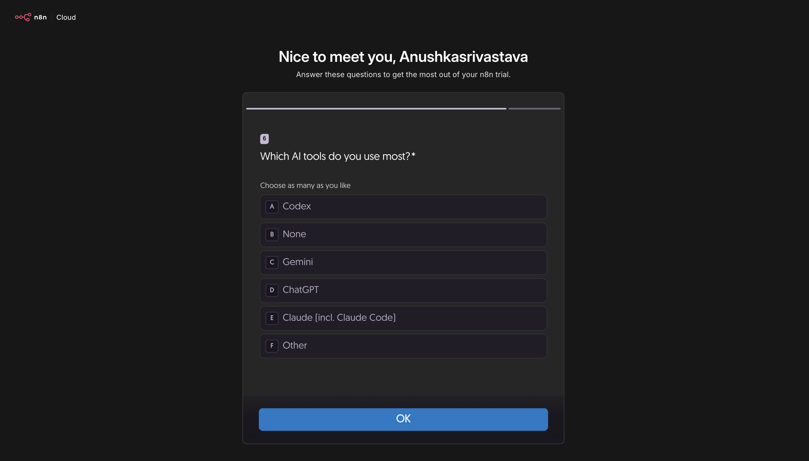

---

## Step 6: Skip the team invite

n8n will ask you to invite team members to your instance. You don’t need this for the course.

1. Click **Skip**.

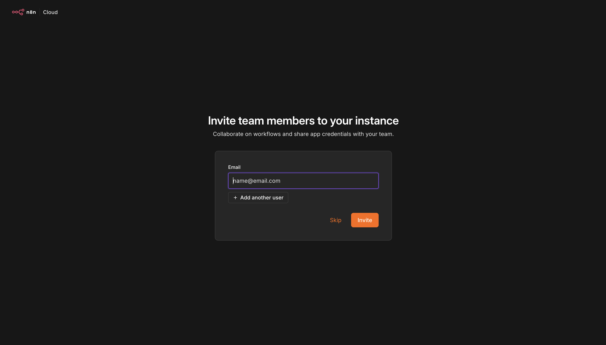

---

## Step 7: Start automating

1. When you see **Your instance is ready!**, click **Start automating**.

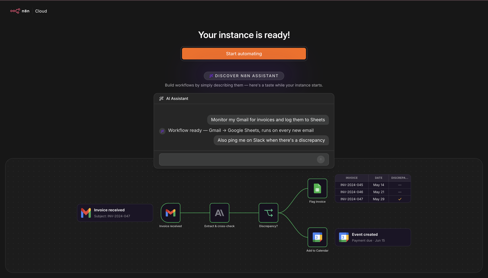

2. This takes you to your n8n home page. You can see your trial status (**14 days left**) at the top.

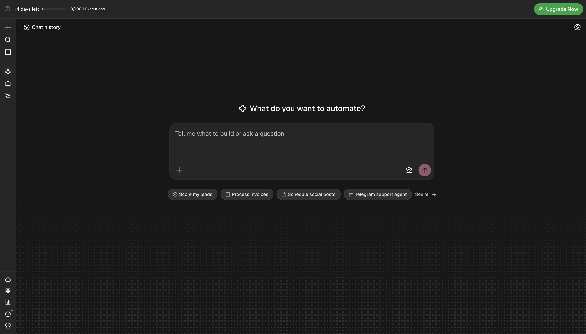

---

## Step 8: Create your first workflow

1. Click the **+** icon in the top left corner.
2. Click **New workflow**.

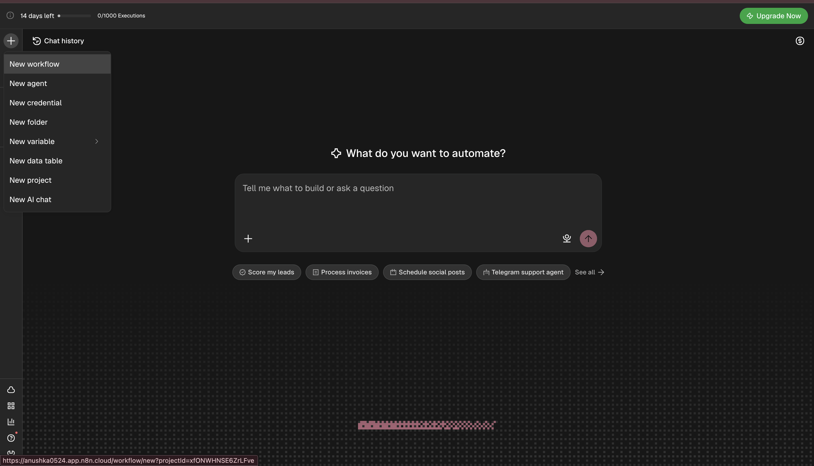

A blank workflow canvas will open. This is where we will build in Week 1.

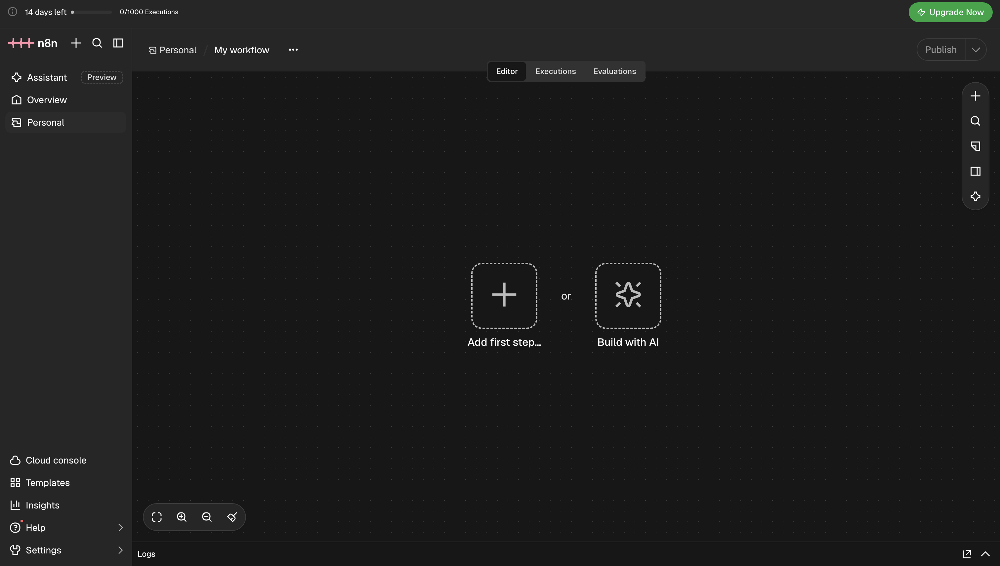

---

## You’re ready

You’ve created your n8n account, set up your instance, and opened a new workflow. Keep your instance URL and password handy — you’ll sign in to the same instance in Week 1.
