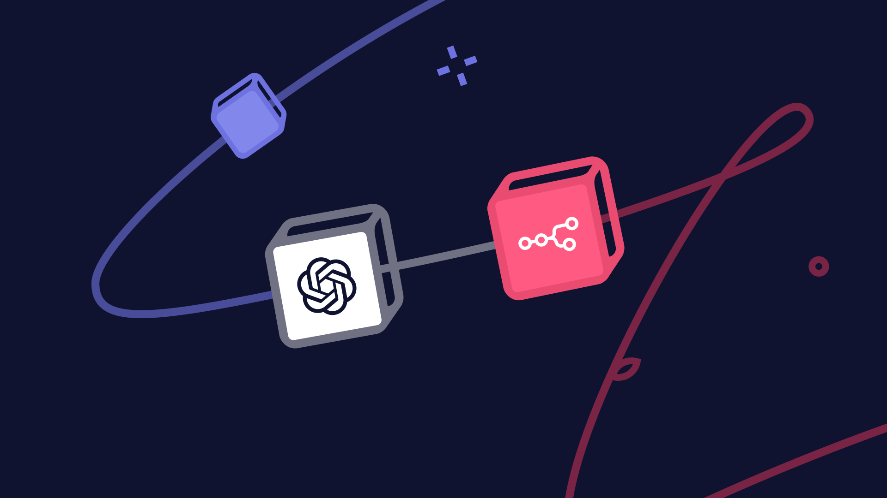
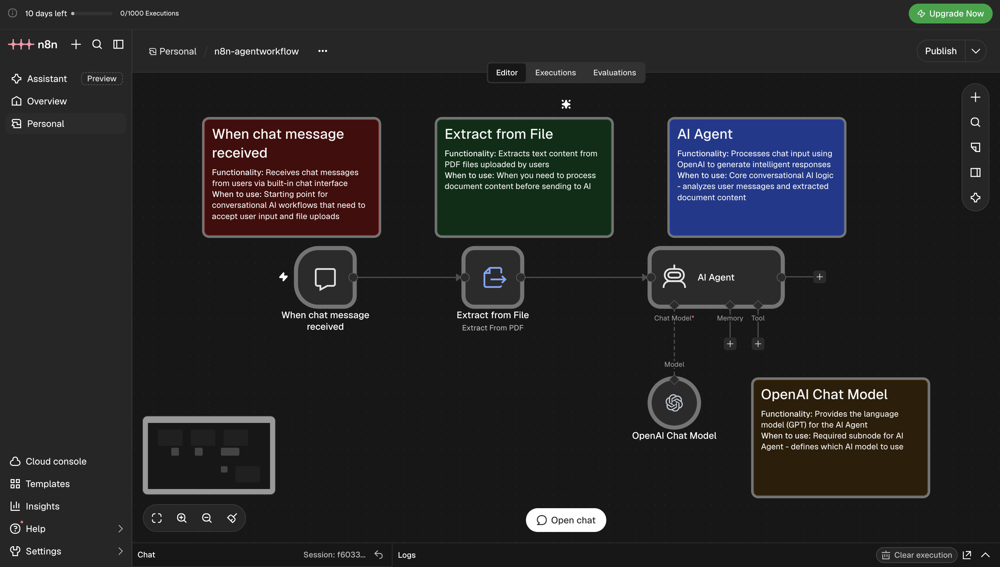
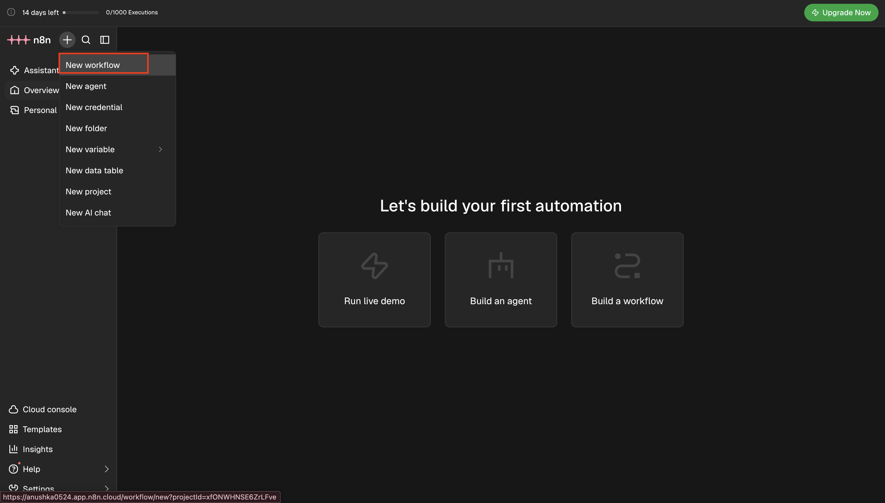
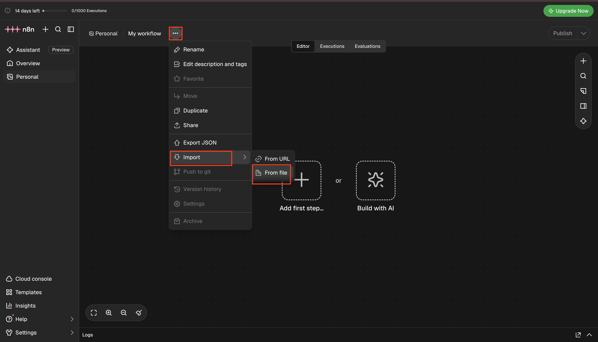

# Lab 1.1: Build Your First AI Agent in n8n

## Table of Contents

- [Prerequisites](#prerequisites)
- [Two Ways to Build This](#two-ways-to-build-this)
- [Import the Workflow](#import-the-workflow)
- [Test Your Agent](#test-your-agent)
- [Troubleshooting Steps](#-troubleshooting-steps)

---

## Overview

In this lab, you'll build a **Document Q&A Agent**: upload a document, ask a question, and get a short answer that points to the exact part of the document it came from. If the answer isn't there, the agent says so instead of guessing.

You'll build it in **n8n**, where you connect blocks on a screen instead of writing code:

**Question + file → turn the file into text → AI writes the answer → answer comes back**

Here's what your finished agent will look like — just four blocks:

By the end of this lab, you'll have a working agent and know how to write the instructions that control it.

---

## Prerequisites

✅ An **n8n account** — sign up free at n8n.io. The cloud version works fine. [Follow this setup guide](../../pre-reads/0.3-setup-n8n/README.md) to create your account.

✅ The **ready-made workflow file** — [download n8n-workflow.json](https://pragyaallc-my.sharepoint.com/:u:/g/personal/anushka_srivastava_legalgraph_ai/IQDuaRJHGH6vQoYMl8VS7BYSAZNwKrRiLULokGgKgDGiddE?e=fazEUx)

✅ The **sample document** — [download the sample contract](https://pragyaallc-my.sharepoint.com/:b:/g/personal/sachin_parmar_legalgraph_ai/IQC2WQJhhIuyRq5JrVY13FwNAdwS4M5gB5w-qzBAm9V4mRQ?e=XyvLU4) (a made-up vendor agreement prepared for this lab)

---

## Two Ways to Build This

| | **Import the Workflow** | **Build from Scratch** |
|---|---|---|
| **Best for** | Getting up and running fast | Understanding what every block does |
| **Time** | ~5 minutes | ~25 minutes |
| **What you do** | Import a ready-made file and add your key | Add and connect each block yourself |

Both give you the same working agent. If this is your first time, **build from scratch** — adding each block yourself is how it really sinks in.

👉 **[Build from Scratch →](./build-from-scratch.md)** — then come back here to [Test Your Agent](#test-your-agent).

---

## Import the Workflow

**Step 1. Create a new workflow.**

Open n8n and click on the plus icon **"+"** in the top left and select **New Workflow**. You'll land on a blank canvas.

**Step 2. Import the ready-made file.**

Click the **three-dot menu (⋮)** at the top, select **"Import from File"**, and upload `n8n-workflow.json`. Your canvas fills up with all the blocks, already connected.

n8n may then ask **"Importing this from an AI tool?"**. Click **Skip**.

**Step 3. Check the connections.**

Every block should be joined by a line. If one isn't, drag from the small circle on its right edge to the next block.

> ✓ Tip. If your agent ever stops responding, check the connections first. One missing line stops the whole workflow without any warning.

**Step 4. Set up the OpenAI model.**

**Double-click** the **"OpenAI Chat Model"** block. n8n gives you **$2 of free OpenAI credit**, so you can start without your own key. Leave the model as **gpt-5-mini**.

---

## Test Your Agent

Click **"Open Chat"**:

upload the **sample document**, and try these one at a time:

*"What is this document about?"*

*"What are the key terms I should know before signing?"*

*"What happens if either side wants to end the agreement early?"*

*"Does this renew automatically?"*

Notice how every answer follows the same JSON format: a `response` with the answer, a `citation` list with the exact section it came from, and a short `reasoning` that ties the two together. That's not luck — it's your System Message at work.

### Now try to break it 🤔

Ask something that's *not* in the document:

*"What's the CEO's phone number?"*

The agent should reply with `response` set to *"This information is not mentioned in the contract."*, and both `citation` (`[]`) and `reasoning` (`""`) empty.

> **Why doesn't it make things up?** Because you gave it two things: the full document, and a rule to answer only from it. Keeping an AI tied to a specific source like this is called **grounding**. It's one of the most important ways to make AI answers trustworthy.

---

## What You Learned

- **AI needs things in a form it can read.** A file isn't text until something opens it up. Preparing the input is a step you'll see in almost every agent.
- **The AI Agent is the coordinator, the model is the brain.** Keeping them separate means you can swap the model anytime.
- **The System Message is where your product decisions live.** Role, rules, tone, format — all in plain text. Same model, different instructions, completely different product.
- **Grounding makes answers trustworthy.** Give the AI the source and tell it to stay inside it.

---

## 🔧 Troubleshooting Steps

Check here before asking for help.

---

**"model_not_found" or "You do not have access to this model"**

Your OpenAI account can't use that model yet. Go to **platform.openai.com → Settings → Limits** to see which models you can use. If `gpt-5-mini` is blocked, pick `gpt-4.1-mini` instead.

---

**The agent doesn't respond at all**

Check that every block is connected with a line. One broken connection stops the whole workflow without any warning.

---

## What's Next

You built an agent on a visual canvas. In Lab 1.2, you'll build a real app with **Claude Code**. In Lab 1.3, you'll give this agent a web address and connect the app to it.

Save this workflow — you'll come back to it.

[Go to Lab 1.2: Build Your Prototype with Claude Code →](../1.2-claude-prototype/README.md)