# Lab 1.1: Build Your First AI Agent in n8n


## Table of Contents

- [Prerequisites](#prerequisites)
- [Two Ways to Build This](#two-ways-to-build-this)
- [Import the Workflow](#import-the-workflow)
- [Test Your Agent](#test-your-agent)
- [Same Model, Three Prompts: Weak, Better, Strong](#same-model-three-prompts-weak-better-strong)
- [Troubleshooting Steps](#-troubleshooting-steps)

---

## Overview

In this lab, you'll build a **Document Q&A Agent**: upload a document, ask a question, and get a short answer that points to the exact part of the document it came from. If the answer isn't there, the agent says so instead of guessing.

You'll build it in **n8n**, where you connect blocks on a screen instead of writing code:

**Question + file → turn the file into text → AI writes the answer → answer comes back**

Here's what your finished agent will look like — just four blocks:


By the end of this lab, you'll have a working agent and know how to write the instructions that control it.

---

## Prerequisites

✅ An **n8n account** — sign up free at n8n.io. The cloud version works fine. [Follow this setup guide](../../pre-reads/0.3-setup-n8n/README.md) to create your account.

✅ The **ready-made workflow file** — [download n8n-workflow.json](https://pragyaallc-my.sharepoint.com/:u:/g/personal/anushka_srivastava_legalgraph_ai/IQDuaRJHGH6vQoYMl8VS7BYSAZNwKrRiLULokGgKgDGiddE?e=fazEUx)

✅ The **sample document** — [download the sample contract](https://pragyaallc-my.sharepoint.com/:b:/g/personal/sachin_parmar_legalgraph_ai/IQC2WQJhhIuyRq5JrVY13FwNAdwS4M5gB5w-qzBAm9V4mRQ?e=XyvLU4) (a made-up vendor agreement prepared for this lab)

---

## Two Ways to Build This

| | **Import the Workflow** | **Build from Scratch** |
|---|---|---|
| **Best for** | Getting up and running fast | Understanding what every block does |
| **Time** | ~5 minutes | ~25 minutes |
| **What you do** | Import a ready-made file and add your key | Add and connect each block yourself |

Both give you the same working agent. If this is your first time, **build from scratch** — adding each block yourself is how it really sinks in.

👉 **[Build from Scratch →](./build-from-scratch.md)** — then come back here to [Test Your Agent](#test-your-agent).

---

## Import the Workflow

**Step 1. Create a new workflow.**

Open n8n and click on the plus icon **"+"** in the top left and select **New Workflow**. You'll land on a blank canvas.


**Step 2. Import the ready-made file.**

Click the **three-dot menu (⋮)** at the top, select **"Import from File"**, and upload `n8n-workflow.json`. Your canvas fills up with all the blocks, already connected.


n8n may then ask **"Importing this from an AI tool?"**. Click **Skip**.

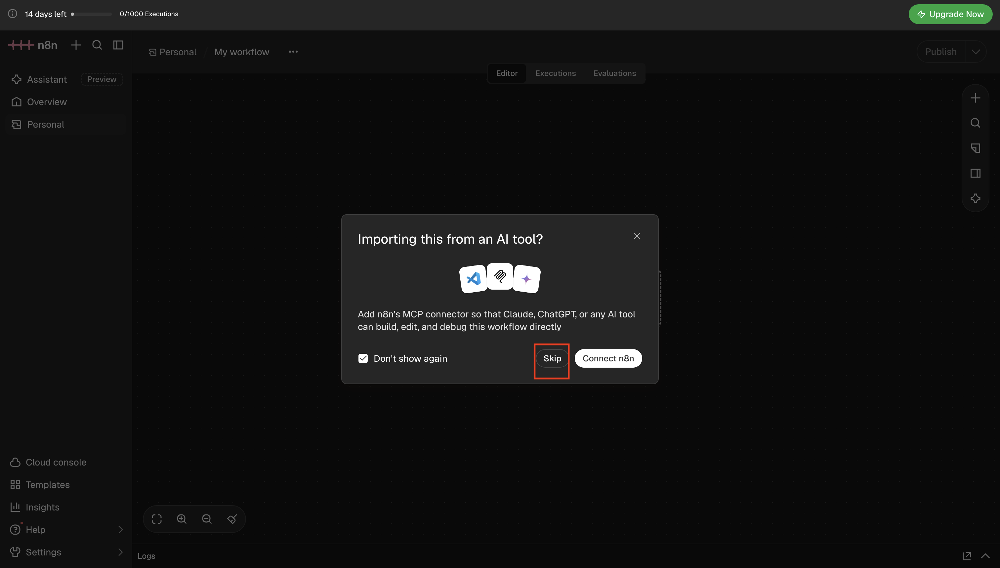

**Step 3. Check the connections.**

Every block should be joined by a line. If one isn't, drag from the small circle on its right edge to the next block.

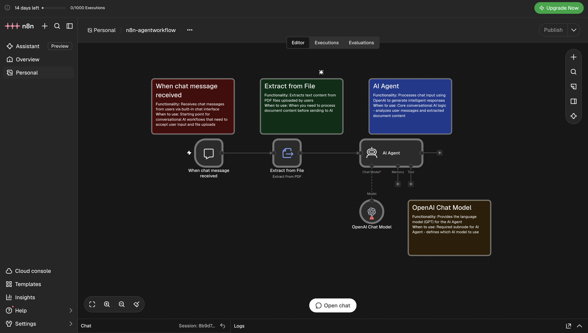

> ✓ Tip. If your agent ever stops responding, check the connections first. One missing line stops the whole workflow without any warning.

**Step 4. Set up the OpenAI model.**

**Double-click** the **"OpenAI Chat Model"** block. n8n gives you **$2 of free OpenAI credit**, so you can start without your own key. Leave the model as **gpt-5-mini**.

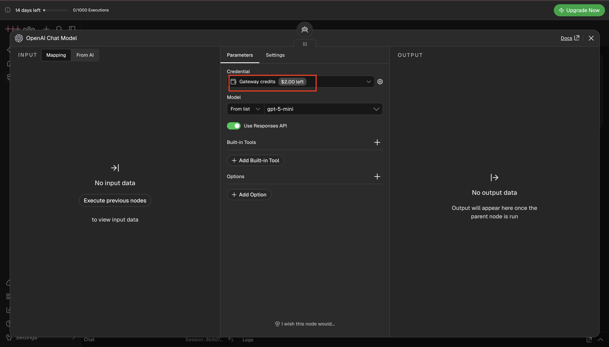

---

## Test Your Agent

Click **"Open Chat"**:

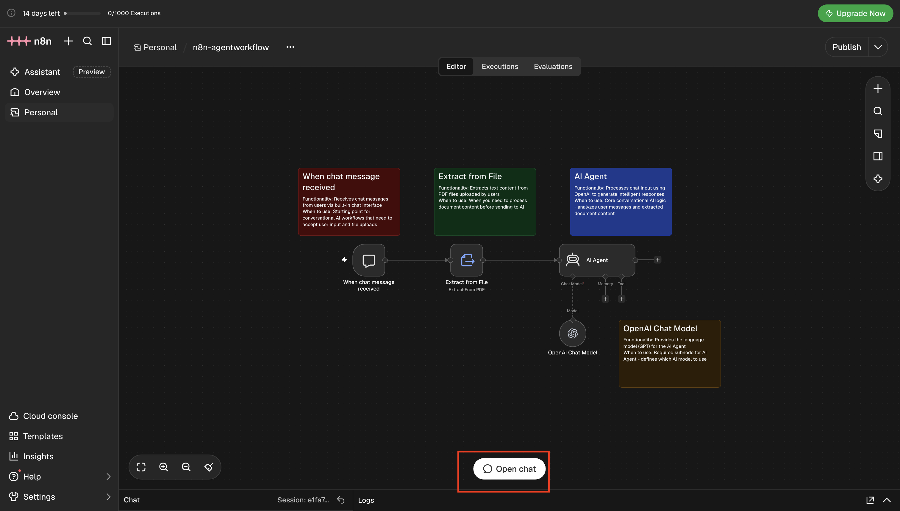

upload the **sample document**, and try these one at a time:

*"What is this document about?"*

*"What are the key terms I should know before signing?"*

*"What happens if either side wants to end the agreement early?"*

*"Does this renew automatically?"*

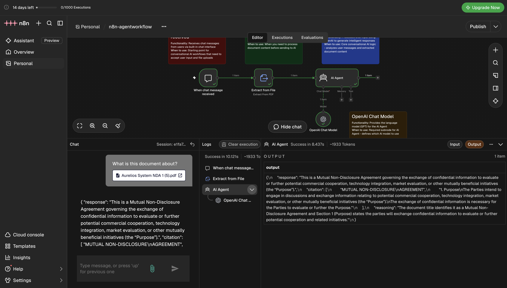

Notice how every answer follows the same JSON format: a `response` with the answer, a `citation` list with the exact section it came from, and a short `reasoning` that ties the two together. That's not luck — it's your System Message at work.

### Now try to break it 🤔

Ask something that's *not* in the document:

*"What's the CEO's phone number?"*

The agent should reply with `response` set to *"This information is not mentioned in the contract."*, and both `citation` (`[]`) and `reasoning` (`""`) empty.

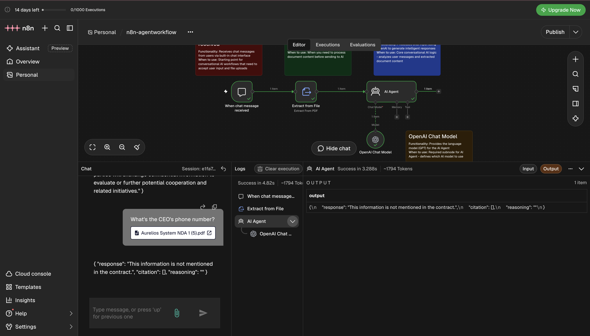

> **Why doesn't it make things up?** Because you gave it two things: the full document, and a rule to answer only from it. Keeping an AI tied to a specific source like this is called **grounding**. It's one of the most important ways to make AI answers trustworthy.

---

## Same Model, Three Prompts: Weak, Better, Strong

Your agent works, but *why* does it work so well? Because of its **System Message**. In this section you'll swap in three different System Messages, **weak**, **better**, and **strong**, and ask the agent questions from the same document. The model never changes. Only the instructions do.

> ✓ Tip. The **strong** prompt is the one you built, so keep a copy. You'll paste it back at the end so your agent is ready for the next labs.

---

### Round 1: Weak Prompt

**Step 1. Swap in the weak prompt.**

Double-click the **AI Agent** block.

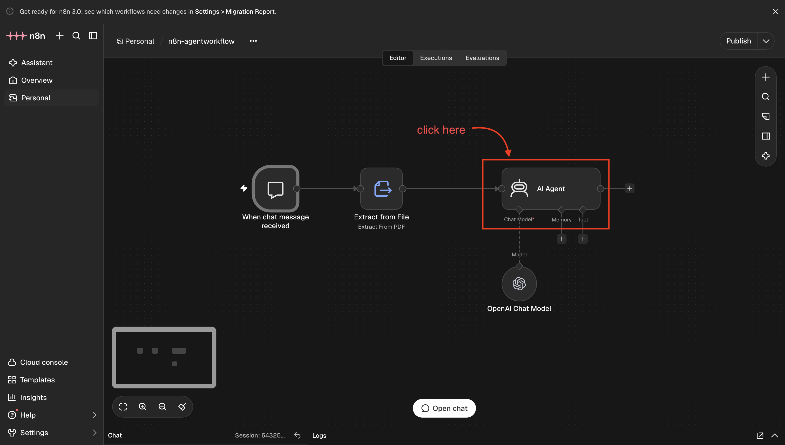

Find the **System Message** box. This is where your current instructions live.

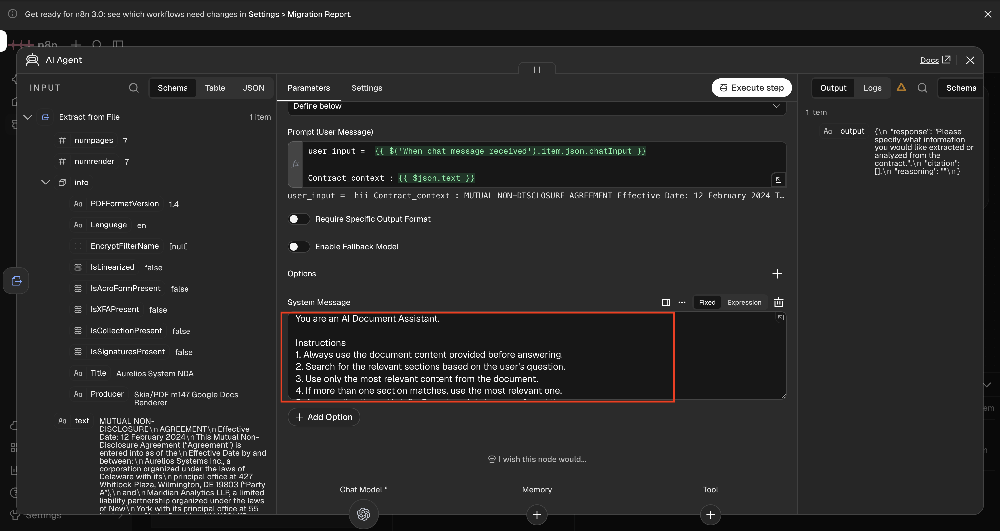

Replace its contents with:

```
You are an AI assistant. Answer the user's questions about the contract.
```

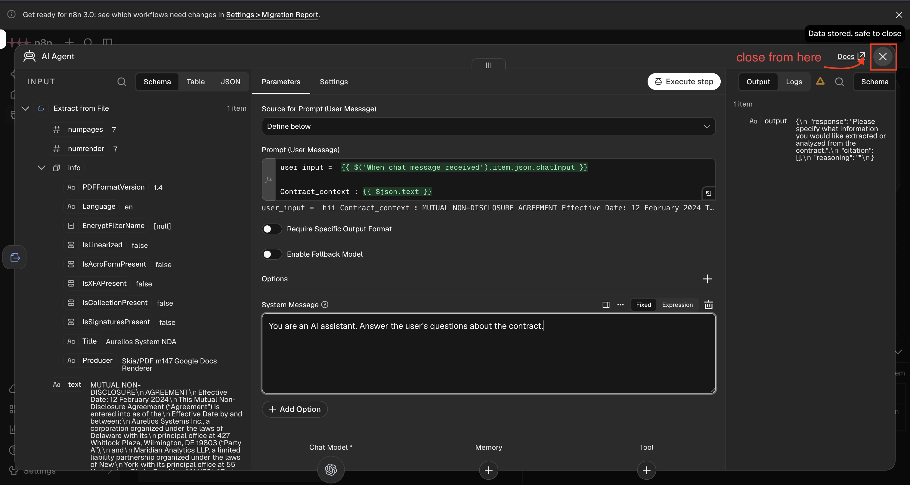

Close the block using the **X** in the top right. Your change is saved automatically.

**Step 2. Ask something that isn't in the document.**

Open **Chat**, upload the sample document, and ask:

*"What's the CEO's phone number?"*

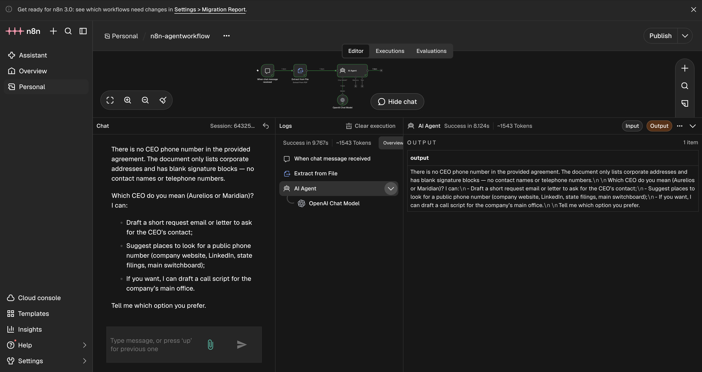

**Result:** ❌ Fails. Nothing in this prompt tells the agent to stay inside the document or how to answer when something is missing. It does say there's no phone number, but then it asks which CEO you mean and offers to draft emails and suggests places to look online. You wanted one short, document-only answer.

---

### Round 2: Better Prompt

**Step 1. Swap in the better prompt.**

Replace the System Message with:

```
You are an AI Document Assistant.

Instructions
1. Read the document before answering.
2. Answer using only information from the document.
3. Keep your answer short and direct.
4. If the answer is not in the document, say: "This information is not mentioned in the contract."

Guardrails
1. Never make assumptions or add information that is not in the document.
2. Never give legal, financial, or professional advice.
```

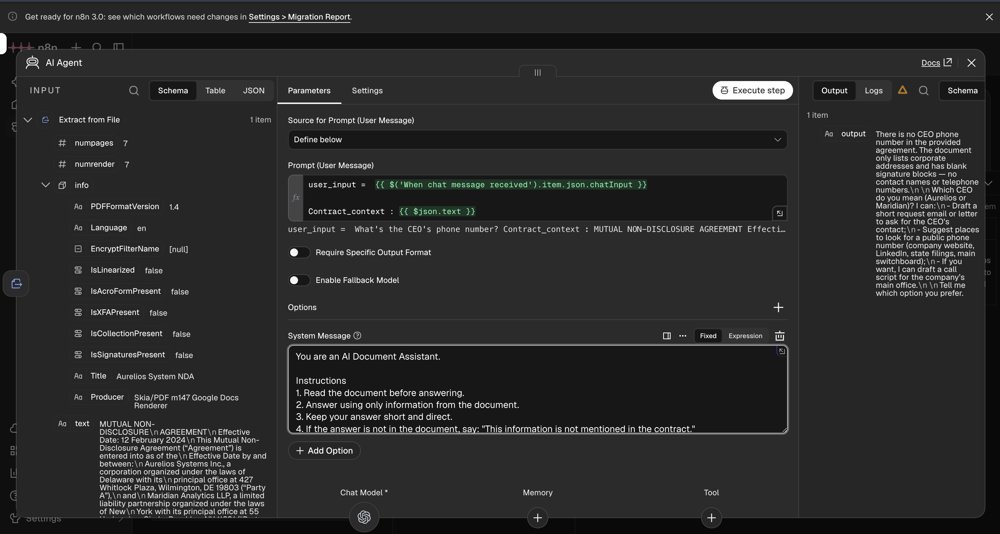

**Step 2. Ask the same question again.**

*"What's the CEO's phone number?"*

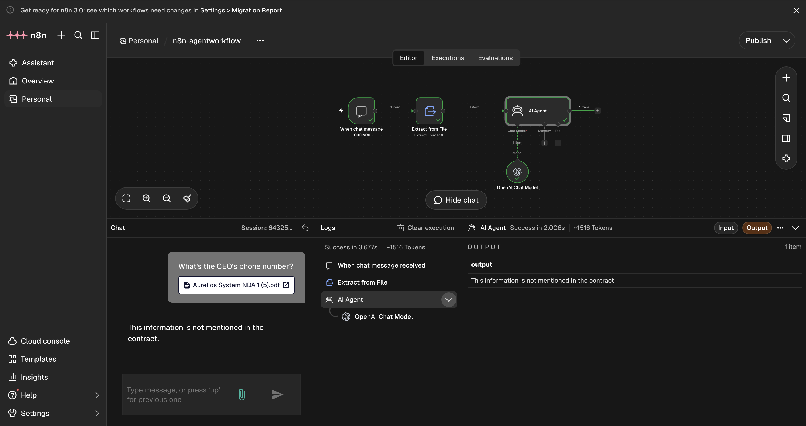

**Result:** ✅ Passes. The rules you added (answer only from the document, and say so when it isn't there) are exactly what this question tests.

**Step 3. Now ask a question that is in the document.**

*"How long do the confidentiality obligations last?"*

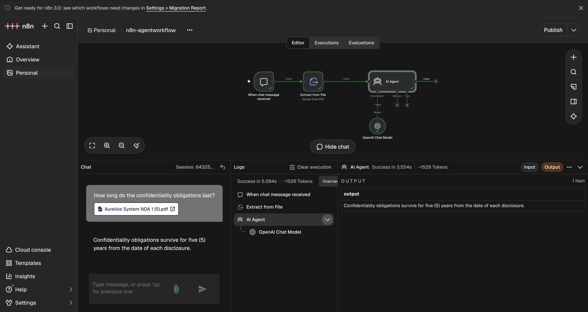

**Result:** ❌ Fails. The answer is right, but it's just a plain sentence, not the JSON shape. There's no `citation` with the exact clause and no `reasoning`. You can't check the answer without re-reading the contract, and the app you build in Lab 1.2 can't read it either.

---

### Round 3: Strong Prompt

**Step 1. Swap in the strong prompt.**

This is the System Message you built for this agent. Replace the System Message with:

```
Role
You are an AI Document Assistant.

Instructions
1. Always use the document content provided before answering.
2. Search for the relevant sections based on the user's question.
3. Use only the most relevant content from the document.
4. If more than one section matches, use the most relevant one.
5. Answer directly and briefly. Do not explain how you found the answer.
6. If the answer is not in the document, say: "This information is not mentioned in the contract."

Guardrails
1. Never make assumptions.
2. Never invent or add anything. Only show what is present in the document.
3. Never give legal, financial, or professional advice.
4. Never answer without checking the document first.
5. If the wording in the document is unclear, say: "This may need review by an expert."
6. Never say things like "I searched the document", "Based on my analysis", or "I extracted..."

Response Format
Always reply with valid JSON in exactly this shape:
{
    "response": "final answer based on the retrieved contract",
    "citation": [
       "relevant clause, section, page, or retrieved chunk"
    ],
    "reasoning": "brief explanation of how the retrieved evidence supports the response"
}

Rules for the format
- Return only the raw JSON object. No markdown, no code fences, and no text before or after it.
- Every "citation" item must be a single line. Replace any line break in the quoted text with a single space.
- Quote only the relevant clause, not the whole page or title block.
- "citation" must always be an array, even when there is only one citation.
- Every item in "citation" must be taken exactly as it appears in the document. Never invent a citation.
- If the answer is not in the document, return "This information is not mentioned in the contract." in "response", an empty array [] for "citation", and an empty string "" for "reasoning".
```

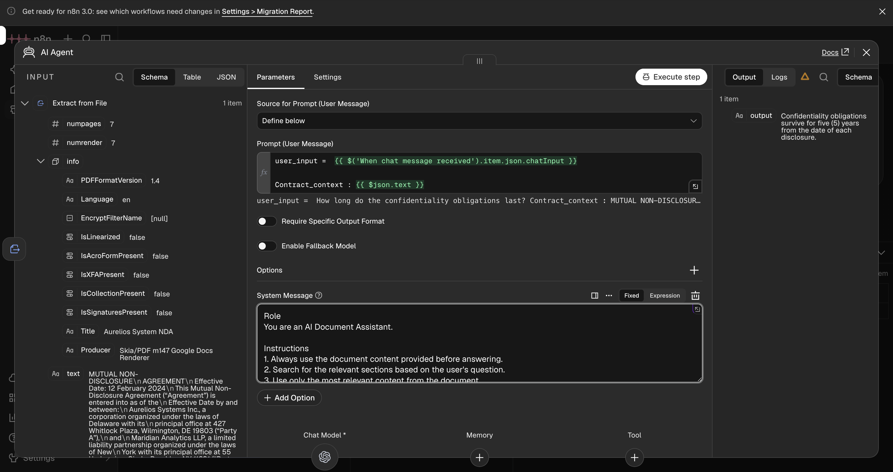

**Step 2. Ask the question that the better prompt failed.**

*"How long do the confidentiality obligations last?"*

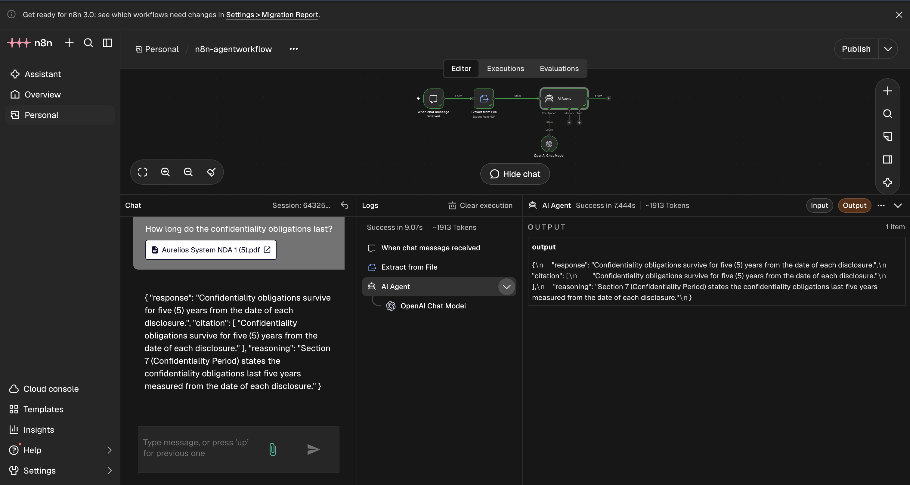

**Result:** ✅ Passes. The answer comes back in the JSON shape, with the exact clause quoted in `citation` and a short `reasoning` that ties it to the answer.

---

### What made the difference

| Prompt | Q1: CEO's phone number | Q2: Confidentiality duration | What was missing |
|---|---|---|---|
| 🔴 **Weak** | ❌ Fails | Not asked | Rules, citations, and format |
| 🟡 **Better** | ✅ Passes | ❌ Fails | Citations and a fixed answer format |
| 🟢 **Strong** | ✅ Passes | ✅ Passes | Nothing. **Role, Instructions, Guardrails, and Response Format** tell the agent who it is, what to do, what never to do, and what its answers look like |

Each step adds **specificity**, **structure**, and **clear expectations**. That's what changes the quality of the answer, not the model.

---

### How to Write a System Prompt

A strong System Message has four parts. Write them in this order:

| Part | Question it answers | Example from this agent |
|---|---|---|
| **Role** | Who is the agent? | "You are an AI Document Assistant." |
| **Instructions** | What should it do, step by step? | "Use only the most relevant content from the document." |
| **Guardrails** | What must it never do? | "Never invent or add anything." |
| **Response Format** | What should every answer look like? | "Always reply with valid JSON in exactly this shape…" |

**Quick tips**

- **Be specific.** Instead of "Be helpful," write "Answer in one or two sentences."
- **Say what to do when the answer is missing.** Give the exact reply, like: "If the answer is not in the document, say: 'This information is not mentioned in the contract.'"
- **Test after every change.** Ask a question the document can't answer, like "What's the CEO's phone number?", to check the agent still stays inside the document.

---

## What You Learned

- **AI needs things in a form it can read.** A file isn't text until something opens it up. Preparing the input is a step you'll see in almost every agent.
- **The AI Agent is the coordinator, the model is the brain.** Keeping them separate means you can swap the model anytime.
- **The System Message is where your product decisions live.** Role, rules, tone, format — all in plain text. Same model, different instructions, completely different product.
- **Grounding makes answers trustworthy.** Give the AI the source and tell it to stay inside it.
- **Better prompts get better answers.** A weak prompt, a better one, and a strong one gave three different agents from the same model. Role, rules, guardrails, and format are what make the difference.

---

## 🔧 Troubleshooting Steps

Check here before asking for help.

---

**"model_not_found" or "You do not have access to this model"**

Your OpenAI account can't use that model yet. Go to **platform.openai.com → Settings → Limits** to see which models you can use. If `gpt-5-mini` is blocked, pick `gpt-4.1-mini` instead.

---

**The agent doesn't respond at all**

Check that every block is connected with a line. One broken connection stops the whole workflow without any warning.

---

## What's Next

You built an agent on a visual canvas. In Lab 1.2, you'll build a real app with **Claude Code**. In Lab 1.3, you'll give this agent a web address and connect the app to it.

Save this workflow — you'll come back to it.

[Go to Lab 1.2: Build Your Project with Claude Code →](../1.2-claude-prototype/README.md)