# Lab 1.3: Build the Webhook and Connect It to Your Prototype

## Table of Contents

- [Prerequisites](#prerequisites)
- [Part 1: Turn Your Agent Into a Tool Real Apps Can Use](#part-1-turn-your-agent-into-a-tool-real-apps-can-use)
- [Part 2: Connect to Your Real Agent](#part-2-connect-to-your-real-agent)
- [What You Learned](#what-you-learned)
- [Troubleshooting Steps](#troubleshooting-steps)

---

## Overview

In this lab, you'll give your n8n agent a **webhook**, a web address that other apps can send a document and a question to. Then you'll connect your contract review app to that address, so it shows real answers from your agent instead of simulated ones.

**Your app (upload + chat) → webhook → your n8n agent → answer back in your app**

By the end of this lab, your app and your agent will work together as one product.

---

## Prerequisites

✅ **Lab 1.1 complete** — your n8n contract review workflow is built and the AI agent responded correctly inside n8n's own chat interface.

✅ **Lab 1.2 complete** — your `contract-review-app` prototype is built and replies with simulated responses. Keep the same Claude Code conversation open if you can, since it already knows your app's structure.

✅ The **sample contract PDF** from Lab 1.1 — same file, use it again here. [Download it here](https://pragyaallc-my.sharepoint.com/:b:/g/personal/sachin_parmar_legalgraph_ai/IQC2WQJhhIuyRq5JrVY13FwNAdwS4M5gB5w-qzBAm9V4mRQ?e=XyvLU4) if you don't have it.

---

## Part 1: Turn Your Agent Into a Tool Real Apps Can Use

Right now, the only way to reach your agent is through n8n's built-in chat window. That's fine for testing — but in Lab 1.2 you built your own app, and it needs a way to send a document and a question to this agent.

The fix is a **Webhook**.

Think of a webhook like a doorbell. Your app rings it, the agent opens the door, takes the document and question, works out an answer, and hands it back.

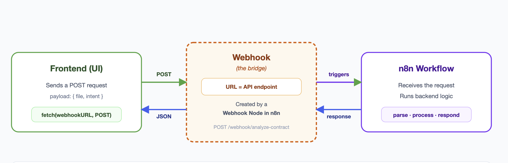

> Your workflow is saved in n8n's cloud, not on your computer. Close the browser, come back days later — everything is exactly where you left it.

### Choose your path

You can get the webhook in two ways. Pick one:

| | **Option A: Import it** | **Option B: Build it yourself** |
|---|---|---|
| **How** | Import a ready-made workflow that already has the Webhook and Respond to Webhook blocks connected | Follow the steps below and add them by hand |
| **Best for** | Getting to Part 2 quickly | Learning how a webhook is wired |

**Option A.** [Download n8n Webhook Workflow](https://pragyaallc-my.sharepoint.com/:u:/g/personal/anushka_srivastava_legalgraph_ai/IQARg0O_Y5nRTJi9dK4Zpm1NAe4-T8GBchgvQ-kcvLvt_B0?e=WXkOXO). In n8n, click the **three-dot menu (⋮)** → **"Import from File"** and upload it. Double-click the **"OpenAI Chat Model"** block to confirm the model is **gpt-5-mini**, then jump to [Copy your webhook link](#step-6-copy-your-webhook-link) to copy your web address.

**Option B.** Keep going with Step 1.

### Step 1: Remove the chat window trigger

Click the **"When Chat Message Received"** block and press **Delete**. It only listens to n8n's own chat window — your app can't reach it.

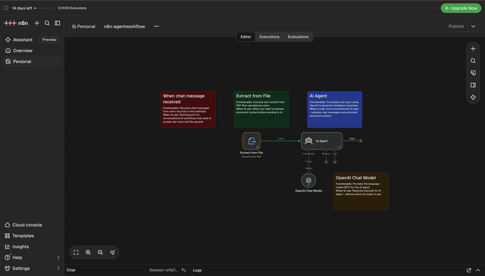

> Don't worry — you're only removing the starting point. You'll replace it next.

### Step 2: Add the Webhook pair

Webhooks come as a pair:

| Block | What it does |
|---|---|
| **Webhook** | Receives the document and question from your app |
| **Respond to Webhook** | Sends the agent's answer back to your app |

Click **(+)**, search for **"Webhook"**, and add it.

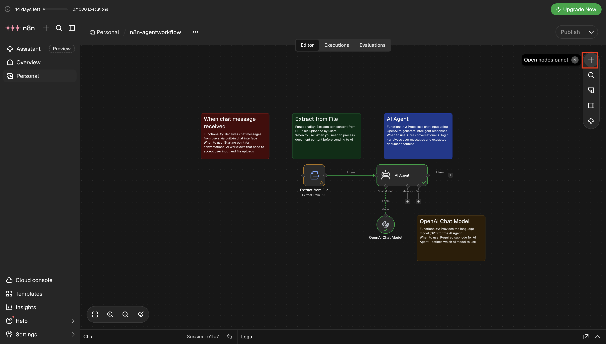

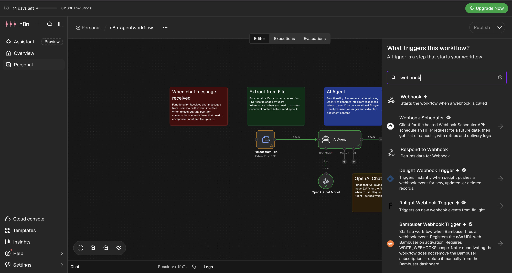

### Step 3: Connect the Webhook to Extract From File

Drag a line from the **Webhook** to **Extract From File** — the same spot where the chat trigger used to be.

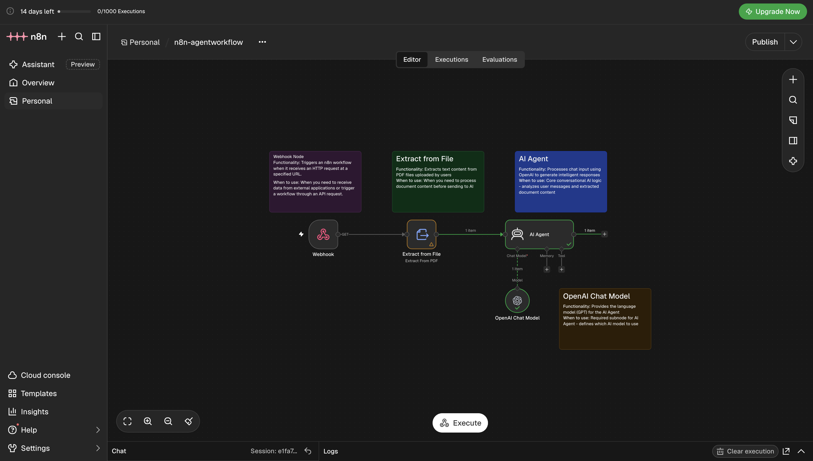

### Step 4: Set up the Webhook

Click the **Webhook** block and make these four changes:

1. **HTTP Method → POST.** This means "I'm sending you something" rather than "I'm asking you for something." Like dropping a letter in a mailbox instead of checking it.
2. **Respond → "Using 'Respond to Webhook' node".** This tells n8n to wait for the agent to finish before replying. Otherwise your app gets an empty reply instantly.
3. **Add Option → Field Name for Binary Data.** This labels the uploaded document so the next block knows where to find it.
4. **Add Option → Allowed Origins (CORS) → `*`.** By default, browsers block a web page from sending data to a different website. This setting says "it's okay, let my app reach this address."

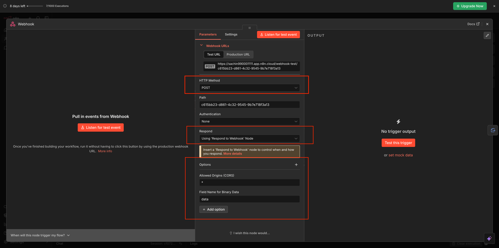

> If your app ever stops getting answers and n8n shows no activity, setting 4 is almost always the reason.

### Step 5: Connect the AI Agent to Respond to Webhook

Again Click **(+)**, search for **"Respond to Webhook"**, and add it.

**Respond to Webhook** is the reply — if the Webhook is the doorbell, this is you handing the answer back to whoever rang it.

Drag a line from **AI Agent** to **Respond to Webhook**. Your workflow now reads:

**Webhook → Extract From File → AI Agent → Respond to Webhook**

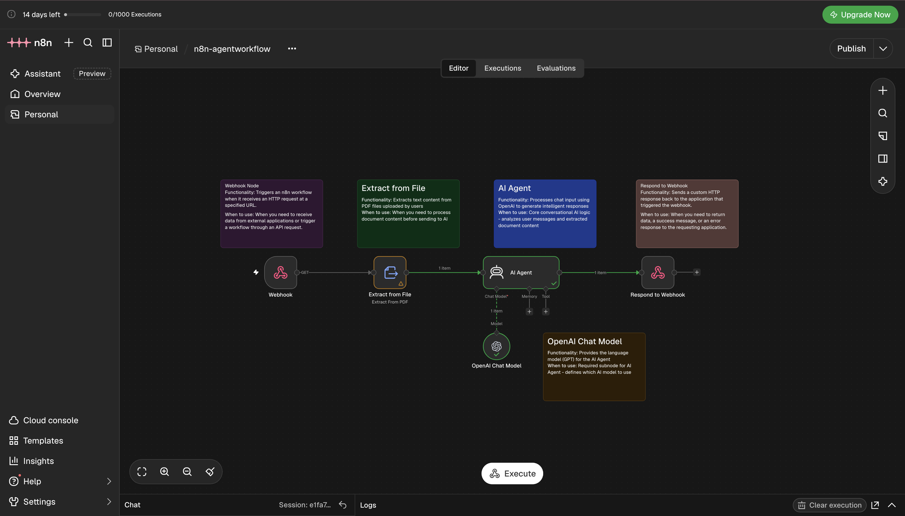

Now click the **Respond to Webhook** block and set it up so your app gets the agent's JSON back cleanly. Make these three changes:

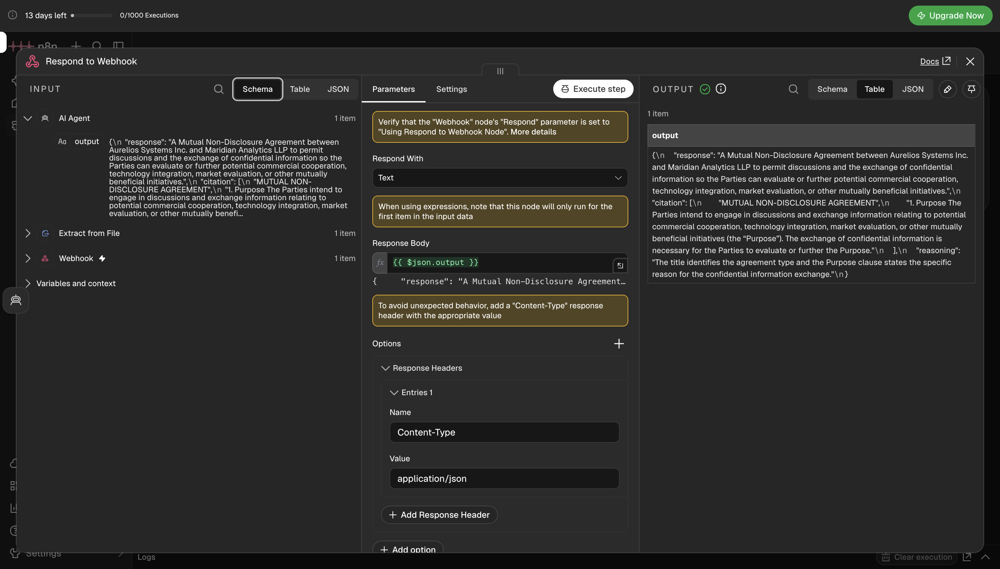

**1. Respond With:** choose **Text**.

**2. Response Body:** switch the field to **Expression** and paste:

```
{{ $json.output }}
```

The AI Agent puts its answer in a field called `output`. This sends just the answer, not the wrapper around it.

**3. Add Option → Response Headers → Add Header.** Paste each value into its own box:

Name:

```
Content-Type
```

Value:

```
application/json
```

Check every line before you move on. One missing connection and nothing comes back.

### Step 6: Copy your webhook link

Click the **Webhook** block again. Your agent's web address is shown at the top. It looks like this:

```
https://your-instance.app.n8n.cloud/webhook-test/your-unique-id
```

Copy it and keep it handy — you'll need it in Part 2.

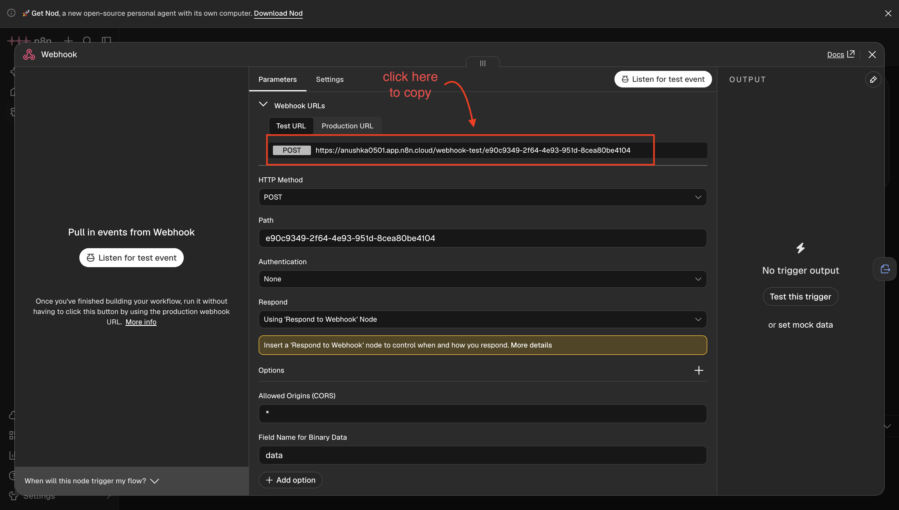

🎉 **Your agent now has its own web address. Any app can send it a document and a question, and get an answer back.**

---

## Part 2: Connect to Your Real Agent

Now that you've attached the webhook to your agent, it's ready to receive requests from the outside world. Let's connect your application to the agent so it can send contracts and questions and show the answers that come back.

---

### Run the integration prompt

Stay in the same Claude Code conversation you used in Lab 1.2 — it already knows your app's structure. Copy the prompt below. Before running it, replace `<Your Webhook URL>` with the webhook link you copied in Part 1.

```
Now add this feature to the existing prototype:

A user uploads a contract file in the UI.
The user enters a message in the chat input.
When the user clicks the Send button:

1. Collect both:
   - The uploaded contract file
   - The user's chat message

2. Send both to this webhook URL:
   <Your Webhook URL>

3. After the webhook processes the request:
   - Capture the JSON response returned by the webhook. It is a valid JSON object
     with no markdown, no code fences and no text before or after it, in exactly this shape:
     {
       "response": "string - final answer based only on the retrieved contract",
       "citation": ["string - exact clause/section/page text that supports the answer"],
       "reasoning": "string - 1-2 sentences on how the citations support the response"
     }
   - Display "response" inside the chat UI as the assistant reply, with the
     "citation" items and "reasoning" shown beneath it

4. Rules:
   - "citation" is always an array of strings. It is [] if nothing relevant was retrieved.
   - Each citation is the relevant clause only, with its section number or page.
   - If the contract doesn't contain the answer, "response" is "This information is not mentioned in the contract.", "citation" is [] and "reasoning" is "".

Replace the dummy hardcoded responses with this webhook integration.
```

Paste it into Claude Code and run it.

Claude will update only the part of the app that needs changing. It won't touch the layout, the design, or anything else that's already working.

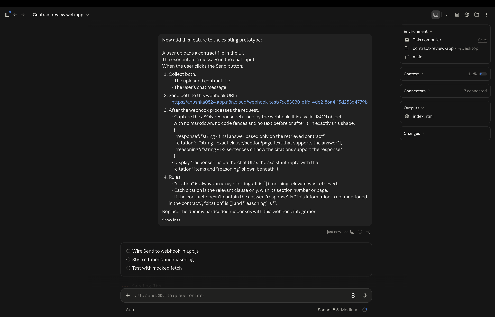

---

### Activate the workflow in n8n, then send your first real message

Before testing in the browser, go back to n8n and click **"Execute Workflow"** first.

This is important. Your webhook address only works when the workflow is actively running. If you skip this step and go straight to testing, n8n won't receive anything and the app will appear to hang.

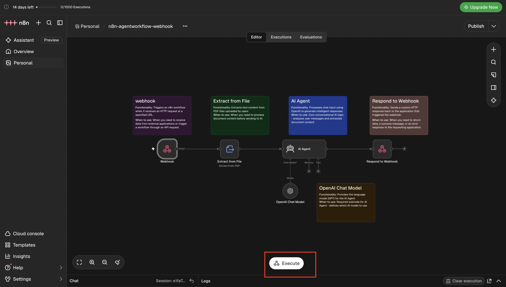

With the workflow running, go to your browser, open `index.html`, upload the sample contract, type a question, and click Send.

You'll likely see an error. That's completely normal — and it's actually a good sign.

It means your web app successfully reached the agent. The error is coming from inside the workflow, not from a broken connection. The bridge is working. There's just one small configuration left.

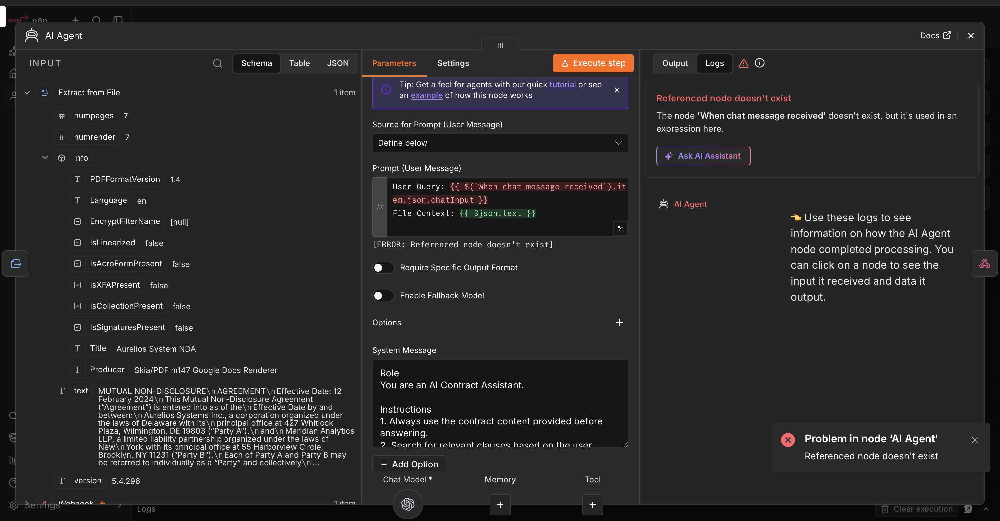

> An error at this stage means your two sides are talking to each other. The connection is live. Now we just need to make sure the agent is reading the right message.

---

### Point the agent to the right input

Go back to n8n and open the **AI Agent** node.

Find the **user message** field. It's currently set to read from the old n8n chat — which no longer exists in this workflow. You need to update it to read from the webhook instead.

Replace whatever is in that field with this:

```

user_query:{{ $('Webhook').item.json.body.message }}
file_context:{{ $json.text }}
```

This tells the agent: "don't look for a hardcoded question — read whatever message the user just sent from the web app." The curly braces are n8n's way of saying "pull this value in live from what just arrived."

If that doesn't work, click on the Webhook node after a test run — you'll see exactly what arrived and can match the field name from there.

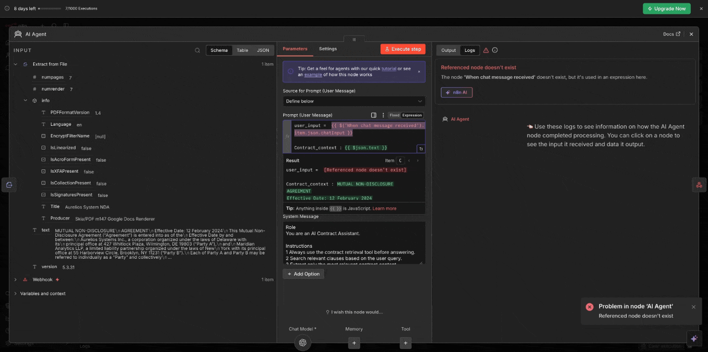

The contract file doesn't need updating — that part of the workflow is already reading it correctly. Only the user message field needs this change. Save the node.

> Not sure what field name to use? Go back to your Claude Code session and ask: "What field name are you sending the user message under?" You'll get the exact answer in one message.

---

### The final test

Go to n8n and click **"Execute Workflow"** again to put the agent back into listening mode.

Go to your browser. Upload the sample contract. Type this and click Send:

*"What is this contract about?"*

This time you'll get a real answer — pulled from the actual contract, reasoned over by your agent, and displayed right in your web app.

Try a few more:

*"What are the payment terms?"*

*"What happens if either party wants to terminate early?"*

*"Are there any auto-renewal clauses?"*

Every answer comes from the actual document. Every response travels through your agent. The two sides of your product are now one.

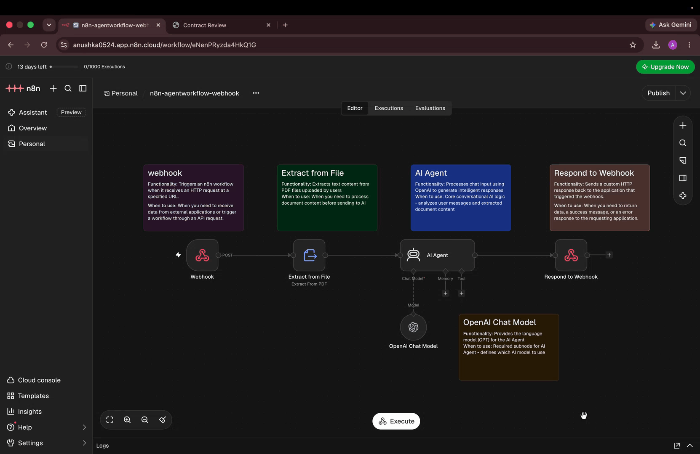

---

## What You Learned

- **Every agent starts with a trigger.** It decides *when* the agent wakes up. You started with a chat window, then swapped it for a webhook so any app can reach it.
- **Two-sided product shape.** A user-facing side (what you built in Claude Code) and an intelligence side (your agent) don't know about each other until you connect them. Most AI products fail because these two sides never get wired together.

---

## Troubleshooting Steps

Check here before asking for help.

---

**Your app shows an error, or nothing happens when you click Send**

Make sure you are using the **Test URL** if your workflow is not published. The Test URL (it contains `/webhook-test/`) only works while n8n is listening, so click **Execute Workflow** before you send a message. The Production URL (it contains `/webhook/`) only works once the workflow is published.

---

## Next: Push Your Code to GitHub

Right now your app, now connected to your agent, lives in one folder on your Desktop. Next, in [Lab 1.4](../1.4-push-code-to-github/README.md), you push the `contract-review-app` folder to GitHub, so it is backed up, shareable, and has a history you can go back to.

**[Next: Lab 1.4: Push Your Prototype to GitHub →](../1.4-push-code-to-github/README.md)**
