# Lab 1.3: Push Your Prototype to GitHub

## From Your Laptop to GitHub — Back Up Your App and Make It Shareable

Your `contract-review-app` works, but it only exists in one folder on your laptop. If the folder is deleted or the laptop breaks, the app is gone. And nobody else can see it.

In this lab you'll put that folder on **GitHub**. You won't type any Git commands yourself. You'll give Claude Code one prompt, and it will run the commands, step by step, in plain language.

---

## What You'll Do in This Lab

- **[Step 1](#step-1-collect-your-details)**: Collect three things from GitHub: your username, your email, and your repo link.
- **[Step 2](#step-2-give-claude-code-the-prompt)**: Give Claude Code one prompt and let it push your code.
- **[Step 3](#step-3-sign-in-to-github)**: Sign in to GitHub when Claude asks.
- **[Step 4](#step-4-check-your-repo)**: Open your repo and check the files are there.
- **[Step 5](#step-5-add-a-readme)**: Add a README so anyone who opens your repo knows what it is.

---

## Prerequisites

✅ **Lab 1.2 complete**: you have a working `contract-review-app` folder on your Desktop.

✅ **A GitHub account and an empty `contract-review-app` repo**: set up in the [GitHub setup lesson](../../pre-reads/0.2-setup-github-account/README.md).

✅ **Claude Code** open in your `contract-review-app` folder.

---

## Step 1: Collect Your Details

**What you're doing**: Getting three pieces of information that Git needs to know who you are and where to send your code.

**Why this matters**: Git adds your name and email to every save you make, and it needs the repo link to know where the code should go. Keep these handy, because you'll paste them into a prompt in the next step.

**Action items**:

1. Open [github.com](https://github.com) and click your **profile picture** in the top-right corner, then click your name to open your profile.
2. Copy your **username** (it's shown right under your name). Keep it safe.

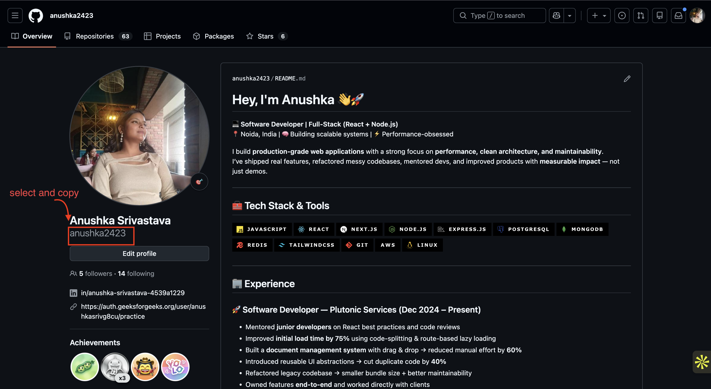

3. Copy the **email** you used to create your GitHub account.
4. Click **Repositories**, then click **contract-review-app**.

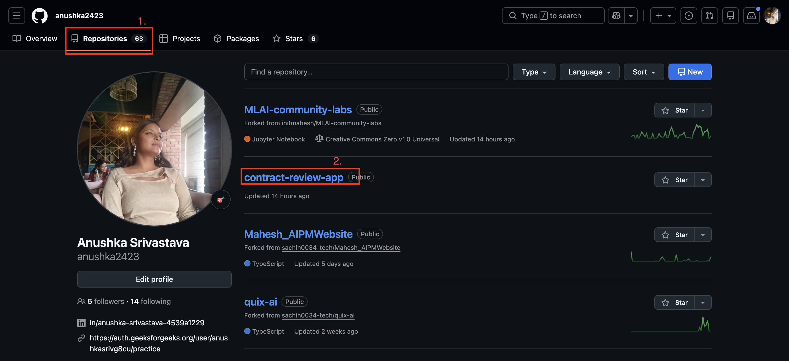

5. Copy the **link** from your browser's address bar. It looks like `https://github.com/<your-username>/contract-review-app.git`.

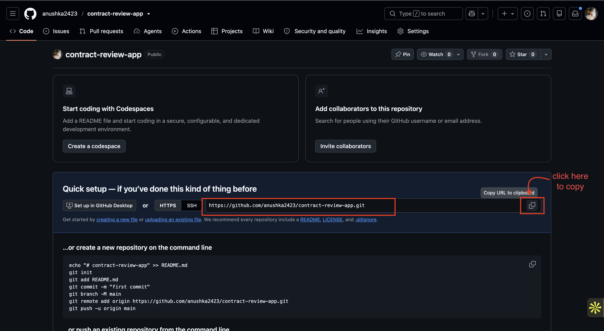

> **Note**: Look at the badge next to the repo name. It says **Public** or **Private**. You'll come back to this in Step 4.

**Output**: You have your username, your email, and your repo link ready to paste.

---

## Step 2: Give Claude Code the Prompt

**What you're doing**: Asking Claude Code to connect your folder to GitHub and push your code.

**Why this matters**: Normally this takes several Git commands that are easy to get wrong. This prompt tells Claude to do the work for you, explain each step simply, and stop to ask before it overwrites anything.

**Action items**:

1. In Claude Code, with your `contract-review-app` folder open, copy the prompt below.
2. Replace `<PASTE REPO LINK HERE>`, `<USERNAME>`, and `<EMAIL>` with the details from Step 1.
3. Paste it into Claude Code and press **Enter**.

```
I want to push my current project folder to my GitHub repository:
<PASTE REPO LINK HERE>

GitHub username: <USERNAME>
Email: <EMAIL>

Please guide me step by step:
1. Check and install Git if missing.
2. Configure my Git username and email.
3. Connect my local project to the GitHub repository.
4. If GitHub sign-in is required, open the sign-in page in my browser, tell me exactly what to click, and wait for me.
5. Push my project code to GitHub.
6. Verify that the files are successfully uploaded.

I'm a non-technical user, so explain everything in simple language. Perform tasks wherever possible instead of asking me to do them.

Important: Never ask me to share my password or token in chat. Don't overwrite existing repository files without asking me first.
```

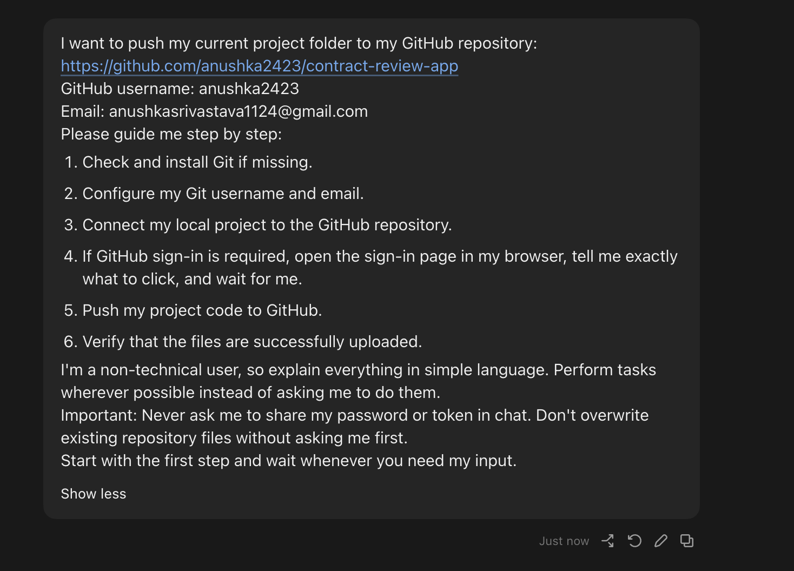

Claude will check Git, set up your name and email, and connect your folder to the repo. Approve its permission requests as they appear. It will stop when it needs you to sign in click on the browser icon at top right corner.

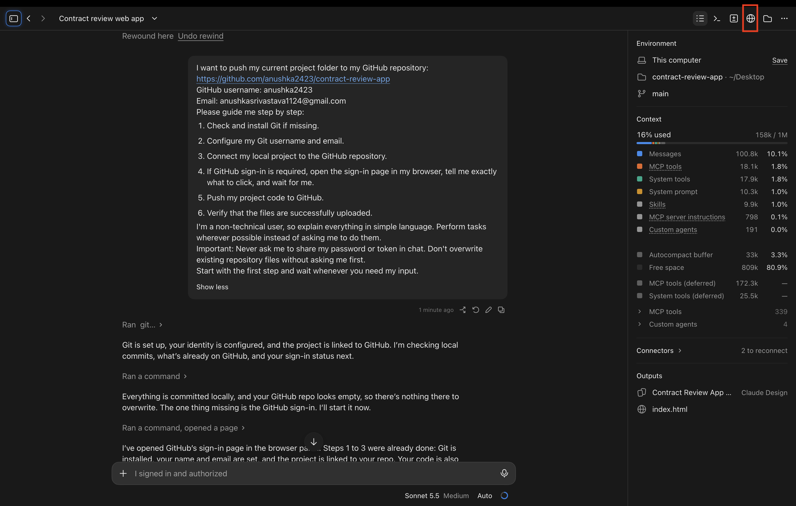

**Output**: Claude Code has connected your folder to your GitHub repo and is waiting for you to sign in.

---

## Step 3: Sign In to GitHub

**What you're doing**: Letting GitHub confirm that you own the repo, so it accepts your code.

**Why this matters**: GitHub won't accept code from just anyone. Signing in proves it's you. You do this in your browser, so your password never goes into the chat.

**Action items**:

1. Look at the panel on the right of Claude Code. The **GitHub sign-in page** opened there. If you don't see it, click the **browser icon** in the top-right corner.


2. Sign in with your GitHub username and password. Type them on this page, never in the chat.

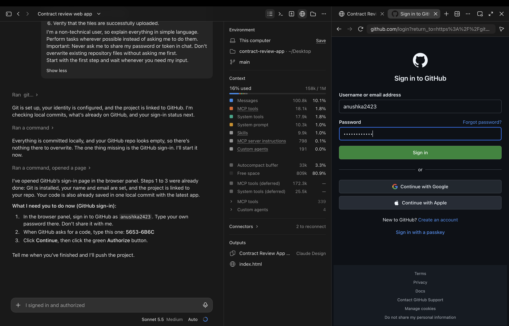

3. On the **Device Activation** page, click **Continue**.

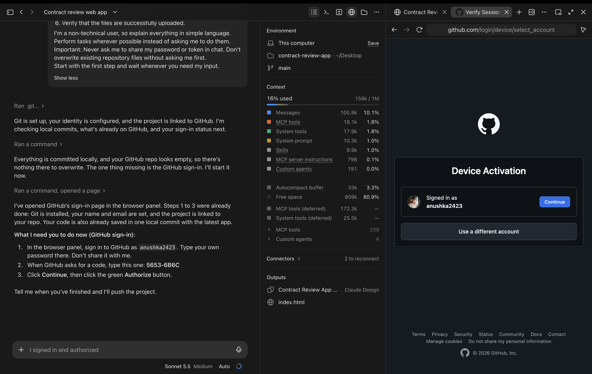

4. Claude shows you a **code** in the chat (it looks like `XXXX-XXXX`). Type it into the boxes on the GitHub page, then click **Continue**.

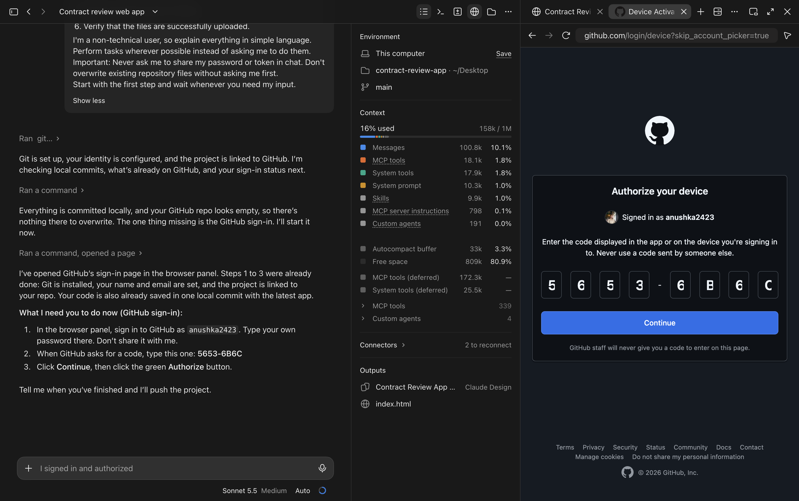

5. Click **Authorize github**.

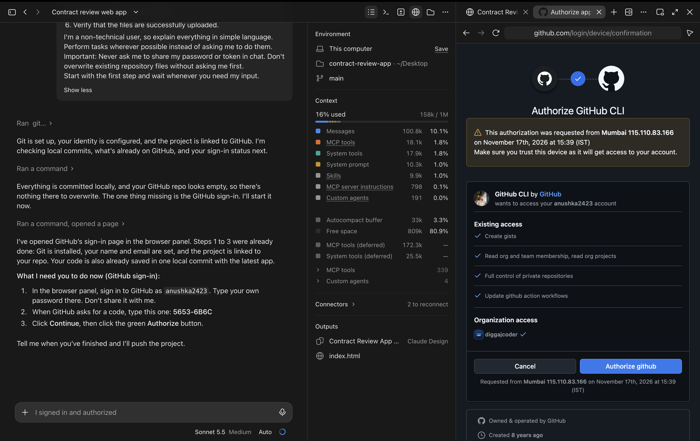

6. You'll see **Congratulations, you're all set!**

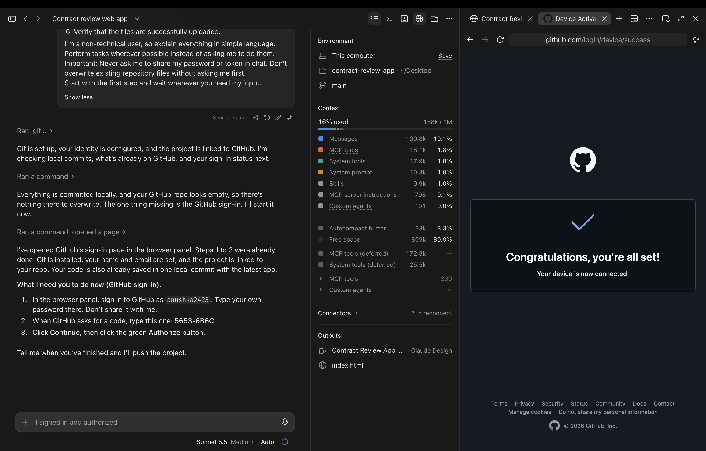

7. Go back to Claude Code and type:

```
I signed in and authorized
```

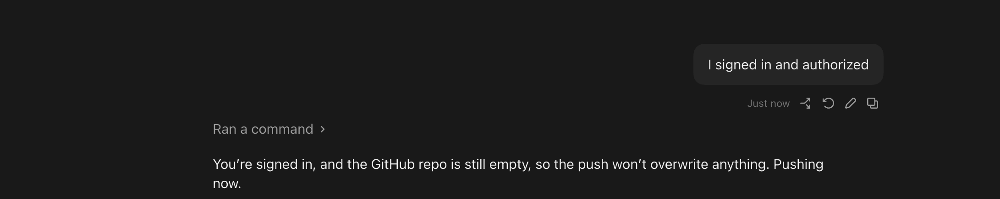

Claude now pushes your code to GitHub.

**Output**: Your code is on GitHub, and Claude confirms the push worked.

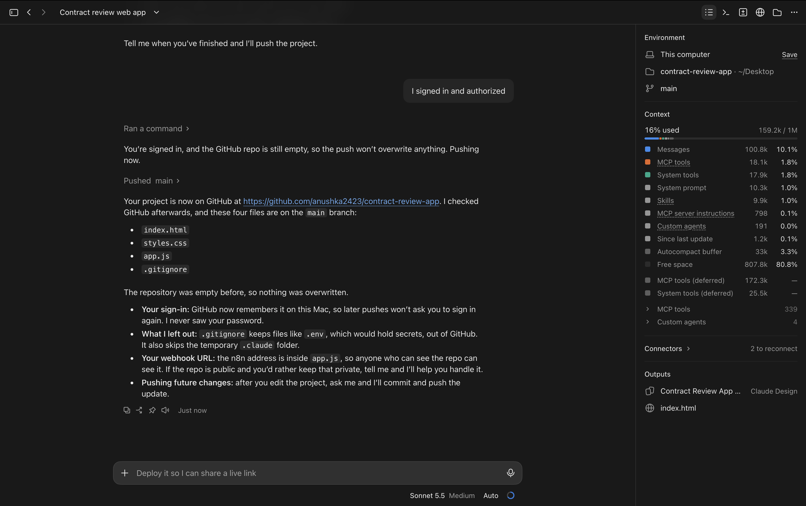

---

## Step 4: Check Your Repo

**What you're doing**: Looking at your repo on GitHub to confirm your files are there.

**Why this matters**: "Claude said it worked" isn't proof. Opening the repo is.

**Action items**:

1. Click the repo link Claude gives you, or open your `contract-review-app` link from Step 1.
2. Refresh the page. You should see `index.html`, `styles.css`, `app.js`, and `.gitignore`.
3. Scroll down. You'll notice there's **no README**, so anyone who opens this repo has no idea what the project is.

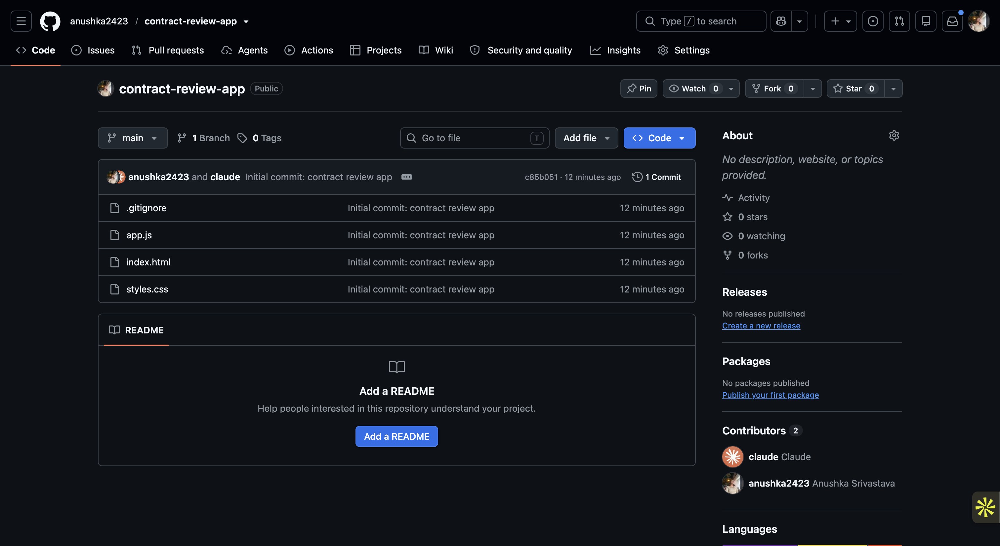

> **Note**: Claude also reminds you that your n8n webhook address is inside `app.js`. If your repo says **Public**, anyone can see it. If you'd rather keep it hidden, tell Claude and it will help you handle it.

**Output**: Your files are on GitHub. The only thing missing is an explanation of what the project is.

---

## Step 5: Add a README

**What you're doing**: Adding a short description file to your repo.

**Why this matters**: A README is the first thing people see on a repo. When you share your link with a teammate, it tells them what the app does and how to run it, so they don't have to ask you.

**Action items**:

1. Go back to Claude Code and paste this prompt:

```
Add a short README.md explaining its key features, and how to run it locally. Then commit all changes with a meaningful commit message and push them to my GitHub repository.
```

2. Approve any permission requests.
3. Refresh your repo page on GitHub.

**Output**: Your repo now shows a README under the file list, and your new changes are saved on GitHub.

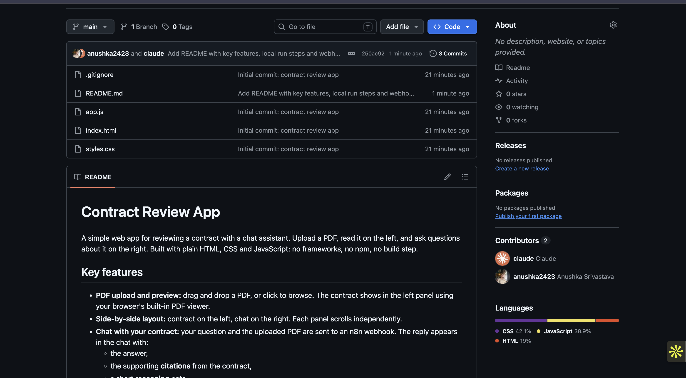

---

## Quick Reference

| Problem | Why it happens | Fix |
|---|---|---|
| Claude asks for your password or token | It shouldn't, and you should never paste one into chat | Say no, and sign in through the browser page instead |
| Browser sign-in page doesn't open | The browser icon wasn't clicked | Click the browser icon in the top-right corner of Claude Code |
| Claude says the repo already has files | Your repo isn't empty (for example, it has a README) | Let Claude explain the options, and approve only what you understand |
| Repo page still looks empty | The page is old | Refresh the page |

---

## What's Next

Your app now lives on GitHub, with a README and a saved history. Every change you push from here on is saved, so you can always go back to a version that worked.
