# Lab 1.4: Push Your Project to GitHub

## Table of Contents

- [Overview](#overview)
- [Prerequisites](#prerequisites)
- [Step 1: Collect Your GitHub Details](#step-1-collect-your-github-details)
- [Step 2: Send the Prompt to Claude Code](#step-2-send-the-prompt-to-claude-code)
- [Step 3: Sign In to GitHub](#step-3-sign-in-to-github)
- [Step 4: Verify Your Repo](#step-4-verify-your-repo)
- [Step 5: Add a README](#step-5-add-a-readme)
- [Troubleshooting Steps](#troubleshooting-steps)
- [What You Learned](#what-you-learned)

---

## Overview

In this lab, you'll put your `contract-review-app` on **GitHub**, so it is backed up, shareable, and keeps a history of every saved version.

You won't type any Git commands yourself. You'll give Claude Code one prompt, and it runs the commands for you and explains each step in plain language.

**Your folder → Claude Code runs Git → Your GitHub repo**

**Words you'll see in this lab**

| Term | What it means |
|---|---|
| **Git** | The tool that tracks changes to your files |
| **GitHub** | A website that stores your Git projects online |
| **Repository (repo)** | A project folder stored on GitHub |
| **Commit** | A saved snapshot of your files, with a short message describing the change |
| **Push** | Uploading your saved changes from your laptop to GitHub |
| **README** | A file that explains what a project is and how to run it |

---

## Prerequisites

✅ **Lab 1.3 complete** — you have a working `contract-review-app` folder on your Desktop.

✅ **A GitHub account and an empty `contract-review-app` repo** — set up in the [GitHub setup lesson](../../pre-reads/0.2-setup-github-account/README.md).

✅ **Claude Code** open in your `contract-review-app` folder.

---

## Step 1: Collect Your GitHub Details

Git needs to know who you are and where to send your code. Collect these three details now, because you'll paste them into a prompt in Step 2.

| Detail | Where to find it |
|---|---|
| **Username** | Your GitHub profile, right under your name |
| **Email** | The email you used to create your GitHub account |
| **Repo link** | The address bar of your `contract-review-app` repo page |

1. Open [github.com](https://github.com), click your **profile picture** in the top-right corner, then click your name to open your profile.
2. Copy your **username**. It's shown right under your name.

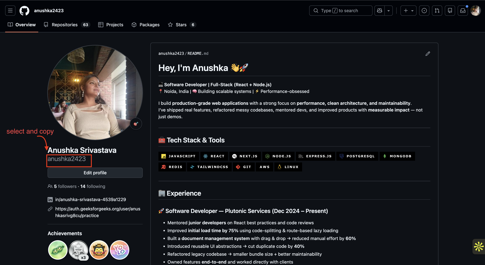

3. Copy the **email** you used to create your GitHub account.
4. Click **Repositories**, then click **contract-review-app**.

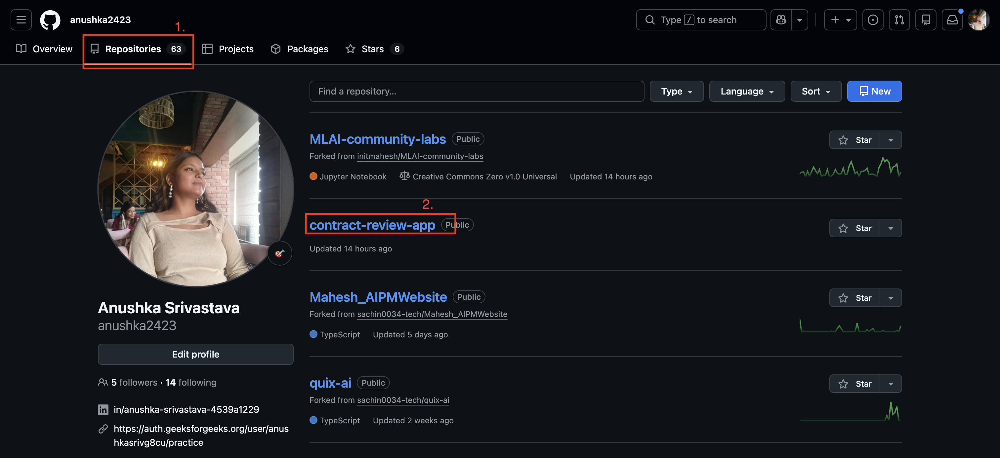

5. Copy the **link** from your browser's address bar. It looks like `https://github.com/<your-username>/contract-review-app`.

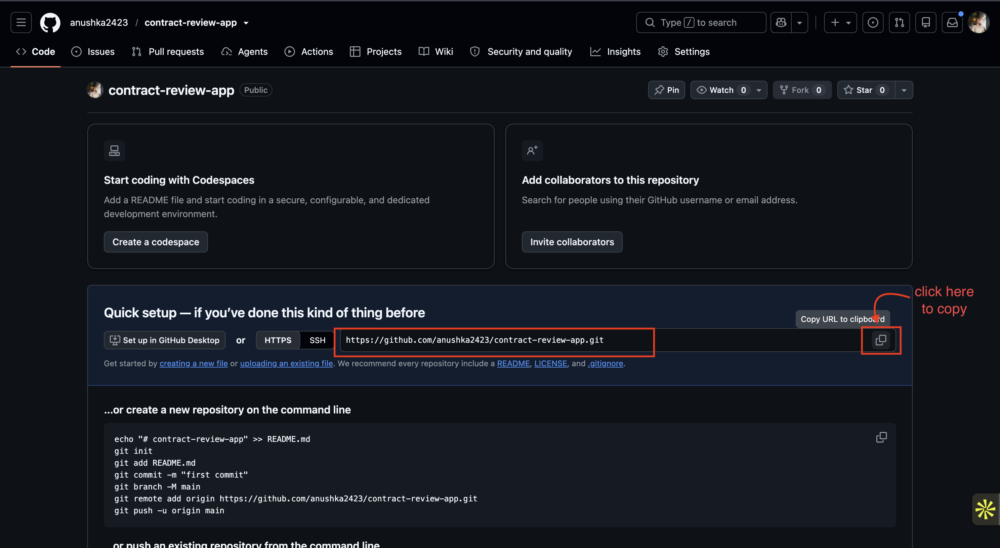

**You should have:** your username, your email, and your repo link, ready to paste.

---

## Step 2: Send the Prompt to Claude Code

This prompt asks Claude Code to connect your folder to GitHub and push your code. It also tells Claude to explain each step simply and to ask before it overwrites anything.

1. In Claude Code, with your `contract-review-app` folder open, copy the prompt below.
2. Replace the three placeholders with your details from Step 1:

| Placeholder | Replace with |
|---|---|
| `<PASTE REPO LINK HERE>` | Your repo link |
| `<USERNAME>` | Your GitHub username |
| `<EMAIL>` | Your GitHub email |

3. Paste the prompt into Claude Code and press **Enter**.

```
I want to push my current project folder to my GitHub repository:
<PASTE REPO LINK HERE>

GitHub username: <USERNAME>
Email: <EMAIL>

Please guide me step by step:
1. Check and install Git if missing.
2. Configure my Git username and email.
3. Connect my local project to the GitHub repository.
4. If GitHub sign-in is required, open the sign-in page in my browser, tell me exactly what to click, and wait for me.
5. Push my project code to GitHub.
6. Verify that the files are successfully uploaded.

I'm a non-technical user, so explain everything in simple language. Perform tasks wherever possible instead of asking me to do them.

Important: Never ask me to share my password or token in chat. Don't overwrite existing repository files without asking me first.
```

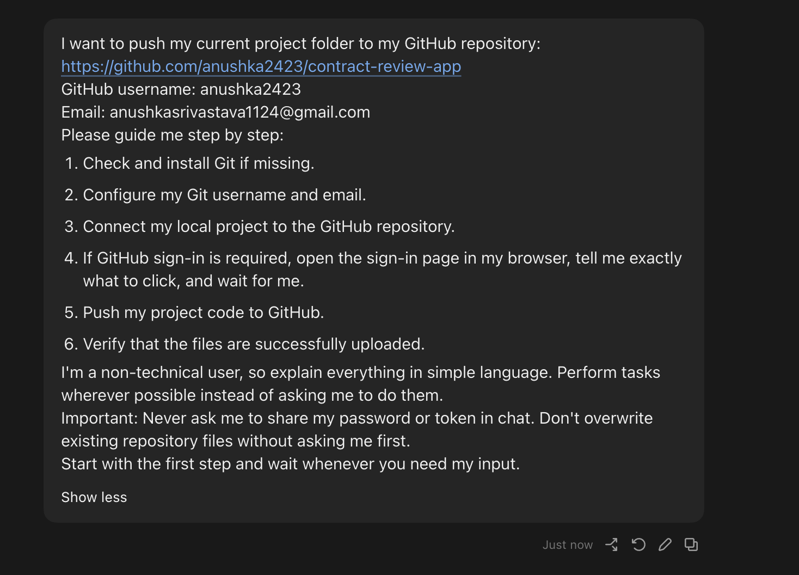

Claude checks Git, sets up your name and email, and connects your folder to the repo. Approve its permission requests as they appear.

**You should see:** Claude pause and ask you to sign in to GitHub. That's your cue for Step 3.

---

## Step 3: Sign In to GitHub

GitHub only accepts code from the repo's owner, so Claude needs you to sign in. You do this in your browser, never in the chat, so your password stays private.

1. Open the sign-in page. Claude opens it in the browser panel on the right side of Claude Code. If you don't see it, click the **browser icon** (the globe) in the top-right corner.

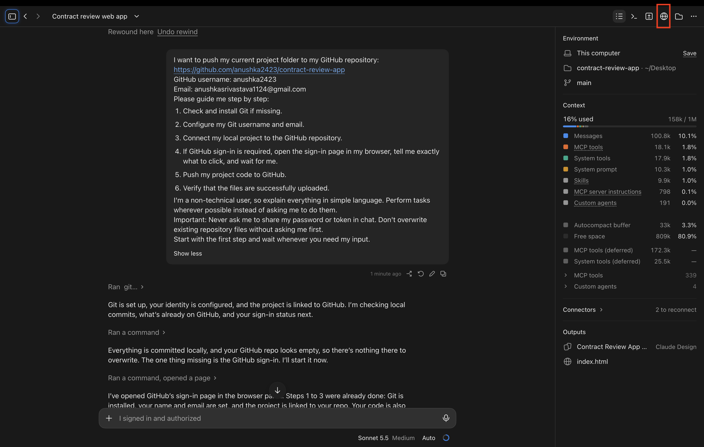

2. Sign in with your GitHub username and password. Type them on this page only. If GitHub already shows you as signed in, skip to the next step.

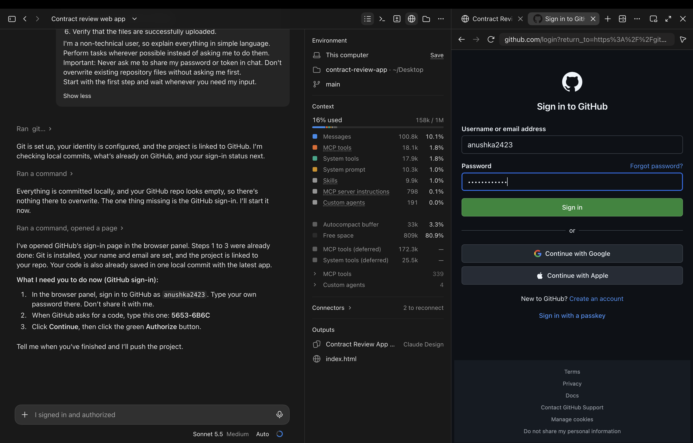

3. On the **Device Activation** page, click **Continue**.

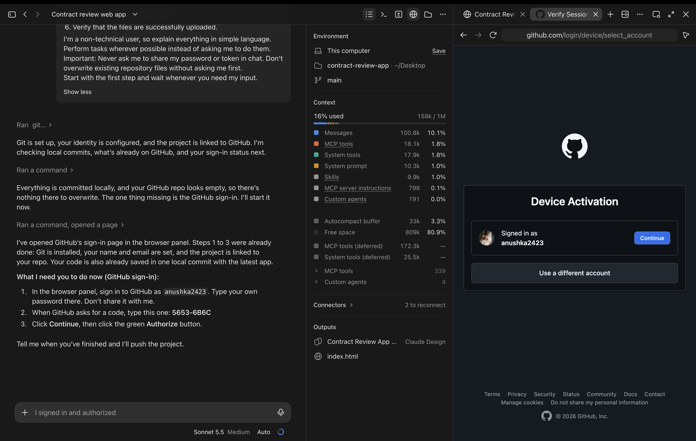

4. Claude shows you a **code** in the chat. It looks like `XXXX-XXXX`. Type it into the boxes on the GitHub page, then click **Continue**.

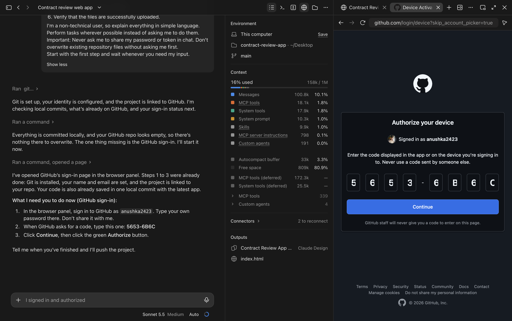

5. Click **Authorize github**.

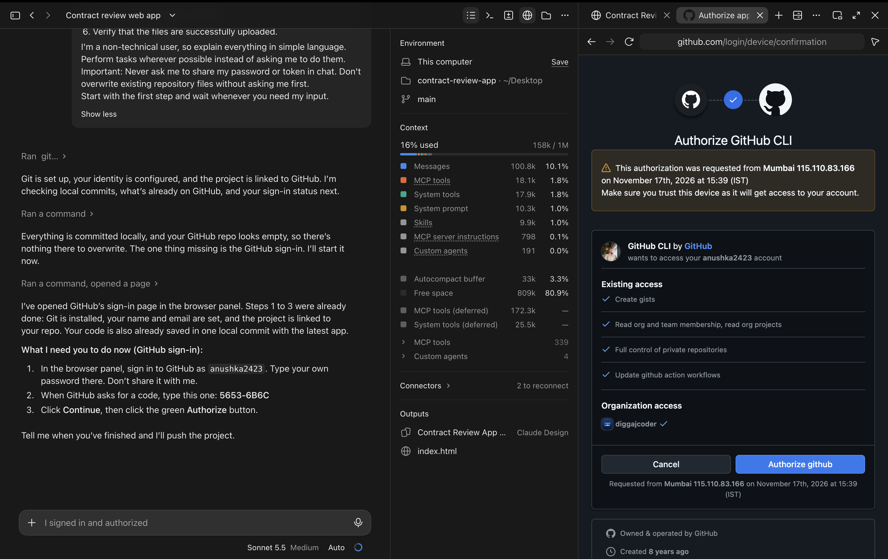

6. You'll see **Congratulations, you're all set!**

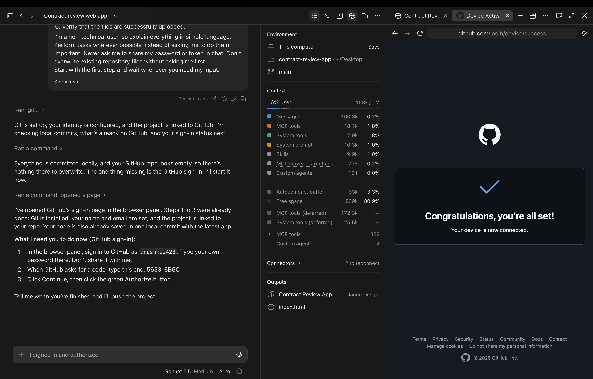

7. Go back to Claude Code and type:

```
I signed in and authorized
```

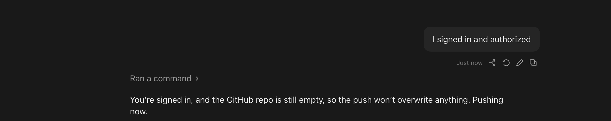

**You should see:** Claude push your code to GitHub and confirm it worked, with a link to your repo and the list of files it uploaded.

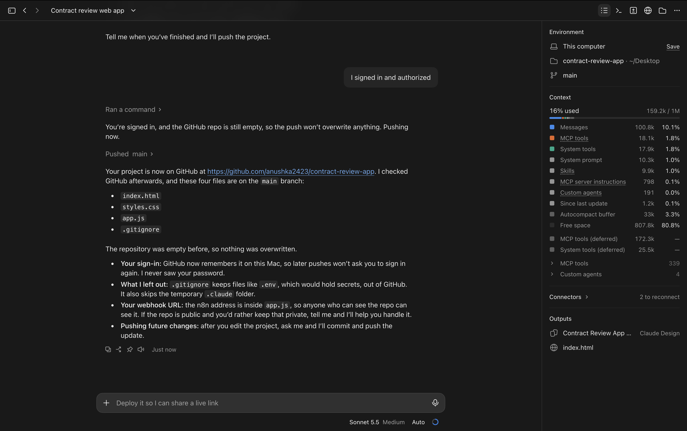

---

## Step 4: Verify Your Repo

"Claude said it worked" isn't proof. Opening your repo is.

1. Click the repo link in Claude's message, or open your `contract-review-app` link from Step 1.
2. Refresh the page. You should see `index.html`, `styles.css`, `app.js`, and `.gitignore`.
3. Scroll down. There's **no README** yet, so anyone who opens this repo can't tell what the project is. You'll fix that in Step 5.

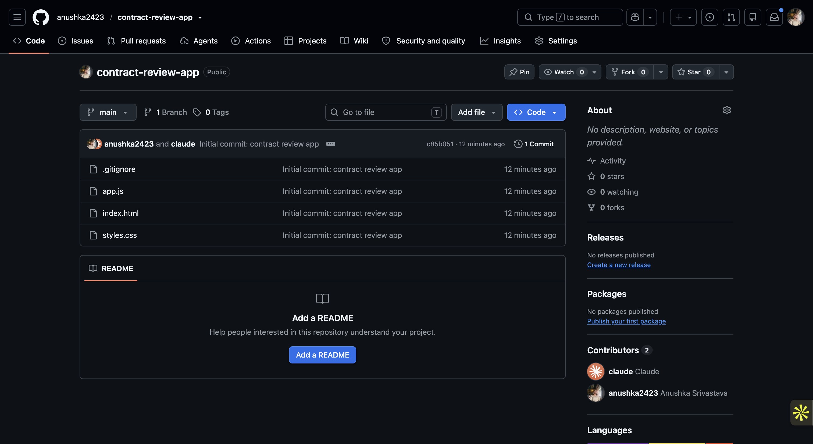

> **Keep your webhook address safe.** Your n8n webhook address from Lab 1.3 is inside `app.js`. Look at the badge next to your repo name. If it says **Public**, anyone can see that address. If you'd rather keep it hidden, tell Claude Code and it will help you handle it.

**You should see:** your four files on GitHub.

---

## Step 5: Add a README

A README is the first thing people see when they open a repo. It tells a teammate what your app does and how to run it, so they don't have to ask you.

1. Go back to Claude Code and paste this prompt:

```
Add a short README.md explaining its key features, and how to run it locally. Then commit all changes with a meaningful commit message and push them to my GitHub repository.
```

2. Approve any permission requests.
3. Refresh your repo page on GitHub.

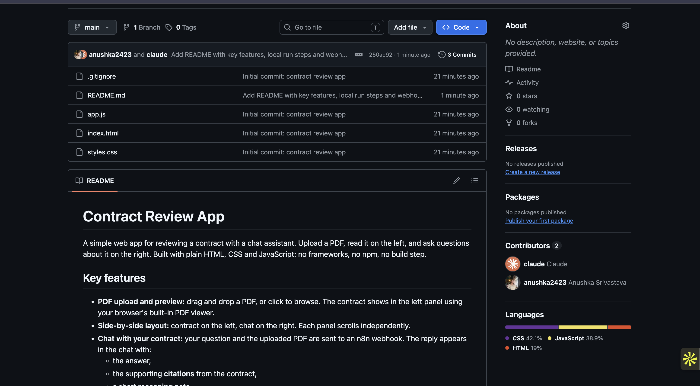

**You should see:** a README under your file list. Your new changes are saved on GitHub.

---

## Troubleshooting Steps

Check here before asking for help.

| Problem | Why it happens | Fix |
|---|---|---|
| Claude asks for your password or token | It shouldn't, and you should never paste either into chat | Say no, and sign in through the browser page instead |
| The browser sign-in page doesn't open | The browser panel isn't showing | Click the **browser icon** (the globe) in the top-right corner of Claude Code |
| Sign-in opens in a **Terminal** tab instead of the browser | Claude sometimes starts sign-in from the terminal | Open the Terminal tab Claude names and follow the steps it lists. They usually ask you to press Enter, then enter a code on GitHub |
| Claude says the repo already has files | Your repo isn't empty, for example it already has a README | Let Claude explain the options, and approve only what you understand |
| Your repo page still looks empty | The page is out of date | Refresh the page |

---

## What You Learned

- **A repo is a backup and a history.** Every change you push is saved, so you can always go back to a version that worked.
- **You sign in through the browser, not the chat.** Never share a password or token with Claude or anyone else.
- **Check, don't assume.** Opening your repo on GitHub is the proof that the push worked.
- **A README makes a repo shareable.** It tells anyone who opens your link what the project is.

Your app now lives on GitHub, with a README and a saved history. Every change you push from here on is saved too.
