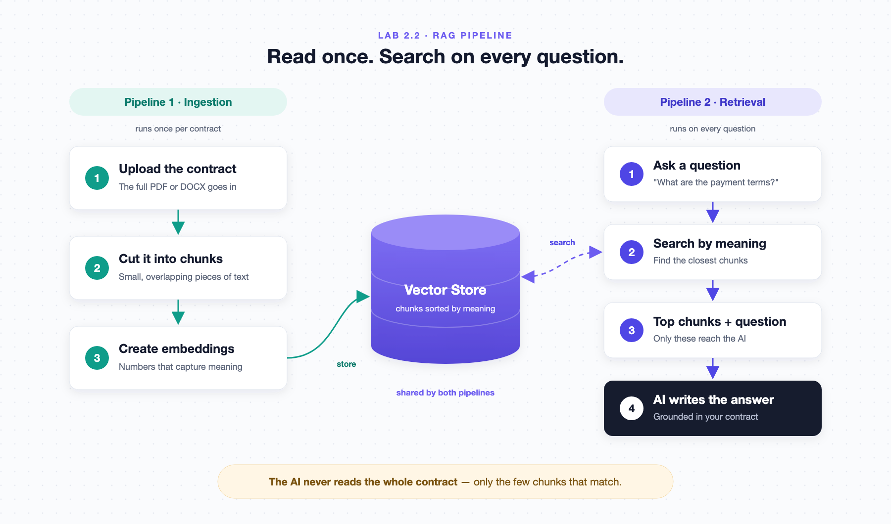
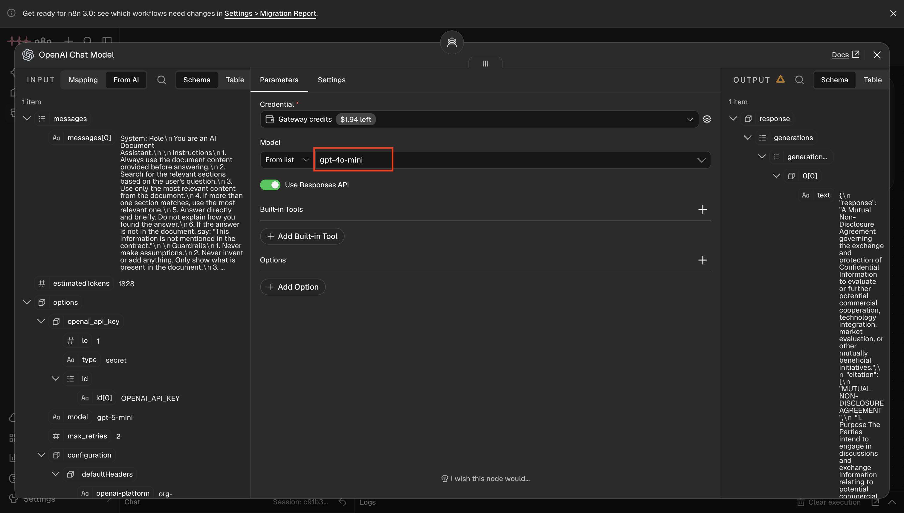
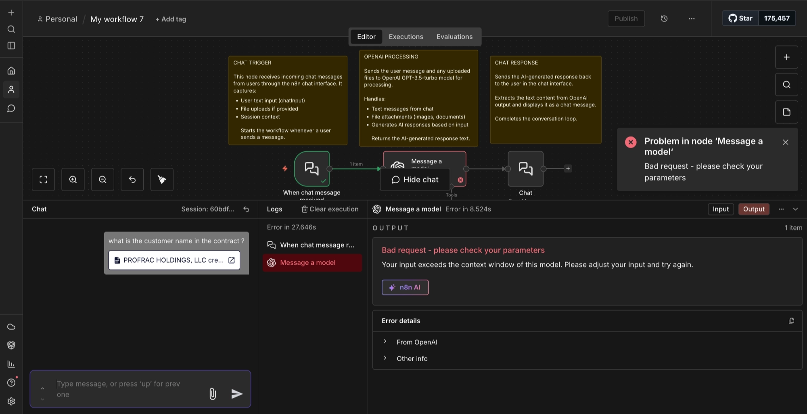
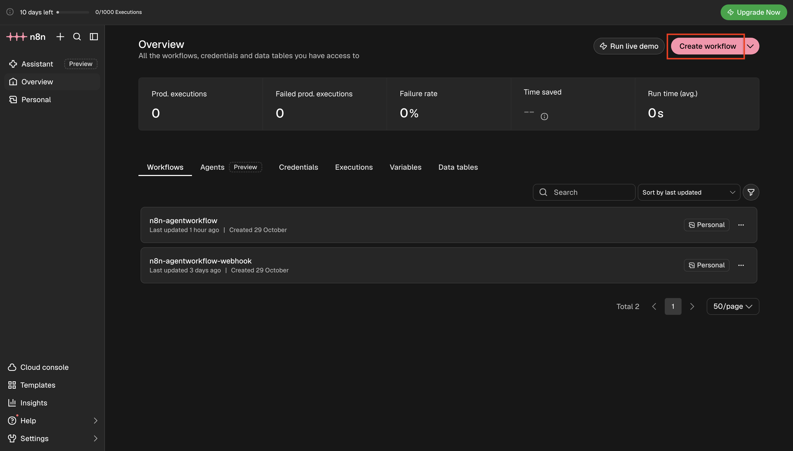
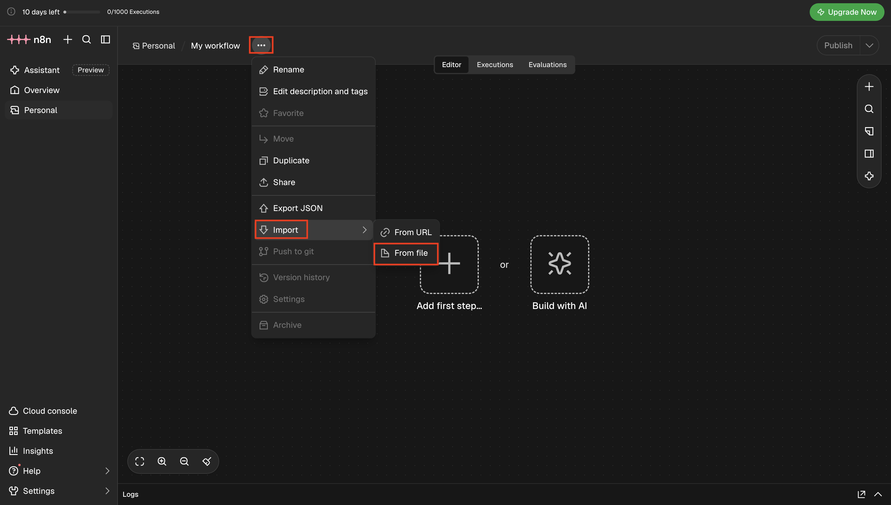
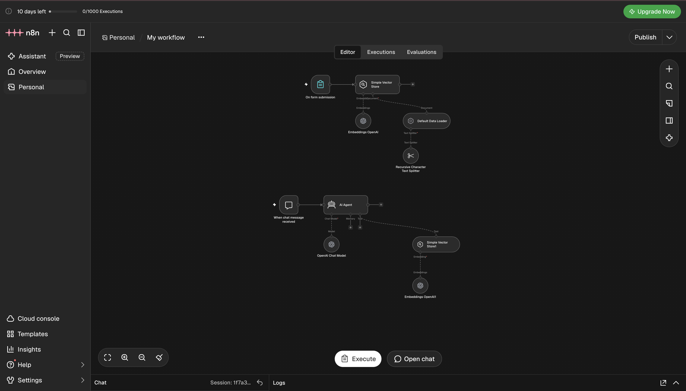
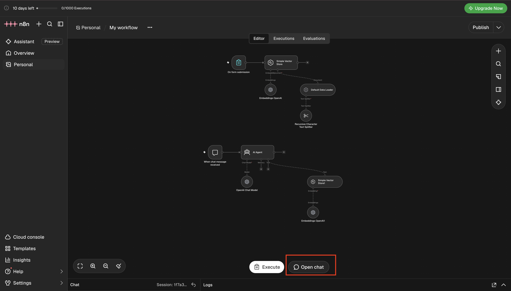
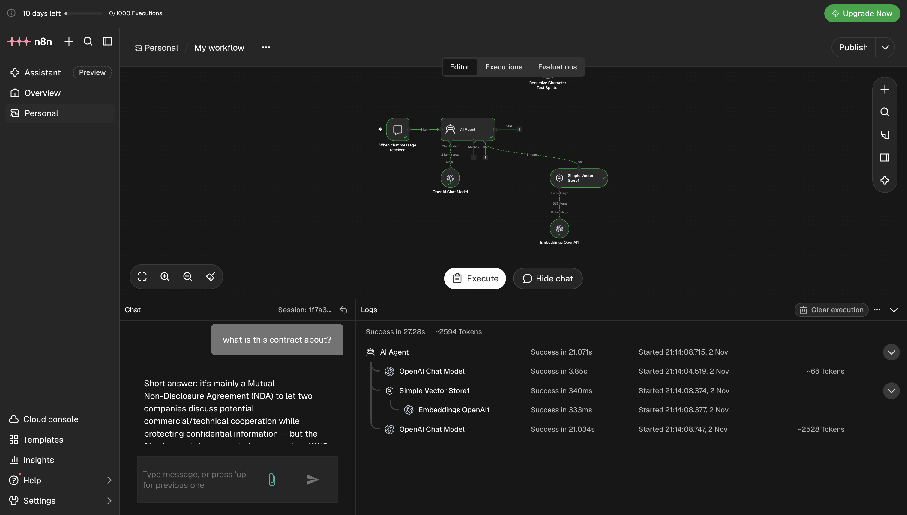
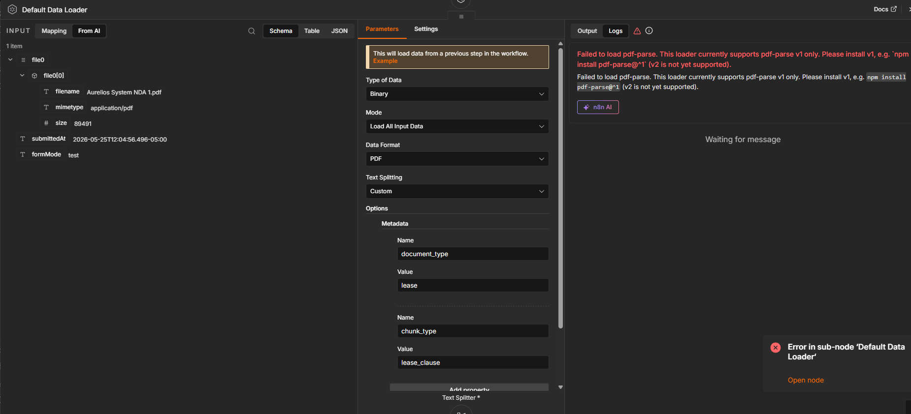
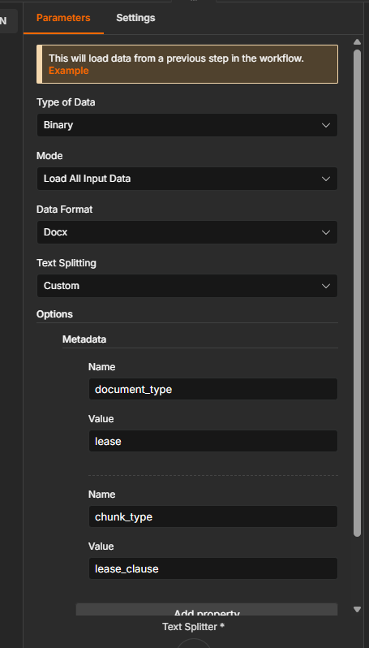

# Lab 2.1: Fix Your Agent on Large Contracts with RAG in n8n



## Table of Contents

- [Overview](#overview)
- [Prerequisites](#prerequisites)
- [Part 1: Find the Limit: Run Your Agent on a Large Contract](#part-1-find-the-limit-run-your-agent-on-a-large-contract)
- [Part 2: Fix It with RAG: Search the Contract Instead of Sending It](#part-2-fix-it-with-rag-search-the-contract-instead-of-sending-it)
  - [The Big Idea: Why RAG Exists](#the-big-idea-why-rag-exists)
  - [Understanding RAG: The Complete Picture](#understanding-rag-the-complete-picture)
  - [The Two Pipelines You'll Build](#the-two-pipelines-youll-build)
  - [Two Ways to Build This](#two-ways-to-build-this)
  - [Import the Workflow](#import-the-workflow)
  - [Test Everything](#test-everything)
  - [What You Learned](#what-you-learned)
  - [The Problem with This RAG Setup](#the-problem-with-this-rag-setup)
- [Troubleshooting Steps](#-troubleshooting-steps)

---

## Overview

In this lab, you'll break your Document Q&A Agent on purpose by giving it a large contract, then fix it with **RAG**. Instead of reading the whole contract, the AI gets only the parts that answer the question.

**Upload contract → cut it into chunks → store them by meaning → find the right chunks → AI answers**

By the end, you'll have a contract Q&A agent that handles large files.

---

## Prerequisites

✅ **Lab 1.1 complete**: your n8n Document Q&A Agent is built and answering questions about a contract. [Go to Lab 1.1](../../week-1/1.1-n8n-agent/README.md), or [download the workflow](https://pragyaallc-my.sharepoint.com/personal/anushka_srivastava_legalgraph_ai/_layouts/15/onedrive.aspx?id=%2Fpersonal%2Fanushka%5Fsrivastava%5Flegalgraph%5Fai%2FDocuments%2Fn8n%2Dagentworkflow%20%284%29%2Ejson&parent=%2Fpersonal%2Fanushka%5Fsrivastava%5Flegalgraph%5Fai%2FDocuments&ga=1) if you don't have it.

✅ The **large test contract** for Part 1: [download it here](https://drive.google.com/file/d/1RMzUyryxh88qiXTW6psH6lEfrhQ8H2ZQ/view).

✅ A **sample contract (PDF)** for Part 2: [download the contract in PDF format](https://pragyaallc-my.sharepoint.com/:b:/g/personal/sachin_parmar_legalgraph_ai/IQCIDp0RA0UYS7g3WGOXOH0uAaJOpNKBwgibUIiks0hCkpc?e=n0XlBh)

✅ A **sample contract (Docx)** for Part 2: [download the contract in Docx format](https://pragyaallc-my.sharepoint.com/:w:/g/personal/sachin_parmar_legalgraph_ai/IQAbCBMxqrFrT6hzD6t9oCdpAR8pdsHtVaZf2O5HiyGq5jY?e=4s3M8D). If the PDF gives you an error, use this one instead (see [Troubleshooting](#-troubleshooting-steps)).

---

## Part 1: Find the Limit: Run Your Agent on a Large Contract

### Run your Document Q&A Agent on a large contract

Open your Lab 1.1 workflow (see [Prerequisites](#prerequisites)). Before you run it, click the **OpenAI Chat Model** node and make sure the model is set to **`gpt-4o-mini`**. Then run it, but this time upload a larger contract instead of the small sample.



Upload this larger test contract: [download it here](https://drive.google.com/file/d/1RMzUyryxh88qiXTW6psH6lEfrhQ8H2ZQ/view).

Ask the same question you used in Lab 1.1:

*"What are the payment terms?"*

### What happens

You'll see one of two things.

**Option A: an error**

```
Bad Request - input exceeds the context
```



**Option B: a slow, degraded, or incomplete answer**

The agent responds, but slowly. Or it misses clauses that are clearly in the document. Or it answers a different question than the one you asked.

Both are the same underlying problem showing up differently.

### Why this happens

The **Extract From File** node pulls the whole contract out as one giant string and pastes it into the AI Agent's prompt, next to the question:

```
User Query: {{ $('Chat Trigger').item.json.chatInput }}

File Context: {{ $('Extract From File').item.json.text }}
```

Every AI model has a **context window**: a hard limit on how much text (measured in **tokens**, roughly ¾ of a word each) it can read in one request. Whatever doesn't fit, it doesn't see.

| Model | Context Window | Approx. Page Limit |
|---|---|---|
| GPT-3.5 Turbo | 16,000 tokens | ~12 pages |
| GPT-4o mini | 128,000 tokens | ~96 pages |
| GPT-4o | 128,000 tokens | ~96 pages |
| Claude Sonnet | 200,000 tokens | ~150 pages |

A 100-page contract can reach 80,000-120,000 tokens, so with the instructions and room for the answer it hits the limit. Then either the API rejects the request (the error above) or the model silently drops the rest (the degraded answer). The model isn't broken. The architecture is.

### The real problem

Even with an infinite context window, sending the whole contract on every question would be:

- **Expensive.** You're billed per token. Sending 100,000 tokens to answer "what are the payment terms?" means paying for 99,900 tokens of unrelated text.
- **Slow.** More tokens take longer to process, so users wait.
- **Less accurate.** Models lose focus when buried in irrelevant text. The right clause is in there, but so are 90 pages of noise.

The current architecture is *send everything, hope the model finds the right part*. That's not good enough for production.

---

## Part 2: Fix It with RAG: Search the Contract Instead of Sending It

Instead of sending the whole contract every time, the system should:

1. Break the contract into smaller pieces when it's first uploaded
2. Store those pieces in a searchable index
3. Find only the relevant pieces when a user asks a question
4. Send just those pieces to the model

That's **RAG** (Retrieval Augmented Generation): the agent stops reading the whole document and starts searching it. Let's build it.

---

## The Big Idea: Why RAG Exists

An AI model only knows what it was trained on, so it has never seen your contracts. **RAG (Retrieval Augmented Generation)** fixes this. Here's how it works:

**1. Filing the contract (once per document)**

Upload contract → cut it into chunks → convert each chunk into an embedding → store them in the vector store

**2. Answering a question (every time someone asks)**

Question → search the vector store → relevant chunks go into the AI's prompt → AI answers from them

Think of the **vector store** as a filing room: a database that sorts text by *meaning* rather than alphabetically or by date. The AI goes to the filing room first, reads the right pages, and only then answers.

---

## Understanding RAG: The Complete Picture

Want to go deeper? This section explains what RAG stands for, how the two pipelines work step by step, and what a vector actually is. It's optional. You can skip straight to [Prerequisites](#prerequisites) and come back later.

<details>
<summary><b>👉 Click to read the complete picture</b></summary>

<br>

### What the name means

| Word | What it means in practice |
|---|---|
| **Retrieval** | Before the AI answers, it *retrieves* the relevant pieces of your document from a search index |
| **Augmented** | The AI's prompt is *augmented* (extended) with that retrieved context |
| **Generation** | The AI *generates* an answer using both its training knowledge and the retrieved material |

- **Without RAG:** `question → AI → answer (from training only)`
- **With RAG:** `question → search index → relevant chunks → AI → answer (from your document)`

### The two pipelines

**Ingestion** (once per document). After this, your 150-page contract lives in the vector store as thousands of small, searchable pieces.

```
PDF Upload
    ↓
Text Extraction (binary → readable text)
    ↓
Chunking (break into ~800 character pieces)
    ↓
Embedding (each chunk → vector of numbers)
    ↓
Vector Store (store the vectors, indexed by meaning)
```

**Retrieval** (every question). The AI never sees the full contract, only the question plus the 5 most relevant chunks: about 3,000–5,000 tokens instead of 100,000. The document isn't made smaller; the AI just reads the part that matters.

```
User Question: "What are the payment terms?"
    ↓
Embed the question (question → vector of numbers)
    ↓
Search the vector store (find chunks with similar vectors)
    ↓
Top 5 most relevant chunks retrieved
    ↓
Chunks + original question → AI model
    ↓
AI answers from the retrieved context
```

### What is a vector, actually?

An **embedding model** turns a piece of text into a long list of numbers, called a **vector**:

```
"Payment is due within 30 days of invoice."
→ [0.23, -0.81, 0.44, 0.12, ..., 0.67]  (1536 numbers)
```

Think of those numbers as a location on a map of meaning (a map with 1,536 dimensions instead of two). Text with similar meaning lands close together, even when the words are different.

So if a user asks *"When do invoices need to be paid?"*, the question gets its own location on the map, and the system returns the nearest chunks. "Payment due within 30 days" and "net-30 payment obligation" both come back, even though neither shares a keyword with the question. This is **semantic search**: matching meaning, not words.

### Putting it together: back to the law firm

A partner asks you: *"What are the termination conditions in the Acme deal?"* You don't answer from memory. You go to the filing room, pull the Acme folder, turn to the termination clause, read it, then answer.

| At the law firm | In RAG |
|---|---|
| The **filing room** | The vector store |
| **Pulling the folder** | Retrieval |
| **Reading the clause** | The retrieved context landing in the AI's prompt |
| **Answering the partner** | Generation |

> The AI is not the filing room. It is the consultant. The vector store is the filing room.

</details>

---

## The Two Pipelines You'll Build

The system is made of two separate workflows, called pipelines. You file a document once and search it as often as you like.

| | **Pipeline 1: Ingestion** (the filing) | **Pipeline 2: Retrieval** (the looking-up) |
|---|---|---|
| **When it runs** | Once per document | Every time someone asks a question |
| **What it does** | Breaks the document into chunks, turns each chunk into a vector embedding, and stores it in the vector store | Finds the most relevant chunks, passes them to the AI agent, and the agent answers |

---

## Two Ways to Build This

| | **Import the Workflow** | **Build from Scratch** |
|---|---|---|
| **Best for** | Getting up and running fast | Understanding every block and setting |
| **What you do** | Import a ready-made file and add your OpenAI credentials | Add and configure each block yourself |

✅ **For the import path:** [download the pre-built n8n workflow JSON](https://drive.google.com/file/d/1bsHT4DsEvLFZv2WPBdnXJoEAfEn9R6Ka/view?usp=sharing).

Both give you the same two workflows. 👉 **[Build from Scratch →](./build-from-scratch.md)**, then come back here to [Test Everything](#test-everything).

---

## Import the Workflow

**Step 1. Create a new workflow.** Log into n8n and click **"Create Workflow"** to open a blank canvas.



**Step 2. Import the ready-made file.** Click the **three-dot menu (⋮)** in the top-right corner, select **"Import from file"**, and choose the JSON file from [Two Ways to Build This](#two-ways-to-build-this). Both workflows, ingestion and retrieval, load onto the canvas.



**Step 3. Add your OpenAI credentials** to the **embedding** and **model** blocks.

---

## Test Everything

### Step 1: Upload the contract

Open the ingestion workflow, click **"Execute Workflow"**, upload the sample contract and submit. Every block should complete successfully. Do this first: you can't search a vector store that's empty.



### Step 2: Ask it questions

Open the retrieval workflow, click **"Execute Workflow"**, then **"Open Chat"**.



Ask *"What is this contract about?"* and watch the execution in the background: the agent calls the vector store, retrieves the relevant chunks, and builds its answer from them.



Then try:

- *"What are the names of the parties in the contract?"*
- *"Are there any auto-renewal clauses?"*

Every answer comes from the stored document, not the model's general training. The agent is reading from the vector store. Answers look generic? See [Troubleshooting](#-troubleshooting-steps).

---

## What You Learned

You started with an agent that broke on a large contract. Here's what made the new one work:

| Concept | What it means | Why it matters |
|---|---|---|
| **RAG** | The vector store holds your documents; the AI only reads what it's handed | Swap the model and the documents stay; add documents and the model doesn't change |
| **Chunking** | The contract is cut into small pieces before it's stored | Too big and the AI gets buried in irrelevant text; too small and the answer loses context |
| **Embeddings** | Each chunk becomes a set of numbers that captures its meaning | A question about "invoice terms" finds "payment obligations", even with different words |
| **Two workflows** | Ingestion runs once per document; retrieval runs once per question | Change chunking without touching the chat, or upgrade the chat without re-uploading |
| **System message** | "Always call the vector store first" tells the agent how to behave | It's a product decision: this one line controls when the agent searches |

---

## The Problem with This RAG Setup

The system works. Now open the chat and type *"Hi"*.

The agent still searches the contract and pulls 5 chunks into the prompt before it replies. The same happens for every "thanks" or "ok": about 1,000 extra tokens for chunks nobody needed, and a response as slow as a real legal question.

**Why?** Your system message says *"always call the Simple Vector Store tool first,"* so the agent searches every time.

What you need is an agent that decides when to search and when to just reply. That's **Agentic RAG**, and you build it in the next lab.

---

## 🔧 Troubleshooting Steps

Check here before asking for help.

**You see this error when running the workflow with the PDF**



1. Open the **Default Data Loader** and change the data format from **PDF** to **Docx**.



2. Upload the `.docx` file, not the `.pdf`.

If you're not seeing this error, carry on with the current workflow.

---

**Answers are generic, or the agent says it doesn't have the information**

Check two things: the **Memory Key** in the retrieval tool matches the one from ingestion exactly, and the **same OpenAI embedding credential** is used in both workflows.

---

## What's Next

You've built the core of a document-aware AI system and seen its first limit: it retrieves blindly on every message. In the next lab, you'll give the agent the judgment to decide when to search, when to skip, and how to handle chats that mix contract questions with small talk, without wasting tokens or adding delay.

[Go to Lab 2.2: Agentic RAG →](../2.2-n8n-agenticRAG/Readme.md)
