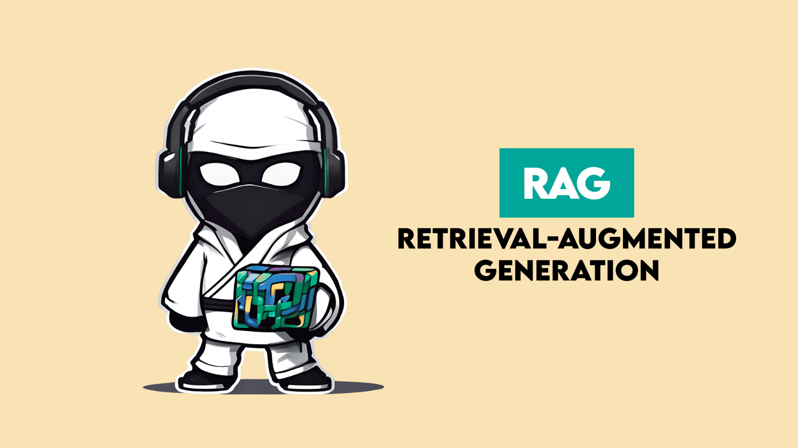
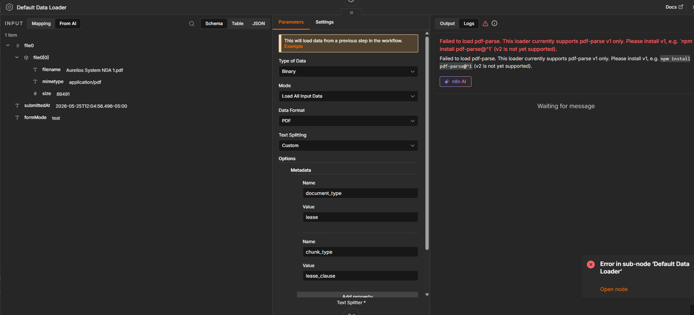
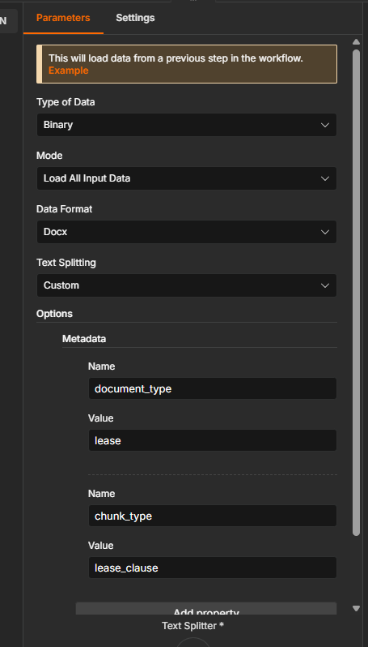
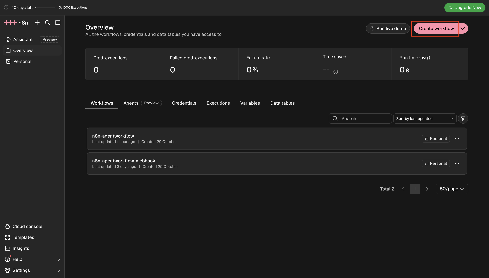
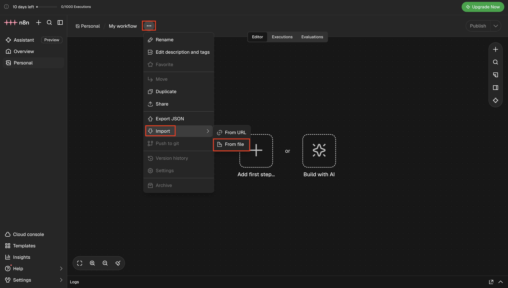
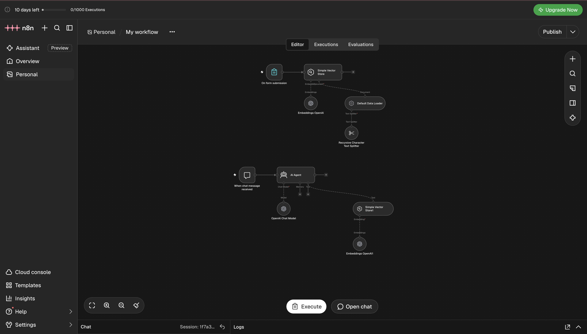
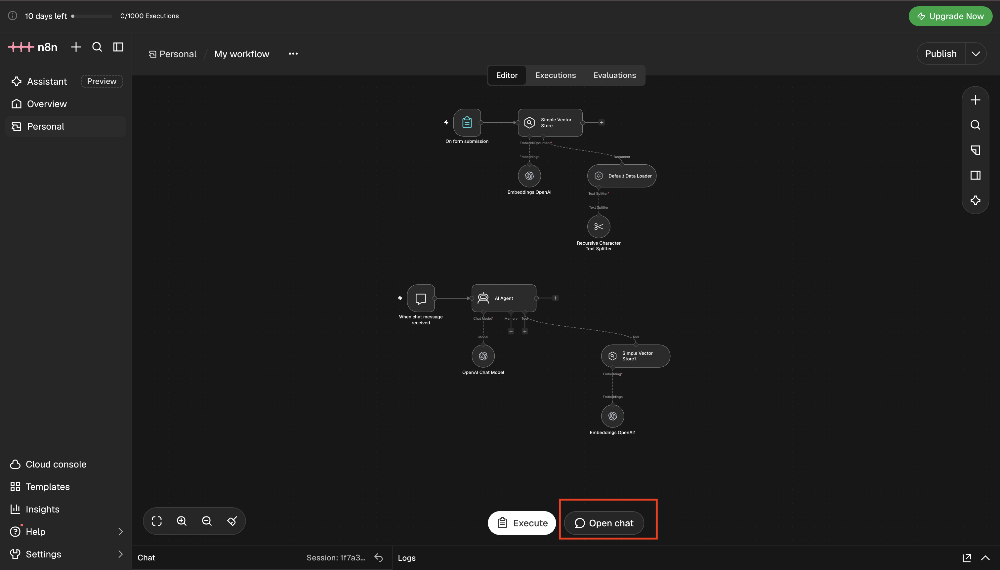
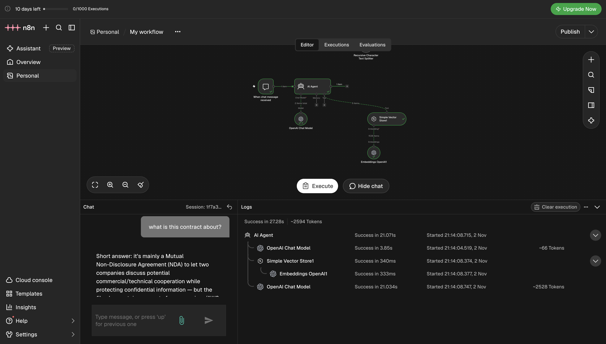
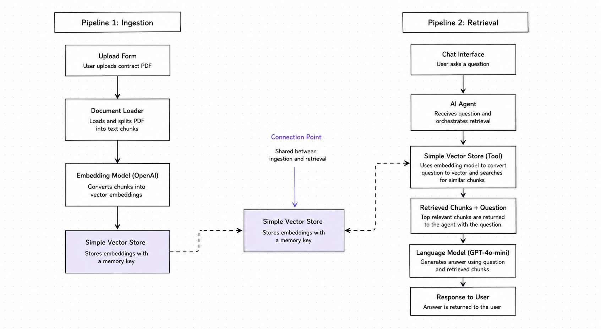

# Lab 2.2: Build Your First RAG Pipeline



In Lab 2.1, you saw the failure firsthand.

You took the agent you built in Week 1 - the one that reads a contract and answers questions about it - and you handed it a real, multi-page document. It either threw an error:

```
Bad Request - input exceeds the context
```

Or it responded slowly, missed clauses that were clearly in the document, or gave you an answer that had nothing to do with what you asked.

You traced the problem back to one line in the workflow: the **Extract From File** node dumps the entire document as one giant string directly into the AI's prompt. For a small sample file, that works. For a 40-page vendor agreement, a 80-page SaaS contract, or a 200-page M&A document - it breaks. Not because the AI isn't smart enough. Because every model has a hard limit on how much text it can process at once, and stuffing a full contract through that slot is the wrong architecture.

That was the point of Lab 2.1. See the failure. Understand why it happens. Now fix it.

This lab fixes that.

By the end, you'll have a pipeline that breaks large contracts into searchable pieces, stores them, and retrieves exactly the right section when a user asks a question - without hitting context limits.

This is RAG. And once you build it, you'll see it in every serious AI product.

By the end of this lab, you will:

- Understand what RAG is and why it exists
- Build a two-workflow system - one that ingests large documents, one that retrieves from them
- Know what vector embeddings are and why they're not just a buzzword
- Have a live contract Q&A agent that handles large files and remembers what it's been given

---

## The Big Idea: Why RAG Exists

Before we touch n8n, there's a mental model worth having. It makes every step in this lab make sense.

An AI model knows a lot. But it only knows what it was trained on - and it can't learn from your specific documents. Hand it a contract it's never seen and it'll try to answer from general knowledge. That's not good enough.

**RAG - Retrieval Augmented Generation** - is the fix.

Here's how to think about it. Imagine you're a consultant who just joined a law firm. You're smart. You've read thousands of contracts. But you haven't read *this* firm's contracts, their deal history, their specific clients. Before you answer any question, you go to the filing room, pull the relevant folders, read the right pages, and *then* you answer.

That's RAG. The AI goes to the filing room first.

The filing room is a **vector store** - a database that doesn't organize documents alphabetically or by date, but by *meaning*. When the user asks a question, the system finds the chunks of text that mean the most similar thing to that question, pulls them out, and hands them to the AI. The AI answers from that retrieved context, not from general knowledge.

```
User asks a question
        ↓
System searches the vector store for relevant context
        ↓
Retrieved chunks land in the AI's prompt
        ↓
AI answers from that specific material
```

There are two pipelines in this system.

**Pipeline 1 - Ingestion:** A user uploads a document. The system breaks it into chunks, converts each chunk into a vector embedding, and stores it in the vector store.

**Pipeline 2 - Retrieval:** A user asks a question. The system finds the most relevant chunks, passes them to the AI agent, and the agent answers.

These two pipelines run separately. The ingestion happens once. The retrieval happens every time someone asks a question. That's the architecture.

---

## Understanding RAG: The Complete Picture

**RAG** stands for **Retrieval Augmented Generation**. Each word is doing real work.

| Word | What it means in practice |
|---|---|
| **Retrieval** | Before the AI answers, it *retrieves* the relevant pieces of your document from a search index |
| **Augmented** | The AI's prompt is *augmented* - extended - with that retrieved context |
| **Generation** | The AI *generates* an answer using both its training knowledge and the retrieved material |

Without RAG, the pipeline is: `question → AI → answer (from training only)`.

With RAG, the pipeline is: `question → search index → relevant chunks → AI → answer (from your document)`.

---

### Why the Context Window Is the Bottleneck

Every AI model has a context window - the maximum amount of text it can process in a single request. Think of it as working memory.

| Model | Context Window | Approx. Page Limit |
|---|---|---|
| GPT-4o mini | 128,000 tokens | ~96 pages |
| GPT-4o | 128,000 tokens | ~96 pages |
| Claude Sonnet | 200,000 tokens | ~150 pages |

A 150-page M&A agreement can hit 120,000 tokens on its own. Add the system prompt, chat history, and the expected response - and you're over the limit. The model either errors out or silently drops the parts that don't fit.

Even when you're under the limit, dumping an entire contract into the prompt is:

- **Expensive** - you're billed per token. Sending 100,000 tokens every time someone asks about payment terms wastes money on 99,900 tokens of irrelevant text.
- **Slow** - processing more tokens takes more time. Users wait.
- **Less accurate** - research shows AI models lose focus when buried in irrelevant context. The right clause is in there, but so are 90 pages of noise.

RAG solves all three problems by sending only what matters.

---

### The Two Pipelines, Explained

**Pipeline 1: Ingestion** - happens once per document

```
PDF Upload
    ↓
Text Extraction (binary → readable text)
    ↓
Chunking (break into ~800 character pieces)
    ↓
Embedding (each chunk → vector of numbers)
    ↓
Vector Store (store the vectors, indexed by meaning)
```

After ingestion, your 150-page contract lives in the vector store as thousands of small, searchable pieces.

**Pipeline 2: Retrieval** - happens every time someone asks a question

```
User Question: "What are the payment terms?"
    ↓
Embed the question (question → vector of numbers)
    ↓
Search the vector store (find chunks with similar vectors)
    ↓
Top 5 most relevant chunks retrieved
    ↓
Chunks + original question → AI model
    ↓
AI answers from the retrieved context
```

The AI never sees the full contract. It only sees the 5 chunks most relevant to the question - plus the question itself. That's typically 3,000-5,000 tokens instead of 100,000.

---

### What Is a Vector, Actually?

An embedding model reads a chunk of text and outputs a list of numbers - something like:

```
"Payment is due within 30 days of invoice." 
→ [0.23, -0.81, 0.44, 0.12, ..., 0.67]  (1536 numbers)
```

Every chunk becomes a point in a 1,536-dimensional space. Chunks that mean similar things end up close to each other in that space - even if the exact words are different.

So when a user asks *"when do invoices need to be paid?"*, the system converts that question into its own vector and finds the chunks whose vectors are closest. "Payment due within 30 days" and "net-30 payment obligation" will both surface - because they mean the same thing, even though they share no keywords.

This is **semantic search**. It finds meaning, not word matches.

---

### The Analogy, One More Time

You are a consultant at a law firm. It's your first week. You're smart - you've read thousands of contracts over your career. But you haven't read *this* firm's contracts.

A partner asks: *"What are the termination conditions in the Acme deal?"*

You don't try to answer from memory. You go to the filing room, pull the Acme folder, flip to the termination clause, read it, then answer.

That is RAG:
- The **filing room** is the vector store
- **Pulling the folder** is retrieval
- **Reading the clause** is the retrieved context landing in the AI's prompt
- **Answering the partner** is generation

The AI is not the filing room. It is the consultant. The vector store is the filing room.

---

✅ **n8n Workflow file** — [Download the pre-built workflow JSON here](https://drive.google.com/file/d/1bsHT4DsEvLFZv2WPBdnXJoEAfEn9R6Ka/view?usp=sharing) to import into n8n.

✅ **n8n account** - the same one from Lab 2.1. You'll be creating new workflows inside it.

✅ **OpenAI API key** - already set up in n8n from Lab 2.1. You won't need to add it again unless you're starting fresh

✅ **A sample contract (PDF)** - [Download the contract in PDF format](https://pragyaallc-my.sharepoint.com/:b:/g/personal/sachin_parmar_legalgraph_ai/IQCIDp0RA0UYS7g3WGOXOH0uAaJOpNKBwgibUIiks0hCkpc?e=n0XlBh)

✅ **A sample contract (Docx)** - [Download the contract in Docx format](https://pragyaallc-my.sharepoint.com/:w:/g/personal/sachin_parmar_legalgraph_ai/IQAbCBMxqrFrT6hzD6t9oCdpAR8pdsHtVaZf2O5HiyGq5jY?e=4s3M8D)


---

**Quick Note**

If you are facing the issue below while running the workflow, follow these steps:



1. Open the default data loader and change the data format from PDF to Docx.



2. When uploading the document, ensure the file format is .docx, not .pdf.

If you are not facing this issue, you can continue with the current workflow.


---

### How to set up this lab

**Import our workflow**

Import the pre-built workflow JSON:

1. Log into n8n and open a blank canvas (click **"Create Workflow"**).



2. Click the **three-dot menu (⋮)** in the top-right corner of the canvas.
3. Select **"Import from file"**.




4. Choose the JSON file you downloaded from the prerequisite section above.
5. The two workflows (ingestion + retrieval) will load onto the canvas. Add your OpenAI credentials to the embedding and model nodes, then proceed to the **Test Everything** section.

**Prefer to build it yourself?** Follow the [step-by-step build-from-scratch guide](./build-from-scratch/Readme.md) to create both workflows node by node, then come back to **Test Everything**.

---

## Test Everything

### Run the ingestion workflow first

Go to your ingestion workflow and click **"Execute Workflow"**. Upload the sample contract and submit. Confirm every node completes successfully.

This step must happen before testing retrieval. You can't search a store that hasn't been filled yet.



---

### Open the chat and ask a question

Go to your retrieval workflow. Click **"Execute Workflow"** to activate it, then click **"Open Chat"**.



Ask this:

*"What is this contract about?"*

Watch what happens in the background - the agent calls the vector store tool, retrieves the relevant chunks, and builds the answer from that context.



Try a few more:

*"What are the parties name in the contract?"*

*"Are there any auto-renewal clauses?"*

Every answer comes from the stored document - not from the model's general training. The agent is reading from the filing room.

> ✓ If answers seem generic or the agent says it doesn't have information, two things to check: (1) confirm the Memory Key in the retrieval tool matches the one from ingestion exactly, and (2) confirm the same OpenAI embedding credential is used in both workflows.

---

## What You Built



You built a two-pipeline system. One processes documents. One answers questions about them. Here's what to take away:

**RAG separates memory from reasoning.** The model doesn't remember your documents - the vector store does. The model's job is to reason over whatever context gets handed to it. Keeping these two concerns separate is what makes the system flexible and scalable. Swap the model, the store stays. Add more documents, the model doesn't change.

**Embeddings convert meaning into coordinates.** When you embed a chunk of text, you're converting its meaning into a location in mathematical space. Chunks that mean similar things end up near each other. That proximity is what search exploits. This is why the system can find "payment obligations" when a user asks about "invoice terms" - the words differ, but the meaning is close.

**The system message is a routing instruction.** Telling the agent to "always call the vector store first" is a product decision, not a technical one. Without it, the agent decides on its own - and it might not always make the right call. The system message is where you enforce behavior. This pattern applies to every agent you'll ever build.

**Chunking is the bridge between large documents and searchable answers.** You can't hand a 200-page contract to an AI in one go. Chunking breaks it into pieces small enough to embed and index. The chunk size controls the granularity of what gets retrieved. Too big and the AI gets buried in irrelevant text. Too small and the answer has no context to stand on. Getting this right is one of the highest-leverage decisions in a RAG system.

**Two workflows, one system.** Ingestion runs once per document. Retrieval runs once per question. Keeping them separate means you can update either side independently - change the chunking strategy without touching the chat interface, or upgrade the chat without reprocessing all your documents.

---

## The Problem with This RAG Setup

The system you just built works. But try something. Open the chat and type:

*"Hi"*

Watch what happens in the background. The agent hits the vector store. It embeds the word "Hi", searches through every chunk of your contract, retrieves the 5 closest matches, stuffs them into the prompt, and then - after all that - responds with something like *"Hello! How can I help you with the contract?"*

It ran the full retrieval pipeline for a greeting.

Now imagine a user has a 10-message conversation. They ask 3 real contract questions and say "thanks", "got it", "ok" in between. Every single message - including the one-word acknowledgements - triggers the same pipeline: embed the message, search the vector store, retrieve 5 chunks, send everything to the model.

That's a problem for three reasons:

**Token cost.** Every retrieved chunk adds tokens to the prompt. 5 chunks at ~800 characters each is roughly 1,000 tokens per query - on top of the question and response. For a casual "Hi", you just spent tokens on 5 contract clauses about termination conditions and payment schedules that had nothing to do with anything.

**Latency.** The vector store search, the embedding call, and the larger prompt all add time. A simple greeting takes as long as a complex legal question. Users notice.

**Noise in the context.** The retrieved chunks are semantically close to the query - but for a vague or conversational message, "semantically close" means random. The model gets irrelevant contract text in its context and has to work around it to give a sensible answer.

The system message you wrote is the cause: *"always call the Simple Vector Store tool first."* It works exactly as instructed - every time, no exceptions. The agent has no way to decide when retrieval is actually useful and when it isn't.

What you need is an agent that can make that decision itself. One that retrieves when it should, skips retrieval when it shouldn't, and routes each message to the right behavior without being told explicitly every time.

That's **Agentic RAG** - and it's what you build in the next lab.

---

## What's Next

You've built the core of a document-aware AI system. And you've seen its first real limitation: a system that retrieves blindly, on every message, regardless of whether retrieval helps. The next lab solves this by giving the agent the intelligence to decide when to search, when to skip, and how to handle conversations that mix document questions with casual chat - without wasting tokens or adding unnecessary latency.

---

> **Quick Note**
>
> If you are facing the issue below while running the workflow, follow these steps:
>
> 1. Make sure you change the default data loader from **PDF** to **DOCX** format.
> 2. When uploading the document, ensure the file format is `.docx`, not `.pdf`.
>
> If you are not facing this issue, you can continue with the current workflow.

[Next Lab →](../2.3-n8n-agenticRAG/Readme.md)
