# Lab 2.2: Build the RAG Pipeline from Scratch

[← Back to the main lab](../Readme.md)

Build both RAG workflows node by node, and learn why each setting matters. Complete the prerequisites in the [main lab](../Readme.md) first. When you finish, go back to the main lab's **Test Everything** section.

---

## What You'll Build

| Phase | Workflow | Job | Nodes |
|---|---|---|---|
| **1** | Ingestion | Turns an uploaded PDF into searchable chunks and stores them | Form Trigger → Simple Vector Store (+ Embeddings, Data Loader, Text Splitter) |
| **2** | Retrieval | Answers questions using the stored chunks | Chat Trigger → AI Agent (+ Chat Model, Vector Store tool, Embeddings) |

> Ingestion runs **once per document**. Retrieval runs **once per question** and searches everything ingested so far. The two workflows are not connected. They share data only through the **memory key**.

---

## Phase 1: Build the Ingestion Pipeline

### Step 1.1: Create a new workflow

Log into n8n and click **Create Workflow** (top right). Start from a blank canvas, not the Lab 1.1 workflow.

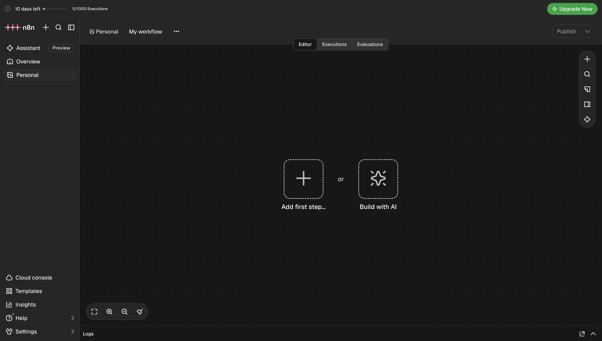

---

### Step 1.2: Add the n8n Form trigger

| Action | Value |
|---|---|
| Add Node → search | **n8n Form** |
| Trigger | **On new n8n Form event** |

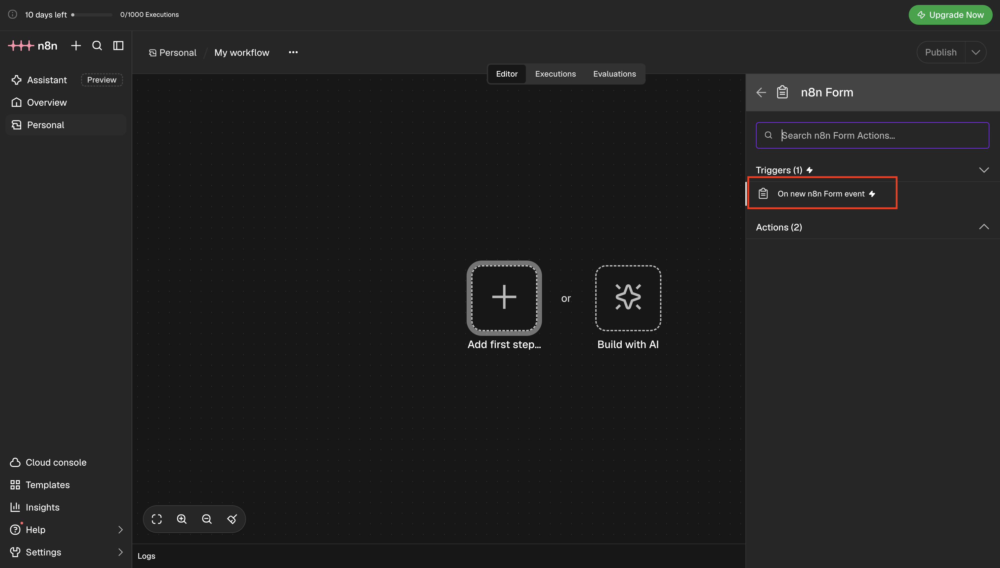

> **Why a Form and not a Chat trigger?** Ingestion is "submit a file and process it", not a conversation. A form gives users a simple upload page.

---

### Step 1.3: Configure the form

| Field | Value |
|---|---|
| Form Title | `Upload Contract` |
| Add Form Element → Label | `file0` |
| Add Form Element → Element Type | **File** |

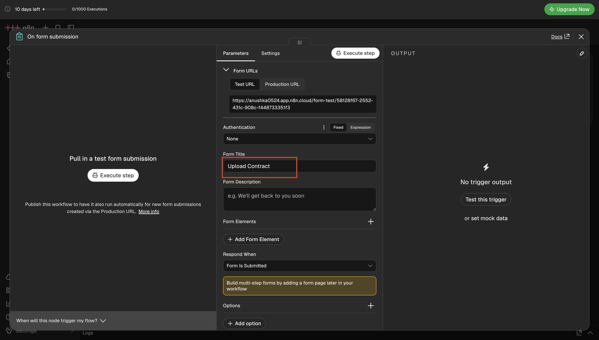

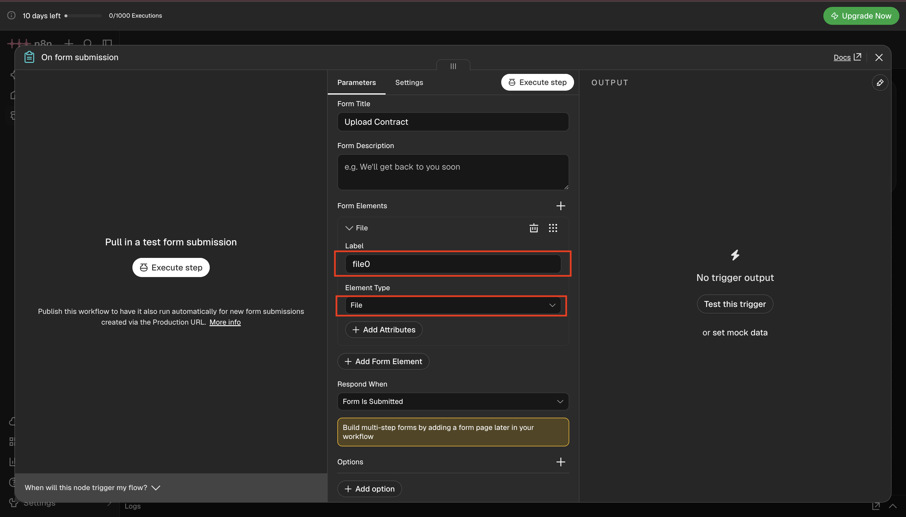

> **Why `file0`?** n8n names uploaded files in order: `file0`, `file1`, and so on. Later nodes look for the file by this name.

---

### Step 1.4: Test the form trigger

1. Click **Execute Step** on the Form node. The upload form opens in a new tab.
2. Click **Choose File**, pick your contract PDF, and click **Submit**.
3. Return to n8n. The node should show a green checkmark.

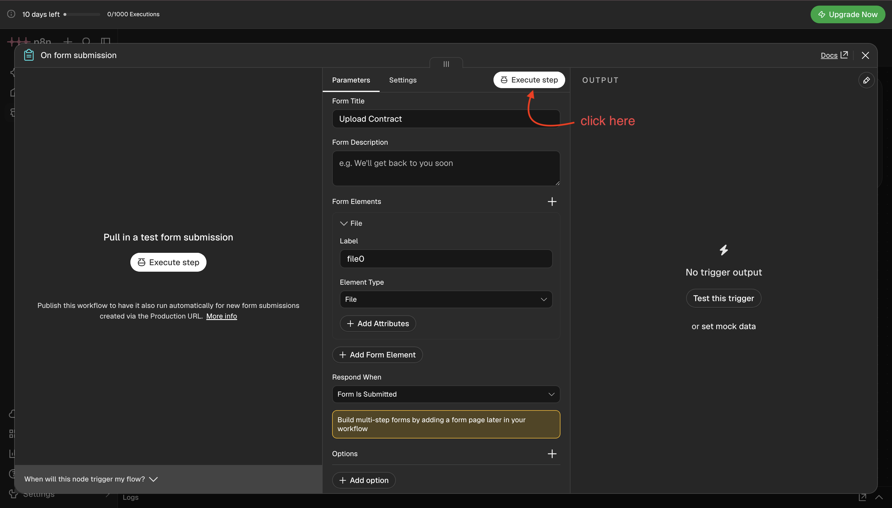

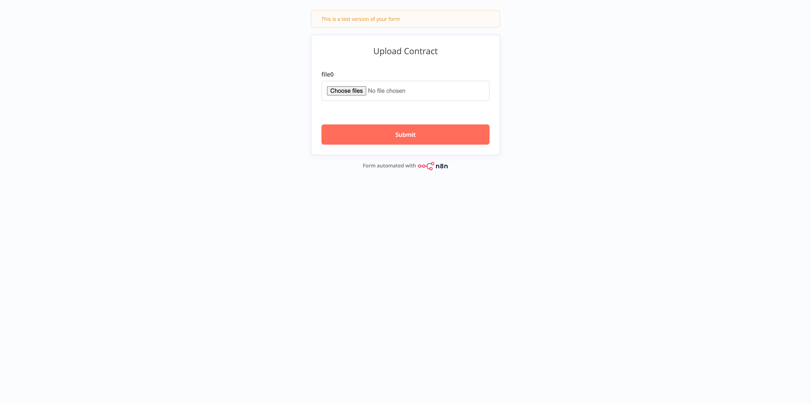

> No result? The form only captures data while the workflow is listening. Click **Execute Step** again, then resubmit.

---

### Step 1.5: Add the Simple Vector Store

| Action | Value |
|---|---|
| Add Node → search | **Simple Vector Store** |
| Action | **Add Document to Vector Store** |
| Connect to | Form trigger |
| Memory Key | Click **(+)** to generate one (e.g. `vector_store_key`). Keep the default name. |

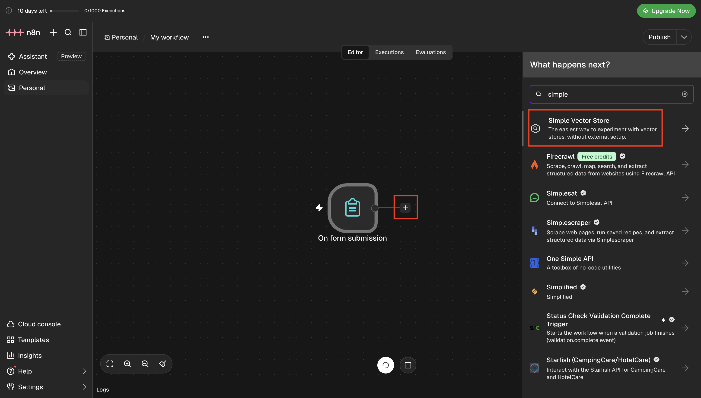

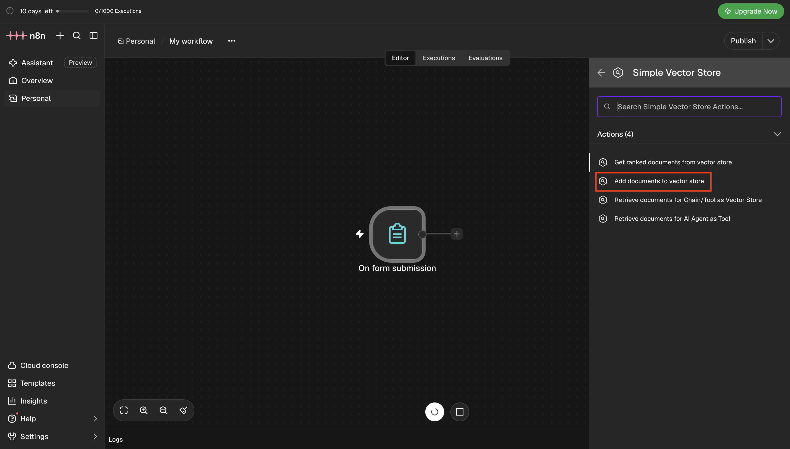

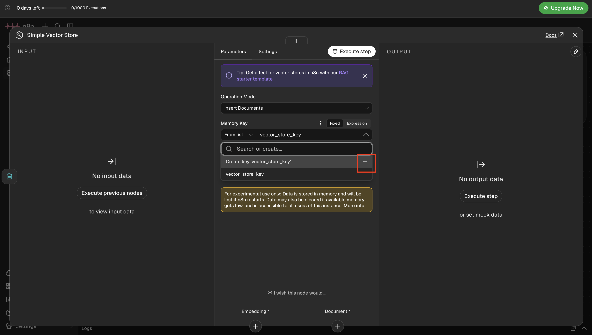

| Concept | In one line |
|---|---|
| **Vector store** | A database that stores text as numbers (vectors), so it can find text with *similar meaning*, not just matching words. |
| **Memory key** | The name of this vector store. Retrieval must use the **exact same key**, or it finds nothing. Copy it for Phase 2. |

---

### Step 1.6: Add the embedding model

| Action | Value |
|---|---|
| Vector Store → **Embedding** | **Embeddings OpenAI** |
| Credential | Your OpenAI credential (or **Create New Credential** and paste your API key) |
| Model | `text-embedding-3-small` |

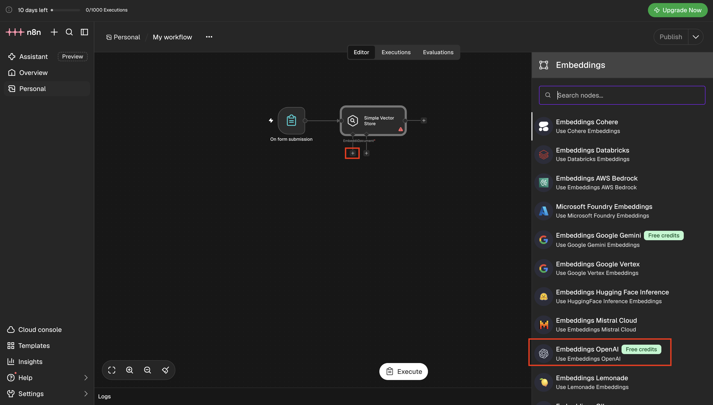

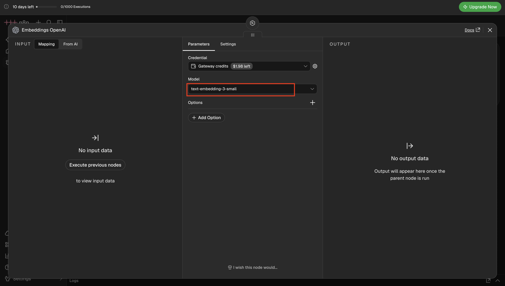

> **What is an embedding?** The embedding model converts each chunk into a vector, which places it as a point on a "meaning map". When a user asks a question, the question is placed on the same map, and the closest chunks are returned, even if they use different words.

<details>
<summary><b>Which embedding option should I choose?</b></summary>

**n8n built-in vs OpenAI**

| | n8n Built-in | OpenAI |
|---|---|---|
| Cost | Free, runs locally | Billed per token |
| Quality | Good for prototypes | Better for production |
| Dimensions | 384 | 1536 to 3072 |
| Use when | Testing, no API budget | Retrieval quality matters |

**OpenAI models**

| Model | Dimensions | Use when |
|---|---|---|
| `text-embedding-3-small` ✅ | 1536 | Default. Best balance of cost and quality. **Use this for the lab.** |
| `text-embedding-3-large` | 3072 | Accuracy is critical (complex legal text, multiple languages). Costs more. |
| `text-embedding-ada-002` | 1536 | Legacy. Use only to stay consistent with data you already embedded with it. |

</details>

> ⚠️ **Golden rule:** Ingest and retrieve with the **same embedding model**. Different models produce incompatible vectors, and you get wrong results or none at all. This is the most common silent mistake in RAG.

---

### Step 1.7: Configure the document loader and text splitter

| Action | Value | Why |
|---|---|---|
| Vector Store → **Document** | **Default Data Loader** | Reads the uploaded file |
| Data Type | **Binary** | The upload arrives as raw bytes, not plain text. The default type breaks on PDFs. |
| Data Format | **PDF** | Uses a PDF parser that understands pages and layout. Otherwise you get garbled text. |
| Text Splitting | **Custom** | Lets you choose the splitter and its settings |
| Text Splitter | **Recursive Character Text Splitter** | Keeps paragraphs and clauses intact |
| Chunk Overlap | `100` | Stops clauses from being cut at chunk boundaries |

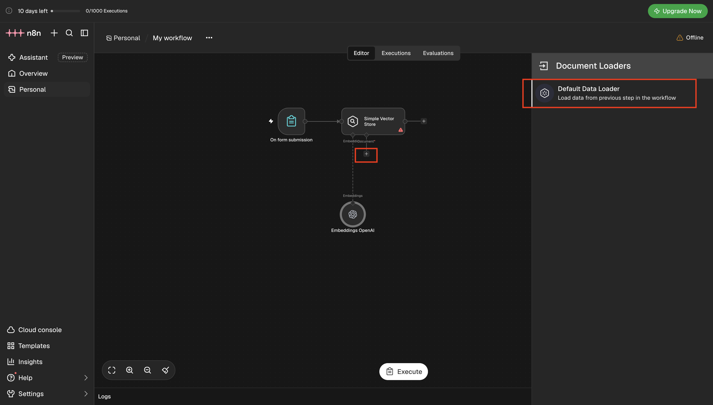

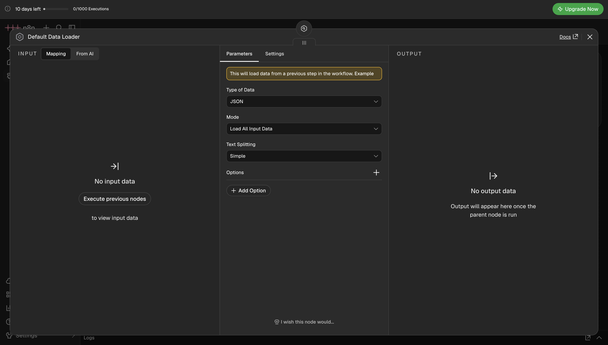

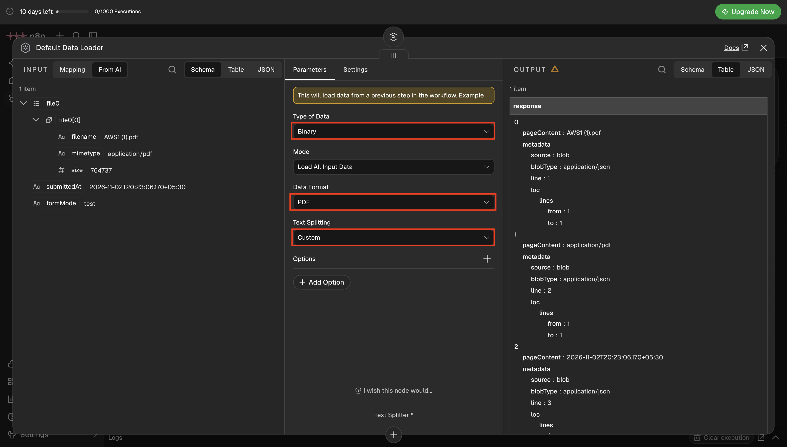

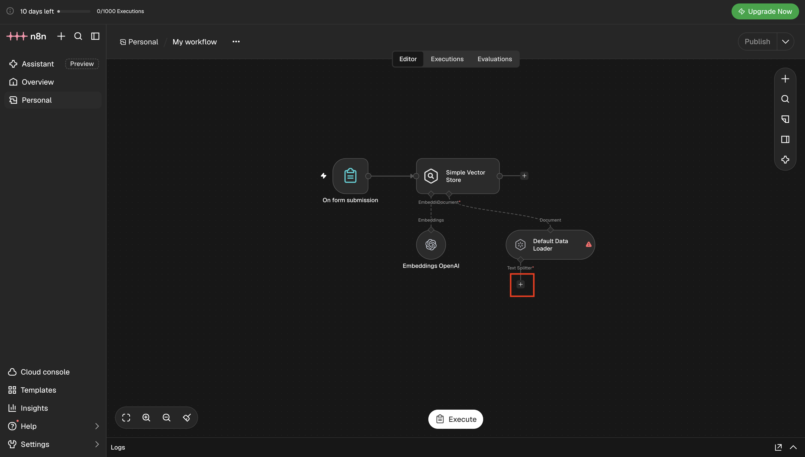

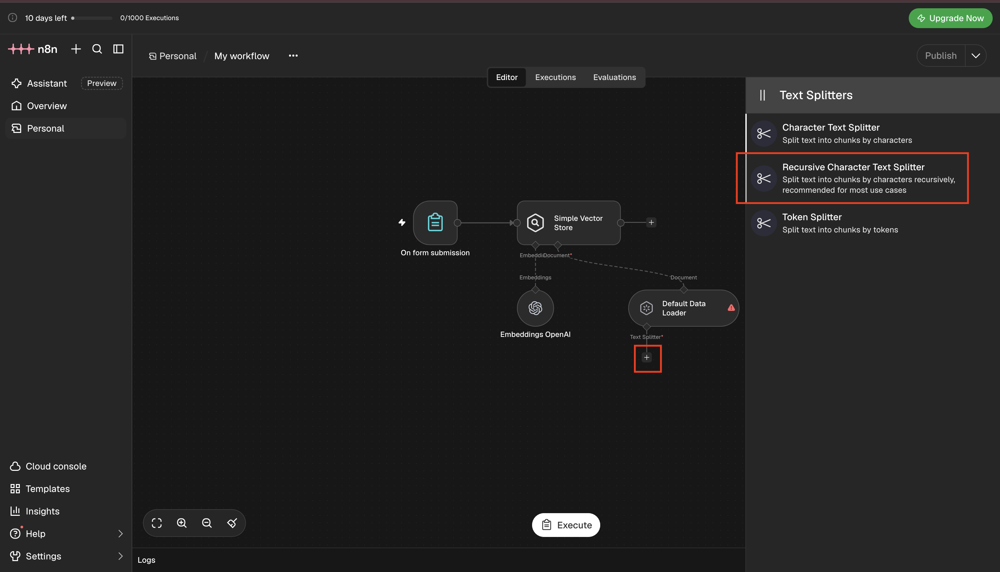

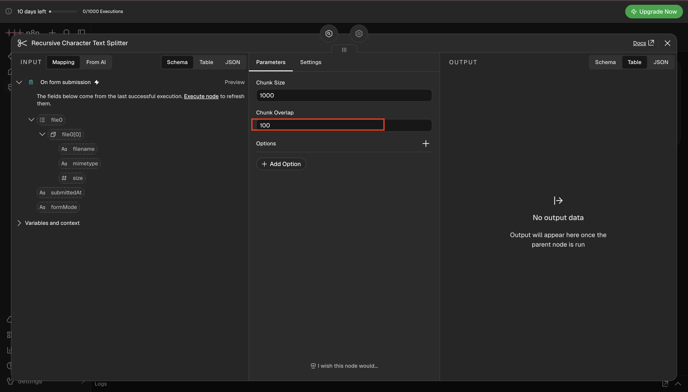

#### What is chunking?


Picture tearing a 200-page contract into index cards, one clause per card. You store the cards, not the book. When someone asks a question, only the relevant cards go to the AI. The **text splitter** does the tearing.

#### How the Recursive Character Text Splitter works

It splits on the largest natural boundary first, and falls back to a smaller one only when a chunk is still too big:

| Priority | Splits on | Result |
|---|---|---|
| 1 | Double newline | Paragraphs stay together |
| 2 | Single newline | Lines stay together |
| 3 | Sentence punctuation | Sentences stay whole |
| 4 | Individual characters | Last-resort hard cut |

Contract clauses are usually one paragraph, so this splitter tends to keep each clause in one chunk.

<details>
<summary><b>Tuning guide: chunk size and overlap</b></summary>

**Chunk size**: how much text goes into each chunk.

| Chunk Size | Contains | Best for |
|---|---|---|
| 200-400 chars | A sentence or short clause | Narrow, precise questions |
| **500-1000 chars** ✅ | One or two paragraphs | Most document Q&A, including contracts |
| 1500-2000 chars | Several paragraphs | Answers that need context across a section |
| 2000+ chars | About a page | Summaries, not retrieval |

**Chunk overlap**: characters shared between neighbouring chunks, so a clause split across a boundary still appears whole in at least one chunk.

| Overlap | Use when |
|---|---|
| 0 | Content is already well structured (e.g. Markdown with clear headers) |
| **50-100** ✅ | Good default for most documents |
| 200-300 | Dense text with unpredictable clause boundaries |
| 500+ | Only if you keep losing context at boundaries and nothing else fixes it |

**Rule of thumb:** overlap should be about **10-20% of chunk size**. Higher overlap doesn't hurt accuracy, but it adds chunks and ingestion cost.

**Symptoms to watch for:**

| Symptom | Likely cause | Fix |
|---|---|---|
| Answers feel vague or generic | Chunks too large | Lower the chunk size |
| Answers feel cut off or miss a step | Chunks too small, or too little overlap | Raise the chunk size or overlap |

**Simple vs Custom text splitting**

| | Simple | Custom (Recursive) ✅ |
|---|---|---|
| Setup | None | Choose a splitter and settings |
| Chunk size / overlap | Fixed defaults | You control them |
| Split logic | Basic character split | Respects paragraphs and sentences |
| Use when | Quick prototypes, plain text | PDFs, production, when quality matters |

</details>

---

### Step 1.8: Test the ingestion pipeline

1. Click **Execute Workflow**.
2. Upload your contract in the form and submit.
3. Watch the nodes run in order: **Form → Vector Store**. All of them should show green checkmarks.

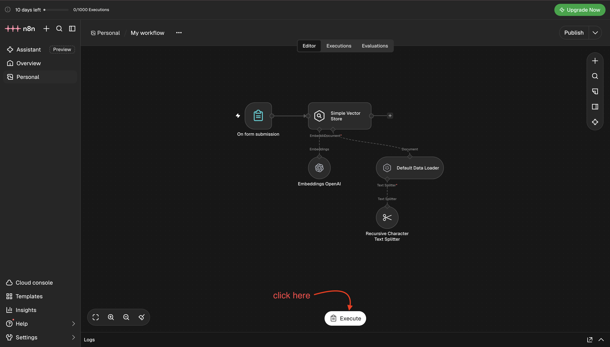

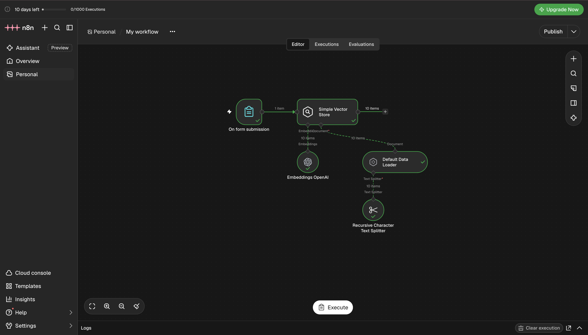

> ✓ Error on the Vector Store node? Most likely your OpenAI credential is missing or expired. Check the Embeddings node.

---

## Phase 2: Build the Retrieval Pipeline

Build this on the **same canvas**, but don't connect it to the ingestion pipeline.

### Step 2.1: Add the Chat Trigger

| Action | Value |
|---|---|
| Add Node → search | **Chat Trigger** |
| Event | **On a new chat message** |

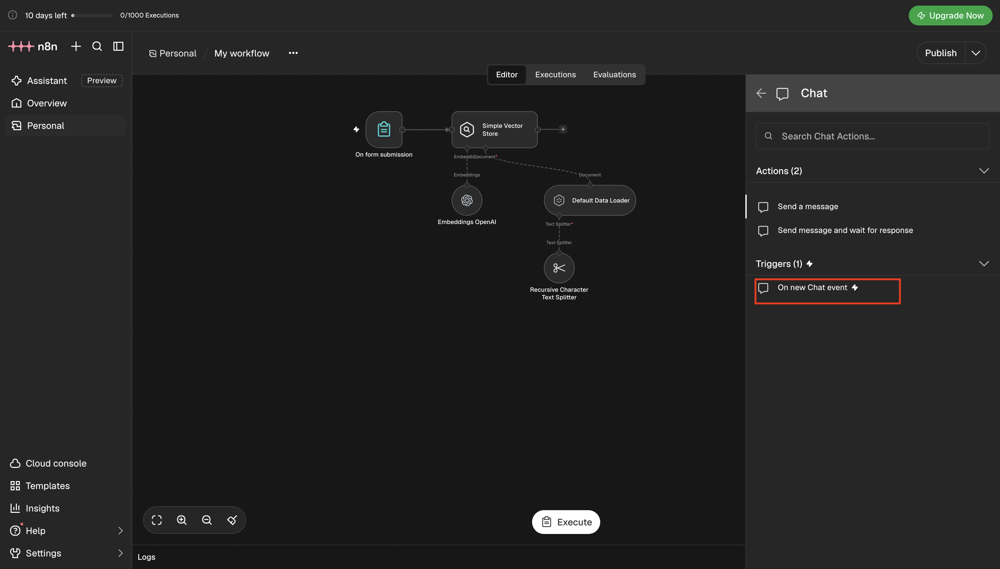

> **Why a Chat Trigger?** Retrieval is a conversation: a user asks a question and gets an answer. Every question enters the pipeline here.

---

### Step 2.2: Allow file uploads (optional)

In the Chat Trigger, click **Add Field** and turn on **Allow File Upload**.

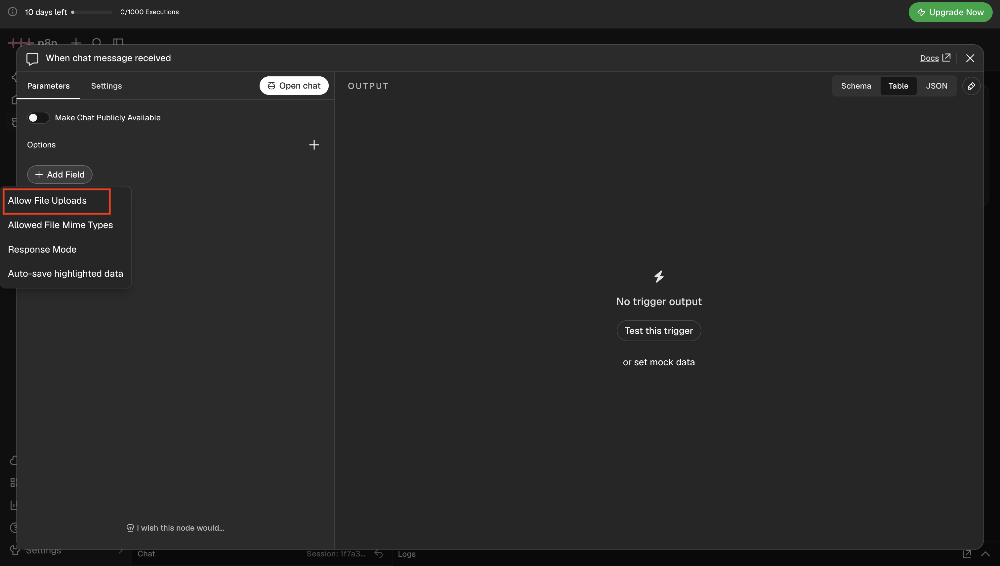

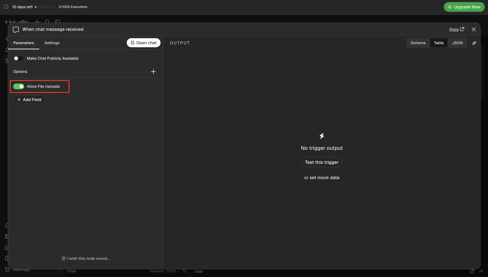

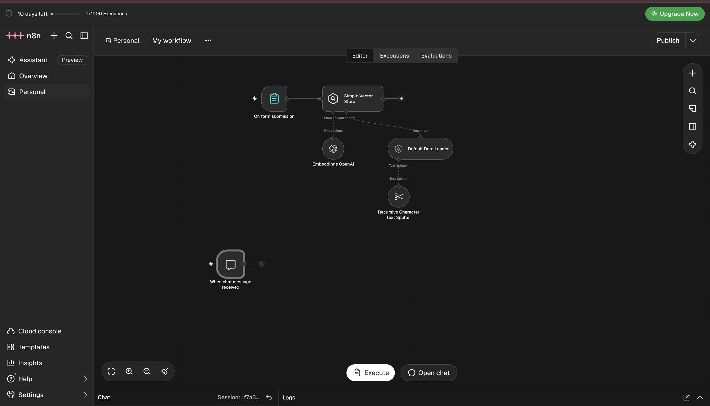

> You don't need this yet. Turning it on now means the workflow can accept documents mid-chat later without a rebuild.

---

### Step 2.3: Add the AI Agent

Click **Add Node**, search for **Agent**, and connect it to the Chat Trigger.

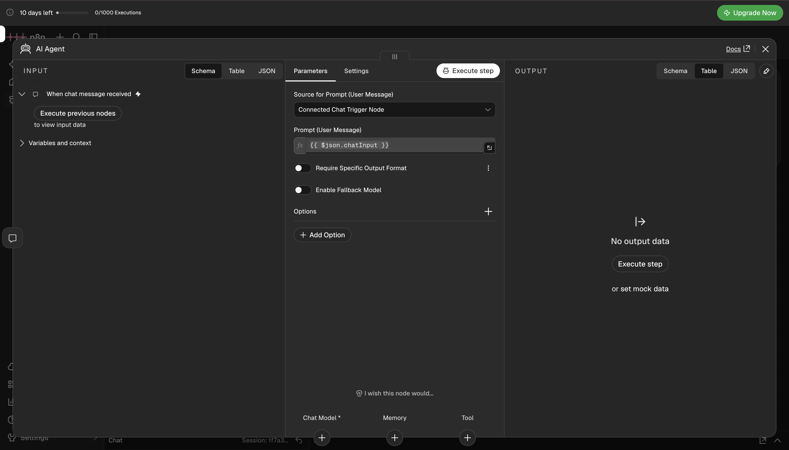

> The Agent is the **coordinator**, not the thinker. It takes the question, calls tools (like the vector store), combines the retrieved context with the question, sends both to the model, and returns the answer.

---

### Step 2.4: Write the system message

In the Agent, click **Add Option** → **System Message**, then paste this exactly:

```
For every incoming user query, always call the Simple Vector Store tool first to retrieve relevant context, previous conversations, and related knowledge. Use the retrieved information to generate accurate, context-aware, and personalized responses. Never skip this tool call unless the query explicitly does not require external context.
```

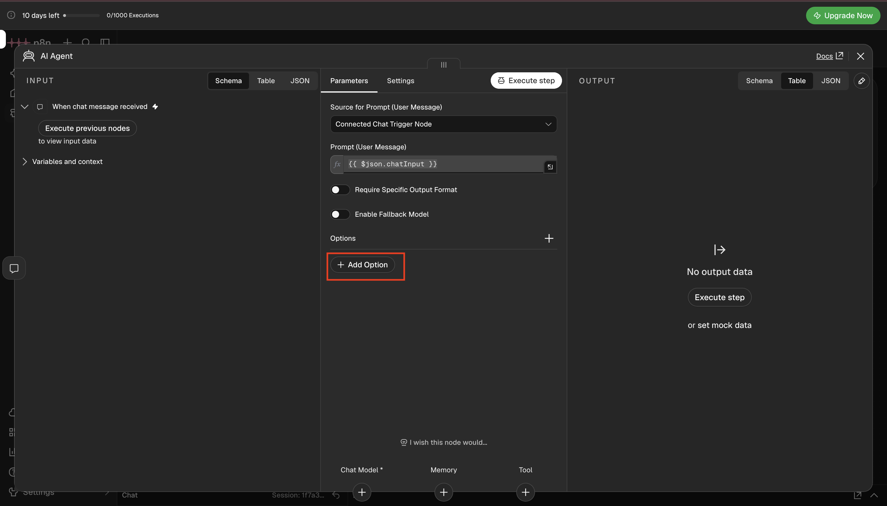

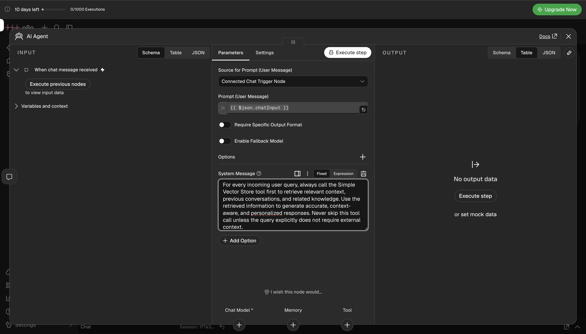

> **Why?** Without this instruction, the agent may answer from its training data and skip your documents. This message tells it to check the vector store first, every time.

---

### Step 2.5: Add the chat model

| Action | Value |
|---|---|
| Agent → **Chat Model** | **OpenAI Chat Model** |
| Model | `gpt-5-mini` (recommended) |
| Credential | Your OpenAI credential |

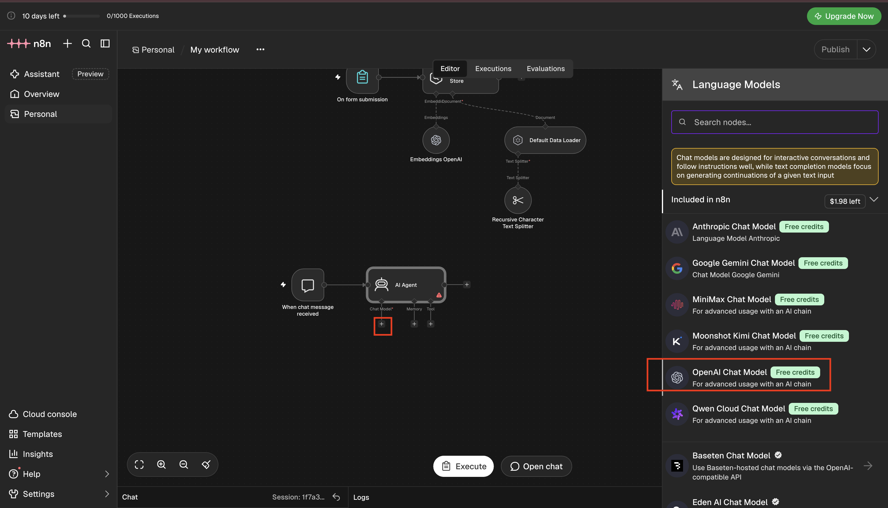

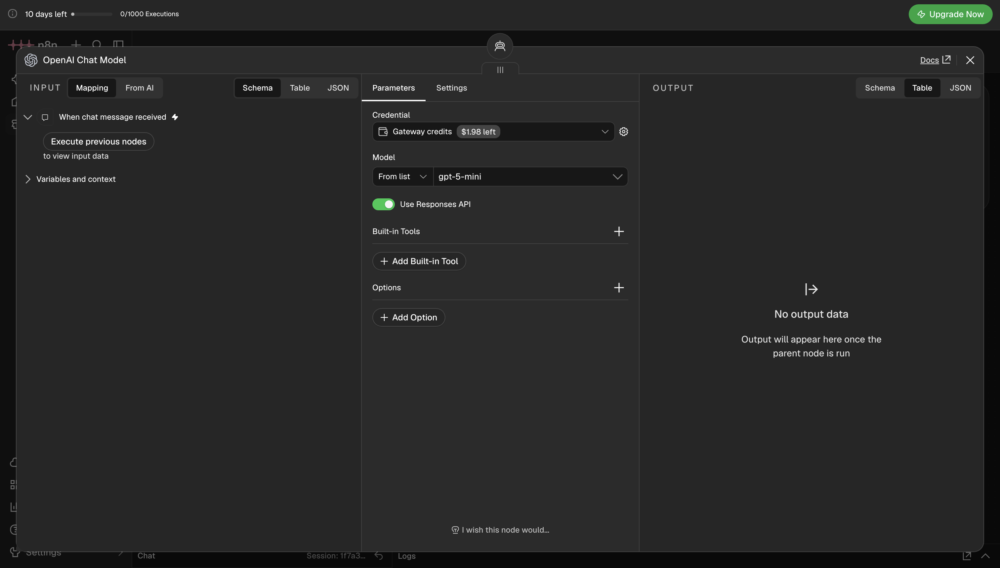

> The model can be swapped. You can change it later without touching anything else in the workflow.

---

### Step 2.6: Add the Simple Vector Store as a tool

In the Agent, click **Tools**, search for **Simple Vector Store**, and open it.

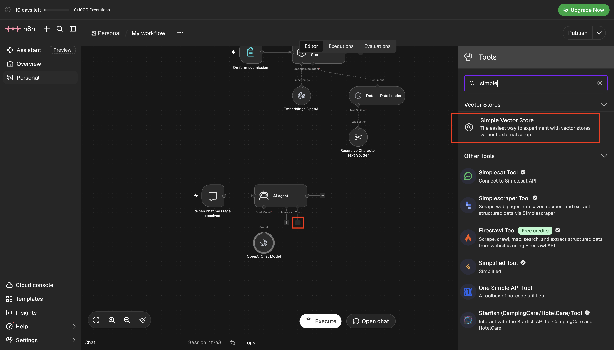

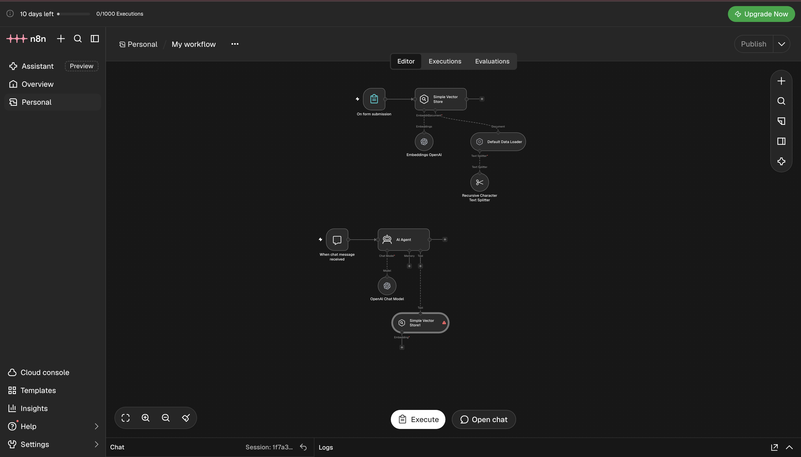

| Field | Value | Why |
|---|---|---|
| Operation Mode | Leave the default | |
| Description | *(paste the text below)* | The agent reads this to decide **when** to call the tool. It's an instruction for the AI, not a label for you. |
| Memory Key | The key from Step 1.5 | Must match **exactly**, or retrieval finds nothing |
| Limit | `5` | Number of chunks returned per question |

**Description:**

```
Use this tool to store, retrieve, and search vector embeddings from previously processed data. It helps the AI system find relevant context, documents, or past information based on semantic similarity to the user's query, enabling more accurate and context-aware responses.
```

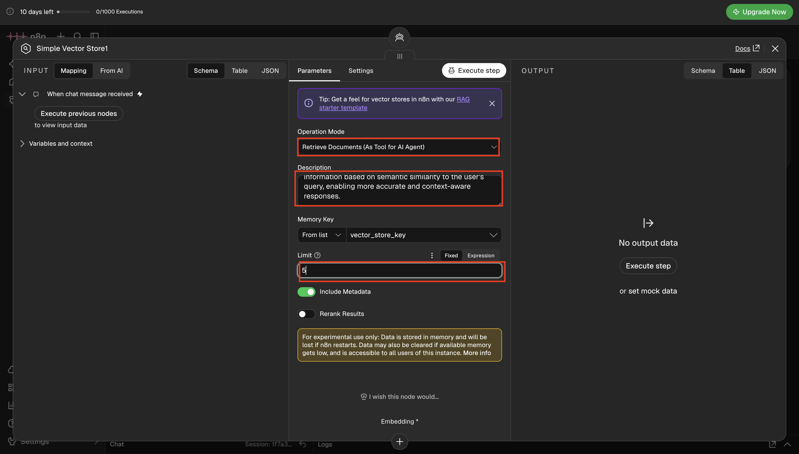

| Limit | Effect |
|---|---|
| Too low (1-2) | May miss the relevant chunk |
| **5** ✅ | Good starting point |
| 8-10 | Try this if answers feel incomplete |
| Too high | Floods the prompt with context the model can't use well |

---

### Step 2.7: Add the embedding model to the tool

| Action | Value |
|---|---|
| Vector Store tool → **Embedding** | **Embeddings OpenAI** |
| Model | `text-embedding-3-small` (**same as Step 1.6**) |
| Credential | Your OpenAI credential |

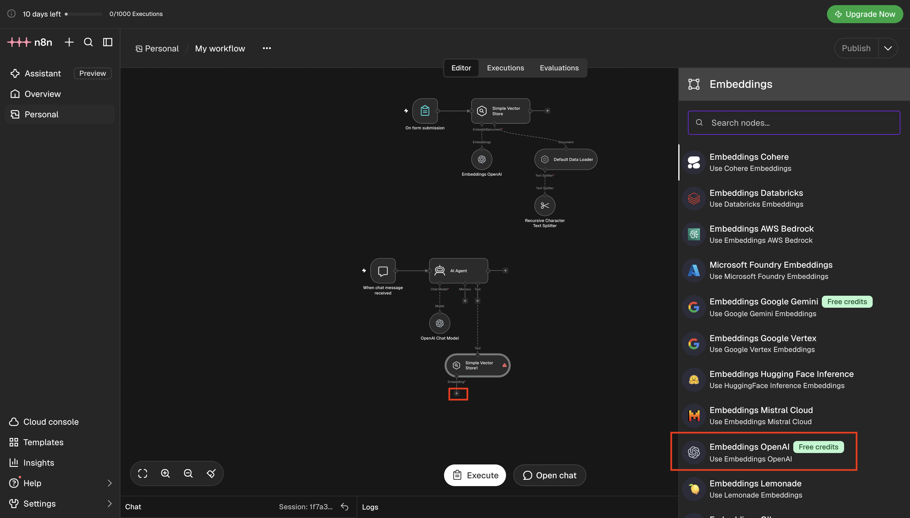

> The stored vectors were created by one specific model. Only that same model can search them correctly.

---

## Quick Reference

| Setting | Ingestion (Phase 1) | Retrieval (Phase 2) | Must match? |
|---|---|---|---|
| Trigger | n8n Form (`file0`, File) | Chat Trigger | |
| Memory Key | Generated in Step 1.5 | Same key | ✅ Yes |
| Embedding model | `text-embedding-3-small` | `text-embedding-3-small` | ✅ Yes |
| Data loader | Binary · PDF · Custom | | |
| Text splitter | Recursive · Overlap `100` | | |
| Chat model | | `gpt-5-mini` | |
| Retrieval limit | | `5` | |

## Troubleshooting

| Problem | Likely cause | Fix |
|---|---|---|
| Form node shows no result | Workflow wasn't listening | Click **Execute Step**, then resubmit the form |
| Vector Store node errors | Missing or expired OpenAI credential | Re-check the credential on the Embeddings node |
| Garbled or empty chunks | Data Type or Format is wrong | Set **Binary** and **PDF** |
| Agent answers without using your document | System message or tool description is missing | Paste both exactly as shown |
| Retrieval returns nothing or irrelevant text | Memory key or embedding model doesn't match | Use the same key and model in both workflows |

---

[← Back to the main lab: Test Everything](../Readme.md#test-everything)
