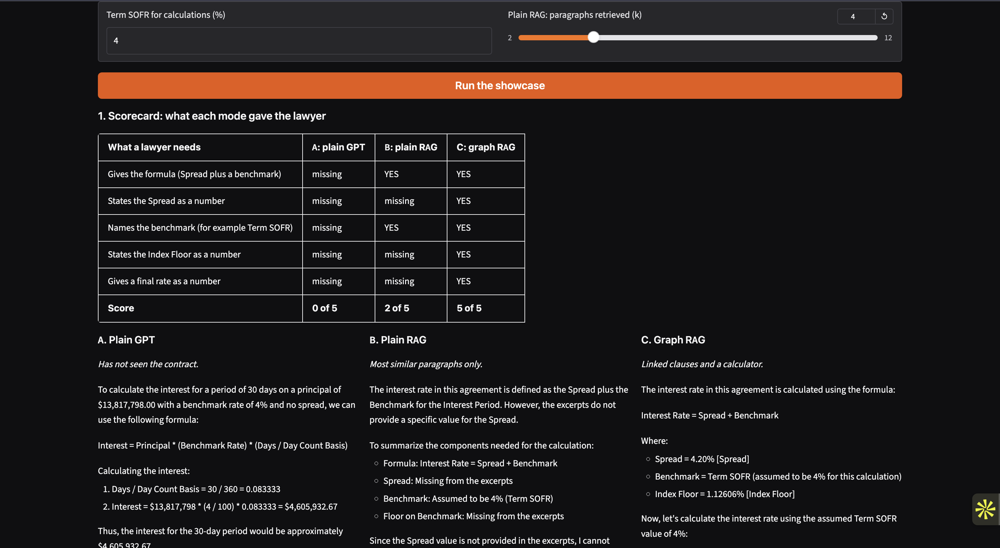
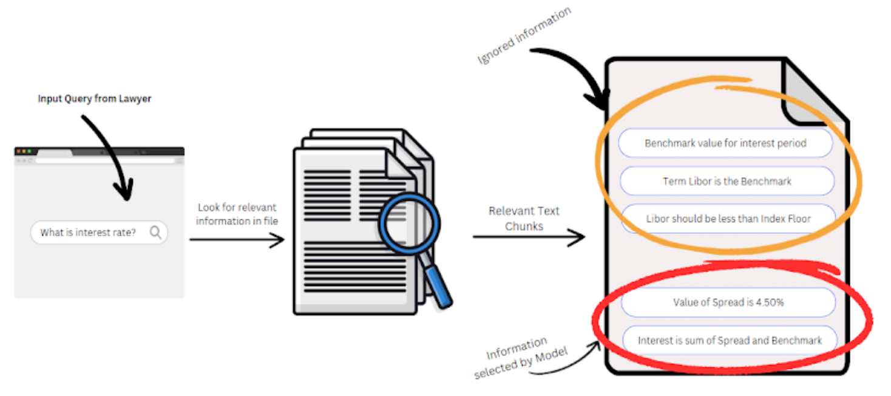
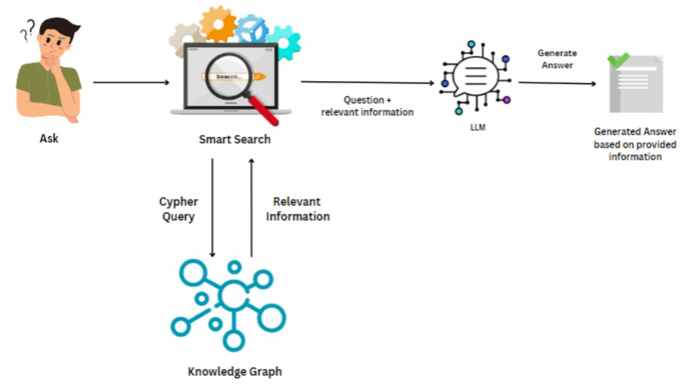
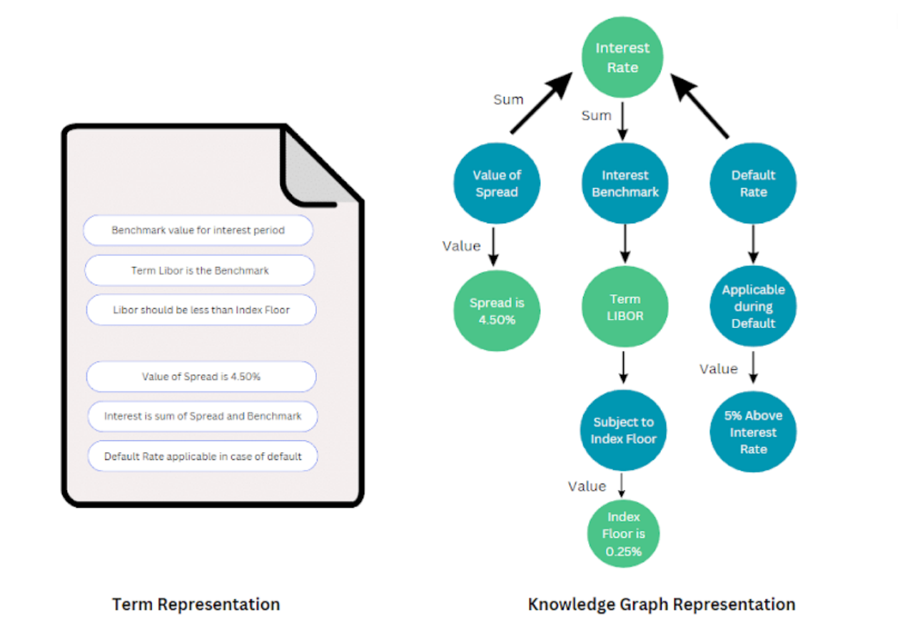

# Lab 2.3: Knowledge Graph RAG

## Run all, then open the app

1. Open the notebook in Colab: 
2. Click **Runtime → Run all**. One optional cell asks you to upload the contract. You can upload the [loan agreement PDF](https://pragyaallc-my.sharepoint.com/:b:/g/personal/sachin_parmar_legalgraph_ai/IQD6lbbrDHV5ToSGrWurVlejAZ9kRJYW40iwWLtE5fzC54M?e=VtD4Mp) there or skip it and upload it in the app.
3. When the last cell finishes, open the link ending in **`.gradio.live`**.
4. On the **1. Setup** tab, paste your **OpenAI API key** (the model is fixed to `gpt-4o-mini`), upload the contract PDF (any contract with selectable text works), and press **Build**. A live log shows each stage. **Fast demo** is ticked by default: Graphify reads only Article 2 (the money terms). Untick it to run on the whole contract (several minutes).
5. Open **2. Knowledge graph** and explore: drag dots, zoom with the mouse wheel, search a term (try `Interest Rate`), and click a dot to read its clause.
6. Open **3. The problem and the fix** and press **Run the showcase**. It asks *"What is the interest rate?"* three ways, shows a scorecard, then shows the steps the graph followed.
7. Open **4. Ask and compare**, type your own question (or click a sample), and press **Ask all three**. You can also run the built-in test suite (a quick set of 8, or all 25).

The **Knowledge graph** tab shows the graph of the whole contract. Blue dots are defined terms, orange dots are sections, green dots are concepts Graphify found:

**Run the showcase** compares plain GPT, plain RAG and graph RAG on the same question, with a scorecard of what each one got right:

> Do not share the `.gradio.live` link while your key is in use. It stops working when you stop the notebook.

---

## What is a knowledge graph?

A **knowledge graph** stores a document as **dots** (the things in it) and **lines** (how they connect).

Normal search finds passages that *look similar* to your question. An answer spread across several clauses can be missed, because the clauses that link to each other don't look alike. A knowledge graph keeps those links, so you can follow them from one clause to the next.

## What we are doing in this lab

We ask the **same question three ways** and compare:

| Mode | What GPT-4o-mini is given |
| --- | --- |
| **A. Plain GPT** | Only your question. It has never seen the contract. |
| **B. Plain RAG** | Your question plus the few paragraphs that *sound most similar* to it. |
| **C. Graph RAG** | Your question plus the clauses found by **following the links between defined terms**, plus a calculator for the maths. |

How mode C works:

- **Graphify** reads the contract and builds a graph. Things in the contract (like `Interest Rate`, `Spread`, `Index Floor`) become **dots**, and how they connect becomes **lines**. Simple rules also add the links the contract states outright (a term mentioning another term, or "see Section 2.8").
- When you ask a question, the app finds the terms in it (the **starting dots**), then repeats up to four rounds: look at the dots linked to what it has opened, let the model pick which ones it needs, and open them.
- An **evidence check** confirms every fact the question needs appears in the opened clauses. If something is missing, the walk goes back to open more.
- The model answers from those clauses, and a **calculator** does the arithmetic, because language models are unreliable at maths. A **number check** compares every number in the answer with the contract text.

**Example:** the interest rate is the `Spread` (4.20%) plus the Benchmark (`Term SOFR`), which can never count as lower than the `Index Floor` (1.12606%). With Term SOFR at 4%, the annual rate is 4.20% + 4% = **8.20%**, and 30 days of interest on $13,817,798 (360-day year) is **$94,421.62**. With Term SOFR at 0.50%, the floor applies: 4.20% + 1.12606% = **5.32606%**.

## Why a contract needs a graph

Law firms review loan agreements of 200+ pages. Facts written in one place (borrower, lender, closing date) are easy to find. The **interest rate** is not: it is a *recipe* (Interest Rate = Spread + Benchmark, and the Benchmark has a floor), and each part lives in a different clause.

| Step | What a lawyer does | Plain search | Knowledge graph |
| --- | --- | --- | --- |
| 1 | Reads the **Interest Rate** definition | Finds it | Finds it |
| 2 | Looks up the **Spread** | Often misses it | Follows the link to Spread |
| 3 | Looks up the **Benchmark** (Term SOFR) | Often misses it | Follows the link to Term SOFR |
| 4 | Finds the **Index Floor** | Almost always misses it | Follows the link to Index Floor |
| 5 | Adds it up | Cannot | Hands the numbers to a calculator |

## What to look for

- **Mode A** cannot know the Spread or the floor, so it should refuse or guess.
- **Mode B** may find the Interest Rate definition but miss the floor or the day count. Raise the **paragraphs retrieved (k)** slider and see whether it catches up.
- **Mode C** prints the **trail** it followed (for example, *Round 1 opened: Spread, Benchmark*) and highlights those dots in a mini-graph.
- Open **what the model saw** under B and C to compare exactly which clauses each mode was given.

Try the sample questions on the last tab, starting with *"What is the simple interest for a 30-day month on the full loan amount?"*. The notebook ends with an answer key for the sample contract so you can judge the three columns.
