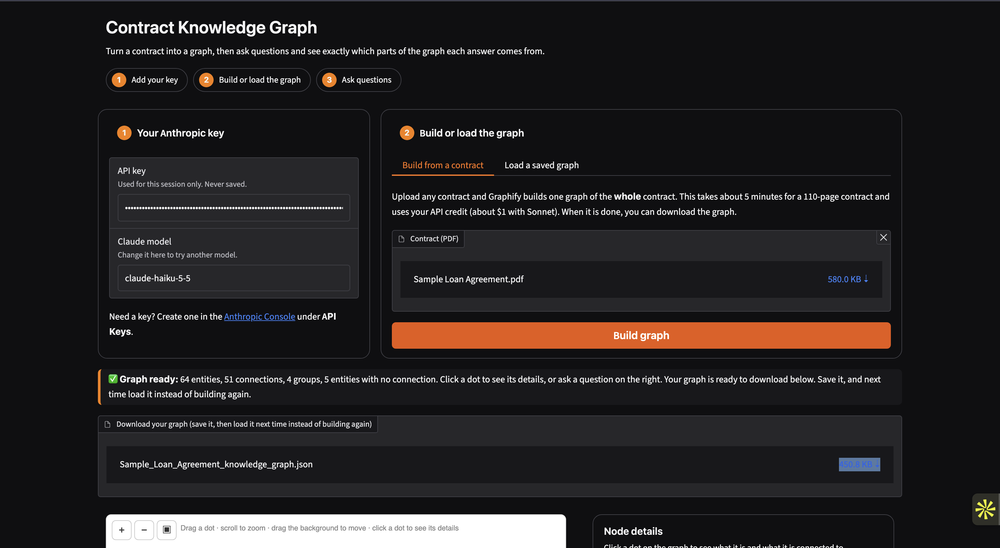

# Lab 2.3: Knowledge Graph RAG

## Run all, then open the app

1. Open the notebook in Colab: 
2. Click **Runtime → Run all**.
3. When the last cell finishes, open the link ending in **`.gradio.live`**.
4. In the app, paste your OpenAI API key, upload the [loan agreement PDF](https://pragyaallc-my.sharepoint.com/:b:/g/personal/sachin_parmar_legalgraph_ai/IQD6lbbrDHV5ToSGrWurVlejAZ9kRJYW40iwWLtE5fzC54M?e=VtD4Mp) (any contract works), and press **Build graph** (about 5 minutes). You get one graph of the whole contract.
5. Press **Download graph** under the status line. It saves the graph straight to your computer as a `.json` file.
6. Ask a question, for example: *What interest rate applies if Term SOFR is 0.80%?*
7. Next time, open the **Load a saved graph** tab and upload that file. The graph appears in seconds with no rebuild and no API credit. You only need your key to ask questions.

After you press **Build graph**, you should see the graph summary and your download:

Below that is the graph of the whole contract, with the chat on the right:

> Do not share the `.gradio.live` link. It stops working when you stop the notebook.

---

## What is a knowledge graph?

A **knowledge graph** stores a document as **dots** (the things in it) and **lines** (how they connect).

Normal search finds passages that *look similar* to your question. An answer spread across several clauses can be missed, because the clauses that link to each other don't look alike. A knowledge graph keeps those links, so you can follow them from one clause to the next.

## What we are doing in this lab

We add a **knowledge graph** to RAG:

- **Graphify** reads the contract and builds a graph. Things in the contract (like `Interest Rate`, `Spread`, `Index Floor`) become **dots**, and how they connect becomes **lines**.
- When you ask a question, the model picks the starting dots, and the app follows their lines to find every related clause.
- The model answers from the contract text those dots point to.

**Example:** the interest rate is the `Spread` (4.20%) plus `Term SOFR`, which is limited by the `Index Floor` (1.12606%). So 4.20% + 1.12606% = **5.32606%**.
