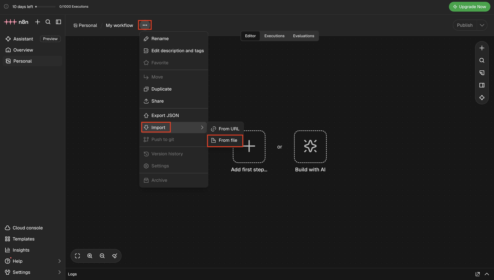
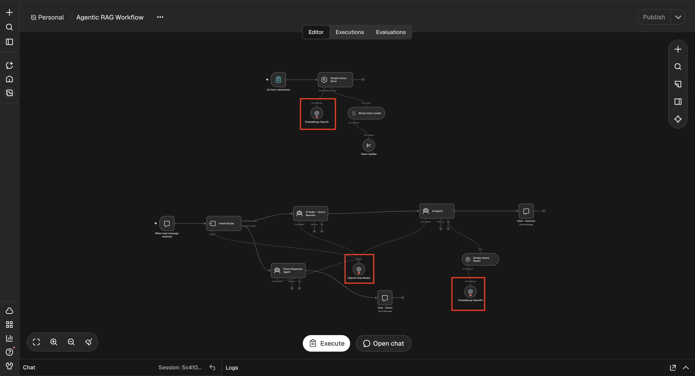
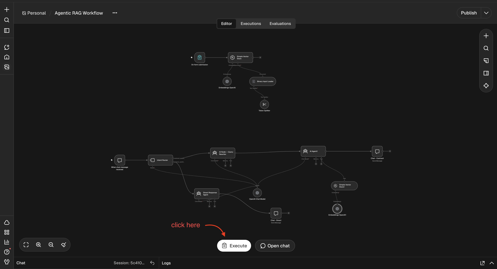
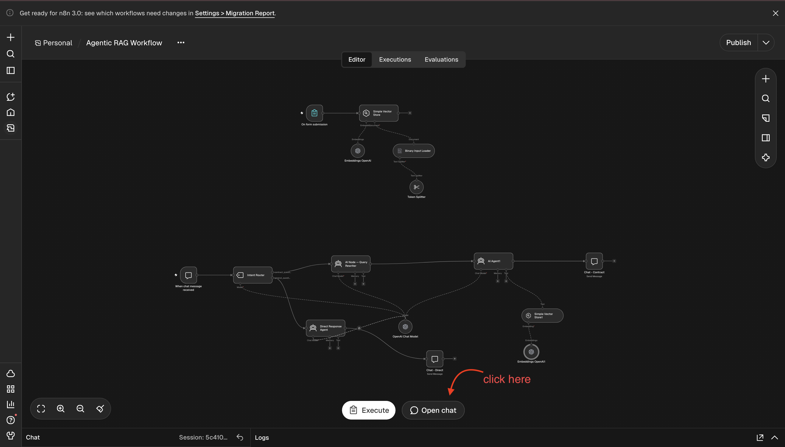
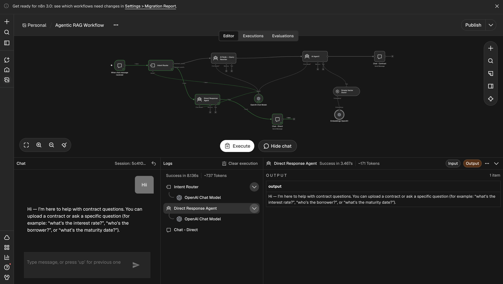
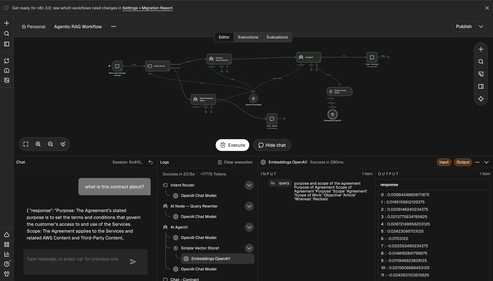
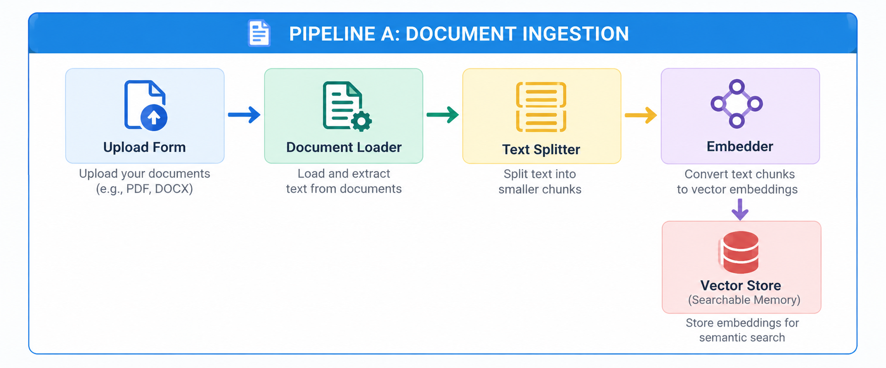
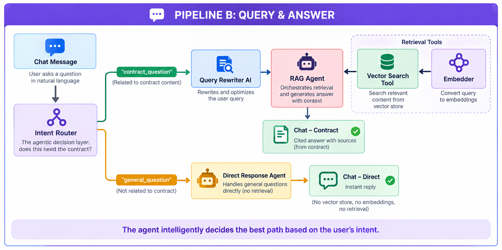
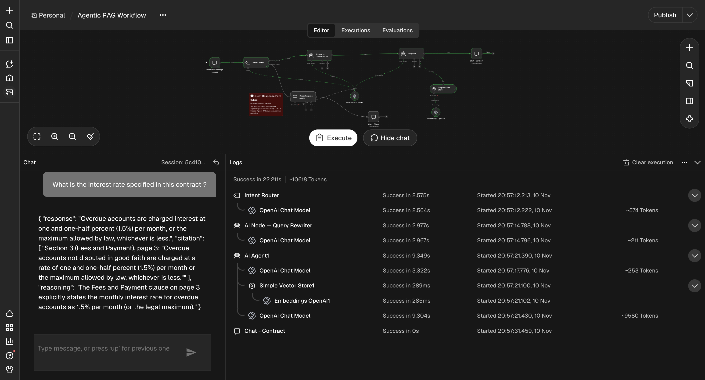

# Lab 2.3: Agentic RAG — Contract Intelligence

In [Lab 2.2](../2.2-understanding-RAG/Readme.md), you built a RAG pipeline that answers questions from a contract. But type **"Hi"** into it, and it still searches the whole contract before it replies. That's wasted time and money.

The fix: let the system decide **before** it searches. A contract question gets a search; anything else gets a direct reply. That one decision is what makes RAG **agentic**.

Here's the flow for this lab:

- **Run the workflow.** See "Hi" skip the search while contract questions go through it.
- **Break it on purpose.** Try a loan agreement and see where RAG still struggles.

---

## Table of Contents

- [Prerequisites](#prerequisites)
- [How Agentic RAG Decides When to Search](#how-agentic-rag-decides-when-to-search)
- [Part 1: Import the Workflow](#part-1-import-the-workflow)
- [Part 2: Add Your OpenAI Key](#part-2-add-your-openai-key)
- [Part 3: Upload Your Contract](#part-3-upload-your-contract)
- [Part 4: Ask Questions and Watch the Routing](#part-4-ask-questions-and-watch-the-routing)
- [Part 5: Stress-Test It with a Loan Agreement](#part-5-stress-test-it-with-a-loan-agreement)
- [Quick Reference](#quick-reference)
- [What's Next](#whats-next)

---

## Prerequisites

✅ **Lab 2.2 done.** You know how chunking, embeddings and vector search work.

✅ **n8n account** and an **OpenAI API key** with credit (from Week 1).

✅ **Download these files:**

- [n8n Workflow JSON](https://pragyaallc-my.sharepoint.com/:u:/g/personal/anushka_srivastava_legalgraph_ai/IQDSdQ5UsRtPSprLfe1iiytRAc6ypCxCv_ZCIBKU5KBCKwM?e=CjaXb4)
- [Test Contract](https://pragyaallc-my.sharepoint.com/:w:/g/personal/sachin_parmar_legalgraph_ai/IQAbCBMxqrFrT6hzD6t9oCdpAR8pdsHtVaZf2O5HiyGq5jY?e=4s3M8D) (keep it in `.docx` format)
- [Loan Agreement](https://pragyaallc-my.sharepoint.com/:b:/g/personal/sachin_parmar_legalgraph_ai/IQD6lbbrDHV5ToSGrWurVlejAZ9kRJYW40iwWLtE5fzC54M?e=VtD4Mp) (for Part 5)

---

## How Agentic RAG Decides When to Search

Before you open n8n, you need to know what's different, because that difference is what you'll be watching for in this lab.

The Lab 2.2 pipeline had one path: every message went straight to the contract search. This lab's workflow adds one step at the front that decides whether to search at all.

| Traditional RAG (Lab 2.2) | Agentic RAG (this lab) |
|---|---|
| Searches for every message, even "Hi" | Checks the message first and searches only when needed |
| One fixed path | Two paths: reply directly, or search the contract |

That new step is called the **Intent Router**. Here's how a message moves through the workflow:

1. The **Intent Router** decides whether the message needs the contract.
2. If **no**, the **Direct Response Agent** replies straight away.
3. If **yes**, the **Query Rewriter** sharpens the question, and the **RAG Agent** searches the contract and answers with citations.

So now you know what to look for. Next, let's get this workflow into your n8n.

---

## Part 1: Import the Workflow

**What it is**: The workflow JSON you downloaded in Prerequisites. It's the full Agentic RAG system described above, with the upload pipeline, the Intent Router and both answer paths already built.

**Why import it**: The ingestion part is the same as Lab 2.2, and you've already built that once. Importing it lets you skip rebuilding and spend your time on what's new: the routing.

**Action items**:

1. In n8n, click **+ New Workflow**.
2. Click the **three-dot menu (⋮)** in the top right → **Import from file** (`Cmd+Shift+I` on Mac / `Ctrl+Shift+I` on Windows).
3. Select the workflow JSON you downloaded.



**Output**: You'll see three groups of nodes on the canvas: **Document Ingestion** at the top, the **Intent Router** fork, and the **Query & Answer** pipeline. Everything is already connected.

The workflow is in place, but it can't run yet. Every agent needs OpenAI, and n8n doesn't have your key.

---

## Part 2: Add Your OpenAI Key

Three nodes need the key. Create the credential once, then select it on each node.

**Action items**:

1. Click **OpenAI Chat Model** → under **Credential**, click **Create New** → paste your API key → **Save**.

   > **Note**: This one node powers all four agents: Intent Router, Query Rewriter, RAG Agent and Direct Response Agent.



2. Click **Embeddings OpenAI** (in the ingestion section) → select the same credential.
3. Click **Embeddings OpenAI1** (in the query section) → select the same credential.

   > **Note**: No API key yet? Get one at [platform.openai.com](https://platform.openai.com) and add a small amount of credit. If your n8n account came with free OpenAI credits, you can use those instead.

**Output**: All three OpenAI nodes use the same credential.

Now the workflow can run, but there's no contract to search yet. Let's give it one.

---

## Part 3: Upload Your Contract

This is the same ingestion you did in Lab 2.2: read, chunk, embed, store.

**Action items**:

1. Click **Execute Workflow** (▶ at the bottom of the canvas).



2. Open the **On Form Submission** node and click the **Test URL**.
3. In the form that opens, upload the test contract and click **Submit**.
4. Go back to the canvas and wait for every ingestion node to turn green. This takes about 5–15 seconds.

**Output**: Your contract is stored and ready to be searched.

Now for the real test: is the "Hi" problem actually fixed?

---

## Part 4: Ask Questions and Watch the Routing

**Action items**:

1. Open the **When chat message received** node → click **Open Chat**.



2. Type **"Hi"**. Only the **Intent Router** and **Direct Response Agent** light up. No search, instant reply. That's the fix working.



3. Now ask **"What is the contract about?"**. This time it takes the other path: **Query Rewriter → RAG Agent → Vector Search Tool**, and answers with citations.



4. Try a few messages from each column and watch which path lights up:

| General (no search) | Contract (full search) |
|---|---|
| "Hello" | "Who are the parties involved?" |
| "How are you?" | "What are the key terms and obligations?" |
| "What can you do?" | "What is the interest rate?" |
| | "When is the maturity date?" |

**Output**: General messages get instant replies, and contract questions get answers with citations.

Here's the full picture of what you just ran:

**Pipeline A: Document Ingestion** (runs once for each upload)



**Pipeline B: Query & Answer** (runs on every message)



The system now decides before it searches. But does it always find the right answer? Let's try a harder document.

---

## Part 5: Stress-Test It with a Loan Agreement

In the test contract, every fact sat in one clause, so one chunk was enough. Real contracts aren't always that simple.

**Action items**:

1. Click **Execute Workflow**, open the upload form and upload the **Loan Agreement**.
2. Once ingestion finishes, ask these questions:

```
What is the interest rate on this loan?
```
```
Can the borrower repay the loan early, and is there a penalty?
```
```
What happens if the borrower misses a payment?
```



You'll get answers with citations, but they're vague. They say *"as set forth in Schedule 1.1(a)"* without telling you what Schedule 1.1(a) says.

**Why?** In a loan agreement, one fact is spread across several places:

> *"The applicable interest rate shall be the Base Rate plus the Applicable Margin, as defined in Schedule 1.1(a), subject to periodic adjustment in accordance with Section 2.7(d)."*

Vector search brings back only the closest chunk, and here that chunk just **points to** the answer.

| Contract type | How facts are written | RAG accuracy |
|---|---|---|
| Test contract | Each fact in one clause | High |
| Loan agreement | Facts spread across sections and schedules | Lower |

This isn't a bug, it's a limit of RAG. To follow references across a document, you need a different structure.

---

## Quick Reference

| Problem | Cause | Fix |
|---|---|---|
| "Hi" triggers a contract search | Traditional RAG searches on every message | Put an Intent Router before the search |
| OpenAI nodes show errors | One of the three nodes is missing the credential | Select the same credential on the Chat Model and both Embeddings nodes |
| Loan agreement answers are vague | Facts are spread across sections that refer to each other | Expected RAG limit, solved with Knowledge Graphs in Lab 2.4 |

---

## What's Next

Your workflow now decides before it searches. But as the loan agreement showed, it still struggles when a fact is spread across clauses, schedules and sections that point to each other.

In [Lab 2.4 — Creating a Context Brain on Graph](../2.4-kg-RAG/Readme.md), you'll turn a contract into a **Knowledge Graph** that connects those pieces, so the answer comes from the whole picture instead of a single chunk.
