# Lab 2.4: Give Your Agentic RAG a Web Layer

Your n8n agent just got a lot smarter. Back in Lab 2.2, you taught it to stop and think before it goes digging through the contract — "Hi" gets an instant reply, "What's the interest rate?" sends it off to actually search the document.

Your web app has no idea any of that happened. It's still talking to your backend the old way, from Lab 1.2 — one file, one message, one webhook, every single time someone hits send.

That's the gap this lab closes. You're not starting over. You're taking the same `contract-review-app` you already built and bringing it up to speed with the smarter backend sitting behind it — both how it talks to n8n, and how it looks.

No new coding concepts here. Just Claude Code, the app you already have, and about 35 minutes.

---

## Table of Contents

- [What Are We Building?](#what-are-we-building)
- [Prerequisites](#prerequisites)
- [Part 1: Swap the Triggers for Webhooks](#part-1-swap-the-triggers-for-webhooks)
- [Part 2: Your App Still Thinks There's Only One Job](#part-2-your-app-still-thinks-theres-only-one-job)
- [Part 3: Test It Inside n8n First](#part-3-test-it-inside-n8n-first)
- [Part 4: Teach Claude Your Design System — as a Skill](#part-4-teach-claude-your-design-system--as-a-skill)
- [Part 5: Try the Whole Thing](#part-5-try-the-whole-thing)
- [Part 6: Push Your Code to GitHub](#part-6-push-your-code-to-github)
- [What You Learned](#what-you-learned)

---

## What Are We Building?

**The wiring.** Your app currently bundles the uploaded PDF and the typed question into one request and fires it at one webhook — every time someone sends a message. That made sense when your backend was one webhook and one agent. It doesn't make sense anymore. Your Lab 2.2 workflow now has two separate jobs: reading the contract once (ingestion), and answering questions many times after that (chat). Two jobs, two webhooks. Your app hasn't caught up.

**The look.** In Lab 1.2 you sketched a palette with `/design` in a few sentences — "navy and orange, clean and professional" — and that was good enough for a first pass. Now you've got an actual design system sitting in this folder, `SKILL.md`. Real tokens, a real type scale, a real spacing grid. No reason to keep guessing.

By the end of this lab, your app will send the file once, ask questions cheaply after that, and look like it came from a real design system instead of a vibe.

---

## Prerequisites

✅ **Lab 1.2 done** — you've got a working `contract-review-app` folder with `index.html`, `styles.css`, and `app.js`, and it already sends messages to a webhook.

✅ **Lab 2.2 done** — your n8n workflow has an Intent Router, a Direct Response Agent, a Query Rewriter, and a RAG Agent.

✅ **Claude Code**, pointed at your existing `contract-review-app` folder. Same session you used before or a brand new one — either works, Claude can just read the files.

---

## Part 1: Swap the Triggers for Webhooks

In Lab 2.2, everything ran inside n8n's own form and chat window. Your web app can't open those. It can only send a request to a URL and wait for a reply.

The fix: replace both triggers with **webhooks**, URLs any app can call. Open the n8n workflow from Lab 2.2 and start with upload, then chat.

### Step 1: Swap the ingestion trigger

1. Delete the **On Form Submission** node.
2. Add a **Webhook** node in its place and set:
   - **HTTP Method:** `POST`
   - **Respond:** `Using 'Respond to Webhook' Node`
   - **Options → Binary Property Name:** `data` (the uploaded file will arrive under this field name)
   - **Options → Allowed Origins (CORS):** add this option
3. Connect it to **Simple Vector Store**.
4. Add a **Respond to Webhook** node after **Simple Vector Store**, so the app gets a reply once the contract has finished indexing.

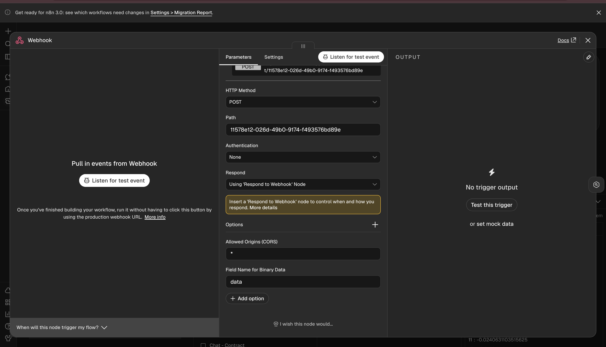

Uploads now work from outside n8n. Next, questions.

### Step 2: Swap the chat trigger

1. Delete the **When chat message received** node.
2. Add a **Webhook** node with:
   - **HTTP Method:** `POST`
   - **Respond:** `Using 'Respond to Webhook' Node`
   - **Options → Allowed Origins (CORS):** add this option
3. Connect it to **Intent Router**.

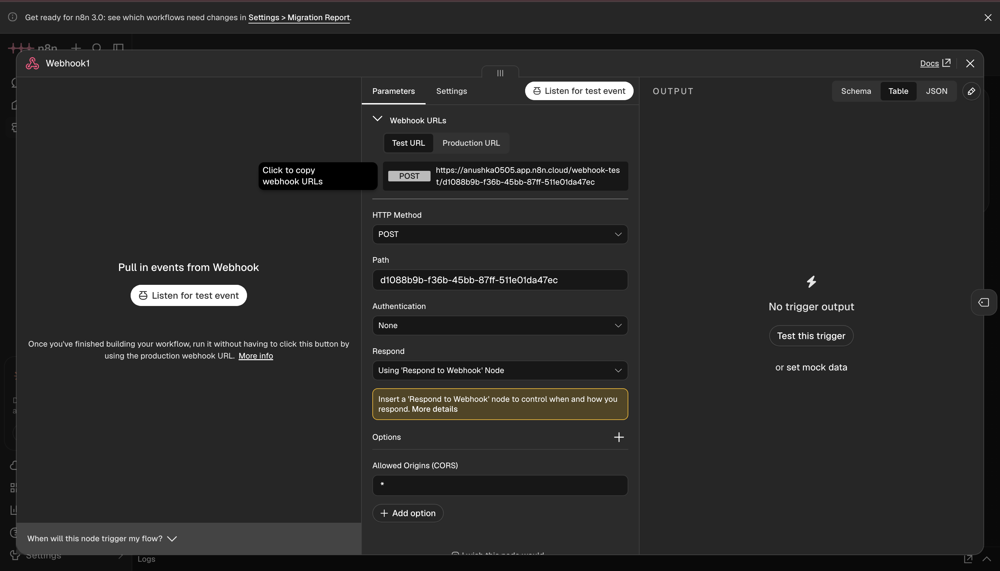

Questions can come in now, but where do the answers go? Both paths still reply to n8n's chat window, which you just removed.

### Step 3: Replace the chat outputs nodes

Both workflows still end in n8n's chat window, which no longer exists. Each one needs a **Respond to Webhook** node so the answer goes back to your app instead.

#### Ingestion workflow

You already added the **Respond to Webhook** node in Step 1, so there is nothing to replace here. Check that your ingestion workflow reads:

**Webhook → Simple Vector Store → Respond to Webhook**

The **Respond to Webhook** node tells your app the contract has finished indexing. Your app only needs to know the upload worked, so leave its settings at the defaults.

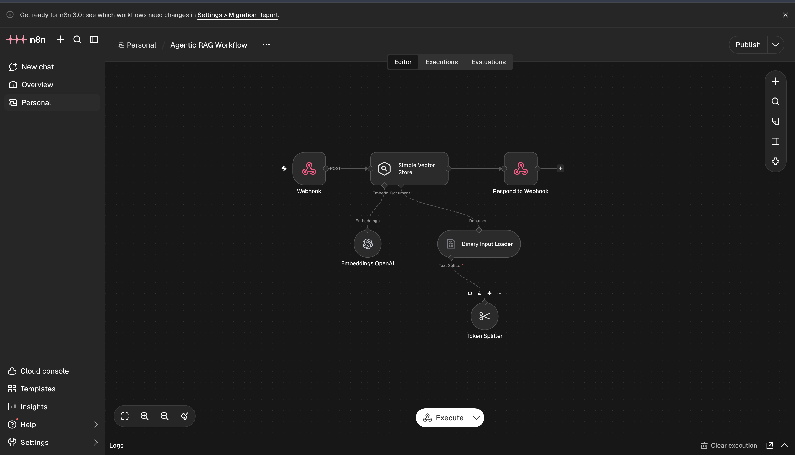

#### Chat workflow

The chat workflow has two outputs, so you replace both.

1. Delete **Chat - Direct** → add a **Respond to Webhook** node → connect **Direct Response Agent** to it.
2. Delete **Chat - Contract** → add a **Respond to Webhook** node → connect **AI Agent1** to it.

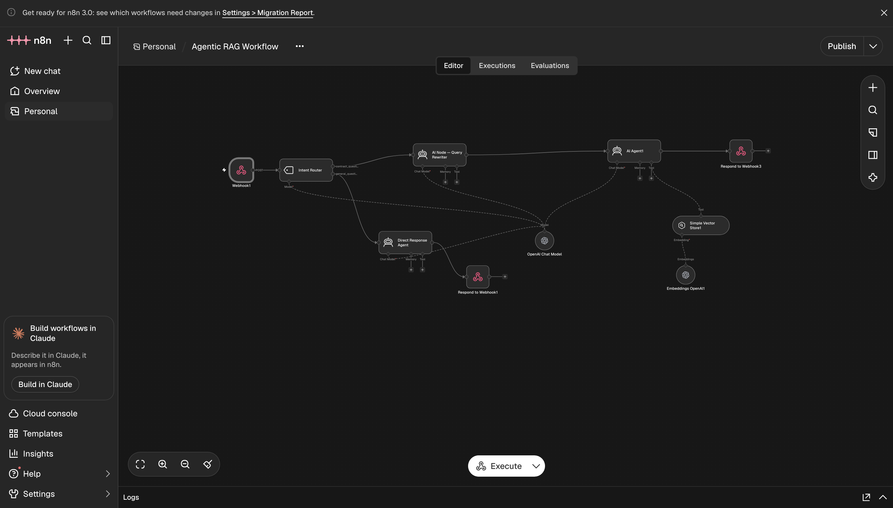

Now set up **both** new **Respond to Webhook** nodes the same way, so your app gets the agent's answer back cleanly. Open each one and make these three changes:

**1. Respond With:** choose **Text**.

**2. Response Body:** switch the field to **Expression** and paste:

```
{{ $json.output }}
```

The AI agents put their answer in a field called `output`. This sends just the answer, not the wrapper around it.

**3. Add Option → Response Headers → Add Header.** Paste each value into its own box:

Name:

```
Content-Type
```

Value:

```
application/json
```

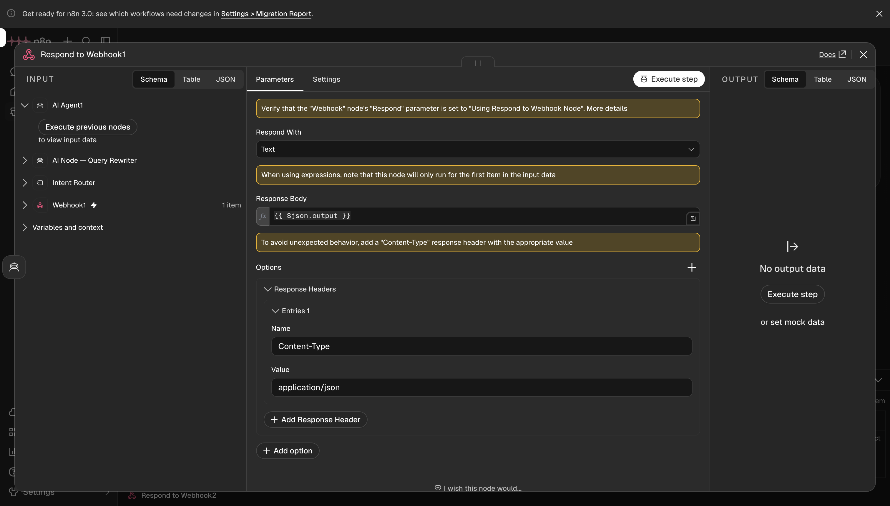

Do this on both nodes. If one is missed, that path (general or contract) will send back a reply your app can't read.

> **Note:** You don't need to update the ingestion workflow's **Respond to Webhook** node. Your app never displays anything from the ingestion reply. It only checks that the request succeeded, then swaps "Indexing contract…" for "Contract loaded" and enables the chat input. The chat replies are different: your app shows them to the user as the assistant's answer, so they need the `Text` body and `Content-Type` header.

### Step 4: Copy both webhook URLs

Click **Execute Workflow** so it's actually listening. Then open both webhook nodes and grab their URLs. You'll need both in Part 2:

- The one starting at **Binary Input Loader → Simple Vector Store (insert)** — that's your **ingestion webhook**. It reads the PDF once.
- The one starting at **Intent Router** — that's your **chat webhook**. It handles every question.

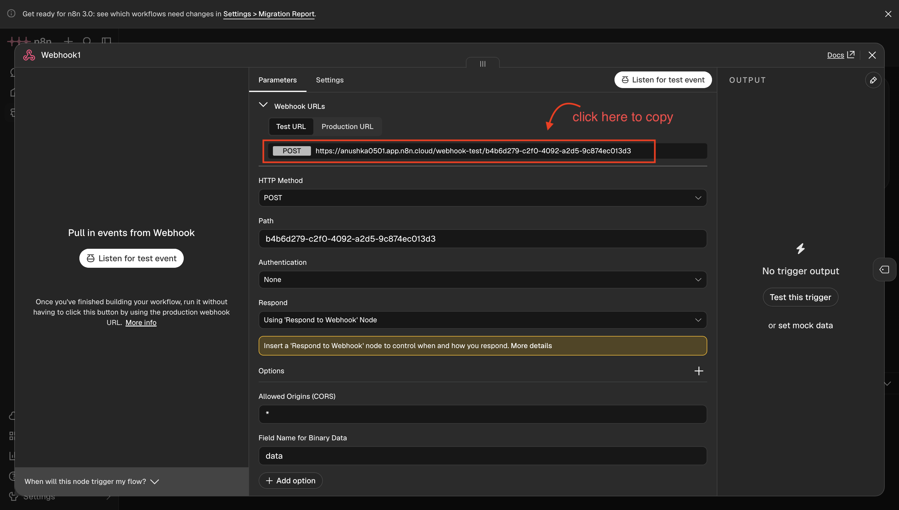

---

## Part 2: Your App Still Thinks There's Only One Job

Go back to the Claude Code session you used to build the app — or open a fresh one and point it at the `contract-review-app` folder, either is fine. Give it this single prompt, with the two URLs you copied in Part 1 swapped in at the very top:

```
Ingestion Webhook URL: <Your Ingestion Webhook URL>
Chat Webhook URL: <Your Chat Webhook URL>

My contract-review-app currently sends the uploaded file and the chat
message together, to one webhook, on every single send. My backend has
changed — it now has two separate webhooks, and app.js needs to match:

1. An ingestion webhook — takes the PDF once, right after upload.

   When a PDF is uploaded (loadFile), immediately POST it as binary
   form-data (field name "data") to this webhook. Show a brief
   "Indexing contract…" status while this is in flight. Keep the chat
   input disabled until ingestion succeeds. If it fails, show an error
   and let the user re-upload.

2. A chat webhook — takes just the typed message, per turn.

   Change the chat form submit handler to POST only the message to
   this webhook — remove the file from the FormData sent on every chat
   turn. The vector store behind this workflow is a single shared
   in-memory store that gets cleared and rewritten on every upload, so
   there's no session ID or document ID to track — one contract loaded
   at a time is the assumption.

Keep everything else — the message rendering, typing indicator, and
error handling — exactly as it is.
```

Here's what applying prompt looked like in an actual session. Claude read `app.js`, split the one webhook constant into two, and rewired both the upload handler and the chat submit handler:

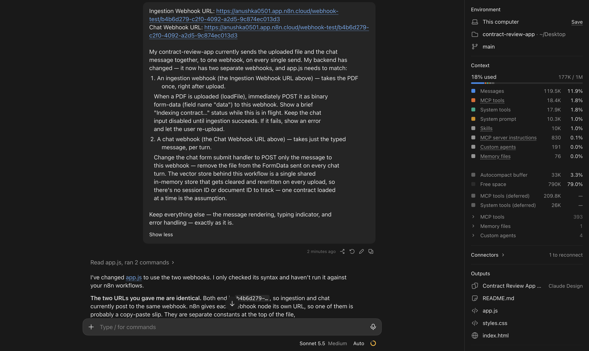

---

## Part 3: Test It Inside n8n First

Open the n8n workflow. You've got two entry points into it — **Webhook** at the top handles ingestion, **Webhook1** on the left handles chat:

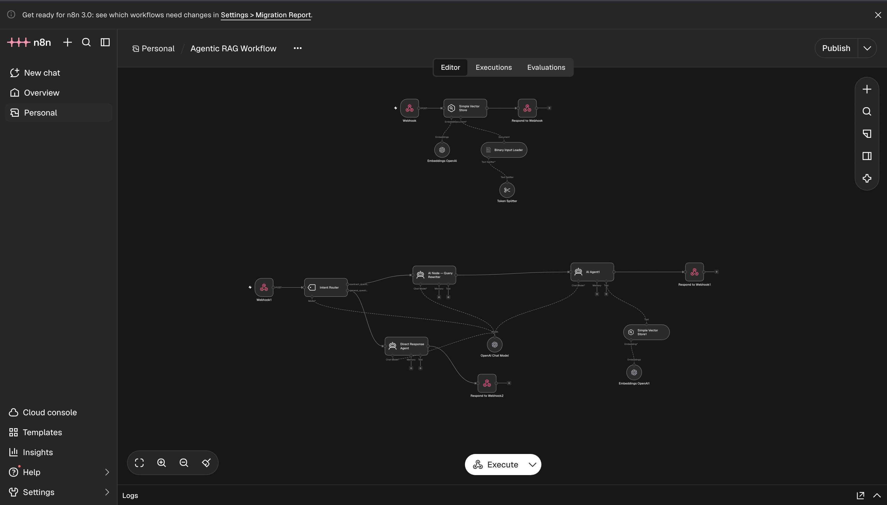

You'll need a sample contract for this — [download it here](https://pragyaallc-my.sharepoint.com/:b:/g/personal/sachin_parmar_legalgraph_ai/IQC2WQJhhIuyRq5JrVY13FwNAdwS4M5gB5w-qzBAm9V4mRQ?e=XyvLU4)

**Step 1 — test ingestion.** Click the dropdown next to **Execute Workflow** and choose **from Webhook**:

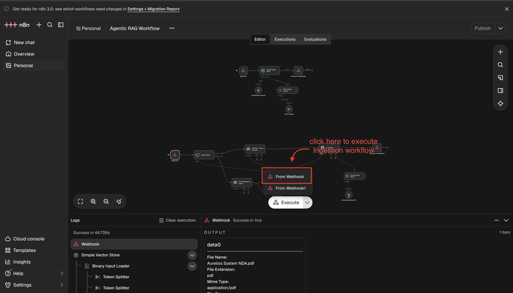

now click on execute workflow and go to your app's contract page and upload the sample contract. The chat panel should show **"Contract loaded: `<your file name>`."** Back in n8n, you should see green checkmarks travel across the whole ingestion path — Webhook → Simple Vector Store → Embeddings → Respond to Webhook :

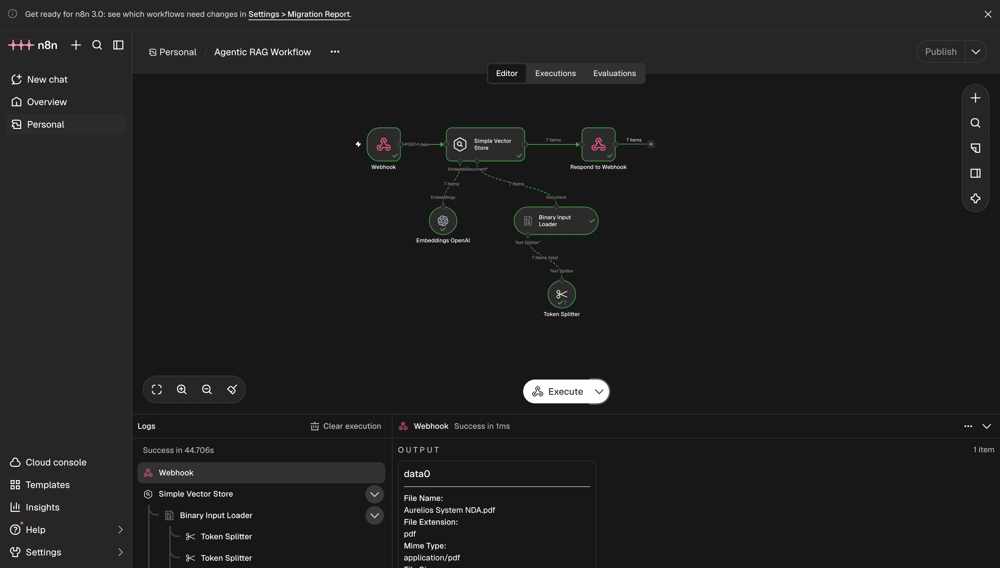

**Step 2 — test chat, first pass.** Click the same dropdown and choose **from Webhook1** instead:

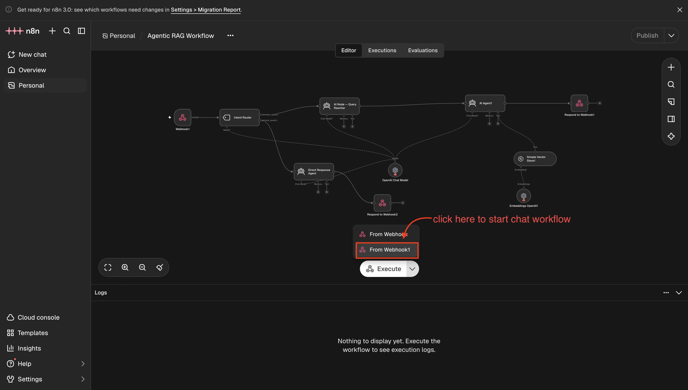

now click on execute workflow

Now go back to your app and send any message in the chat. You'll get an error back. **That's a good sign** — it means the message actually reached n8n, and you're looking at a real problem inside the workflow instead of a broken connection.

Open the **Intent Router** node — that's the first node Webhook1 hands off to, so it's the first place execution can fail. Fix text to classify, previously it was using from chat trigger now you need to update it for webhook1 trigger

```
{{ $json.body.message }}
```

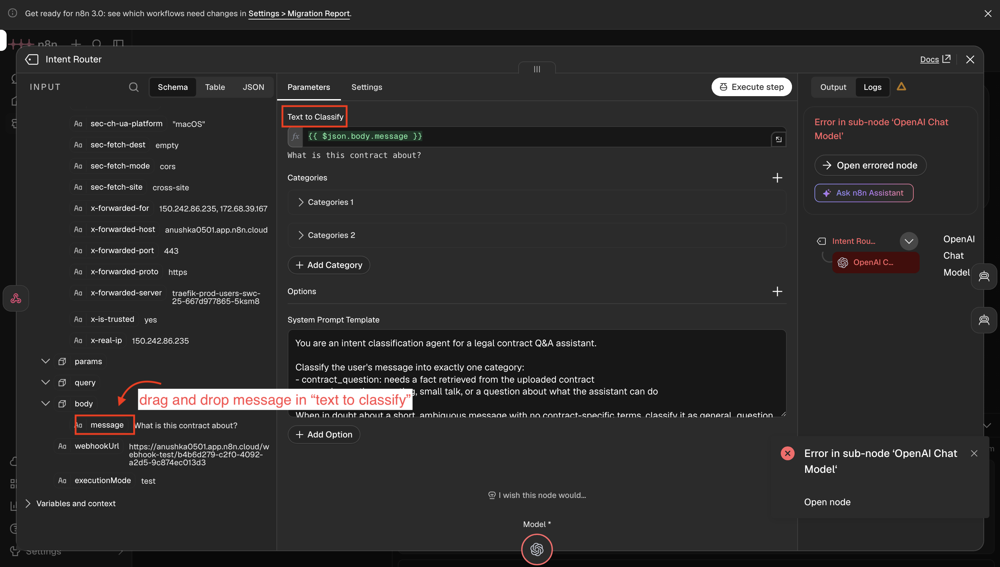

**Step 3 — test chat, second pass.** Click **Execute Workflow → from Webhook1** again (each test run only listens for one request, so you have to re-execute it before every retry). Back in the app, ask a question that has nothing to do with the contract — something like 

```
What can you help me with?
```

You'll get an error again. This time it's the **Direct Response Agent** — the node that handles anything the Intent Router classifies as a general question. Open it and apply the same fix:

```
{{ $('Webhook1').item.json.body.message }}
```

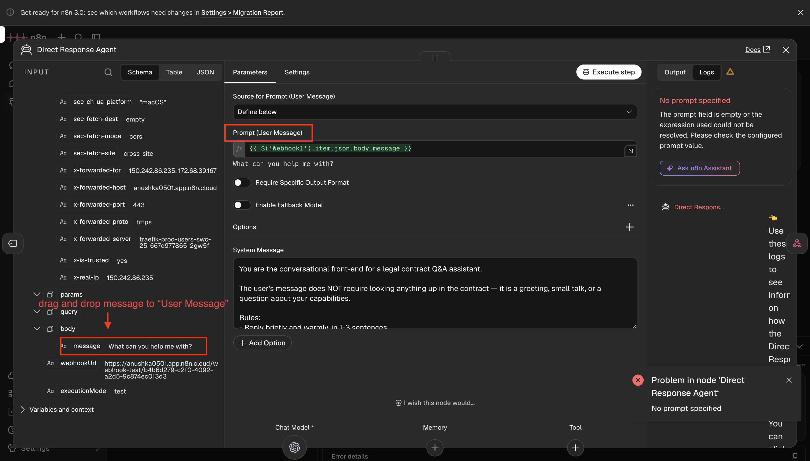

**Step 4 — confirm the general path works.** Execute Workflow → from Webhook1 once more, and ask that same non-contract question again. This time you should get a real answer back. That confirms the greeting/small-talk path is fully wired.

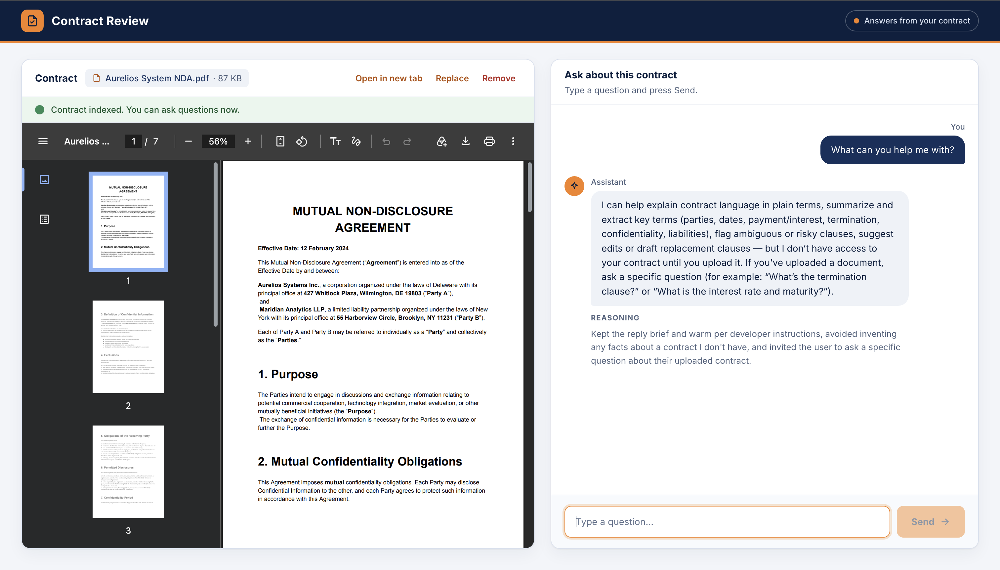

**Step 5 — now ask a contract question.** With the workflow still armed (re-execute if it's timed out), ask something that actually needs the document —

```
What is this contract about?
```

You'll hit an error a third time, and this one's on **AI Node — Query Rewriter**, still reading the same broken expression

Open it and apply the identical fix:

```
{{ $json.body.message }}
```

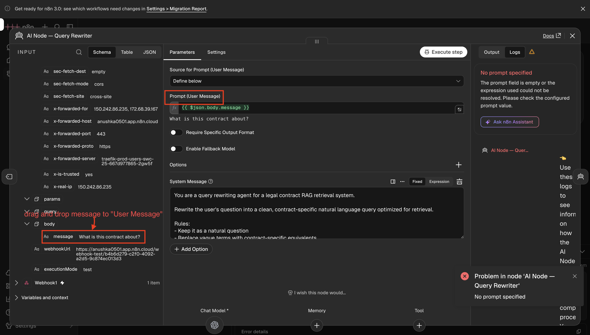

**Step 6 — confirm everything.** Execute Workflow → from Webhook1 one last time, and ask that same contract question again. You should now get a real, grounded answer:

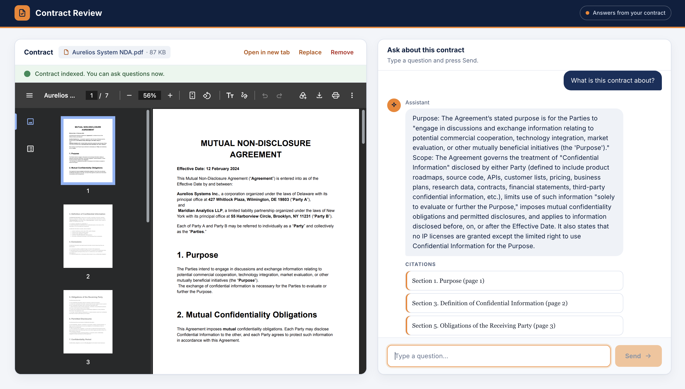

And on the n8n side, both branches of the Intent Router — general and contract — should now run clean end to end, no red errors anywhere:

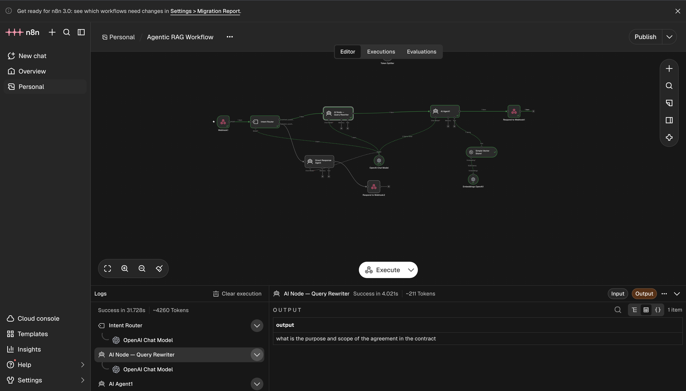

Your app is working correctly against the new backend. On to the next step.

---

## Part 4: Teach Claude Your Design System — as a Skill

Back in Lab 1.2, you described a look in a sentence and let Claude fill in the blanks. Fine for a first draft. Not something you'd want to redo from memory every time you open a new project — and not something you want to re-type into a prompt every time either.

There's a better way to hand Claude something it should follow every single time, without you re-explaining it: turn it into a **skill**. Before we restyle anything, let's build one.

### What's a Skill?

Think of a skill as a **saved instruction sheet** for Claude — like handing a new designer your company's brand guidelines on day one, instead of explaining your colors and fonts out loud every time.

It's just a text file (Markdown) with the rules written down. Once you upload it to Claude, you can call it by name — `/design-system` — or simply mention it in your message, and Claude reads the whole sheet and follows it. You don't have to retype anything, and Claude won't "forget" a rule you gave it last week.

**Why it matters here:** a design system is exactly the kind of thing that's tedious to re-explain: exact colors, font sizes, spacing, corner roundness. Write it down once as a skill and every future project can reuse it.

### Step 1: Download the Skill

The design system for this lab is already written for you in `SKILL.md` — a real color palette, type scale, 4px spacing grid, and patterns for things like status badges. Nothing in it is a guess.

[Download SKILL.md from GitHub](./SKILL.md)

### Step 2: Upload It into Claude

You only do this once, and the same steps work for any skill you get later.

1. In Claude's left sidebar, click **Customize** (marked **1** below)
2. Make sure you're on the **Skills** tab, then click **Add** at the top right (**2**)
3. Choose **Upload skill** from the dropdown (**3**)

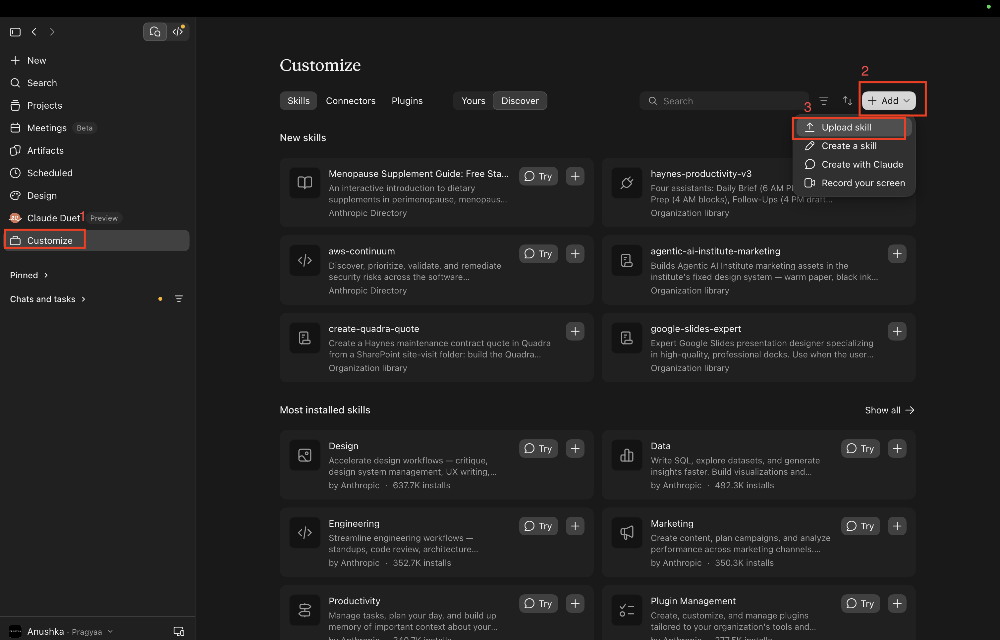

4. Select the `SKILL.md` file you just downloaded. Claude shows a preview with the skill's name (`design-system`) and what it does
5. Click **Upload**

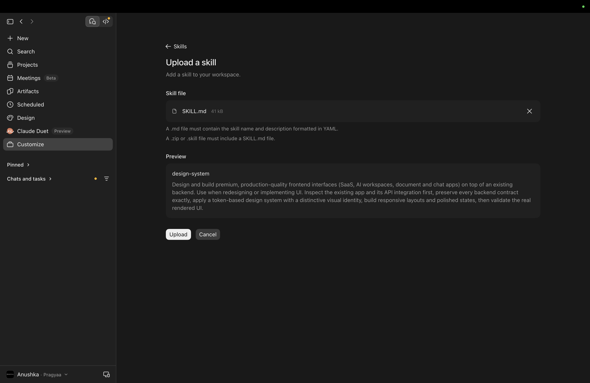

That's it — `design-system` is now installed and ready to use.

### Step 3: Use It on Your App

This is different from the `/design` command you used in Lab 1.2, which opens a sketch-first canvas. Here, Claude already knows your full design system and applies it straight to your code. Paste this into Claude Code:

```
Use the /design-system skill and restyle styles.css for the contract-review-app to follow our
design system exactly — palette, type scale, 4px spacing grid, and
border-radius rules.
```

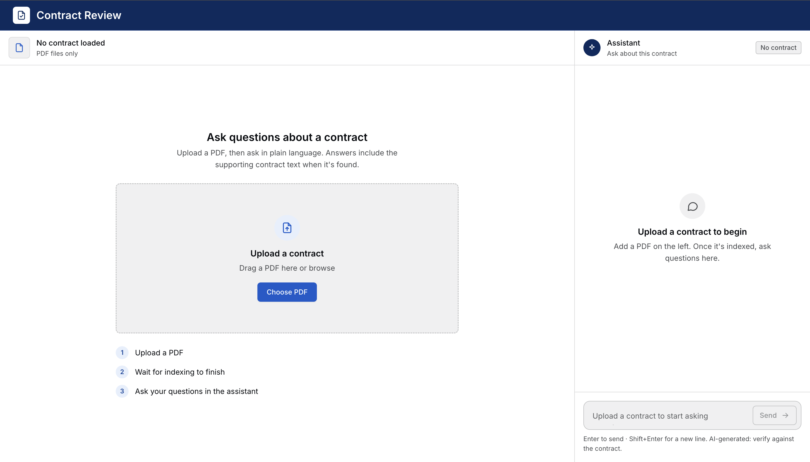

Refresh and take a look. Same layout, same behavior underneath — just a visual language you can now point back to a real source instead of a memory of what looked nice. If something still looks off, tell Claude which rule in `SKILL.md` it missed, rather than describing the fix yourself. The skill knows better than either of you at this point.

---

## Part 5: Try the Whole Thing

You already proved the wiring works back in Part 3 — upload, ingest, ask, answer, all of it. So this last pass isn't about function anymore. It's about looking closely at the thing Part 4 actually changed: does the app now genuinely look like it came from `design.md`, or just "different from before"?

Open the app fresh and walk through it slowly, checking it against the design system as you go:

1. **The empty state, before you upload anything.** Text should be Inter Display, primary text in Grey 900, secondary/hint text in Grey 500 — not the old navy or orange showing up anywhere.

   

2. **Upload the sample contract.** Watch the "Indexing contract…" status — its spacing and type should match the same 4px grid and type scale as everything else, not feel like a leftover from the old style.
3. **The loaded contract + chat layout.** Check spacing between sections — does it look like multiples of 4px, or are there odd gaps that were never redone? Cards and panels should carry the rounded corners `design.md` specifies (8px for cards, 6px for buttons and inputs).
4. **Send a real question** — *"What are the payment terms?"* — and look at the response bubble itself: body text should read as Paragraph Large Medium, not a random size Claude picked on its own.

   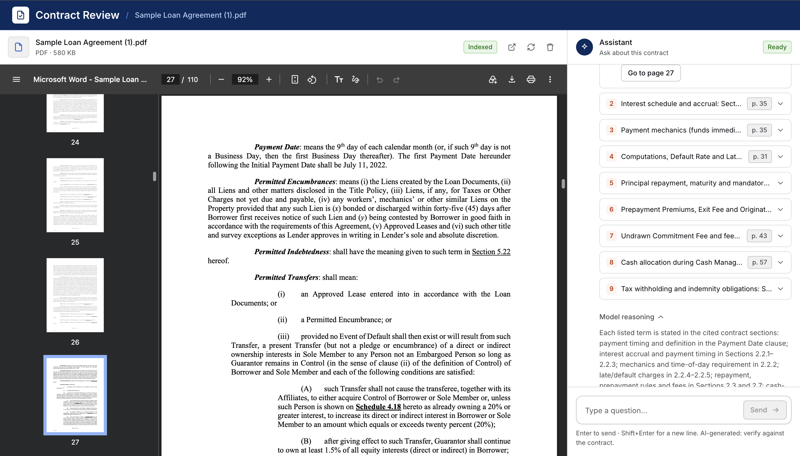

---

## Part 6: Push Your Code to GitHub

Your app now has a web layer and a design system, so it's worth saving. Pushing it to GitHub gives you a backup and a version history you can come back to.

Paste this into Claude Code:

```
Push the contract-review-app to GitHub so the repo is up to date. Check git status first, stage all changes, write a short commit message describing what changed, and push to the current branch.
```

Open your repo on GitHub and refresh. Your latest commit should show up at the top of the file list.

---

## What You Learned

| What | What it means | Why it matters |
|---|---|---|
| **Reading a document and answering questions aren't the same job** | You only need to upload and read the contract once. After that, you're just asking it questions, over and over | Sending the whole file again with every single message is slow and pointless once it's already been read |
| **Check every path before you trust it** | An agent that quietly fails on one path can still look totally fine — until someone actually hits that path | It only takes a minute to test both sides of a decision point, and it saves you from a confusing bug later |
| **A real design system beats a good guess** | Describing a look in a sentence gets you something that looks fine for a day. Writing it down once, as `SKILL.md`, gets you something everyone can keep using | When Claude follows an actual file instead of your memory of what "looked nice," you always know exactly why something looks the way it does |

---

### The Takeaway Before the Next Lesson

| Contract type | How answers are stored | RAG accuracy |
|---|---|---|
| Lease agreement | Direct, self-contained clauses | High |
| Loan agreement | Cross-referenced sections, defined terms, exhibits | Lower — without extra architecture |

This is the exact problem the **next lab** is built to solve. When facts are scattered across a document — or across multiple documents — you need more than vector search. You need a system that can follow references, resolve defined terms, and reason across chunks.

**That is where Knowledge Graphs come in.**

---

## Troubleshooting

These are the most common problems learners hit in this lab. Check here before asking for help.

---

**Webhook stops responding after switching to the production URL**

This lab runs on n8n's test webhook URL (`/webhook-test/...`), which only listens while you have the workflow open and are running it manually. If you swap in the production URL (`/webhook/...`) instead, requests will fail — the production URL only listens once the workflow has actually been published.

Fix: stick to the test URL for everything in this lab. If you want to use the production URL instead, you need to publish your workflow first, so it listens on that URL even when you're not watching it run.

---

**OpenAI node returns a 429 rate limit error**

If the OpenAI model node in your n8n workflow errors out with something like `429 - Rate limit reached` or `insufficient_quota`, nothing in your workflow is actually broken — it means your OpenAI API key has run out of usage credits.

Fix: go to **platform.openai.com → Billing** and add more credits to your account. Your existing API key keeps working as-is — just retry the request in n8n once billing shows the added credits.

[← Back to Week 2 Overview](../Readme.md)
