# Lab 3.1: Connect Your App to Supabase Using Claude's Connectors

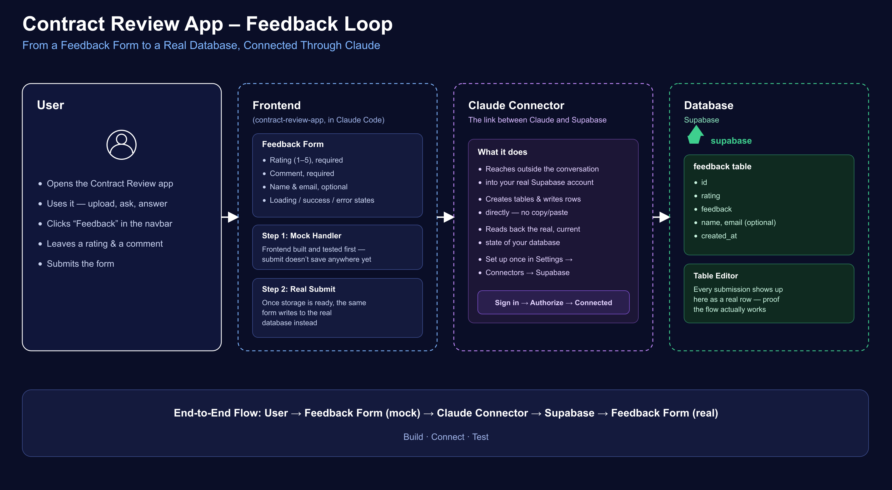

## Table of Contents

- [Overview](#overview)
- [Prerequisites](#prerequisites)
- [Part 1: Build a Feedback Form](#part-1-build-a-feedback-form)
- [Part 2: Store the Feedback Somewhere Real](#part-2-store-the-feedback-somewhere-real)
- [Part 3: Set Up Your Supabase Account and Project](#part-3-set-up-your-supabase-account-and-project)
- [Part 4: Connect Supabase to Claude (the Connector)](#part-4-connect-supabase-to-claude-the-connector)
- [Part 5: Connect the Application to Supabase](#part-5-connect-the-application-to-supabase)
- [Part 6: Test the Feedback Feature](#part-6-test-the-feedback-feature)
- [Part 7: Push Your Code to GitHub](#part-7-push-your-code-to-github)

---

## Overview

In week 1 you built `contract-review-app`, and in week 2 you updated its backend. It works — but is the person using it actually satisfied? Right now you have no way to know.

To find out, we'll add a **feedback form** so users can tell you what they think.

But there's a second problem: the moment you refresh the app, your chat is gone, and your feedback has nowhere to go. So we'll also add a **database** — **Supabase**, integrated with Claude through a **connector** — to retain both the chats and the feedback.

Here's the flow for this lab:

- **Build a feedback form.** So real users can tell you how the app is doing.
- **Add a database with Supabase, connected through Claude.** So chats and feedback are saved for real instead of disappearing on refresh.

---

## Prerequisites

✅ **Lab 2.4 done** — you have a working `contract-review-app` folder.

✅ **Claude Code Desktop** installed and signed in.

---

## Part 1: Build a Feedback Form

The obvious first move is the one you'd expect: build the form itself.

Go to your Claude Code session, pointed at `contract-review-app`, and give it this prompt:

```
Add a Feedback feature to the existing Contract Review application.

Build only the frontend for the Feedback form.

- Add a "Feedback" button to the existing navbar.
- Open the form inside the app using the existing UI pattern (modal, drawer, or in-app view).
- Inspect the existing project structure and reuse existing components.
- Before implementing, follow the existing `design-system` skill for layout, typography, colors, spacing, buttons, form fields, and states.
- Keep the design consistent with the existing Contract Review application.
- Do not add login/signup.
- Do not change or break existing Contract Review functionality.

Feedback form fields:
- Rating: 1–5, required
- Feedback/comment: required
- Name: optional
- Email: optional

Include:
- Clear labels
- Client-side validation
- Submit button
- Loading state
- Success state
- Error state
- Prevent duplicate submissions while submitting

For this step, do NOT integrate Supabase yet. Use a temporary/mock submit handler so the complete frontend flow can be tested.
```

Claude will build the form itself — styled to match the rest of the app.

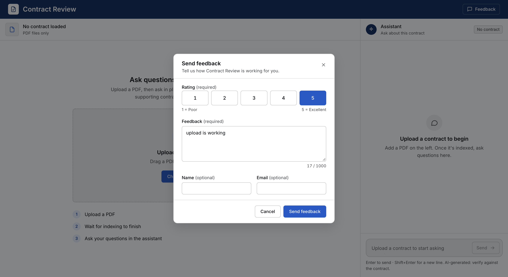

It works — you can click through the whole flow, even see a fake success state. But hit submit for real and nothing actually happens: there's nowhere for that data to land yet. Once real users start filling this out, where does their feedback actually go?

---

## Part 2: Store the Feedback Somewhere Real

Right now the feedback form works, but its submit handler is fake — fill it out, hit submit, and the data just disappears into nothing. You need a real database — somewhere to actually store every rating and comment that comes in.

You could build that yourself: set up a database, write the code that talks to it, handle authentication, write the API endpoints that let your form send data back and forth. That's a lot of work, and it's exactly the kind of work that's easy to get wrong.

So instead of building and wiring up a database by hand, we're going to let Claude connect to database directly. Using Claude Connectors - A connector allows Claude to interact with another tool for you. Instead of switching between Claude and Database, copying information, or creating everything manually, Claude can use the connector to work with database directly.
for database we are going to use Supabase - Supabase is an online platform where we can store and manage the data our application needs. You can think of it as a ready-to-use place for keeping information, so we don’t need to build our own database from scratch.

---

## Part 3: Set Up Your Supabase Account and Project

Before Claude can connect to a database, you need a database for it to connect to. **Supabase** is a free, ready-made database — you get a real place to store data without setting up or managing a server yourself. In this lab, it's where every feedback submission and every saved chat will live.

1. Go to [supabase.com](https://supabase.com) and sign up. You can continue with GitHub, ChatGPT, SSO, or an email and password — whichever is easiest for you.


   If you already have a Supabase account, sign in instead.


2. If you signed up with an email and password, Supabase sends you a confirmation email. Open it and click **Confirm Email Address**.


3. Supabase will then ask you to create an organization — a container that holds your projects. Enter a name and keep the **Free - $0/month** plan.


   The remaining questions are optional and only help Supabase improve its product. Answer them or skip them, then click **Create organization**.


4. Next, create your first project inside the organization:
   - **Project name:** `contract-review-feedback`
   - **Database password:** set a strong password and save it somewhere safe (the **Copy** button helps).
   - **Region:** leave it on **Auto**, or pick one close to you.
   - Leave the other options at their defaults.

```
contract-review-feedback
```

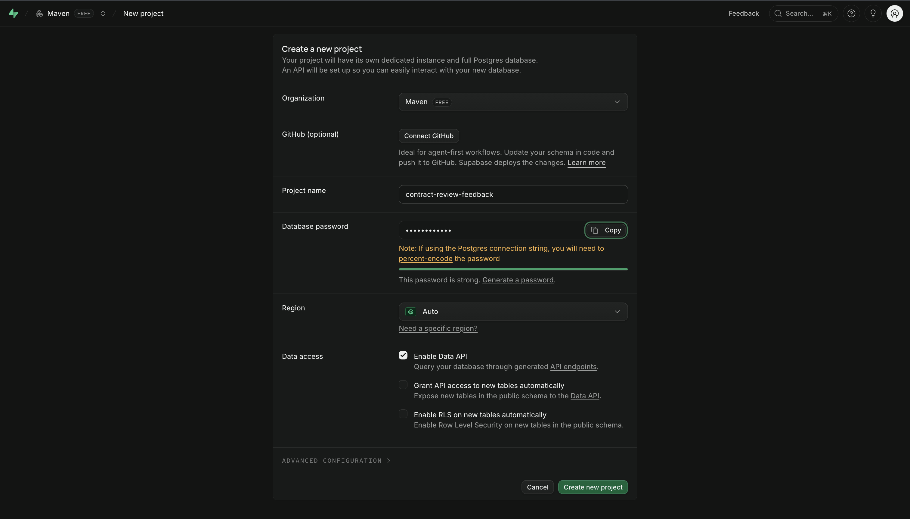

5. Click **Create new project** and wait a couple of minutes while Supabase finishes setting it up.

6. Once the project is ready, click **Copy** next to the project address and choose **Project URL** (it looks like `https://xxxxxxxxxxxx.supabase.co`). Save it somewhere handy — you'll paste it into a prompt in Part 5.

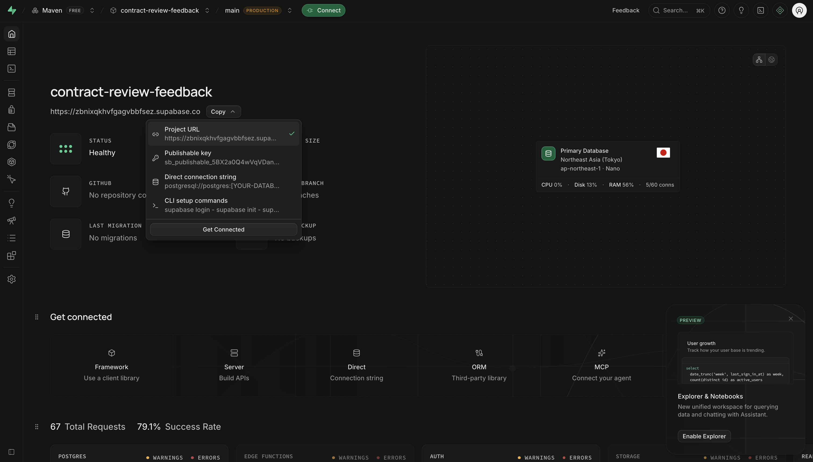

---

## Part 4: Connect Supabase to Claude (the Connector)

Your Supabase project is ready, but Claude can't reach anything outside this conversation on its own — it doesn't know your Supabase account exists. A **connector** is how you fix that: it's a direct link between Claude and an outside tool, so Claude can actually reach in and use it instead of just knowing the tool exists.

Let's add the Supabase connector:

1. In Claude, open **Customize** from the left sidebar and select the **Connectors** tab.
2. Click **Discover** and search for **Supabase**.
3. Find the **Supabase** entry listed as a **Connector** (not the Supabase *plugin*) and click **Connect**.

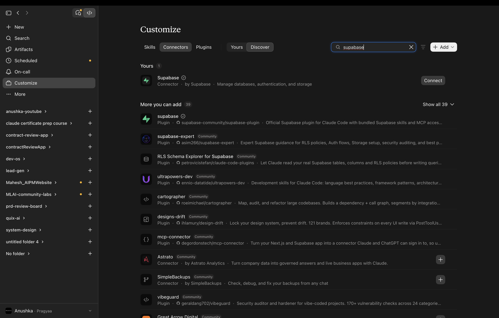

4. Claude will show a **"Finish connecting a connector?"** screen. Click **Continue connecting**.

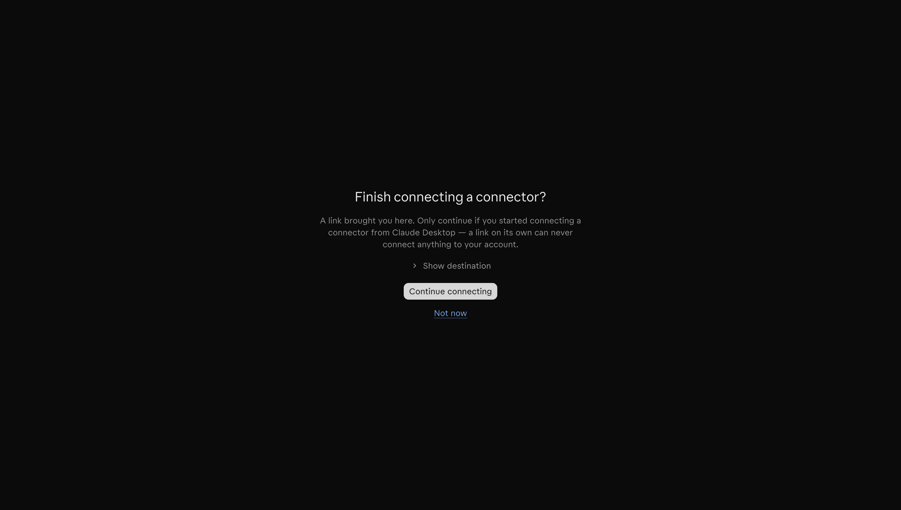

5. You'll land on a screen asking you to **Authorize Claude** to access your Supabase account. Select the organization you just created and click **Authorize Claude**.


6. Claude takes you back to the connector's page, where you can review the tool permissions it now has for Supabase.


7. Go back to **Customize → Connectors → Yours**. Supabase now appears in your list of connectors with a check mark in the **Status** column.

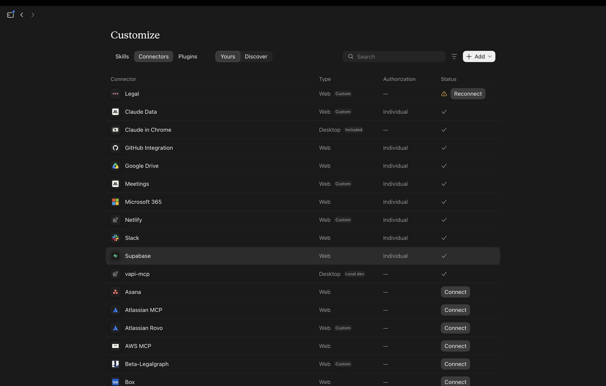

Your Supabase account is set up, and Claude is now connected to it. Let's put that connection to use.

---

## Part 5: Connect the Application to Supabase

Your Supabase account is ready, and Claude is connected to it. Now let's go back and replace that mock submit handler with the real thing — wiring the feedback form you already built to your actual Supabase project.

Go back to your Claude Code session, still pointed at `contract-review-app`, and give it this prompt:

> Replace `<YOUR SUPABASE PROJECT URL>` in the prompt below with the Supabase Project URL you copied in Part 3.

```
SUPABASE PROJECT (use only this one): <YOUR SUPABASE PROJECT URL>

TASK
Integrate the existing Feedback form and the Contract Review chat with Supabase
for the first time, and make saved chats visible again: the user must be able to
see past chat history per contract after reloading or returning to the app.
Do not create or use any other Supabase project.

STEP 0: INSPECT FIRST
Review the existing Supabase config, client setup, env vars, and app
architecture before changing anything. Reuse what exists.

DATABASE (create both tables; no auth, no user_id; the app has no login/signup)
1. `feedback`: id, rating, feedback, name, email, created_at
2. `chat_messages`: id, contract_name (text, not null), question, response,
   citation (text[], nullable), reasoning (text, nullable), created_at
   - Add an index on (contract_name, created_at) for history lookups.

RLS POLICIES (enable RLS on both tables)
- feedback: public INSERT only. No public SELECT, UPDATE or DELETE.
- chat_messages: public INSERT and SELECT only (the app reads chats back).
  No public UPDATE or DELETE.

SECURITY
- The frontend uses only the anon/publishable key, read from env vars.
- Never expose a service-role key or other privileged credentials in frontend code.

FEEDBACK FORM
- Wire the existing form's submit to insert into `feedback`.
- Validate input before submit and reject invalid input (e.g. rating range,
  required fields, email format).
- Handle all states: loading (disabled submit/spinner), success, error,
  validation errors.
- Prevent duplicate submissions (disable while in flight, guard against
  double-clicks and repeat submits).

CONTRACT REVIEW CHAT: SAVING
- Determine the contract name from what the app already knows (the uploaded or
  selected contract's file name or title). Strip the file extension for display
  and trim it. If none is available, use 'Untitled contract'.
- After each question gets its response displayed, insert a new row into
  `chat_messages` with contract_name, question, response, citation and reasoning.
- If the reply has no citation or reasoning, leave those columns null/empty.
- If saving fails, the chat must keep working normally. The user must see no
  error, so log it silently. Never block or delay the response display.

CONTRACT REVIEW CHAT: HISTORY
- Add a "Chat history" entry point in the existing UI (for example, a sidebar
  section or a history button/panel). Reuse existing components and tokens.
- Chat history list: query `chat_messages` and group by `contract_name`. For
  each contract show its name, the number of questions, and the time of the
  last message. Sort by most recent activity first.
- Selecting a contract opens its conversation. Load that contract's rows ordered
  by created_at ascending and render each as a question and response pair.
  Reuse the existing chat message components so it looks identical to a live
  chat, including citations and reasoning when present.
- If the user is currently reviewing a contract with the same name, load its
  prior messages when the chat opens, so history survives a reload.
- Handle loading (skeleton or spinner), empty state ("No chat history yet"),
  and fetch-error states (a friendly message with a retry; this view may show
  errors, unlike the silent save path).
- Reads use the anon key and the existing SELECT policy only. Fetch only the
  needed columns, and limit results (for example, the latest 200 rows per
  contract) so the list stays fast.
- Newly saved messages must appear in history without a manual refresh (refetch
  when the panel opens, or update local state after a successful save).

CONSTRAINTS
- Preserve the existing frontend design and the `design-system` implementation.
  Reuse existing components and tokens; no visual redesign.

VERIFY (report pass/fail for each)
1. The Feedback button opens the form.
2. Valid feedback is inserted into Supabase.
3. Invalid input is rejected.
4. Success and error states work.
5. Duplicate submissions are prevented.
6. Each chat question, response, citation, reasoning and contract_name is saved
   to `chat_messages`.
7. Existing Contract Review functionality still works.
8. Chat history lists contracts by name with correct counts and ordering.
9. Opening a contract shows its full Q&A (with citations and reasoning), in order.
10. After a full page reload, the history is still visible and loads from Supabase.
11. A simulated save failure leaves the chat working with no visible error.
12. Loading, empty and error states of the history view render correctly.
Also confirm the RLS policies behave as specified (anon can't read feedback,
can't update or delete either table; anon can read and insert chat_messages).
```

Claude will inspect your Supabase setup and create two tables: `feedback`, to store the feedback submitted by users, and `chat_messages`, to store every question asked in the chat along with the contract name, response, citation and reasoning it received. It will also add a **Chat history** button to the app so you can see those saved chats again. You'll use these saved chats in Lab 3.3 to build your evaluation dataset.

---

## Part 6: Test the Feedback Feature

Now that the feedback feature is ready, let's see what happens when a user actually interacts with it.

### 1. Start with the obvious test

Open the Contract Review app and click **Feedback** in the navbar.

Fill in the form with a rating and some feedback, then submit it.

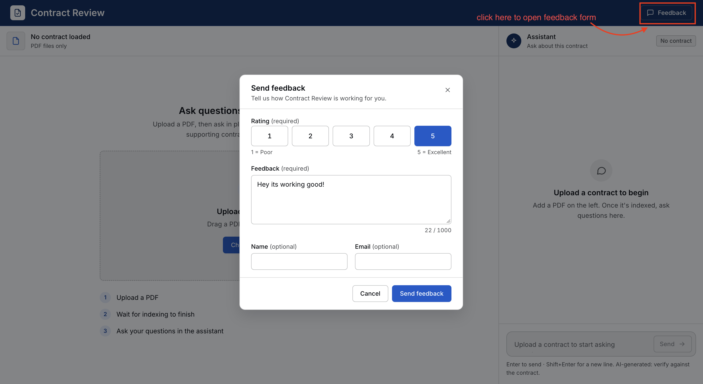

You should see a success message once the feedback is submitted.

### 2. What if we submit an empty form? 🤔

Try clicking **Submit Feedback** without entering anything.


Check whether the app prevents the submission and shows the appropriate validation messages.

### 3. Where did our feedback go? 🔍

Now let's verify that the feedback actually reached the database.

Open your **Supabase project → Table Editor → `feedback`**.


You should see your submitted feedback as a new row, including the rating, feedback, optional details, and timestamp.

### 4. Are the chat questions and responses saved too? 💬

Go back to the Contract Review chat, upload the sample contract, and ask a question like *"What are the payment terms?"*

Then open **Supabase project → Table Editor → `chat_messages`**. You should see a new row with the question you asked and the response the agent gave (plus citation and reasoning, if the agent returned them).

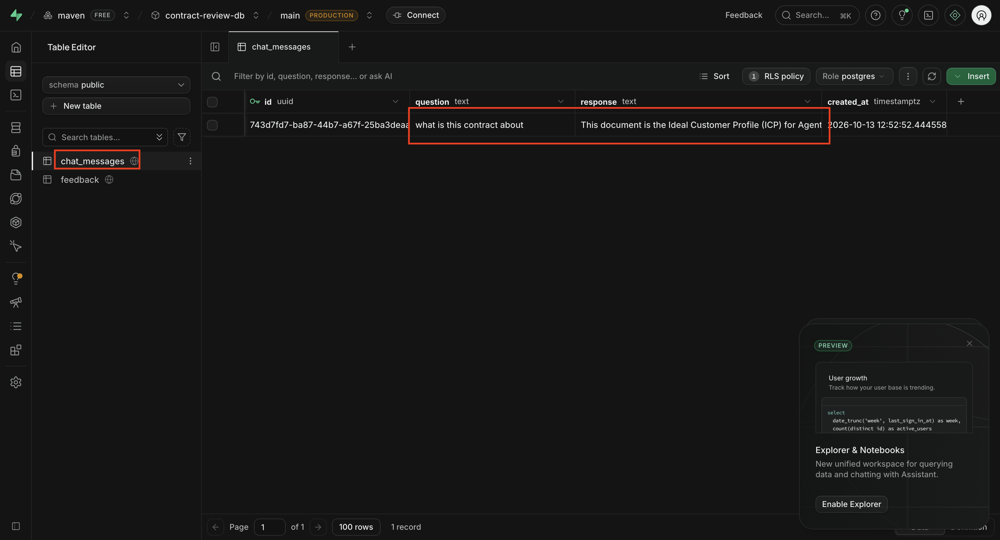

### 5. Can I still see my chats after a refresh? 🔄

Look at the top of the chat panel. You'll see a **Chat history** button.

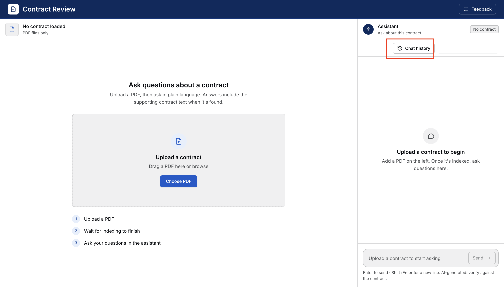

Click it, and you'll see every contract you've chatted about, with the number of questions and the time of the last message. Even if you refresh the page, your chats are saved here. Select a contract to reopen its full conversation.

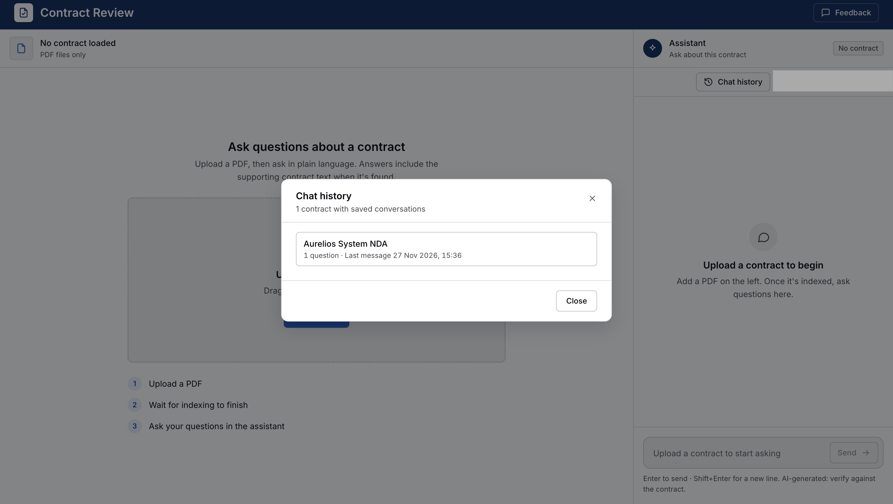

🎉 **If you can see your feedback and your chat questions and responses in Supabase, the complete flow is working.**

---

## Part 7: Protect Your Secrets and Push Your Code to GitHub

Everything works, so let's save it. First, a quick concept:

- **`.env`** is a local file that holds secrets and config, like your Supabase project URL and keys. It never goes to GitHub.
- **`config.js`** is the same idea, but for apps like ours. Our app is plain `index.html`, `style.css` and `app.js` opened straight in the browser, and a browser can't read a `.env` file. So we keep the real values in `config.js`, load it with a `<script>` tag, and read them from there in `app.js`.
- **`.gitignore`** lists files Git should skip. Adding `.env` and `config.js` to it stops you from committing secrets by accident.

### 1. Create `.env`, `config.js` and `.gitignore`

Go back to your Claude Code session, still pointed at `contract-review-app`, and give it this prompt:

```
My app is only index.html, style.css and app.js, opened as a local file preview, so it cannot read a .env file.

1. Create a .env file in the project root with my Supabase project URL and anon key. This is just a reference copy for me.
2. Create a config.js file in the project root that defines window.APP_CONFIG with my Supabase project URL, anon key, and any other important URLs or keys currently hardcoded in the code.
3. Update index.html to load config.js with a <script> tag BEFORE app.js, and update app.js to read every URL and key from window.APP_CONFIG instead of hardcoding them.
4. Create a config.example.js with the same structure but placeholder values (like "YOUR_SUPABASE_URL"), so others know what to fill in. This one is safe to commit.
5. Create a .gitignore that includes .env, .env.*, config.js, and .DS_Store.

Run `git status` and confirm .env and config.js are NOT listed as files to be committed, while config.example.js is.
```

Check that neither `.env` nor `config.js` shows up in `git status` before moving on.

### 2. Commit and push

Now give Claude Code this prompt:

```
Commit and push all my changes to the main branch on GitHub with a clear commit message. Don't commit secrets (.env files, config.js, or service-role keys), and never force-push. Confirm the push succeeded.
```

Once it finishes, your code is updated on GitHub. 🎉

---

## What You Learned

- **Connectors are how Claude reaches outside itself.** Supabase isn't something Claude has built in — the connector is what links your actual Supabase account to your Claude session, so Claude can create tables and write data on your behalf instead of you doing it by hand.

- **Now your app can hear back from real users.** With the feedback form wired to Supabase, every rating and comment a user submits lands as a real row in your database — turning "I think this app is good" into something you can actually check.

---

Feedback tells you how people feel about the app — but it doesn't tell you whether the code underneath is actually sound. That's what the next lab checks.

[Go to Lab 3.2: Review Your App Using Claude's Sub Agent →](../3.2-code-review-subagent/Readme.md)
