# Lab 3.2: Evaluating Your n8n AI Agent with Azure AI Foundry

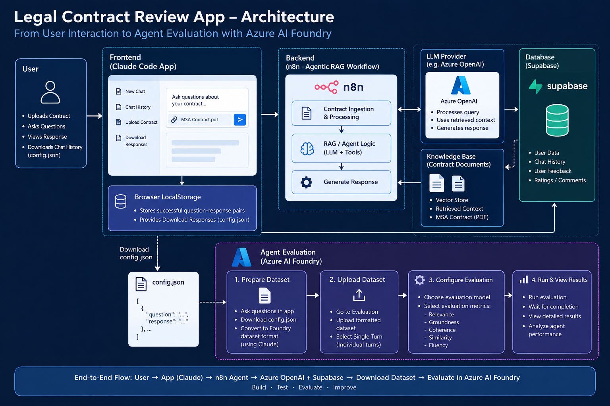

## Closing the Loop — From Building to Measuring What Your Agent Actually Does

You have come a long way. Over the previous weeks you built a contract-review app, wired it to an n8n agentic RAG backend, and connected a Supabase database to capture user feedback. The app works — but "it works" is not the same as "it works well." That gap is exactly what this lab closes.

This week the focus is **evaluation**. You will measure how well your agent actually answers questions by running a structured eval inside Azure AI Foundry. By the end of this lab you will have a scored report across five quality dimensions — Relevance, Groundedness, Coherence, Similarity, and Fluency — that tells you, with numbers, how your agent is performing.

---

## Prerequisites

Before you begin, confirm all of the following are in place:

1. You have completed all labs from the previous weeks.
2. The contract-review app you have been building since Week 1 is running locally in Claude Code.
3. You have access to an Azure account where you can create an Azure AI Foundry resource. New accounts receive $300 in free credits — you will set this up in Step 4.
4. Download the MSA (Master Services Agreement) sample contract — **[Download From Here](https://drive.google.com/file/d/1kJpujNVGU7Bk8nu35s3BZCtAWo-gHiqb/view?usp=sharing)** — you will upload this into your app when generating the dataset.

---

## Phase 1: Prepare Your App to Export Data

### Step 1: Add the "Download Responses" Feature to Your App

**What you're doing**: Adding a way to export the chats your app already saved in Supabase (from [Lab 3.1.2](../3.1-subagent-connectors/3.1.2-connectors-feedback-form/Readme.md)), letting you choose how many recent responses to include. This exported file becomes your evaluation dataset.

**Why this matters**: Azure AI Foundry needs a dataset of real question-and-answer pairs to evaluate. The cleanest source for that dataset is your own app, with real answers from your own agent. Rather than hand-crafting examples, you'll generate them naturally by chatting with the app — every exchange is already saved in your Supabase `chat_messages` table, and the Download button exports the number you choose.

**Action items**:

1. Open Claude Code with your contract-review app project.
2. Run the following prompt exactly as written:

```
Update the existing contract-review-app to add a Download Responses feature that reads saved chats from the existing Supabase `chat_messages` table.
Requirements:
- Supabase `chat_messages` is the only source to save responses.
- Do not create a new Supabase project or table. Use the existing `chat_messages` table with `question`, `response`, `citation`, `reasoning`, and `created_at`.
- Show a `Download Responses` button in the chat section.
- When clicked, open a small dialog asking how many of the most recent responses to download, with these preset choices: Last 5, Last 10, Last 20, All.
- Show how many saved responses exist, and disable any preset larger than that number.
- If there are no saved responses, show a clear message instead of downloading an empty file.
- After the user picks an option, fetch that many rows from `chat_messages`, newest first, and export them as a `config.json` file in the order they were asked (oldest first).
- Do not show or export `id` or `created_at`.
- If the Supabase request fails, show a clear error message and do not download a file.
- Never expose a Supabase service-role key in frontend code.
- Keep the existing contract upload, chatbot, and feedback functionality unchanged.
- Do not make any other changes.

Export `config.json` in this format:
[
  {
    "question": "What is the effective date?",
    "response": "April 1, 2023",
    "citation": ["Section 4.1 – Term and Effective Date"],
    "reasoning": "The effective date is stated explicitly in the retrieved clause."
  }
]
```

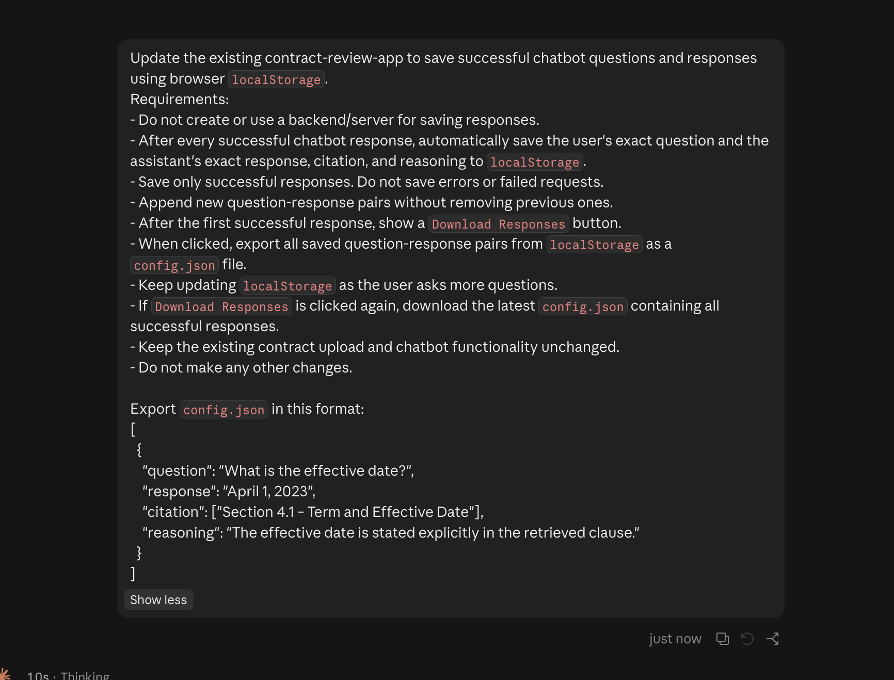

3. Claude Code will update your app. Once it finishes, run your app and verify it still loads correctly. If Claude asks to change the `chat_messages` policies so the app can read saved chats, allow it.
4. Upload the MSA contract you downloaded in the Prerequisites step.

**Output**: Your app now has a "Download Responses" button that exports saved chats from Supabase, in the number you choose.

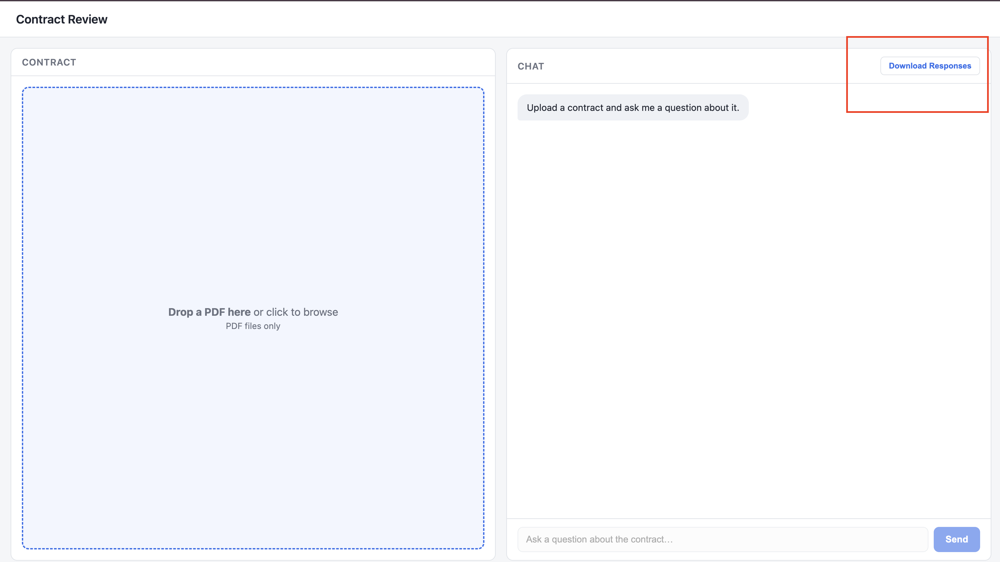

---

## Phase 2: Generate Your Evaluation Dataset

### Step 2: Ask the Five Evaluation Questions

**What you're doing**: Using your live agent to answer five carefully chosen contract-law questions, generating the raw material for your evaluation dataset.

**Why these five questions**: Each question targets a different clause category — termination, IP, liability, payment, and dispute resolution. Together they give the evaluator broad coverage of how well your agent handles the full contract, not just one narrow topic.

**Action items**:

1. Make sure the MSA contract is uploaded in your app's contract section.
2. Go to the chat section of your app.
3. Ask each of the following five questions, one at a time. Wait for a complete response before moving to the next:

> **Question 1**: What is the Customer Name?

> **Question 2**: What is the Contract start date?

> **Question 3**: what is the Contract end date / Expiration Date?

> **Question 4**: What is the total term period or duration of this contract? Provide answer in the form of number of months if possible

> **Question 5**: What is the total amount to be paid by the customer?

4. After all five responses appear, confirm that no errors occurred. All five must be successful responses for the dataset to be complete.

**Output**: Five question-and-answer pairs are now saved in your Supabase `chat_messages` table. Check **Table Editor → `chat_messages`** if you want to confirm.

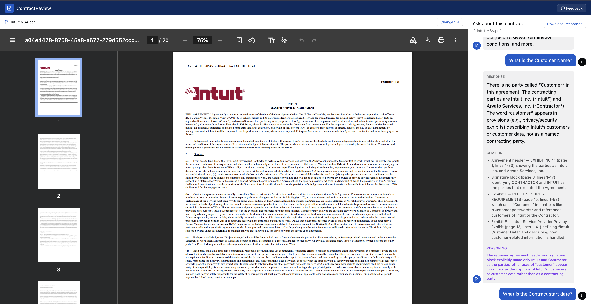

---

### Step 3: Download Your Responses

**What you're doing**: Exporting the five Q&A pairs as a `config.json` file that you will convert into a properly formatted evaluation dataset in the next phase.

**Action items**:

1. Click the **Download Responses** button in your app's chat section.
2. In the dialog, choose **Last 5** (the five questions you just asked). A file named `config.json` will download to your machine.
3. Open the file and verify it contains all five question-response pairs in the correct format. It should look like this:

```json
[
  {
    "question": "What is the termination notice period...",
    "response": "The agreement requires 30 days written notice...",
    "citation": ["Section 9.2 – Termination"],
    "reasoning": "The notice period is stated explicitly in the retrieved clause."
  },
  ...
]
```

4. Keep this file handy — you will need it in the next step.

**Output**: A `config.json` file on your machine containing your agent's answers to the five contract questions.

---

## Phase 3: Set Up Azure AI Foundry

### Step 4: Create Your Azure AI Foundry Account and Project

**What you're doing**: Creating the cloud workspace where the evaluation will run before you touch anything else in Foundry.

> **Note**: If you already have an Azure AI Foundry account and project from a previous lab, skip ahead to Step 5.

**Action items**:

1. Go to Azure AI Foundry and create a new account. [Watch: How to create an Azure AI Foundry account](https://youtu.be/Is3GgsCEPho?si=WhCt7DQQG_UOMP2o). New accounts receive $300 in free credits.

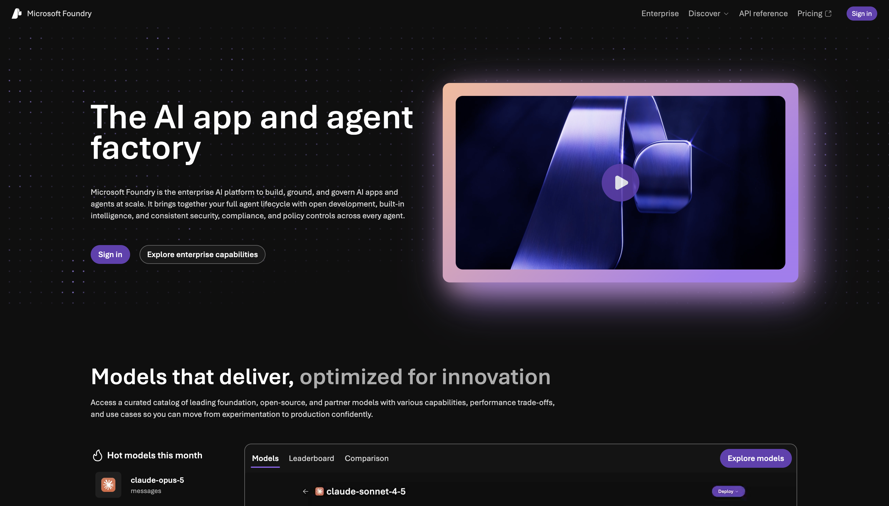

2. Once your account is ready, create a new resource group first. [Watch: How to create a resource group in Azure](https://youtu.be/bTeD1Ec62dY?si=gBTiO-oc0M3hvv2q). Then create a new project inside that resource.

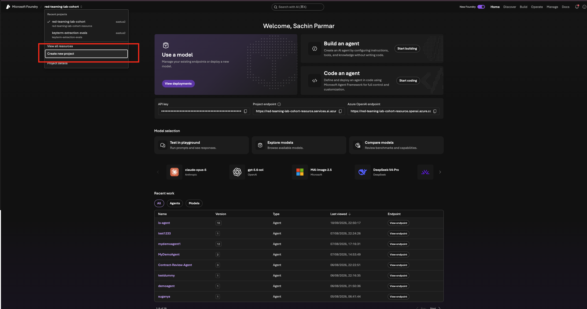

3. Fill in all the required details — resource name, region, and subscription — then confirm.

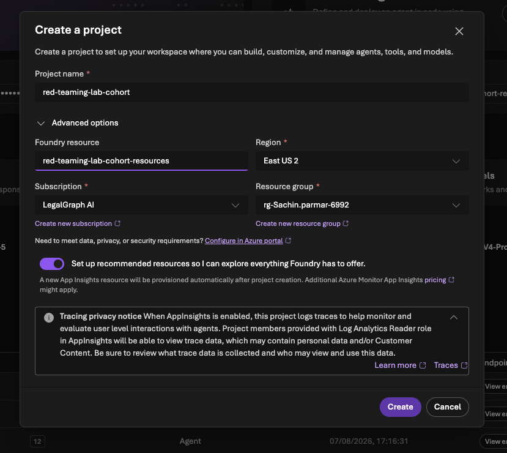

**Output**: An active Azure AI Foundry project ready to receive your dataset and evaluation.

---

## Phase 4: Format the Dataset for Azure AI Foundry

### Step 5: Try to Upload — and Discover the Format Requirement

**What you're doing**: Starting the evaluation setup in Foundry and attempting to upload your `config.json` — and discovering exactly why it needs one more step first.

**Action items**:

1. Inside your Foundry project, navigate to the **Build** section.

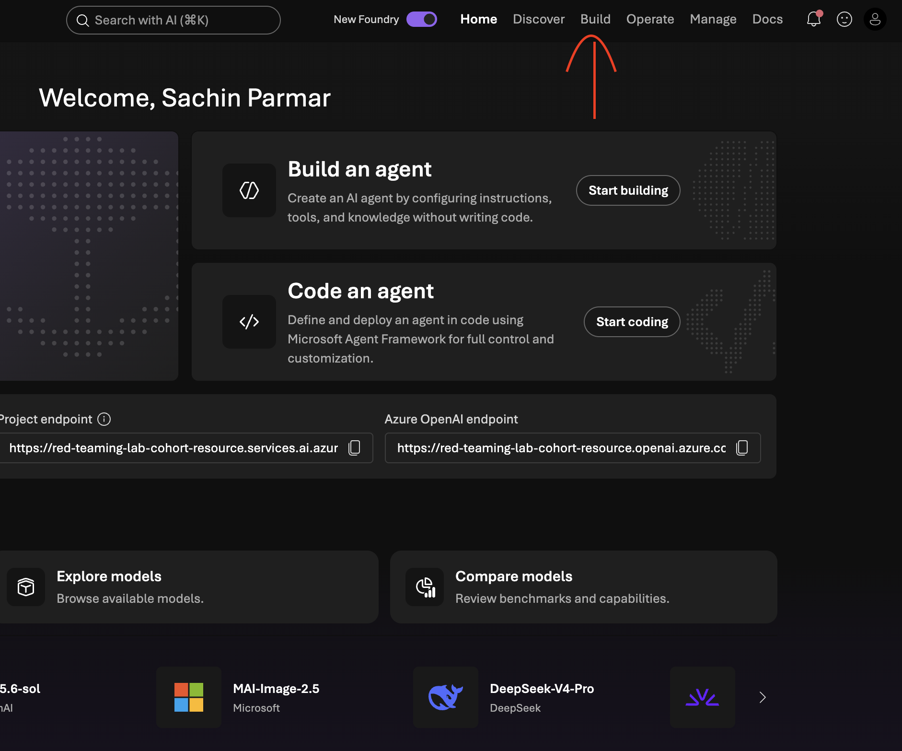

2. Click on **Evaluation**, then click **Create**.

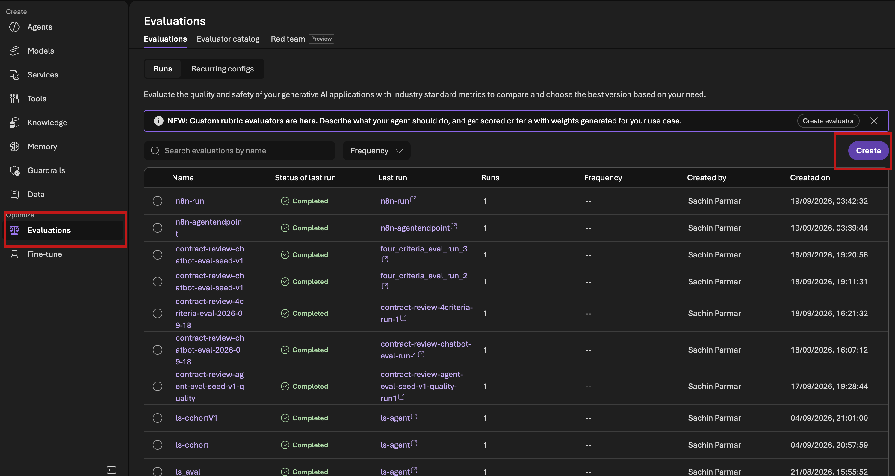

3. Select **Dataset** → **Upload Dataset**.

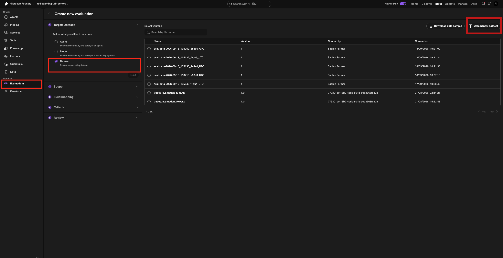

> **Note**: In the next step there may be an option to select **Single Turn** or **Multi-Turn** format. Select **Single Turn**.

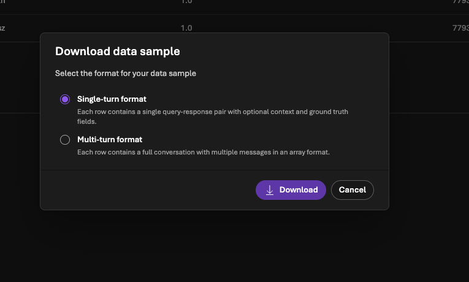

4. Try to upload your `config.json` file.

You will notice that **Foundry rejects the file**. This is expected — Foundry requires datasets to follow a specific schema, and `config.json` does not match it yet. Rather than being a blocker, this moment tells you exactly what needs to happen next: reformat the file.

5. Download the **sample dataset** and confirm **Single Turn** is selected as the format type. This sample file is your formatting specification — keep it alongside your `config.json`.

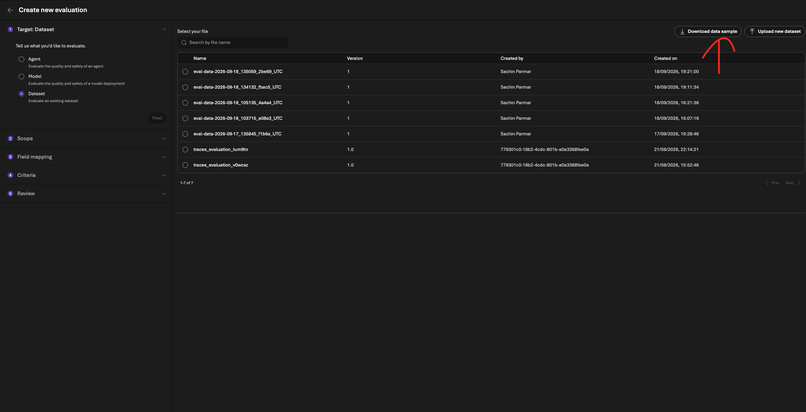

**Output**: You now have the Foundry sample dataset downloaded, and you understand exactly why your `config.json` needs to be reformatted.

---

### Step 6: Convert Your Dataset Using Claude Code

**What you're doing**: Asking Claude Code to reformat your `config.json` into the schema Foundry requires, using the sample file as the specification.

Your `config.json` has the query, response, and citation your agent generated. It does not have ground truth values, and Azure AI Foundry needs those to score your evaluation. You'll download a reference file that has this data before asking Claude Code to build the final dataset.

**Action items**:

1. Download the ground truth reference file — **[Download From Here](https://docs.google.com/spreadsheets/d/146uj0YOBdGlScHxgcZwbxhp2rP28NphtuluEdRihcyQ/export?format=csv&gid=1493472500)** — and save it as `sample.csv`.
2. Open Claude Code.
3. Attach three files: your `config.json`, the `sample.csv` you just downloaded, and the sample dataset you downloaded from Foundry in Step 5.
4. Run the following prompt:

```
Task: Create Evaluation Dataset

The config.json file contains the queries, responses, and citations generated from sample.csv.
Your task is to create the final evaluation dataset by combining the information from both files.

Instructions
  1.Read the query, response, and citation pairs from config.json.
  2.For each query, find the corresponding record in sample.csv.
  3.From sample.csv, fetch the corresponding:
    -Ground truth
  4.Map the query, response, and citation from config.json with the matching ground truth from sample.csv.
  5.Create the final evaluation dataset using this combined information.
  6.Use the attached data-sample.jsonl file as the reference for the required dataset structure and format.
  7.Ensure the output follows the same:
    -JSONL structure
    -Field names
    -Data types
    -Formatting conventions as shown in data-sample.jsonl.
  8.Do not invent, modify, or infer any ground-truth values. Use only the values available in sample.csv.
Expected Output
Generate a complete JSONL evaluation dataset where each record contains the appropriate query, response, citation, and ground truth information based on the data in config.json and sample.csv.
```

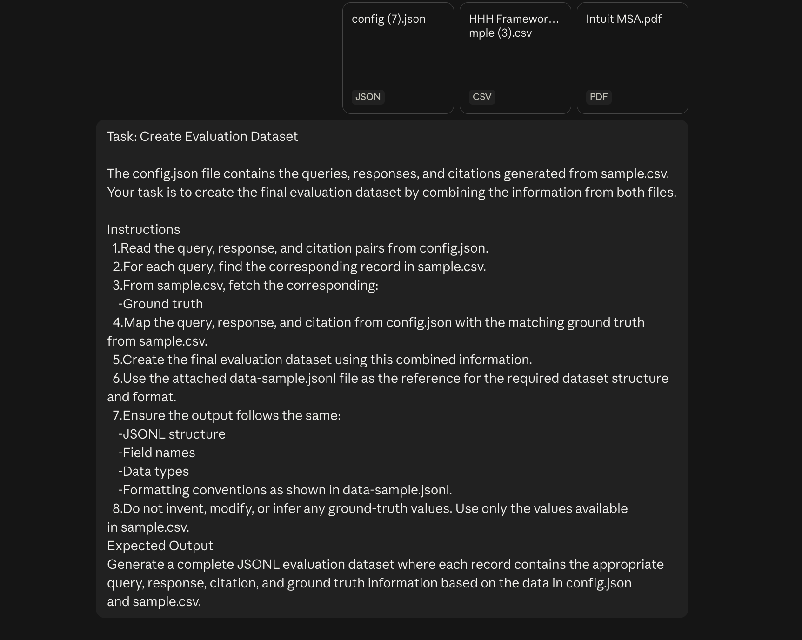

5. Claude will produce a new file formatted to Foundry's specification. Save it.

**Output**: A Foundry-compatible dataset file ready for upload.

---

## Phase 5: Run the Evaluation

### Step 7: Upload Your Formatted Dataset

**What you're doing**: Bringing your formatted dataset into Foundry so the evaluation engine can read it.

**Action items**:

1. Inside your Foundry project, navigate to **Build** → **Evaluation** → **Create**.


2. Select **Dataset** → **Upload Dataset**.

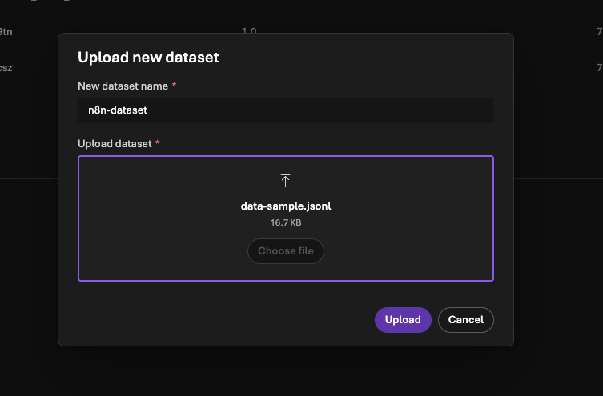

3. Upload the formatted dataset file that Claude produced in Step 6 (not the original `config.json`).
4. Once uploaded successfully, click **Next**.

**Output**: Your dataset is live inside Foundry and ready to be evaluated.

---

### Step 8: Configure and Run the Evaluation

**What you're doing**: Telling Foundry which model to use as the judge, which quality dimensions to measure, and kicking off the evaluation run.

Before you configure the run, Foundry will ask what you are evaluating — an **Agent**, a **Model**, or a **Dataset**. Select **Dataset**, since you are evaluating a pre-generated set of responses rather than running the agent live inside Foundry.

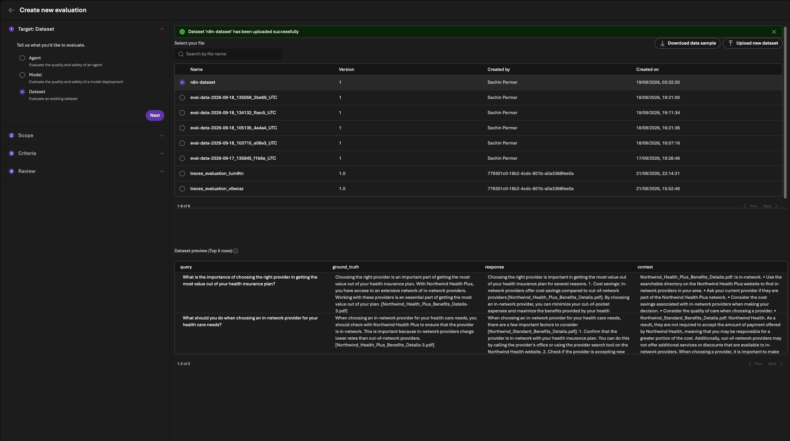

**Action items**:

1. When prompted for scope, select **Individual Turns**.

   > **Why Individual Turns?** Your dataset contains five separate, independent questions — each one stands alone. Individual Turns tells Foundry to evaluate each Q&A pair on its own merits rather than treating the whole conversation as a single unit. This gives you granular scores per question, which is far more useful for diagnosing specific weaknesses.

   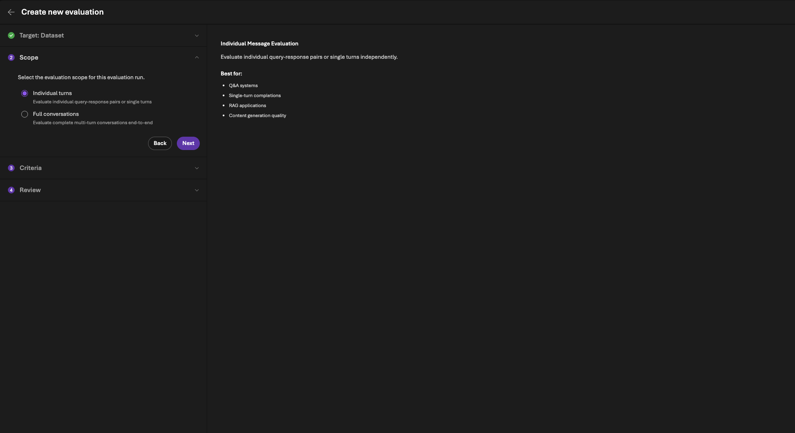

2. Select the **model** you want to use as the evaluator (this is the judge model, not your agent). Choose a capable model available in your Foundry project — GPT-4o is a reliable default if available.

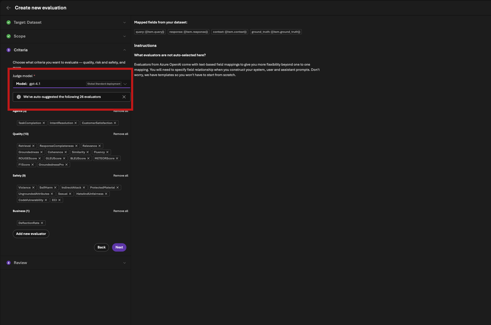

3. Under the **Quality** evaluation category, select the following five metrics:

   | Metric | What it measures |
   |---|---|
   | **Relevance** | Does the response directly address what was asked? |
   | **Groundedness** | Is the response supported by the source contract? |
   | **Coherence** | Is the response logically structured and easy to follow? |
   | **Similarity** | How close is the response to the ground-truth answer? |
   | **Fluency** | Is the language natural, grammatical, and well-formed? |

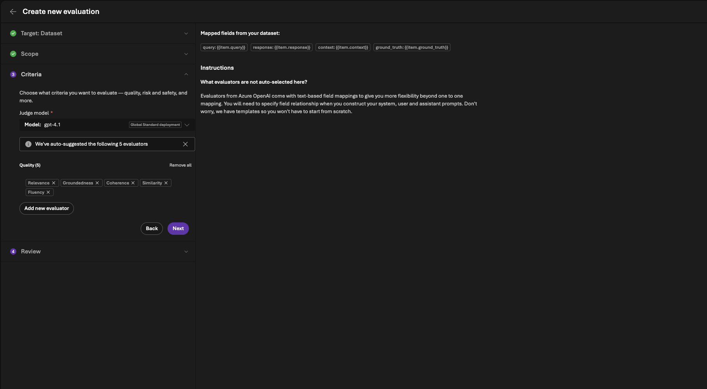

4. Give your evaluation run a descriptive name (e.g., `msa-contract-agent-eval-v1`).

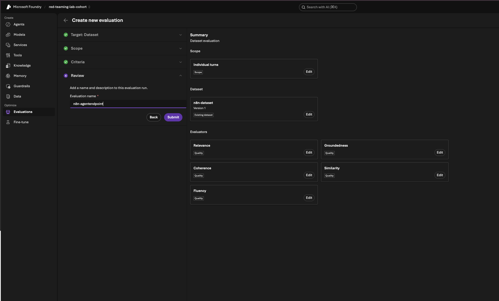

5. Click **Submit**. The run will take a few minutes to complete.

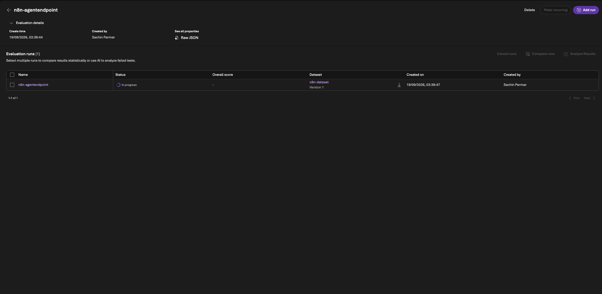

**Output**: A scored evaluation report showing your agent's performance across five quality dimensions for each of the five contract questions.

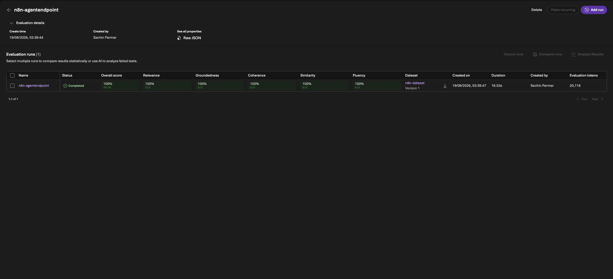

---

### Step 9: Re-run the Evaluation with a Different Judge Model

**What you're doing**: Creating a new evaluation run on the same dataset, this time with GPT-5 as the judge model, to see how the choice of judge affects your scores.

**Why this matters**: One run tells you how your agent scored against a single judge. Swapping the judge model tells you whether that score holds up — a stronger judge model gives you a sharper, more reliable read on your agent's actual performance.

**Action items**:

1. When prompted for scope, select **Individual Turns**, same as before.
2. Select **GPT-5** as the model you want to use as the evaluator, instead of GPT-4o.

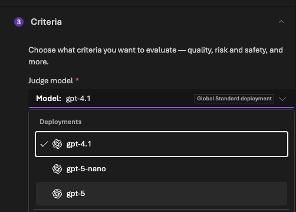

3. Under the **Quality** evaluation category, select the same five metrics: Relevance, Groundedness, Coherence, Similarity, and Fluency.
4. Give this evaluation run a descriptive name (e.g., `msa-contract-agent-eval-v2-gpt5`).
5. Click **Submit**. The run will take a few minutes to complete.

**Output**: A second scored evaluation report, run with GPT-5 as the judge. Compare it against your first report — you should see better, more consistent scores across the five quality dimensions, showing how upgrading the judge model sharpens the evaluation.

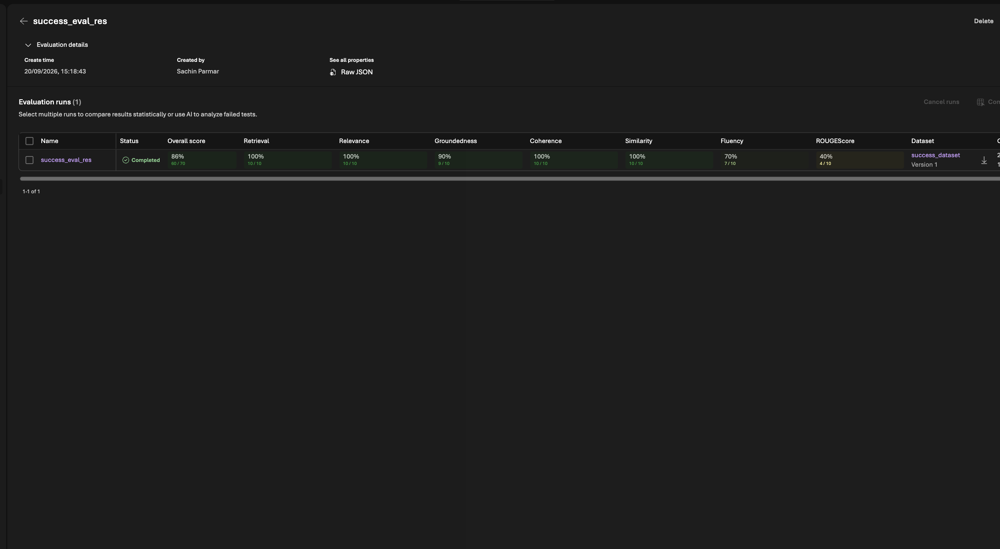

Look at the overall score in both reports side by side. In this run, the GPT-4o judge scored the agent at **64%**, while the GPT-5 judge scored the same, unchanged responses at **86%**. Nothing about your agent changed between the two runs — only the judge did. That gap is the whole point: a weaker judge model can undersell an agent that's actually performing well, so the judge you pick shapes the score as much as the agent itself.

---

## Complete Process Flow

1. Add a Download Responses feature that exports saved chats from Supabase, with a choice of how many to include (Claude Code prompt).
2. Upload the MSA contract and ask the five evaluation questions.
3. Download `config.json` from the app.
4. Create your Azure AI Foundry account and project.
5. Download the Foundry sample dataset (Single Turn format).
6. Convert `config.json` to Foundry format using Claude Code.
7. Upload the formatted dataset to Foundry.
8. Configure the eval: Individual Turns scope, judge model, five quality metrics.
9. Name the run and submit.
10. Review the scored report.
11. Re-run the eval on the same dataset with GPT-5 as the judge model.
12. Compare the two reports to see how the judge model change affects your scores.

---

## Key Principles to Keep in Mind

**Ground truth matters**: Your agent's responses become the ground truth for this eval. Make sure all five chat responses were complete and error-free before downloading — a truncated or failed response will skew your scores.

**The judge model is not your agent**: The model you select in Step 8 is an independent evaluator. It reads your agent's responses and the source contract and scores them. Keep these roles mentally separate.

**Individual Turns = per-question granularity**: Choosing Individual Turns gives you a score for each question independently. This tells you if your agent handles IP clauses differently than payment terms — which is the insight that actually drives improvements.

**Evaluation is iterative**: One run gives you a baseline. Change something in your n8n workflow, regenerate the dataset, rerun the eval, and compare. That loop is how agents get better.

---

## Useful Links

- [Azure AI Foundry — Built-in Evaluators](https://learn.microsoft.com/en-us/azure/foundry/concepts/built-in-evaluators)
